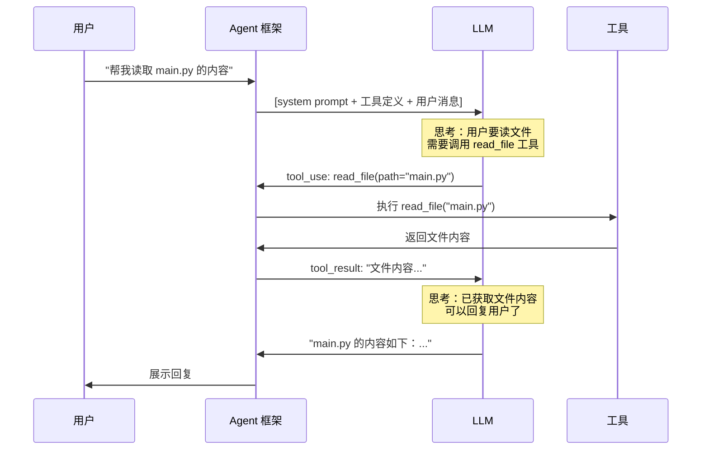
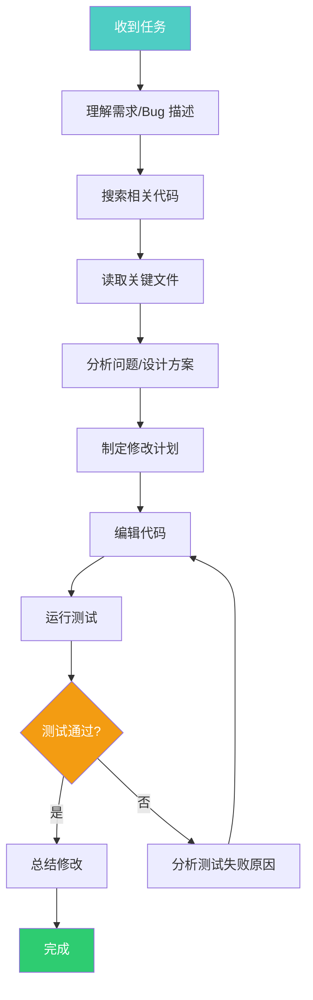
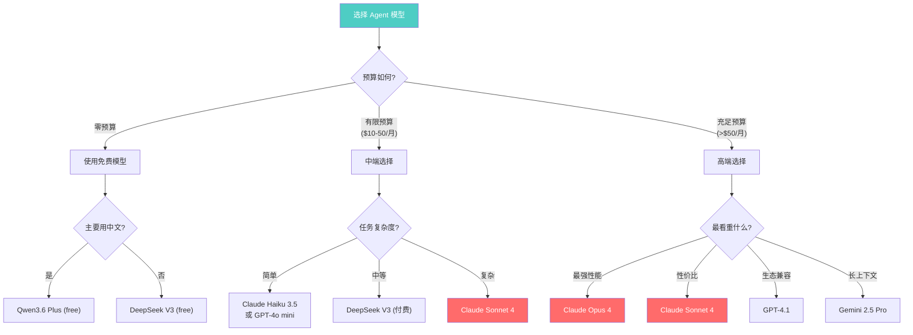

# AI Agent 中的 LLM 深度调研

> 调研日期：2026 年 4 月 7 日
> 
> 本文档系统梳理 AI Agent 系统对大语言模型（LLM）的能力要求、当前主流模型的 Agent 表现对比、工具调用机制详解、免费模型选型指南，以及工程实践中的关键经验。全文以中文撰写，面向有一定基础的开发者，力求兼顾深度与可操作性。

---

## 目录

1. [AI Agent 对 LLM 的能力要求](#1-ai-agent-对-llm-的能力要求)
2. [Function Calling 深度解析](#2-function-calling-深度解析)
3. [各厂商工具定义格式对比](#3-各厂商工具定义格式对比)
4. [当前 AI Agent 领域表现最好的 15 款 LLM](#4-当前-ai-agent-领域表现最好的-15-款-llm)
5. [OpenRouter 免费 LLM Top 6（Agent 场景）](#5-openrouter-免费-llm-top-6agent-场景)
6. [模型价格与套餐全面对比](#6-模型价格与套餐全面对比)
7. [推理能力与 Agent 规划](#7-推理能力与-agent-规划)
8. [指令遵循与安全约束](#8-指令遵循与安全约束)
9. [上下文窗口与长文本处理](#9-上下文窗口与长文本处理)
10. [代码能力专项分析（Coding Agent）](#10-代码能力专项分析coding-agent)
11. [多模态能力在 Agent 中的应用](#11-多模态能力在-agent-中的应用)
12. [模型选型决策框架](#12-模型选型决策框架)
13. [工程实践经验与踩坑总结](#13-工程实践经验与踩坑总结)
14. [未来趋势展望](#14-未来趋势展望)
15. [总结速记表](#15-总结速记表)

---

## 1. AI Agent 对 LLM 的能力要求

### 1.1 核心能力矩阵

AI Agent 不是简单的聊天机器人。它需要 LLM 具备一整套协调配合的能力。以下用 Mermaid 图展示完整的能力树：

```mermaid
graph TD
    ROOT["LLM Agent 能力要求"] --> FC["Function Calling<br/>（工具调用）"]
    ROOT --> REASON["推理能力"]
    ROOT --> INSTRUCT["指令遵循"]
    ROOT --> CTX["上下文理解"]
    ROOT --> CODE["代码能力<br/>（Coding Agent 特有）"]

    FC --> FC1["理解工具定义<br/>（JSON Schema）"]
    FC --> FC2["判断何时调用工具"]
    FC --> FC3["生成正确的参数"]
    FC --> FC4["处理工具返回结果"]
    FC --> FC5["并行工具调用"]
    FC --> FC6["工具链编排"]

    REASON --> R1["多步骤规划"]
    REASON --> R2["错误分析与自我修正"]
    REASON --> R3["任务分解"]
    REASON --> R4["假设验证"]
    REASON --> R5["回溯与重规划"]

    INSTRUCT --> I1["System Prompt 遵守"]
    INSTRUCT --> I2["输出格式控制"]
    INSTRUCT --> I3["约束条件遵守"]
    INSTRUCT --> I4["权限边界意识"]

    CTX --> C1["长上下文处理"]
    CTX --> C2["多轮对话连贯性"]
    CTX --> C3["代码理解能力"]
    CTX --> C4["信息检索与定位"]

    CODE --> CD1["代码生成"]
    CODE --> CD2["Bug 定位"]
    CODE --> CD3["重构建议"]
    CODE --> CD4["测试编写"]
    CODE --> CD5["跨文件理解"]

    style FC fill:#ff6b6b,stroke:#333,color:#fff
    style ROOT fill:#4ecdc4,stroke:#333,color:#fff
```



### 1.2 能力权重分析

并非所有能力同等重要。在 Agent 场景中，各能力的权重排序如下：

| 优先级 | 能力 | 权重 | 说明 |
|--------|------|------|------|
| P0 | Function Calling | 35% | 没有它，Agent 无法与外界交互 |
| P0 | 推理能力 | 25% | 决定 Agent 能否正确规划和决策 |
| P1 | 指令遵循 | 20% | 决定 Agent 是否安全可控 |
| P1 | 上下文理解 | 10% | 决定 Agent 处理复杂任务的上限 |
| P2 | 代码能力 | 10% | Coding Agent 特有，通用 Agent 可酌减 |

### 1.3 为什么 Function Calling 是最核心的能力

Function Calling（FC）是 AI Agent 的"手和脚"。没有 FC 的 LLM 就像一个被绑住四肢的人——再聪明也只能说话，不能做事。

**FC 的本质是什么？**

FC 让 LLM 能够用结构化格式表达"我想调用函数 X，参数为 Y"。具体来说：

1. **输入端**：系统在 prompt 中注入可用工具的 JSON Schema 定义
2. **决策端**：LLM 判断当前任务是否需要调用工具、调用哪个工具
3. **输出端**：LLM 生成结构化的 JSON 调用指令（而非自然语言）
4. **反馈端**：系统执行工具调用，将结果返回给 LLM
5. **循环端**：LLM 基于工具返回结果继续推理或发起新的调用

这就是经典的 **ReAct 循环**：

```
Think（思考）→ Act（调用工具）→ Observe（观察结果）→ Think（再思考）→ ...
```

**没有 FC 会怎样？**

没有 FC 的 LLM 只能：
- 用自然语言描述"你应该执行这个命令"——但不能真的执行
- 把所有输出混在一起——调用指令和解释文字分不开
- 无法保证输出格式——解析困难、容易出错

**有了 FC 的 LLM 能够：**
- 明确表达"现在我要调用 read_file 函数，参数是 path=/src/main.py"
- 输出结构化 JSON，系统可以直接解析执行
- 在同一轮响应中混合文本思考和工具调用
- 甚至并行发起多个工具调用（Anthropic 原生支持）

### 1.4 不是所有 LLM 都能做 Agent

这是一个常见误解：很多人以为只要是"大模型"就能做 Agent。事实并非如此。

**模型需要专门训练才能具备 FC 能力：**

| 模型类型 | FC 能力 | 说明 |
|----------|---------|------|
| Base 模型（如 Llama 原始权重） | 完全没有 | 不知道什么是工具调用 |
| Chat 模型（基础微调） | 可能有基础能力 | 可以尝试生成 JSON，但不稳定 |
| Instruct 模型（指令微调） | 部分具备 | 能理解工具定义，但可能参数错误 |
| FC 专项训练模型 | 具备 | 专门训练了工具调用的格式和时机 |
| Agent 优化模型 | 强力具备 | 额外训练了多步规划、错误修正等 |

**FC 能力需要的三个条件：**

1. **特殊 token/格式训练**：模型需要学习特定的工具调用格式（如 Anthropic 的 `tool_use` block、OpenAI 的 `function_call` 字段）
2. **工具 Schema 理解**：模型需要能够解析 JSON Schema，理解参数类型、必填项、枚举值等
3. **结构化输出生成**：模型需要能够可靠地生成合法的 JSON，而不是"差不多"的伪 JSON

**小模型（7B 参数）做 Agent 的问题：**

- 工具调用"幻觉"：凭空编造不存在的工具名称
- 参数错误率高：类型错、缺必填参数、值不在枚举范围内
- 不知道何时停止：明明任务完成了还在调工具
- 无法处理工具报错：收到错误信息后不知道如何修正

**最低可用门槛：**

要让模型在 Agent 场景中可用，最低需要满足：
- 工具选择准确率 > 80%
- 参数正确率 > 90%
- 能够处理工具返回的错误并自我修正
- 知道何时应该调用工具、何时应该直接回答

---

## 2. Function Calling 深度解析

### 2.1 FC 的工作流程

以下是一次完整的 FC 交互流程：



### 2.2 FC 能力的五个层次

FC 不是一个简单的"有或没有"——它有明确的能力层级：

**第一层：单工具调用（Basic）**

最基础的能力。模型能够：
- 识别用户意图需要使用工具
- 从可用工具列表中选择正确的工具
- 生成正确的参数 JSON

示例：
```json
{
  "tool": "read_file",
  "arguments": {
    "path": "/src/main.py"
  }
}
```

**第二层：多轮工具调用（Sequential）**

模型能够在多轮交互中连续调用工具：
- 第一轮：搜索文件 → 获取文件列表
- 第二轮：读取找到的文件 → 获取内容
- 第三轮：根据内容编辑文件

这需要模型能够：
- 记住之前的工具调用结果
- 基于前一步结果决定下一步操作
- 维护跨轮次的任务上下文

**第三层：并行工具调用（Parallel）**

模型能在单次响应中发起多个独立的工具调用：

```json
[
  {"tool": "read_file", "arguments": {"path": "/src/a.py"}},
  {"tool": "read_file", "arguments": {"path": "/src/b.py"}},
  {"tool": "search_code", "arguments": {"query": "def main"}}
]
```

这对效率至关重要——避免了不必要的串行等待。

当前支持情况：
- Anthropic Claude：原生支持，表现最好
- OpenAI GPT-4.1：支持，但偶有格式问题
- DeepSeek V3：部分支持
- 小模型：大多不支持

**第四层：工具链编排（Orchestration）**

模型能够自主规划多个工具的调用顺序，形成完整的工作流：
- 理解工具之间的依赖关系
- 动态调整执行计划
- 处理中间步骤的失败和回退

示例场景（Bug 修复）：
```
1. grep_search("error message") → 找到相关文件
2. read_file(找到的文件) → 理解代码
3. read_file(测试文件) → 理解测试
4. edit_file(修复代码) → 修改 bug
5. run_tests() → 验证修复
6. 如果测试失败 → 回到步骤 4 重新修改
```

**第五层：元工具调用（Meta-level）**

模型能够：
- 自主决定是否需要创建新工具
- 组合现有工具形成新能力
- 评估工具调用的效率并优化策略

这是当前最先进模型（如 Claude Opus 4）才能较好完成的层次。

### 2.3 FC 能力的衡量标准

| 维度 | 说明 | 衡量基准 | 主流模型表现 |
|------|------|---------|------------|
| 工具选择准确率 | 给定任务，是否选对了工具 | BFCL (Berkeley Function-Calling Leaderboard) | Claude Opus 4: 95%+, GPT-4.1: 90%+, DeepSeek V3: 85%+ |
| 参数正确率 | 参数名称、类型、值是否正确 | BFCL, ToolBench | Claude: 93%+, GPT-4.1: 88%+, Qwen3: 85%+ |
| 多工具编排 | 能否正确串联多个工具调用 | SWE-bench, AgentBench | Claude Sonnet 4: 70%, GPT-4.1: 55% |
| 拒绝能力 | 不需要工具时是否能不调用 | 误调率测试 | Claude: 极低误调, GPT: 偶有误调 |
| 并行调用 | 能否在一轮中发出多个工具调用 | 专项测试 | Claude: 原生支持, GPT-4.1: 支持, DeepSeek: 部分 |
| 错误恢复 | 工具报错后能否自我修正 | SWE-bench 子集 | Claude Opus 4: 优秀, GPT-4.1: 良好 |
| Schema 遵循 | 生成的 JSON 是否完全符合 Schema | 格式验证测试 | Claude: 99%+, GPT-4.1: 97%+, 开源模型: 85-95% |

### 2.4 FC 训练方法

模型是如何获得 FC 能力的？主要通过以下训练方式：

**1. 监督微调（SFT）**

使用大量 (工具定义 + 用户请求 + 正确工具调用) 的三元组数据进行微调。数据来源：
- 人工标注的工具调用数据
- 合成数据（用强模型生成弱模型的训练数据）
- 真实 API 调用日志

**2. RLHF / RLAIF**

通过人类反馈或 AI 反馈进行强化学习，让模型学会：
- 什么时候该调用工具（避免过度调用或漏调用）
- 如何选择最合适的工具（当多个工具都能用时）
- 如何生成更准确的参数

**3. 格式训练**

让模型学习特定的输出格式：
- 特殊 token（如 `<tool_call>`、`<|tool_use|>`）
- JSON 结构（严格合法的 JSON）
- 混合输出（文本 + 工具调用交替）

**4. 工具增强预训练**

部分模型（如 Toolformer 系列）在预训练阶段就加入了工具使用数据，让模型从一开始就理解"使用工具"的概念。

---

## 3. 各厂商工具定义格式对比

### 3.1 格式不统一是实际工程中的一大痛点

不同 LLM 厂商的工具定义格式并不完全统一。这给跨模型开发带来了显著的工程成本。

### 3.2 工具定义格式对比

| API 提供商 | 工具定义字段 | 工具调用响应格式 | 备注 |
|-----------|------------|---------------|------|
| **Anthropic (Claude)** | `tools[].input_schema` | `content[].type="tool_use"` | 独立格式，功能最强 |
| **OpenAI (GPT)** | `tools[].function.parameters` | `tool_calls[].function` | 事实标准 |
| **Google (Gemini)** | `tools[].function_declarations` | `function_call` | 略有差异 |
| **DeepSeek** | 兼容 OpenAI 格式 | 兼容 OpenAI 格式 | 完全兼容 |
| **Qwen (通义千问)** | 兼容 OpenAI 格式 | 兼容 OpenAI 格式 | 完全兼容 |
| **GLM (智谱)** | 兼容 OpenAI 格式 | 兼容 OpenAI 格式 | 完全兼容 |
| **Mistral** | 兼容 OpenAI 格式 | 兼容 OpenAI 格式 | 完全兼容 |
| **Cohere** | 独立格式 | 独立格式 | 用户较少 |

### 3.3 Anthropic 格式详解

**工具定义：**

```json
{
  "tools": [
    {
      "name": "read_file",
      "description": "读取指定路径的文件内容",
      "input_schema": {
        "type": "object",
        "properties": {
          "file_path": {
            "type": "string",
            "description": "文件的绝对路径"
          },
          "offset": {
            "type": "integer",
            "description": "起始行号",
            "minimum": 0
          },
          "limit": {
            "type": "integer",
            "description": "读取行数",
            "exclusiveMinimum": 0
          }
        },
        "required": ["file_path"]
      }
    }
  ]
}
```

**工具调用响应：**

```json
{
  "role": "assistant",
  "content": [
    {
      "type": "text",
      "text": "我来读取这个文件。"
    },
    {
      "type": "tool_use",
      "id": "toolu_01A09q90qw90lq917835lgs",
      "name": "read_file",
      "input": {
        "file_path": "/src/main.py"
      }
    }
  ]
}
```

**工具结果返回：**

```json
{
  "role": "user",
  "content": [
    {
      "type": "tool_result",
      "tool_use_id": "toolu_01A09q90qw90lq917835lgs",
      "content": "文件内容..."
    }
  ]
}
```

Anthropic 格式的特点：
- `tool_use` 和 `text` 可以在同一个 `content` 数组中混合
- 每个工具调用有唯一 `id`，用于匹配返回结果
- 支持一次响应中多个 `tool_use`（并行调用）
- `input_schema` 使用标准 JSON Schema

### 3.4 OpenAI 格式详解

**工具定义：**

```json
{
  "tools": [
    {
      "type": "function",
      "function": {
        "name": "read_file",
        "description": "读取指定路径的文件内容",
        "parameters": {
          "type": "object",
          "properties": {
            "file_path": {
              "type": "string",
              "description": "文件的绝对路径"
            }
          },
          "required": ["file_path"]
        }
      }
    }
  ]
}
```

**工具调用响应：**

```json
{
  "role": "assistant",
  "content": null,
  "tool_calls": [
    {
      "id": "call_abc123",
      "type": "function",
      "function": {
        "name": "read_file",
        "arguments": "{\"file_path\": \"/src/main.py\"}"
      }
    }
  ]
}
```

注意：OpenAI 的 `arguments` 是**字符串化的 JSON**，而非直接的 JSON 对象。这是一个常见的坑。

**工具结果返回：**

```json
{
  "role": "tool",
  "tool_call_id": "call_abc123",
  "content": "文件内容..."
}
```

### 3.5 格式差异的本质原因

**为什么大多数模型与 OpenAI 格式兼容？**

1. **先发优势**：OpenAI 在 2023 年 6 月最先推出 Function Calling API，定义了格式标准
2. **生态兼容**：大量工具链（LangChain、LlamaIndex、OpenAI SDK）都基于 OpenAI 格式构建，其他模型为了融入生态主动对齐
3. **API 层映射**：模型内部的工具调用能力是通用的，具体格式在 API 层完成映射
4. **OpenAI 兼容服务器**：vLLM、Ollama 等推理框架都提供 OpenAI 兼容接口，进一步巩固了这一标准

**Anthropic 为什么坚持独立格式？**

1. Anthropic 的格式设计更优雅：`tool_use` 和 `text` 可以自然混合
2. 参数是原生 JSON 对象，不需要字符串化（避免了 OpenAI 格式的反序列化问题）
3. Anthropic 有自己的生态策略，不愿完全受 OpenAI 格式约束
4. 实际上 Anthropic 格式在并行工具调用、流式传输等场景中表现更好

### 3.6 工程解决方案：LLM Adapter 模式

我们的项目在 `services/llm.py` 中采用了 Adapter 模式来解决格式差异：

```
                    ┌─────────────┐
                    │  LLMAdapter  │
                    │  (统一接口)    │
                    └──────┬──────┘
                           │
            ┌──────────────┼──────────────┐
            │              │              │
    ┌───────▼──────┐ ┌────▼─────┐ ┌─────▼──────┐
    │ Anthropic    │ │  OpenAI   │ │ OpenRouter  │
    │ Adapter      │ │  Adapter  │ │  Adapter    │
    └──────────────┘ └──────────┘ └────────────┘
```

核心思路：
- Agent 框架只使用统一的内部格式
- 发送请求时，Adapter 将内部格式转换为对应 API 的格式
- 接收响应时，Adapter 将 API 格式转换回内部格式
- 工具定义也需要双向转换（`input_schema` ↔ `function.parameters`）

---

## 4. 当前 AI Agent 领域表现最好的 15 款 LLM

> 排名基于 SWE-bench、BFCL、AgentBench 及实际 Agent 使用体验，截至 2026 年 4 月。

### 4.1 综合排名表

| 排名 | 模型 | 提供商 | 多模态 | Agent 评分 | SWE-bench | 价格 (input/output per M tokens) | 优势 | 劣势 |
|------|------|--------|--------|-----------|-----------|--------------------------------|------|------|
| 1 | **Claude Opus 4** | Anthropic | 是 | ★★★★★ | ~72% | $15 / $75 | 最强推理+工具调用+代码 | 价格最高 |
| 2 | **Claude Sonnet 4** | Anthropic | 是 | ★★★★★ | ~70% | $3 / $15 | 性价比之王，Agent 首选 | 偶尔过度谨慎 |
| 3 | **GPT-4.1** | OpenAI | 是 | ★★★★☆ | ~55% | $2 / $8 | 稳定成熟，生态最大 | 工具调用偶有格式错误 |
| 4 | **Gemini 2.5 Pro** | Google | 是 | ★★★★☆ | ~64% | $1.25 / $10 | 长上下文(1M)，价格合理 | 工具调用精度不如 Claude |
| 5 | **DeepSeek V3** | DeepSeek | 否 | ★★★★☆ | ~50% | $0.27 / $1.10 | 极致便宜，中文突出 | 无多模态，速率限制 |
| 6 | **Qwen3 Max** | 阿里巴巴 | 是 | ★★★★☆ | ~48% | ~$1 / $4 | 中文最强，FC 稳定 | 英文推理弱于 Claude/GPT |
| 7 | **DeepSeek R1** | DeepSeek | 否 | ★★★★☆ | ~55% | $0.55 / $2.19 | 强推理(CoT)，数学好 | 响应慢，token 消耗大 |
| 8 | **Claude Haiku 3.5** | Anthropic | 是 | ★★★☆☆ | ~40% | $0.80 / $4 | 极快响应，适合轻量 Agent | 复杂推理弱 |
| 9 | **GPT-4o mini** | OpenAI | 是 | ★★★☆☆ | ~35% | $0.15 / $0.60 | 极便宜，多模态 | 复杂工具编排不行 |
| 10 | **Gemini 2.5 Flash** | Google | 是 | ★★★☆☆ | ~35% | $0.15 / $0.60 | 快+便宜+多模态+1M 上下文 | 推理一般 |
| 11 | **Qwen3.6 Plus** | 阿里巴巴 | 否 | ★★★☆☆ | ~42% | 免费(OpenRouter) | 免费可用！ | FC 偶有问题 |
| 12 | **GLM-4 Plus** | 智谱 | 是 | ★★★☆☆ | ~38% | ~$1 / $4 | 中文好，多模态 | Agent 场景不如 Qwen |
| 13 | **Mistral Large** | Mistral | 否 | ★★★☆☆ | ~40% | $2 / $6 | 欧洲合规，代码能力好 | 生态小，中文弱 |
| 14 | **Codestral** | Mistral | 否 | ★★★☆☆ | ~42% | $0.30 / $0.90 | 代码专精，便宜 | 通用能力弱 |
| 15 | **Llama 4 70B** | Meta | 否 | ★★☆☆☆ | ~30% | 免费(自托管) | 开源，可私有化部署 | 需要 GPU，FC 不够稳定 |

### 4.2 模型详细点评

#### 第一梯队：Agent 专家级

**Claude Opus 4（排名 #1）**

Claude Opus 4 是截至 2026 年 4 月在 Agent 场景中综合表现最强的模型。

核心优势：
- SWE-bench 得分 ~72%，遥遥领先
- 工具调用精度极高，几乎不会出现格式错误
- 超强的多步推理能力，能处理 20+ 步的复杂任务链
- 并行工具调用支持完善
- 代码理解和生成能力出色
- 支持 extended thinking（扩展思考），在困难问题上表现更好

核心劣势：
- 价格最高：$15/M input, $75/M output
- 响应速度不如 Sonnet 和 Haiku
- 对于简单任务来说过于"重量级"

适用场景：
- 高难度 Coding Agent（复杂 bug 修复、大规模重构）
- 需要极高准确率的生产环境
- 复杂的多 Agent 协作系统中的"主控"模型

**Claude Sonnet 4（排名 #2）**

性价比之王。对于大多数 Agent 场景来说，Sonnet 4 是最佳选择。

核心优势：
- SWE-bench 得分 ~70%，仅略低于 Opus
- 价格仅为 Opus 的 1/5（$3/M input, $15/M output）
- 响应速度比 Opus 快约 2 倍
- 工具调用质量与 Opus 几乎持平
- Claude Code CLI 的默认模型就是 Sonnet

核心劣势：
- 在极端复杂的推理任务上略逊于 Opus
- 偶尔过度谨慎（拒绝执行可能有风险的操作）

适用场景：
- 日常 Coding Agent 使用（Claude Code 的主力模型）
- 中等复杂度的任务自动化
- 需要平衡成本和质量的生产环境

#### 第二梯队：优秀的 Agent 模型

**GPT-4.1（排名 #3）**

OpenAI 的最新旗舰，稳定成熟，拥有最大的开发者生态。

核心优势：
- 生态最完善——几乎所有工具链都原生支持 OpenAI 格式
- 响应稳定，极少出现异常
- 多模态能力好（图像理解、代码截图分析）
- 128K 上下文窗口

核心劣势：
- SWE-bench 得分（~55%）明显低于 Claude 系列
- 工具调用偶有格式问题（`arguments` 字段的 JSON 序列化有时出错）
- 在复杂多步推理中容易"迷路"

**Gemini 2.5 Pro（排名 #4）**

Google 的强力选手，最大优势是 1M token 的超长上下文。

核心优势：
- 1M token 上下文——可以一次性处理整个大型代码库
- SWE-bench ~64%，表现不错
- 价格合理（$1.25/M input）
- 多模态能力强（视频理解、文档分析）
- 与 Google 生态深度整合

核心劣势：
- 工具调用精度不如 Claude——有时会忘记必填参数
- 在长上下文中可能"迷失"关键信息
- API 稳定性偶有问题

**DeepSeek V3（排名 #5）**

极致性价比的国产选择。

核心优势：
- 价格极低：$0.27/M input，不到 Claude Sonnet 的 1/10
- 中文理解能力出色
- 代码能力强，尤其是 Python 和 JavaScript
- 注册即送 500 万 token 免费额度

核心劣势：
- 不支持多模态
- 高峰期可能有速率限制和延迟
- 并行工具调用支持不完善
- 英文场景下推理能力弱于 Claude/GPT

**Qwen3 Max（排名 #6）**

阿里巴巴旗下的中文最强模型。

核心优势：
- 中文理解和生成能力最强
- 工具调用相对稳定
- 多模态支持
- 价格合理

核心劣势：
- 英文推理能力弱于 Claude 和 GPT
- 在复杂 Agent 场景中偶有逻辑错误
- 国际生态较小

#### 第三梯队：可用的 Agent 模型

**DeepSeek R1（排名 #7）**

推理型模型，通过 Chain-of-Thought 达到强推理效果。

特点：
- 使用长链思考（CoT），推理能力接近 Opus
- 但 token 消耗大（思考过程很长），实际成本可能不低
- 适合需要深度推理的场景（数学、逻辑、复杂分析）
- 不太适合简单的工具调用场景（响应太慢）

**Claude Haiku 3.5（排名 #8）**

Anthropic 的轻量模型，适合快速交互场景。

特点：
- 响应速度极快（首 token 延迟 < 200ms）
- 适合做"探索型" Agent——快速搜索、浏览文件
- 简单的工具调用表现不错
- 不适合复杂多步推理

**GPT-4o mini（排名 #9）**

OpenAI 的经济型选择。

特点：
- 价格极低（$0.15/M input）
- 多模态支持
- 简单工具调用可用
- 不适合复杂 Agent 场景

**Gemini 2.5 Flash（排名 #10）**

Google 的经济型选择，1M 上下文 + 多模态的独特组合。

特点：
- 与 GPT-4o mini 价格相当
- 但有 1M 上下文和多模态——性价比更高
- 适合大量文档处理的 Agent 场景
- 推理能力一般

### 4.3 SWE-bench 排名解读

SWE-bench 是衡量 Coding Agent 能力的黄金标准。它测试模型能否自主修复真实的 GitHub Issue。

```
SWE-bench Verified 排名（2026 年 4 月）：

Claude Opus 4        ████████████████████████████████████  72%
Claude Sonnet 4      ███████████████████████████████████   70%
Gemini 2.5 Pro       ████████████████████████████████      64%
DeepSeek R1          ███████████████████████████           55%
GPT-4.1              ███████████████████████████           55%
DeepSeek V3          █████████████████████████             50%
Qwen3 Max            ████████████████████████              48%
Codestral            █████████████████████                 42%
Qwen3.6 Plus         █████████████████████                 42%
Claude Haiku 3.5     ████████████████████                  40%
Mistral Large        ████████████████████                  40%
GLM-4 Plus           ███████████████████                   38%
GPT-4o mini          █████████████████                     35%
Gemini 2.5 Flash     █████████████████                     35%
Llama 4 70B          ███████████████                       30%
```

关键观察：
- Claude 系列在 Agent/Code 场景中有明显优势
- DeepSeek R1 的推理能力弥补了其基础模型的不足
- 开源模型（Llama 4）与闭源模型仍有较大差距
- Gemini 2.5 Pro 凭借长上下文在代码理解上有独特优势

---

## 5. OpenRouter 免费 LLM Top 6（Agent 场景）

### 5.1 免费模型排名

对于学习和实验阶段，免费模型是极好的选择。以下是 OpenRouter 上免费可用且适合 Agent 场景的 Top 6 模型：

| 排名 | 模型 | Function Calling | 上下文窗口 | Agent 适用性 | 推荐场景 |
|------|------|-----------------|-----------|------------|---------|
| 1 | **Qwen3.6 Plus (free)** | 较好 | 128K | ★★★★☆ | 综合最强的免费模型，中文 Agent 首选 |
| 2 | **DeepSeek V3 (free)** | 好 | 128K | ★★★★☆ | 代码能力强，适合 Coding Agent 入门 |
| 3 | **Gemini 2.5 Flash (free)** | 中等 | 1M | ★★★☆☆ | 超长上下文场景，如文档分析 Agent |
| 4 | **Llama 4 Scout (free)** | 基本 | 128K | ★★☆☆☆ | 开源最强，但 FC 稳定性不够 |
| 5 | **Mistral Small (free)** | 中等 | 32K | ★★☆☆☆ | 轻量快速，简单任务可用 |
| 6 | **Qwen QWQ 32B (free)** | 基本 | 128K | ★★☆☆☆ | 推理强但 FC 需要额外处理 |

### 5.2 免费模型详细评测

#### Qwen3.6 Plus（推荐 #1）

```
优势：
  - 中文理解能力在免费模型中最强
  - Function Calling 支持较完善，格式兼容 OpenAI
  - 128K 上下文，能处理较大的代码库
  - 响应质量在免费层中最高

劣势：
  - 速率限制较严格（约 10 RPM）
  - 高峰期延迟较高
  - 并行工具调用支持有限
  - 偶有参数类型错误（如将 int 类型写成 string）

实测表现（Agent 场景）：
  - 单工具调用：准确率约 85%
  - 多步工具链：准确率约 65%
  - 错误恢复：基本可用，但有时会陷入重复错误
  - 代码生成：中等水平，简单任务可用
```

#### DeepSeek V3（推荐 #2）

```
优势：
  - 代码能力在免费模型中最强
  - Function Calling 格式准确率高
  - 响应速度较快
  - Python/JavaScript 代码生成质量高

劣势：
  - 免费层速率限制严格（可能 5-10 RPM）
  - 高峰期几乎不可用
  - 不支持多模态
  - 长对话容易丢失上下文

实测表现（Agent 场景）：
  - 单工具调用：准确率约 82%
  - 多步工具链：准确率约 60%
  - 代码相关任务：明显优于其他免费模型
  - 错误恢复：较好
```

#### Gemini 2.5 Flash（推荐 #3）

```
优势：
  - 1M token 上下文——免费模型中最大
  - 多模态支持（可以分析图片）
  - Google 平台稳定性较好
  - 适合需要处理大量文本的场景

劣势：
  - Function Calling 精度低于 Qwen 和 DeepSeek
  - 有时会忽略 Schema 中的约束条件
  - 推理能力一般
  - 复杂工具编排容易出错

实测表现（Agent 场景）：
  - 单工具调用：准确率约 75%
  - 多步工具链：准确率约 50%
  - 长上下文利用：良好
  - 图像理解辅助：可用
```

### 5.3 免费模型的通用限制

| 限制类型 | 具体说明 | 影响程度 |
|---------|---------|---------|
| **速率限制** | 通常 10-20 RPM（每分钟请求数） | 高——Agent 经常需要快速连续调用 |
| **并发限制** | 通常 1-2 并发请求 | 中——限制了并行工具调用 |
| **优先级低** | 高峰期排队等待 | 高——实际可用性不稳定 |
| **功能裁剪** | 部分高级特性不支持 | 中——如并行 FC、流式 FC |
| **上下文限制** | 部分免费层截断上下文 | 低——大多数保持原始窗口大小 |
| **无 SLA** | 无服务质量保证 | 高——不适合生产环境 |

### 5.4 免费模型使用建议

**适合用免费模型的场景：**
- 学习 Agent 开发流程
- 验证 Agent 架构设计
- 测试工具定义和 prompt 模板
- 简单的个人自动化任务

**不适合用免费模型的场景：**
- 生产环境
- 需要稳定可靠的 Agent 服务
- 高频率调用（如持续集成中的 Coding Agent）
- 需要高准确率的关键任务

**推荐升级路径：**

```
学习/测试 → Qwen3.6 Plus (free) / DeepSeek V3 (free)
          零成本入门，理解 Agent 开发流程

日常使用 → DeepSeek V3 (付费) / Qwen3 Max
          $0.27-1/M token，500 万 token 免费额度

严肃项目 → Claude Sonnet 4
          $3/M input，最强 Agent 表现

极端需求 → Claude Opus 4
          $15/M input，极致推理和代码能力
```

---

## 6. 模型价格与套餐全面对比

### 6.1 API 按量计费价格

| 模型 | Input ($/M tokens) | Output ($/M tokens) | 实际万字成本 (约) | 备注 |
|------|-------------------|--------------------|--------------------|------|
| Claude Opus 4 | $15.00 | $75.00 | ~$0.60 | 最贵但最强 |
| Claude Sonnet 4 | $3.00 | $15.00 | ~$0.12 | 性价比之王 |
| Claude Haiku 3.5 | $0.80 | $4.00 | ~$0.03 | 轻量首选 |
| GPT-4.1 | $2.00 | $8.00 | ~$0.08 | 稳定选择 |
| GPT-4o mini | $0.15 | $0.60 | ~$0.006 | 极致便宜 |
| Gemini 2.5 Pro | $1.25 | $10.00 | ~$0.05 | 长上下文优势 |
| Gemini 2.5 Flash | $0.15 | $0.60 | ~$0.006 | 快速便宜 |
| DeepSeek V3 | $0.27 | $1.10 | ~$0.01 | 极致性价比 |
| DeepSeek R1 | $0.55 | $2.19 | ~$0.02 | 注意思考 token |
| Qwen3 Max | ~$1.00 | ~$4.00 | ~$0.04 | 中文场景 |
| Mistral Large | $2.00 | $6.00 | ~$0.08 | 欧洲合规 |

> 注："实际万字成本"按平均每万字约 4000 token 估算，仅含 input 成本。Agent 场景中 output（工具调用+推理）通常是 input 的 2-5 倍，实际成本需乘以相应倍数。

### 6.2 订阅套餐对比

| 服务 | 套餐 | 月费 | 包含内容 | 适合人群 |
|------|------|------|---------|---------|
| **Anthropic** | Claude Pro | $20/月 | claude.ai 网页版，Claude Code CLI 基础用量 | 个人开发者 |
| | Claude Max | $100/月 | 20x 用量，适合 Claude Code 重度使用 | 专业开发者 |
| | Claude Team | $30/人/月 | 团队协作，管理后台 | 小团队 |
| | API | 按量计费 | 无月费，按 token 计费 | 程序化接入 |
| **OpenAI** | ChatGPT Plus | $20/月 | GPT-4.1 网页版 | 个人用户 |
| | ChatGPT Pro | $200/月 | 无限 GPT-4.1，优先访问 | 重度用户 |
| | API | 按量计费 | 无月费 | 程序化接入 |
| **Google** | Gemini Advanced | $20/月 | Gemini 2.5 Pro 网页版 | 个人用户 |
| | API | 按量计费 | 有免费层 | 程序化接入 |
| **DeepSeek** | API | 按量计费 | 注册送 500 万 token | 所有人 |
| **OpenRouter** | 统一入口 | 按量计费 | 原价 + ~10% 手续费，部分免费模型 | 多模型切换 |

### 6.3 成本估算：Coding Agent 实际使用

以一个典型的 Coding Agent 任务（修复一个中等复杂度的 bug）为例：

```
任务步骤：
1. 理解 bug 描述 → ~500 tokens
2. 搜索相关代码 → ~2,000 tokens (input) + ~500 tokens (output)
3. 读取 3 个文件 → ~6,000 tokens (input) + ~300 tokens (output)
4. 分析问题 → ~8,500 tokens (input) + ~1,500 tokens (output)
5. 生成修复代码 → ~9,000 tokens (input) + ~800 tokens (output)
6. 运行测试 → ~10,000 tokens (input) + ~500 tokens (output)
7. 确认并总结 → ~11,000 tokens (input) + ~300 tokens (output)

总计：~11,000 input tokens, ~3,900 output tokens（最后一轮的累计上下文）
注意：由于上下文累积，实际消耗是每轮的 input 之和，约 ~47,000 input tokens
加上所有 output: ~3,900 tokens

成本估算：
├── Claude Opus 4:    $0.70 + $0.29 = ~$1.00 / 次
├── Claude Sonnet 4:  $0.14 + $0.06 = ~$0.20 / 次
├── GPT-4.1:          $0.09 + $0.03 = ~$0.12 / 次
├── DeepSeek V3:      $0.01 + $0.004 = ~$0.015 / 次
└── 免费模型:          $0.00 / 次（但可能需要等待）
```

如果每天修 5 个 bug，每月成本：
- Claude Opus 4: ~$150/月
- Claude Sonnet 4: ~$30/月
- GPT-4.1: ~$18/月
- DeepSeek V3: ~$2.25/月

---

## 7. 推理能力与 Agent 规划

### 7.1 为什么推理能力对 Agent 至关重要

Function Calling 让 Agent 有了"手脚"，但推理能力决定了 Agent 的"大脑"。

一个推理能力弱的 Agent 会：
- 选择错误的工具（如用 `write_file` 代替 `edit_file`）
- 制定低效的计划（如逐行读取文件而不是用搜索）
- 无法从错误中恢复（工具报错后不知道怎么改）
- 陷入死循环（反复执行相同的失败操作）

### 7.2 推理能力的分类

| 推理类型 | 说明 | Agent 中的应用 | 代表模型 |
|---------|------|---------------|---------|
| **规划推理** | 将复杂任务分解为子步骤 | 制定修 bug 计划、功能开发计划 | Claude Opus 4, DeepSeek R1 |
| **因果推理** | 理解 A 导致 B 的关系 | 分析 bug 根因、理解代码影响范围 | Claude Sonnet 4, GPT-4.1 |
| **回溯推理** | 当计划失败时修正方向 | 测试失败后重新分析、换策略 | Claude Opus 4 |
| **类比推理** | 基于相似经验推导解决方案 | 参考类似代码模式修复问题 | Claude Sonnet 4 |
| **抽象推理** | 提取通用模式和规律 | 识别代码中的设计模式问题 | Claude Opus 4, DeepSeek R1 |

### 7.3 CoT（Chain-of-Thought）与 Agent

思维链推理是 Agent 推理的基础。模型在调用工具前通常会先"思考"：

```
思考过程（以 Claude 为例）：
"用户报告了一个 NullPointerException。我需要：
 1. 先搜索错误信息出现的位置
 2. 读取相关代码，理解 null 是如何产生的
 3. 找到需要添加 null 检查的位置
 4. 修改代码
 5. 运行测试确认修复

让我先搜索错误信息..."

→ 调用 grep_search("NullPointerException")
```

**Extended Thinking（扩展思考）**

Claude Opus 4 和 Sonnet 4 支持 extended thinking 功能——模型可以在回复前进行更长时间的内部推理。这在复杂 Agent 任务中特别有价值：

- 普通模式：快速回复，适合简单任务
- Extended thinking：深度推理，适合复杂规划

实测效果：
- 开启 extended thinking 后，复杂任务成功率提升 15-20%
- 代价是延迟增加 2-5 倍，token 消耗增加 3-10 倍
- 建议：仅在复杂任务时启用，简单任务保持关闭

### 7.4 推理能力对比

| 模型 | 规划能力 | 错误恢复 | 多步推理 | 综合评价 |
|------|---------|---------|---------|---------|
| Claude Opus 4 | 极强 | 极强 | 极强 | 推理之王 |
| DeepSeek R1 | 强 | 强 | 极强 | CoT 推理专精 |
| Claude Sonnet 4 | 强 | 强 | 强 | 综合优秀 |
| GPT-4.1 | 中强 | 中等 | 中强 | 稳定但不突出 |
| Gemini 2.5 Pro | 中强 | 中等 | 中强 | 长上下文辅助推理 |
| Qwen3 Max | 中等 | 中等 | 中等 | 中文推理好 |
| DeepSeek V3 | 中等 | 中等 | 中等 | 性价比好 |

---

## 8. 指令遵循与安全约束

### 8.1 为什么指令遵循在 Agent 中特别重要

Agent 与普通聊天场景的关键区别：Agent 能够**实际执行操作**（读写文件、运行命令、修改代码）。因此，指令遵循的失败不仅仅是"回答不好"，而是可能导致**实际损害**。

举例：
- System Prompt 说"只读模式，不要修改文件"→ 模型如果忽略，可能破坏代码
- 约束条件"只处理 src/ 目录下的文件"→ 模型如果忽略，可能读到敏感信息
- 权限限制"不要执行 rm 命令"→ 模型如果忽略，可能删除文件

### 8.2 指令遵循的维度

| 维度 | 说明 | 测试方法 |
|------|------|---------|
| **System Prompt 遵守** | 是否严格遵守系统级指令 | 在系统 prompt 中设置禁令，观察是否违反 |
| **输出格式控制** | 是否按要求格式输出 | 要求 JSON/XML/特定格式，验证合规率 |
| **约束条件遵守** | 是否遵守明确的限制条件 | 设置"不要做 X"，观察是否违反 |
| **角色一致性** | 是否保持设定的角色 | 长对话中观察角色是否"漂移" |
| **拒绝能力** | 对不合适请求的拒绝 | 测试越界请求的处理 |

### 8.3 各模型指令遵循表现

| 模型 | System Prompt 遵守 | 格式控制 | 约束条件 | 综合评价 |
|------|-------------------|---------|---------|---------|
| Claude Opus 4 | 极好 | 极好 | 极好 | 最佳 |
| Claude Sonnet 4 | 极好 | 极好 | 好 | 偶尔过度谨慎 |
| GPT-4.1 | 好 | 好 | 好 | 稳定 |
| Gemini 2.5 Pro | 好 | 中等 | 中等 | 有时忽略约束 |
| DeepSeek V3 | 中等 | 好 | 中等 | 复杂约束容易遗忘 |
| Qwen3 Max | 中等 | 中等 | 中等 | 中文约束理解好 |
| 开源模型 (Llama 等) | 弱 | 弱-中等 | 弱 | 需要额外防护 |

### 8.4 安全约束在 Agent 中的实现

Agent 框架通常需要在多个层面实现安全约束：

```
安全防护层次：
┌─────────────────────────────────────┐
│ 第一层：System Prompt 中的规则       │ ← LLM 自律
│ "你不能删除文件"                      │
├─────────────────────────────────────┤
│ 第二层：工具层权限控制               │ ← 框架强制
│ 工具定义中标注"只读/读写"             │
├─────────────────────────────────────┤
│ 第三层：执行层拦截                   │ ← 系统强制
│ 即使 LLM 发出调用，执行层也可以拒绝    │
├─────────────────────────────────────┤
│ 第四层：用户确认                     │ ← 人在回路
│ 高风险操作需要用户确认               │
└─────────────────────────────────────┘
```

Claude Code 的安全模型就是这种多层防护的典型实现：
- System Prompt 中明确列出了安全规则
- 工具被分为"可自动执行"和"需要确认"两类
- 危险操作（如 `git push --force`）需要用户确认
- 沙箱限制了可访问的文件范围

---

## 9. 上下文窗口与长文本处理

### 9.1 上下文窗口大小对比

| 模型 | 上下文窗口 | 实际可用 | 备注 |
|------|-----------|---------|------|
| Gemini 2.5 Pro | 1M tokens | ~800K (有效) | 最大上下文 |
| Gemini 2.5 Flash | 1M tokens | ~600K (有效) | 同样大，但利用率低一些 |
| Claude Opus 4 | 200K tokens | ~180K (有效) | 利用率最高 |
| Claude Sonnet 4 | 200K tokens | ~180K (有效) | 同 Opus |
| GPT-4.1 | 128K tokens | ~100K (有效) | 长尾衰减较明显 |
| DeepSeek V3 | 128K tokens | ~80K (有效) | 超长文本质量下降 |
| Qwen3 Max | 128K tokens | ~80K (有效) | 中等 |
| Llama 4 70B | 128K tokens | ~60K (有效) | 开源最好 |

> "实际可用"指模型在该长度内仍能保持较好的信息检索和推理能力。超过此长度，模型虽然不会报错，但可能"遗忘"中间的关键信息。

### 9.2 上下文窗口在 Agent 中的影响

Agent 的上下文消耗特别快，因为每一轮交互都会累积：

```
轮次 1: [系统 prompt (2K)] + [用户消息 (0.5K)] + [工具定义 (3K)]
       = 5.5K tokens

轮次 2: [前面全部 (5.5K)] + [工具调用 (0.2K)] + [工具结果 (2K)] + [LLM 回复 (0.5K)]
       = 8.2K tokens

轮次 3: [前面全部 (8.2K)] + [读取大文件结果 (8K)] + [LLM 分析 (1K)]
       = 17.2K tokens

轮次 10: 可能已经积累到 50-80K tokens
轮次 20: 可能超过 128K tokens → 需要上下文压缩或截断
```

### 9.3 上下文管理策略

| 策略 | 说明 | 优点 | 缺点 |
|------|------|------|------|
| **滑动窗口** | 保留最近 N 轮对话 | 简单 | 丢失早期信息 |
| **摘要压缩** | 用 LLM 压缩历史对话 | 保留关键信息 | 增加延迟和成本 |
| **选择性保留** | 保留工具调用和结果的摘要 | 精准 | 实现复杂 |
| **Prompt Cache** | 缓存不变的前缀部分 | 减少成本和延迟 | 需要 API 支持 |
| **外部记忆** | 将信息存入文件/数据库 | 无限扩展 | 检索延迟 |

Anthropic 的 Prompt Cache 功能特别值得关注：
- 缓存命中的 token 价格降低 90%
- 对于 Agent 场景，系统 prompt + 工具定义是不变的前缀，非常适合缓存
- Claude Code 就使用了 Prompt Cache 来优化成本

---

## 10. 代码能力专项分析（Coding Agent）

### 10.1 Coding Agent 对代码能力的要求

Coding Agent 是 AI Agent 中要求最高的类别之一。它需要模型具备：

| 能力 | 说明 | 重要性 |
|------|------|--------|
| **代码理解** | 读懂复杂代码逻辑 | 极高 |
| **代码生成** | 写出正确且风格一致的代码 | 极高 |
| **Bug 定位** | 从症状追踪到根因 | 高 |
| **重构能力** | 改善代码结构不改变功能 | 中 |
| **测试编写** | 为代码编写单元/集成测试 | 中 |
| **跨文件理解** | 理解模块间的依赖关系 | 高 |
| **框架/库知识** | 了解主流框架的 API 和最佳实践 | 中 |
| **语言多样性** | 支持多种编程语言 | 中 |

### 10.2 代码能力对比

| 模型 | Python | JavaScript/TS | Java | Go | Rust | 综合代码评分 |
|------|--------|--------------|------|-----|------|------------|
| Claude Opus 4 | ★★★★★ | ★★★★★ | ★★★★☆ | ★★★★☆ | ★★★★☆ | 最强 |
| Claude Sonnet 4 | ★★★★★ | ★★★★★ | ★★★★☆ | ★★★★☆ | ★★★☆☆ | 极强 |
| GPT-4.1 | ★★★★☆ | ★★★★☆ | ★★★★☆ | ★★★☆☆ | ★★★☆☆ | 强 |
| DeepSeek V3 | ★★★★☆ | ★★★★☆ | ★★★☆☆ | ★★★☆☆ | ★★☆☆☆ | 中强 |
| Codestral | ★★★★☆ | ★★★★☆ | ★★★☆☆ | ★★★☆☆ | ★★★☆☆ | 中强（代码专精） |
| Gemini 2.5 Pro | ★★★★☆ | ★★★☆☆ | ★★★★☆ | ★★★☆☆ | ★★☆☆☆ | 中等 |
| Qwen3 Max | ★★★★☆ | ★★★☆☆ | ★★★☆☆ | ★★☆☆☆ | ★★☆☆☆ | 中等 |

### 10.3 Coding Agent 的典型工作流



### 10.4 代码质量的隐藏问题

即使模型能写出"正确"的代码，还需要关注：

1. **代码风格一致性**：修改是否与项目现有风格一致？
2. **最小化修改原则**：是否只改了必要的部分？
3. **边界情况处理**：是否考虑了 null、空列表、并发等边界？
4. **性能影响**：修改是否引入了性能问题？
5. **安全问题**：是否引入了注入、越权等安全隐患？

这些"软"能力目前只有最强的模型（Claude Opus/Sonnet 4）能较好地处理。

---

## 11. 多模态能力在 Agent 中的应用

### 11.1 多模态支持情况

| 模型 | 文本 | 图像输入 | 音频输入 | 视频输入 | 图像生成 |
|------|------|---------|---------|---------|---------|
| Claude Opus 4 | 是 | 是 | 否 | 否 | 否 |
| Claude Sonnet 4 | 是 | 是 | 否 | 否 | 否 |
| GPT-4.1 | 是 | 是 | 是 | 否 | 否 |
| Gemini 2.5 Pro | 是 | 是 | 是 | 是 | 否 |
| Qwen3 Max | 是 | 是 | 否 | 否 | 否 |
| DeepSeek V3 | 是 | 否 | 否 | 否 | 否 |

### 11.2 Agent 中的多模态应用场景

| 场景 | 说明 | 需要的模态 | 推荐模型 |
|------|------|-----------|---------|
| **UI 截图分析** | Agent 分析网页/应用截图，定位 UI bug | 图像输入 | Claude, GPT-4.1, Gemini |
| **设计稿还原** | 根据设计图生成前端代码 | 图像输入 | Claude Sonnet 4 |
| **文档 OCR** | 从文档图片中提取结构化信息 | 图像输入 | Gemini 2.5 Pro |
| **错误截图理解** | 用户发送错误截图，Agent 诊断问题 | 图像输入 | Claude, GPT-4.1 |
| **视频教程分析** | 分析视频教程中的操作步骤 | 视频输入 | Gemini 2.5 Pro（独家） |
| **语音交互** | 通过语音与 Agent 交互 | 音频输入 | GPT-4.1, Gemini |

### 11.3 当前局限

多模态在 Agent 中仍处于早期阶段：
- 图像理解的精度不够高（细小文字、复杂图表容易误读）
- 多模态输入显著增加 token 消耗（一张图片 ~1000-5000 tokens）
- 多模态 + 工具调用的组合目前只有少数模型支持良好
- 视频/音频支持的模型更少

---

## 12. 模型选型决策框架

### 12.1 选型决策树



### 12.2 场景化推荐

| 场景 | 推荐模型 | 理由 |
|------|---------|------|
| **学习 Agent 开发** | Qwen3.6 Plus (free) | 零成本，FC 支持足够 |
| **个人 Coding Agent** | Claude Sonnet 4 | 最强代码+Agent 能力，成本可控 |
| **企业 Coding Agent** | Claude Opus 4 + Sonnet 4 | Opus 做复杂任务，Sonnet 做日常任务 |
| **中文 NLP Agent** | Qwen3 Max | 中文理解最强 |
| **文档处理 Agent** | Gemini 2.5 Pro | 1M 上下文处理大文档 |
| **预算极有限** | DeepSeek V3 | 每百万 token 仅 $0.27 |
| **需要私有部署** | Llama 4 70B | 开源，可本地部署 |
| **欧洲合规需求** | Mistral Large | 法国公司，欧盟数据保护 |
| **多模态 Agent** | Claude Sonnet 4 或 GPT-4.1 | 图像理解 + Agent 能力兼顾 |
| **高并发 Agent 服务** | Claude Haiku 3.5 | 响应极快，成本低 |

### 12.3 混合模型策略

在实际项目中，不必只用一个模型。智能的做法是混合使用：

```
任务路由策略：

简单查询（文件搜索、格式化等）
  → Claude Haiku 3.5 / GPT-4o mini（便宜+快速）

中等任务（代码修改、bug 修复）
  → Claude Sonnet 4（最佳性价比）

复杂任务（大规模重构、架构设计）
  → Claude Opus 4（最强能力）

大上下文任务（整个代码库分析）
  → Gemini 2.5 Pro（1M 上下文）

批量处理（大量重复性任务）
  → DeepSeek V3（极致便宜）
```

这种策略在 Claude Code 中已有体现：默认使用 Sonnet，但允许手动切换到 Opus 处理复杂任务。

---

## 13. 工程实践经验与踩坑总结

### 13.1 工具定义的最佳实践

**1. 工具描述要详细且无歧义**

```json
// 差的工具描述
{
  "name": "search",
  "description": "搜索"
}

// 好的工具描述
{
  "name": "grep_search",
  "description": "在代码库中搜索匹配正则表达式的内容。返回匹配的文件路径和行号。适合查找特定的函数定义、变量使用、错误信息等。不适合查找文件名（请用 glob_search）。",
  "input_schema": {
    "type": "object",
    "properties": {
      "pattern": {
        "type": "string",
        "description": "正则表达式模式。支持标准正则语法。例如：'def main'、'import.*os'、'TODO|FIXME'"
      },
      "path": {
        "type": "string",
        "description": "搜索的起始路径。默认为当前工作目录。"
      },
      "include": {
        "type": "string",
        "description": "文件过滤 glob 模式。例如：'*.py' 只搜索 Python 文件"
      }
    },
    "required": ["pattern"]
  }
}
```

**2. 工具数量要适度**

| 工具数量 | 影响 | 建议 |
|---------|------|------|
| < 5 | 功能不足 | 至少包含基础的读写搜索 |
| 5-15 | 最佳范围 | 大多数 Agent 的理想数量 |
| 15-30 | 可用但有风险 | 模型可能选错工具 |
| > 30 | 严重劣化 | 模型选择困难，建议分类或分层 |

Claude Code 定义了约 10-15 个核心工具——这是一个经过验证的合理数量。

**3. 参数名称要语义清晰**

```json
// 差的参数名
{"p": "string", "n": 10, "f": true}

// 好的参数名
{"file_path": "string", "max_results": 10, "case_sensitive": true}
```

### 13.2 常见踩坑

**坑 1：OpenAI 格式的 arguments 是字符串**

OpenAI 格式中 `tool_calls[].function.arguments` 是 JSON 字符串，不是 JSON 对象。很多开发者忘记做 `JSON.parse()`，导致传入工具的是字符串而非对象。

```python
# 错误
args = response.tool_calls[0].function.arguments  # 这是字符串！
tool_func(**args)  # 报错

# 正确
import json
args = json.loads(response.tool_calls[0].function.arguments)
tool_func(**args)
```

**坑 2：工具返回结果太大**

如果工具返回了一个很大的文件内容（如 10000 行的代码文件），会迅速撑爆上下文窗口。

解决方案：
- 工具层面限制返回长度（如最多返回 200 行）
- 提供 offset/limit 参数支持分页读取
- 返回摘要而非全文

**坑 3：模型编造工具调用**

某些模型（尤其是较小的模型）会凭空编造不存在的工具名称或参数。

解决方案：
- 在执行层验证工具名称是否在定义列表中
- 验证参数是否符合 JSON Schema
- 如果验证失败，将错误信息返回给模型让它重试

**坑 4：并行工具调用的结果乱序**

当模型发起并行工具调用时，结果可能不按发起顺序返回。

解决方案：
- 使用 tool_use_id 匹配调用和结果
- 不要依赖结果的顺序

**坑 5：流式响应中的工具调用解析**

在流式（streaming）模式下，工具调用的 JSON 是分块到达的，需要正确拼接。

```python
# 流式工具调用的 JSON 可能这样到达：
# chunk 1: {"name": "read_fi
# chunk 2: le", "arguments":
# chunk 3:  {"path": "/src/
# chunk 4: main.py"}}
# 需要累积到完整 JSON 再解析
```

**坑 6：上下文截断后的行为异常**

当对话超过上下文限制被截断时，模型可能丢失了工具定义或之前的调用结果，导致行为异常。

解决方案：
- 监控上下文使用量
- 在接近限制时主动压缩对话历史
- 确保系统 prompt 和工具定义始终保留

### 13.3 性能优化技巧

**1. Prompt Cache（提示缓存）**

Anthropic 和部分其他 API 支持 prompt cache。对于 Agent 场景：
- 系统 prompt + 工具定义通常占 2000-5000 tokens
- 这部分在每轮对话中都重复发送
- 使用 prompt cache 可以节省 90% 的这部分成本

**2. 工具结果压缩**

不要把工具的原始输出全部塞入上下文。例如：
- `grep_search` 返回 100 个结果 → 只保留前 10 个最相关的
- `read_file` 读取 1000 行文件 → 只返回请求的行范围
- 命令执行输出 10000 行日志 → 只返回最后 50 行 + 错误摘要

**3. 并行工具调用**

当模型发起多个独立的工具调用时，并行执行而非串行：
```python
# 串行（慢）
for tool_call in tool_calls:
    result = execute(tool_call)

# 并行（快）
import asyncio
results = await asyncio.gather(*[execute(tc) for tc in tool_calls])
```

**4. 模型降级策略**

在 API 不可用或响应慢时，自动降级到备用模型：
```
主力模型: Claude Sonnet 4
  ↓ (不可用时)
备用模型 1: GPT-4.1
  ↓ (也不可用时)
备用模型 2: DeepSeek V3
  ↓ (全都不可用时)
告知用户稍后重试
```

### 13.4 调试技巧

**1. 记录完整的 API 交互日志**

```python
# 记录每次 API 调用的完整请求和响应
logger.debug(f"API Request: {json.dumps(request, indent=2)}")
logger.debug(f"API Response: {json.dumps(response, indent=2)}")
```

这在排查"模型为什么选错了工具"时极其有用。

**2. 构建工具调用的回放机制**

将完整的对话历史保存下来，可以在不调用 API 的情况下回放和分析 Agent 的决策过程。

**3. 设置工具调用次数上限**

防止 Agent 陷入无限循环：
```python
MAX_TOOL_CALLS = 50  # 单次任务最多调用 50 次工具
```

---

## 14. 未来趋势展望

### 14.1 短期趋势（2026-2027）

| 趋势 | 说明 | 影响 |
|------|------|------|
| **MCP 协议普及** | Model Context Protocol 成为工具连接标准 | 工具生态统一 |
| **Agent 专项优化** | 更多模型针对 Agent 场景专门训练 | Agent 表现持续提升 |
| **成本持续下降** | 硬件进步 + 推理优化 | 更多场景可用 Agent |
| **多 Agent 协作** | 多个 Agent 协同完成复杂任务 | 任务复杂度上限提升 |
| **工具自动发现** | Agent 能自动发现和使用新工具 | 减少手动配置 |

### 14.2 中期趋势（2027-2028）

| 趋势 | 说明 | 影响 |
|------|------|------|
| **自主 Agent** | Agent 能独立执行数小时的复杂任务 | 接近人类开发者水平 |
| **多模态 Agent 成熟** | 视觉、听觉、操作一体化 | 能力范围大幅扩展 |
| **Agent 操作系统** | 专门为 Agent 设计的操作环境 | 安全性和效率提升 |
| **开源模型追赶** | 开源 Agent 模型接近闭源水平 | 降低成本门槛 |

### 14.3 需要关注的风险

| 风险 | 说明 | 应对 |
|------|------|------|
| **安全风险** | Agent 执行恶意操作 | 多层安全防护 |
| **可靠性** | Agent 在边界情况下失败 | 充分测试 + 人工兜底 |
| **成本失控** | 无限循环导致高额账单 | 设置成本上限和调用次数限制 |
| **依赖风险** | 过度依赖单一模型提供商 | 多模型支持 + 适配器模式 |
| **隐私泄露** | 代码/数据通过 API 传输 | 敏感数据脱敏 + 本地部署选项 |

---

## 15. 总结速记表

### 15.1 一句话速记

| 问题 | 答案 |
|------|------|
| AI Agent 最需要 LLM 的什么能力？ | Function Calling（工具调用）是基础，推理能力决定上限 |
| 工具定义格式统一吗？ | 不完全统一。OpenAI 格式是事实标准，Anthropic 是独立格式 |
| 哪个模型做 Agent 最好？ | Claude Sonnet 4（综合最佳性价比）或 Claude Opus 4（极致性能） |
| 免费模型能做 Agent 吗？ | 能，但有明显限制。推荐 Qwen3.6 Plus (free) 入门 |
| 小模型能做 Agent 吗？ | 简单任务可以，复杂 Agent 场景不行 |
| SWE-bench 是什么？ | 衡量模型自主修复 GitHub Issue 能力的基准测试 |
| 为什么 Claude 在 Agent 场景最强？ | 专门为 Agent/工具使用场景优化，FC 精度和推理能力都是最高的 |
| OpenRouter 是什么？ | 统一的多模型 API 入口，一个 key 调用所有模型 |
| MCP 是什么？ | Model Context Protocol，Anthropic 提出的工具连接协议标准 |
| 如何控制 Agent 成本？ | 混合模型策略 + prompt cache + 工具结果压缩 + 调用次数限制 |

### 15.2 模型选择速查

```
需要最强 Agent 能力 → Claude Opus 4
需要性价比最高 → Claude Sonnet 4
需要最便宜的付费模型 → DeepSeek V3
需要免费模型 → Qwen3.6 Plus (OpenRouter free)
需要最长上下文 → Gemini 2.5 Pro (1M)
需要最快响应 → Claude Haiku 3.5
需要最强中文 → Qwen3 Max
需要本地部署 → Llama 4 70B
需要最大生态 → GPT-4.1 (OpenAI)
需要欧洲合规 → Mistral Large
```

### 15.3 成本速查

```
每月 Agent 成本估算（按每天处理 10 个中等任务计算）：

Claude Opus 4:    ~$300/月  — 适合企业关键项目
Claude Sonnet 4:  ~$60/月   — 适合专业开发者
GPT-4.1:          ~$36/月   — 适合日常开发
DeepSeek V3:      ~$4.5/月  — 适合预算有限
免费模型:          $0/月     — 适合学习和实验
```

### 15.4 FC 能力速查

```
FC 能力从强到弱：

Tier 1（极强）：Claude Opus 4, Claude Sonnet 4
  - 并行调用、复杂编排、极低错误率

Tier 2（强）：GPT-4.1, Gemini 2.5 Pro, DeepSeek R1
  - 可靠调用、偶有格式问题

Tier 3（中等）：DeepSeek V3, Qwen3 Max, Mistral Large
  - 基本可用、复杂场景可能出错

Tier 4（基本）：开源模型 (Llama 4, QWQ 等)
  - 简单调用可用、复杂场景不推荐
```

### 15.5 关键结论

1. **FC 是必要条件，推理是充分条件**：一个好的 Agent 模型两者都不能缺。
2. **不要只看参数量**：7B 参数的专项模型可能在特定任务上优于通用 70B 模型。
3. **格式兼容不等于能力相同**：虽然很多模型兼容 OpenAI 格式，但 FC 质量差异巨大。
4. **混合模型是王道**：简单任务用便宜模型，复杂任务用强力模型。
5. **安全不能只靠 LLM**：必须在框架层、执行层、用户确认层都设置防护。
6. **上下文管理是工程核心**：Agent 场景下上下文消耗极快，必须有效管理。
7. **Claude Sonnet 4 是当前大多数 Agent 场景的最佳选择**：在 Agent 表现、代码能力、成本之间取得了最好的平衡。

---

## 附录 A：术语表

| 术语 | 全称 | 中文 | 说明 |
|------|------|------|------|
| FC | Function Calling | 函数调用/工具调用 | LLM 调用外部工具的能力 |
| CoT | Chain-of-Thought | 思维链 | 模型逐步推理的能力 |
| ReAct | Reasoning + Acting | 推理+行动 | Agent 的核心循环模式 |
| SWE-bench | Software Engineering Benchmark | 软件工程基准 | 衡量 Coding Agent 的标准测试 |
| BFCL | Berkeley Function-Calling Leaderboard | 伯克利FC排行榜 | 衡量 FC 能力的标准测试 |
| MCP | Model Context Protocol | 模型上下文协议 | Anthropic 的工具连接标准 |
| RPM | Requests Per Minute | 每分钟请求数 | API 速率限制单位 |
| SLA | Service Level Agreement | 服务等级协议 | 服务质量保证 |
| RLHF | Reinforcement Learning from Human Feedback | 人类反馈强化学习 | 模型训练方法 |
| RLAIF | Reinforcement Learning from AI Feedback | AI反馈强化学习 | 模型训练方法 |

## 附录 B：参考资源

| 资源 | 链接 | 说明 |
|------|------|------|
| SWE-bench 排行榜 | swe-bench.com | Coding Agent 能力排名 |
| BFCL 排行榜 | gorilla.cs.berkeley.edu/leaderboard | FC 能力排名 |
| OpenRouter | openrouter.ai | 多模型统一入口 |
| Anthropic 文档 | docs.anthropic.com | Claude API 文档 |
| OpenAI 文档 | platform.openai.com/docs | GPT API 文档 |
| Claude Code | claude.ai/code | Anthropic 官方 Coding Agent |

## 附录 C：各模型 API 接入示例

### Anthropic Claude（Python）

```python
import anthropic

client = anthropic.Anthropic(api_key="your-key")

# 定义工具
tools = [
    {
        "name": "read_file",
        "description": "读取文件内容",
        "input_schema": {
            "type": "object",
            "properties": {
                "path": {"type": "string", "description": "文件路径"}
            },
            "required": ["path"]
        }
    }
]

# 发送请求
response = client.messages.create(
    model="claude-sonnet-4-20260514",
    max_tokens=4096,
    system="你是一个代码助手。",
    tools=tools,
    messages=[
        {"role": "user", "content": "请读取 main.py 文件"}
    ]
)

# 处理工具调用
for block in response.content:
    if block.type == "tool_use":
        print(f"工具: {block.name}")
        print(f"参数: {block.input}")
        print(f"ID: {block.id}")
    elif block.type == "text":
        print(f"文本: {block.text}")
```

### OpenAI GPT（Python）

```python
from openai import OpenAI
import json

client = OpenAI(api_key="your-key")

# 定义工具
tools = [
    {
        "type": "function",
        "function": {
            "name": "read_file",
            "description": "读取文件内容",
            "parameters": {
                "type": "object",
                "properties": {
                    "path": {"type": "string", "description": "文件路径"}
                },
                "required": ["path"]
            }
        }
    }
]

# 发送请求
response = client.chat.completions.create(
    model="gpt-4.1",
    tools=tools,
    messages=[
        {"role": "system", "content": "你是一个代码助手。"},
        {"role": "user", "content": "请读取 main.py 文件"}
    ]
)

# 处理工具调用
message = response.choices[0].message
if message.tool_calls:
    for tc in message.tool_calls:
        print(f"工具: {tc.function.name}")
        print(f"参数: {json.loads(tc.function.arguments)}")
        print(f"ID: {tc.id}")
else:
    print(f"文本: {message.content}")
```

### OpenRouter 统一接入（Python）

```python
from openai import OpenAI

# OpenRouter 兼容 OpenAI 格式
client = OpenAI(
    base_url="https://openrouter.ai/api/v1",
    api_key="your-openrouter-key"
)

# 可以用同样的代码调用不同模型
models = [
    "anthropic/claude-sonnet-4",
    "openai/gpt-4.1",
    "deepseek/deepseek-chat",
    "qwen/qwen3.6-plus:free",  # 免费模型
]

for model in models:
    response = client.chat.completions.create(
        model=model,
        tools=tools,  # 同样的工具定义
        messages=[
            {"role": "user", "content": "请读取 main.py 文件"}
        ]
    )
    print(f"{model}: {response.choices[0].message}")
```

---

> **文档结束**
> 
> 本文档基于 2026 年 4 月的市场状态撰写。AI Agent 和 LLM 领域发展极快，模型排名、价格、能力可能在数月内发生显著变化。建议定期查阅各厂商官方文档和权威排行榜获取最新信息。
> 
> 核心建议：从 Claude Sonnet 4 开始，它是当前 Agent 场景的最佳平衡点。如果预算有限，DeepSeek V3 和 Qwen3.6 Plus (free) 是极好的入门选择。
