# Agent Skills 深度解读

> 本文是一篇面向 AI Agent 开发者的深度教程，全面解析 Agent Skills 的概念、原理、实现与最佳实践。
> 适合有一定 AI Agent 基础知识的读者阅读。

---

## 目录

1. [Agent Skills 的含义与背景](#1-agent-skills-的含义与背景)
2. [Skills 与 Function Calling、Tool、MCP 的区别](#2-skills-与-function-callingtoolmcp-的区别)
3. [Skill 的结构与组成](#3-skill-的结构与组成)
4. [如何编写高质量的 Skill](#4-如何编写高质量的-skill)
5. [简单的 Skill 示例](#5-简单的-skill-示例)
6. [Agent 如何感知 Skill——渐进式披露详解](#6-agent-如何感知-skill渐进式披露详解)
7. [Skill 的总体工作流程](#7-skill-的总体工作流程)
8. [Token 消耗优化与上下文污染](#8-token-消耗优化与上下文污染)
9. [Skill 的高级用法与进阶模式](#9-skill-的高级用法与进阶模式)
10. [Skill 在真实项目中的应用案例](#10-skill-在真实项目中的应用案例)
11. [Skill 与其他 Agent 架构的整合](#11-skill-与其他-agent-架构的整合)
12. [最佳实践与工程建议](#12-最佳实践与工程建议)
13. [疑惑解答——常见误区与深度辨析](#13-疑惑解答常见误区与深度辨析)
14. [未来展望：Skill 生态的演进方向](#14-未来展望skill-生态的演进方向)
15. [总结速记表](#15-总结速记表)

---

## 1. Agent Skills 的含义与背景

### 1.1 什么是 Agent Skills？

Agent Skills 是一种**可复用的任务指南**——用自然语言编写的、针对特定场景的最佳实践说明书。它告诉 AI Agent "面对这类任务时，应该怎么做"。

通俗来说，Skills 就是 Agent 的"工作手册"。就像一个新员工入职时收到的岗位操作手册一样，Skills 告诉 Agent：

- 这个任务的目标是什么
- 应该按什么步骤执行
- 有哪些注意事项和规范
- 遇到异常情况怎么处理

**核心类比**：

| 概念 | 类比 | 作用 |
|------|------|------|
| Tool | Agent 的"手" | 能执行什么动作 |
| MCP | Agent 的"外部连接" | 能访问什么服务 |
| **Skill** | **Agent 的"经验"** | **知道怎么做事最好** |

这个类比非常精准：

- **Tool（工具）** 赋予 Agent 执行能力——读文件、写代码、运行命令、调用 API。没有 Tool，Agent 只能"纸上谈兵"。
- **MCP（模型上下文协议）** 让 Agent 能连接外部世界——GitHub、数据库、Slack、Jira。没有 MCP，Agent 只能操作本地资源。
- **Skill（技能）** 给 Agent 领域知识和流程指导——团队规范、项目约定、最佳实践。没有 Skill，Agent 虽然能做事，但做不到"做得好"。

### 1.2 诞生背景与动机

#### 问题的根源

AI Agent（如 Claude Code、Cursor、GitHub Copilot Workspace 等）已经具备了强大的推理能力和工具调用能力。但在实际使用中，用户发现一个痛点：

> Agent 知道怎么调用 git 命令，但不知道你们团队的 commit 规范；它知道怎么写代码，但不知道你们项目的架构约定；它知道怎么部署，但不知道你们公司的发布流程。

这个问题的本质是：**通用能力 vs 领域知识的鸿沟**。

大语言模型的预训练知识是"通用的"——它知道所有编程语言的语法，但不知道你们团队偏好哪种风格；它知道所有数据库的操作，但不知道你们公司的数据库命名规范。

#### 没有 Skills 之前的解决方案

在 Skills 出现之前，开发者们尝试了多种方式弥补这个鸿沟：

**方案 A：全部塞进 System Prompt**

```
System Prompt:
  你是一个编程助手。
  
  ## Git 规范
  - commit 消息使用 Conventional Commits...（200 行）
  
  ## 代码风格
  - 使用 TypeScript strict mode...（300 行）
  
  ## 部署流程
  - 先跑测试，然后...（150 行）
  
  ## 数据库规范
  - 表名使用 snake_case...（100 行）
  
  ## API 设计规范
  - RESTful 风格...（200 行）
  
  ...（还有更多）
```

**问题**：上下文爆炸。每一次 API 请求都要携带所有知识，即使用户只是问了一个简单的问题。假设你有 20 个领域规范，总共 5000 token，那么每次请求都浪费 5000 token——而且大部分时候这些知识根本用不上。

**方案 B：用户每次手动告诉 Agent**

```
用户: "帮我提交代码，记得用 Conventional Commits 格式，
      第一行不超过 72 字符，用祈使语气，
      引用 issue 编号..."
```

**问题**：重复劳动。每次都要手动说明规范，用户会很快厌烦。

**方案 C：Fine-tune 模型**

在模型的训练数据中加入领域知识，让模型"内化"这些规范。

**问题**：
- 成本高（需要 GPU 集群、训练数据标注）
- 不灵活（规范变了要重新训练）
- 更新慢（训练一次需要几天到几周）
- 难以复用（每个团队的规范不同，不能共享一个 fine-tuned 模型）

#### Skills 的解决方案：渐进式披露

Skills 采用了一种巧妙的策略——**渐进式披露（Progressive Disclosure）**：

- **平时**：只在 System Prompt 中放技能的"目录"（名称 + 一句话描述），占用极少的 token
- **需要时**：Agent 判断当前任务需要某个 Skill，主动加载其完整内容
- **加载后**：Agent 按照 Skill 的指导执行任务

这种方式同时解决了上述三个方案的所有问题：

- 不会上下文爆炸（只按需加载）
- 不需要用户重复说明（自动触发）
- 不需要重新训练模型（修改 Markdown 文件即时生效）

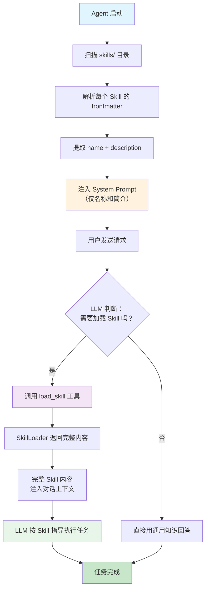

### 1.3 Skills 解决的核心问题

下面这张表格完整概括了 Skills 解决的五大核心问题：

| 问题 | 没有 Skills 时 | 有 Skills 后 |
|------|---------------|-------------|
| **上下文膨胀** | 所有知识塞进 System Prompt，每次请求都带 | 按需加载，只在需要时占用上下文 |
| **领域知识缺失** | Agent 只有通用知识，不懂你的项目规范 | 针对性的最佳实践，精准指导 |
| **重复指导** | 用户每次手动告诉 Agent 怎么做 | 一次编写，持续复用 |
| **团队一致性** | 每个人使用 Agent 的方式不同 | 统一的工作流程，所有人共享同一套 Skill |
| **更新灵活性** | Fine-tune 太慢，System Prompt 修改要全局改 | 修改 Markdown 文件即时生效 |

### 1.4 Skills 的发展时间线

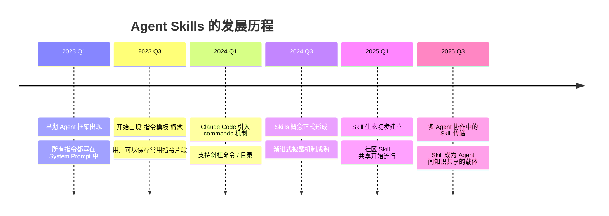

### 1.5 为什么用自然语言而不是代码？

你可能会疑惑：为什么 Skill 用 Markdown（自然语言）编写，而不是用 Python/JSON/YAML 等结构化语言？

原因有三：

1. **LLM 的输入就是自然语言**：LLM 理解自然语言的能力远强于理解代码逻辑。一段 Markdown 描述的步骤，LLM 能完美理解；但同样的步骤如果写成代码流程图，LLM 反而可能误解。

2. **灵活性**：自然语言允许"模糊指导"。比如"如果改动较大，拆分成多个 commit"——这里的"较大"是模糊的，但 LLM 能根据上下文自主判断。如果用代码写，你需要定义"大于 5 个文件算较大"，失去了灵活性。

3. **低门槛**：任何人都能编写 Skill，不需要编程知识。产品经理、设计师、运维人员都可以贡献自己领域的 Skill。

---

## 2. Skills 与 Function Calling、Tool、MCP 的区别

### 2.1 四大概念的定位

在 AI Agent 的技术体系中，Function Calling、Tool、MCP 和 Skill 是四个容易混淆的概念。让我们用一张架构图理清它们的关系：

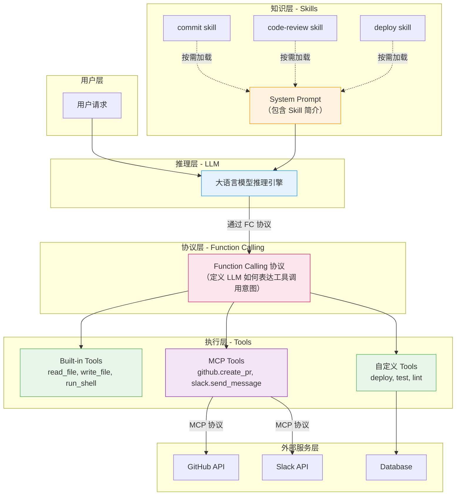

### 2.2 四大概念的本质区别

#### Function Calling（函数调用协议）

**本质**：一种 API 协议规范。

Function Calling 定义了 LLM 如何表达"我想调用某个工具"的意图。它不是工具本身，而是 LLM 与工具之间的"通信语言"。

```json
// Function Calling 的输入：告诉 LLM 有哪些工具可用
{
  "tools": [
    {
      "name": "read_file",
      "description": "Read a file from disk",
      "input_schema": {
        "type": "object",
        "properties": {
          "path": {"type": "string"}
        }
      }
    }
  ]
}

// Function Calling 的输出：LLM 表达调用意图
{
  "type": "tool_use",
  "name": "read_file",
  "input": {"path": "/src/main.py"}
}
```

**关键点**：Function Calling 是 "协议"，不是 "能力"。就像 HTTP 协议定义了浏览器和服务器之间的通信格式，但 HTTP 本身不能做任何事情。

#### Tool（工具）

**本质**：可执行的函数。

Tool 是 Agent 真正能"做事"的部分。每个 Tool 是一个函数，接受输入、执行操作、返回结果。

```python
# 一个 Tool 的定义
class ReadFileTool:
    name = "read_file"
    description = "Read a file from disk"
    
    def execute(self, path: str) -> str:
        with open(path) as f:
            return f.read()
```

**关键点**：Tool 有副作用——它会读写文件、执行命令、修改状态。Tool 是 Agent 的"手"。

#### MCP（Model Context Protocol，模型上下文协议）

**本质**：外部服务接入协议。

MCP 是 Anthropic 提出的标准协议，用于连接 LLM 与外部服务。MCP Server 暴露工具（tools）、资源（resources）和提示词（prompts），MCP Client（Agent）通过 JSON-RPC 与其通信。

```
Agent <--JSON-RPC--> MCP Server <--API--> GitHub/Slack/DB/...
```

**关键点**：MCP 是"桥梁"——它把外部服务的能力转化为 Agent 可调用的工具。通过 MCP，Agent 可以操作 GitHub、查询数据库、发送消息，而无需直接集成每个服务的 SDK。

#### Skill（技能）

**本质**：可复用的自然语言任务指南。

Skill 是 Markdown 文本，包含领域知识、操作步骤和最佳实践。它不可执行——它只是被 LLM "阅读" 后，指导 LLM 的后续行为。

```markdown
# Deploy Skill
## Steps
1. Run tests first
2. Build the project
3. Deploy to staging
4. Run smoke tests
5. Deploy to production
```

**关键点**：Skill 没有副作用——它是纯文本，被注入到 LLM 的上下文中。Skill 是 Agent 的"经验"。

### 2.3 详细对比表

| 维度 | Function Calling | Tool | MCP | Skill |
|------|-----------------|------|-----|-------|
| **本质** | API 协议 | 可执行的函数 | 外部服务协议 | 可复用的文本指南 |
| **执行方式** | 模型输出结构化调用意图 | Agent 执行函数代码 | JSON-RPC 通信调用远程服务 | 注入到 LLM 上下文中被"阅读" |
| **传递方式** | API 请求的 `tools` 参数 | API 请求的 `tools` 参数 | 转换为 `tools` 参数传入 | System Prompt 或 tool_result |
| **有副作用？** | 本身无（取决于工具实现） | 是（读写文件、执行命令等） | 是（操作外部服务） | **否（纯文本，无任何副作用）** |
| **定义格式** | JSON Schema | 代码函数（Python/TS/...） | MCP 协议规范 + 代码 | **Markdown + YAML frontmatter** |
| **何时介入** | LLM 输出阶段 | LLM 输出后执行 | LLM 输出后远程执行 | **LLM 推理前注入上下文** |
| **可执行？** | 不是工具本身 | 可执行 | 可执行（远程） | **不可执行** |
| **上下文成本** | 工具定义占用 token | 同 Function Calling | 同上 + server instructions | **按需加载，简介极省 token** |
| **标准化程度** | 各厂商有自己的格式 | 无统一标准 | Anthropic 主导标准化 | **无标准，各 Agent 自行约定** |
| **谁来执行** | LLM 表达意图，Agent 执行 | Agent 直接执行 | MCP Server 执行 | **LLM 自主决定后续操作** |
| **更新方式** | 修改 API 调用代码 | 修改函数代码 | 更新 MCP Server | **修改 Markdown 文件即时生效** |
| **编写门槛** | 需要了解 JSON Schema | 需要编程能力 | 需要了解 MCP 协议 + 编程 | **会写 Markdown 即可** |

### 2.4 四者如何协作

一个完整的 Agent 交互中，四者的协作流程如下：

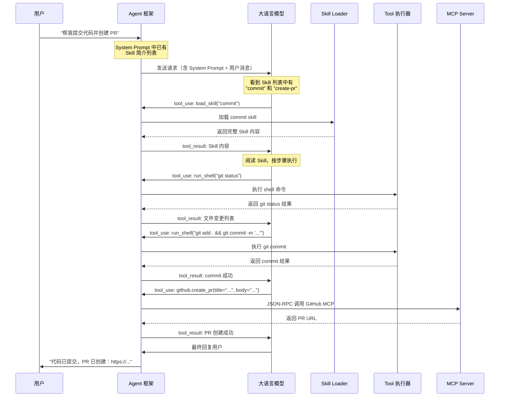

在这个流程中：
- **Skill** 提供了"怎么做"的知识（commit 步骤、PR 模板等）
- **Function Calling** 定义了 LLM 如何表达调用意图（tool_use 格式）
- **Tool** 执行了本地操作（git 命令）
- **MCP** 连接了外部服务（GitHub API）

四者各司其职，缺一不可。

### 2.5 一句话总结

| 概念 | 一句话 |
|------|--------|
| Function Calling | **LLM 说"我要调用工具"的语法规范** |
| Tool | **Agent 真正能做的事** |
| MCP | **Agent 连接外部世界的桥梁** |
| Skill | **Agent 知道怎么把事做好的经验** |

---

## 3. Skill 的结构与组成

### 3.1 Skill 文件格式

在 Claude Code 中，Skill 是一个 Markdown 文件，通常放在 `skills/` 目录或 `.claude/commands/` 目录下。

一个完整的 Skill 文件由两部分组成：

```
┌─────────────────────────────┐
│  YAML Frontmatter (元数据)    │  ← 用 --- 包裹的 YAML 块
│  - name                      │
│  - description               │
│  - allowed-tools             │
│  - ...                       │
├─────────────────────────────┤
│  Markdown Body (正文内容)     │  ← 完整的任务指南
│  - 使用场景                   │
│  - 执行步骤                   │
│  - 规则与约束                 │
│  - 示例                      │
│  - 错误处理                   │
└─────────────────────────────┘
```

**典型结构示例**：

```markdown
---
name: commit
description: Create a well-formatted git commit following conventional commits
allowed-tools: run_shell, read_file, edit_file
version: "1.2"
---

# Git Commit Skill

## When to use
When the user asks to commit changes, create a PR, or save progress.

## Steps
1. Run `git status` to see what changed
2. Run `git diff --staged` to review staged changes
3. If nothing is staged, ask user which files to stage
4. Analyze the changes and determine the commit type:
   - feat: new feature
   - fix: bug fix
   - refactor: code restructuring
   - docs: documentation only
   - test: adding or updating tests
   - chore: maintenance tasks
5. Write a commit message following Conventional Commits format
6. Run `git commit -m "type(scope): description"`

## Rules
- Keep the first line under 72 characters
- Use imperative mood ("add" not "added")
- Reference issue numbers when applicable (#123)
- For breaking changes, add BREAKING CHANGE in the body
- Never use --no-verify flag unless user explicitly requests it

## Examples

### Good commit messages
- feat(auth): add OAuth2 login support
- fix(api): handle null response from payment gateway
- refactor(db): migrate from Knex to Prisma

### Bad commit messages
- fixed stuff
- update
- WIP

## Error Handling
- If `git status` shows no changes: Tell the user there's nothing to commit
- If pre-commit hooks fail: Show the error, help fix it, then retry
- If there are merge conflicts: Help resolve them before committing
```

### 3.2 组成部分详解

#### 必须部分

**1. Frontmatter（YAML 头部）**

Frontmatter 是 Skill 文件开头用 `---` 包裹的 YAML 块，包含元数据。其中两个字段是关键的：

- **`name`**（必须）：技能的唯一标识符，用于引用和加载。命名建议使用 kebab-case（如 `code-review`、`deploy-staging`）。
- **`description`**（必须）：一句话描述技能的作用。这句话会被放入 System Prompt，是 LLM 决定是否加载该 Skill 的唯一依据。**写好 description 至关重要**——如果描述不清楚，LLM 就无法在正确时机加载 Skill。

**2. Body（正文）**

正文是 Skill 的完整内容，用 Markdown 格式编写。这是 LLM 加载 Skill 后真正阅读的部分。正文通常包含：

- **When to use**：明确说明在什么场景下使用此 Skill
- **Steps**：编号步骤列表，是 Skill 的核心
- **Rules**：必须遵守的规则和约束
- **Examples**：好的和坏的示例
- **Error Handling**：异常情况的处理方式

#### 可选部分

| 字段 | 说明 | 示例 |
|------|------|------|
| `allowed-tools` | 此 Skill 可能需要的工具 | `run_shell, read_file` |
| `version` | 版本号 | `"1.2"` |
| `tags` | 分类标签 | `["git", "workflow"]` |
| `author` | 作者 | `"team-platform"` |
| `when-to-use` | 触发条件的更详细描述 | `"When user mentions deploy or release"` |
| `priority` | 优先级（多个 Skill 匹配时） | `high` |
| 任何自定义字段 | 根据项目需要 | — |

### 3.3 这些是协议规定的还是可以自定义？

**这是一个好问题。答案是：没有硬性协议规定。**

Skills 不像 MCP 那样有一个正式的协议规范。它更像是一种**约定（Convention）**，而非**协议（Protocol）**。

**什么是约定的**：
- Frontmatter 使用 YAML `---` 块格式——这是 Claude Code 的 SkillLoader 所期望的
- `name` 字段——SkillLoader 用它来索引和检索 Skill
- `description` 字段——SkillLoader 用它来生成 System Prompt 中的简介

**什么是完全自由的**：
- Body 内容的格式——可以用任何 Markdown 结构
- 自定义字段——你可以在 frontmatter 中加任何字段
- 文件名和目录结构——可以自行组织
- 正文的章节划分——"Steps"、"Rules" 等名称不是强制的

**不同 Agent 系统的 Skill 格式可能不同**：

```
Claude Code:           skills/commit/SKILL.md
                       .claude/commands/commit.md

Cursor:                .cursor/rules/*.md（类似概念）

自定义 Agent:          任何你定义的格式
```

### 3.4 Skill 文件的组织方式

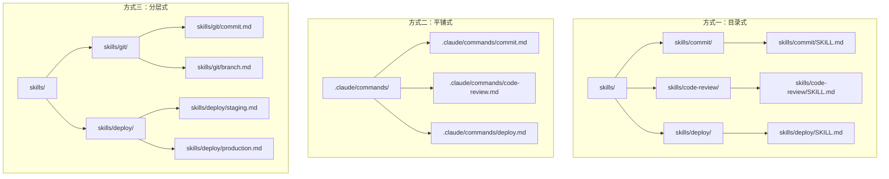

每种方式都有适用场景：
- **目录式**：每个 Skill 一个目录，适合 Skill 有附属资源（模板文件等）的情况
- **平铺式**：所有 Skill 放同一目录，适合 Skill 数量不多的项目
- **分层式**：按领域分组，适合大型团队有大量 Skill 的情况

### 3.5 Skill 与 .claude/commands 的关系

在 Claude Code 中，`.claude/commands/` 目录下的 Markdown 文件会被注册为"斜杠命令"。用户可以通过输入 `/commit`、`/review` 等方式直接触发。

这些斜杠命令本质上就是 Skill——它们也是 Markdown 文件，也有元数据和正文。区别在于触发方式：

| | Skills（skills/ 目录） | Commands（.claude/commands/） |
|---|---|---|
| 触发方式 | LLM 自动判断并加载 | 用户手动输入斜杠命令 |
| 适用场景 | Agent 自主决策时使用 | 用户主动要求时使用 |
| 灵活性 | 更高（LLM 判断何时需要） | 更直接（用户精确控制） |

在实践中，同一个 Skill 可以同时放在两个位置，既支持自动加载，也支持手动触发。

---

## 4. 如何编写高质量的 Skill

### 4.1 编写原则

编写高质量 Skill 的六大原则：

**原则一：明确范围——一个 Skill 解决一类问题**

不好的做法：

```markdown
# General Development Skill
## Steps
1. 写代码时遵循 SOLID 原则
2. 提交代码时用 Conventional Commits
3. 部署时先跑测试
4. 写 PR 时附上截图
...
```

好的做法：把上面的内容拆成 4 个独立的 Skill（coding-standards、commit、deploy、create-pr），每个聚焦一件事。

**原则二：步骤清晰——用编号列表**

不好的做法：

```markdown
首先你应该检查 git 状态，然后看看有哪些改动，接着根据改动类型
决定 commit 消息的前缀，最后执行 commit 命令。如果有问题就处理一下。
```

好的做法：

```markdown
## Steps
1. Run `git status` to check for changes
2. Run `git diff --staged` to review staged changes
3. Determine commit type based on changes:
   - New files/features → `feat:`
   - Bug fixes → `fix:`
   - Refactoring → `refactor:`
4. Write commit message: `type(scope): description`
5. Run `git commit -m "<message>"`
```

LLM 处理编号列表的能力远强于处理自然段落。编号列表提供了明确的执行顺序和检查点。

**原则三：给出示例——示例比抽象描述更有效**

不好的做法：

```markdown
写出符合规范的 commit 消息。
```

好的做法：

```markdown
## Good Examples
- feat(auth): add Google OAuth2 login
- fix(cart): prevent duplicate item addition
- refactor(db): replace raw SQL with Prisma ORM

## Bad Examples (avoid)
- fixed stuff
- update code
- WIP
- miscellaneous changes
```

**原则四：声明工具依赖——明确说明需要哪些工具**

```yaml
---
name: deploy
allowed-tools: run_shell, read_file, github.create_release
---
```

这样做有两个好处：
1. Agent 可以在加载前检查是否具备所需工具
2. 如果 Skill 涉及 MCP 工具，可以提前连接对应的 MCP Server

**原则五：错误处理——告诉 Agent 常见错误和处理方式**

```markdown
## Error Handling
- If `npm test` fails:
  1. Read the error output carefully
  2. Fix the failing tests
  3. Re-run tests before proceeding
- If deployment fails due to permission:
  1. Check if you have the correct credentials
  2. Ask user to verify access rights
- If the API returns 429 (rate limit):
  1. Wait 60 seconds and retry
  2. If still failing, inform the user
```

**原则六：简洁优先——避免冗长描述**

每个 Skill 加载后会占用上下文 token。一个 2000 token 的 Skill 和一个 500 token 的 Skill，如果效果相同，应该选择 500 token 的版本。

经验法则：**500-2000 token 是 Skill 的理想长度**。
- 少于 500 token：可能信息不足
- 多于 2000 token：考虑拆分成多个 Skill

### 4.2 评估 Skill 质量

| 指标 | 如何评估 | 目标值 |
|------|---------|--------|
| **任务完成率** | Agent 使用 Skill 后是否成功完成任务 | > 90% |
| **Token 效率** | Skill 加载后消耗多少额外 token | < 2000 token |
| **触发准确率** | Agent 是否在正确时机加载 Skill | > 85% |
| **误触率** | Agent 是否在不需要时错误加载 | < 10% |
| **用户满意度** | Agent 的输出是否符合 Skill 规范 | 主观评估 |

### 4.3 Skill 编写模板

下面是一个推荐的 Skill 编写模板：

```markdown
---
name: <kebab-case-name>
description: <一句话描述，要精准，LLM 靠这句话决定是否加载>
allowed-tools: <逗号分隔的工具名>
---

# <Skill 名称>

## 使用场景
<什么情况下应该使用这个 Skill>

## 前置条件
<执行前需要满足什么条件>

## 执行步骤
1. <步骤 1>
2. <步骤 2>
3. ...

## 规则与约束
- <规则 1>
- <规则 2>

## 示例

### 正确示例
<好的输入输出示例>

### 错误示例
<常见的错误做法>

## 错误处理
- 如果 <异常情况 1>：<处理方式>
- 如果 <异常情况 2>：<处理方式>
```

### 4.4 编写 description 的技巧

`description` 是 Skill 最重要的元数据字段——它直接决定 LLM 是否会加载该 Skill。以下是编写好 description 的技巧：

**技巧一：包含关键动词**

```yaml
# 好
description: Create well-formatted git commits following conventional commits
# 坏
description: Git commit helper
```

"Create"、"Review"、"Deploy" 等动词帮助 LLM 匹配用户意图。

**技巧二：提及使用场景**

```yaml
# 好
description: Review code changes for bugs, security issues, and style violations
# 坏
description: Code review tool
```

**技巧三：避免过于笼统**

```yaml
# 好
description: Deploy Node.js applications to AWS ECS with blue-green strategy
# 坏
description: Deployment skill
```

**技巧四：不要太长**

```yaml
# 好（~15 words）
description: Create pull requests with structured descriptions and automated test plans
# 坏（太长，浪费 System Prompt 空间）
description: This skill helps create pull requests on GitHub with well-structured 
  descriptions that include a summary section, a test plan section, and automated 
  links to related issues, and also handles draft PRs...
```

---

## 5. 简单的 Skill 示例

### 5.1 Code Review Skill

```markdown
---
name: code-review
description: Review code changes for bugs, style issues, and best practices
allowed-tools: read_file, run_shell
---

# Code Review Skill

## 使用场景
当用户要求审查代码、检查 PR、或 review 某些文件的改动时使用。

## 执行步骤

### 第一步：了解改动范围
1. Run `git diff` or `git diff --staged` to see changes
2. If reviewing a PR, run `gh pr diff <number>` to see PR changes
3. List all changed files

### 第二步：逐文件审查
For each changed file:

1. **逻辑正确性**
   - 边界条件是否处理
   - 空值/undefined 是否检查
   - 异步操作是否正确 await
   - 循环是否有终止条件

2. **安全性**
   - SQL 注入（是否使用参数化查询）
   - XSS（是否转义用户输入）
   - 硬编码密钥/密码
   - 路径遍历漏洞

3. **性能**
   - N+1 查询问题
   - 不必要的大量数据加载
   - 缺少索引的数据库查询
   - 内存泄漏风险

4. **代码风格**
   - 命名是否清晰
   - 函数是否过长（>50 行考虑拆分）
   - 注释是否必要且准确
   - 类型定义是否完整

### 第三步：输出审查报告

## 输出格式
### File: <filename>
- **Critical**: [严重问题，必须修复]
- **Warning**: [警告，建议修复]
- **Suggestion**: [建议改进]
- **Good**: [值得肯定的好做法]

### Summary
- Total files reviewed: X
- Critical issues: X
- Warnings: X
- Suggestions: X

## 规则
- 每个问题都要说明原因和修复建议
- 不要只挑毛病，也要肯定好的做法
- 对于不确定的问题，标注"需要确认"
- 安全问题永远标记为 Critical
```

### 5.2 Database Migration Skill

```markdown
---
name: db-migration
description: Create and run database migrations safely with rollback support
allowed-tools: run_shell, read_file, edit_file
---

# Database Migration Skill

## 领域知识
- 我们使用 Prisma 做 ORM 和数据库迁移
- 数据库是 PostgreSQL
- 迁移文件在 prisma/migrations/ 目录
- Schema 定义在 prisma/schema.prisma

## 执行步骤
1. Read `prisma/schema.prisma` to understand current schema
2. Make the required schema changes in `schema.prisma`
3. Run `npx prisma migrate dev --name <descriptive_name>` to create migration
4. Review the generated SQL in the new migration file
5. Run `npx prisma generate` to update the client
6. Update affected TypeScript types if needed

## 命名规范
Migration 名称使用 snake_case，描述性命名：
- add_email_to_users
- create_orders_table
- add_index_on_created_at

## 规则
- 每次迁移必须是可逆的（Prisma 自动处理）
- 不要在一次迁移中做太多改动
- 添加新列时总是设置默认值或允许 NULL
- 删除列前先确认没有代码依赖
- 大表改动要考虑锁表影响

## 错误处理
- 如果 migrate dev 失败：
  1. 读取错误信息
  2. 如果是 schema 冲突，运行 `npx prisma migrate reset`（仅开发环境！）
  3. 如果是 SQL 错误，手动修复 migration 文件
- 如果需要回滚：
  1. 运行 `npx prisma migrate reset` 重置到初始状态
  2. 然后重新运行所有迁移
```

### 5.3 API Endpoint Skill

```markdown
---
name: create-api-endpoint
description: Create new REST API endpoints following project conventions
allowed-tools: read_file, edit_file, run_shell
---

# Create API Endpoint Skill

## 项目约定
- 框架：Express.js + TypeScript
- 路由文件：src/routes/<resource>.ts
- 控制器：src/controllers/<resource>.controller.ts
- 服务层：src/services/<resource>.service.ts
- 验证：使用 Zod schema
- 认证：JWT middleware

## 执行步骤
1. 确定资源名称和 HTTP 方法
2. 在 src/routes/ 下创建或修改路由文件
3. 创建对应的 controller 函数
4. 创建对应的 service 函数
5. 编写 Zod validation schema
6. 添加到主路由文件 src/routes/index.ts
7. 编写对应的测试文件

## 路由约定
- GET /api/v1/<resources> → 列表
- GET /api/v1/<resources>/:id → 详情
- POST /api/v1/<resources> → 创建
- PUT /api/v1/<resources>/:id → 更新
- DELETE /api/v1/<resources>/:id → 删除

## 响应格式
成功：
{
  "success": true,
  "data": { ... }
}

错误：
{
  "success": false,
  "error": {
    "code": "VALIDATION_ERROR",
    "message": "..."
  }
}

## 规则
- 所有端点必须有认证（除非明确标注为 public）
- 列表端点必须支持分页（page, limit 参数）
- 所有输入必须经过 Zod 验证
- 错误使用统一的 error handler
```

---

## 6. Agent 如何感知 Skill——渐进式披露详解

### 6.1 动机：为什么不能一次性加载全部 Skill？

让我们做一个简单的计算：

假设一个项目有 20 个 Skill，每个平均 1000 token：
- 全部加载：20 x 1000 = 20,000 token
- 渐进式披露：20 x 20（简介） + 1 x 1000（按需加载）= 1,400 token

**节省了 93% 的上下文空间！**

对于 Claude 的 200K 上下文窗口来说，20,000 token 或许不算多。但考虑到：
1. 上下文中还有 System Prompt、对话历史、工具定义、工具结果等
2. 上下文越长，推理质量越容易下降（"Lost in the Middle" 问题）
3. Token 消耗直接影响 API 费用
4. 实际项目可能有 50-100 个 Skill

因此，渐进式披露是必要的优化。

### 6.2 两阶段加载机制

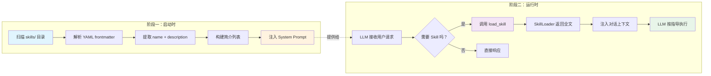

#### 阶段一详解：启动时扫描

当 Agent 启动时，SkillLoader 模块执行以下操作：

```python
# 伪代码：SkillLoader 的初始化过程
class SkillLoader:
    def __init__(self, skills_dir: str):
        self.skills = {}
        self.summaries = []
        
        # 1. 递归扫描 skills 目录
        for skill_file in Path(skills_dir).rglob("*.md"):
            content = skill_file.read_text()
            
            # 2. 解析 YAML frontmatter
            meta, body = self._parse_frontmatter(content)
            
            # 3. 提取元数据
            name = meta.get("name", skill_file.stem)
            description = meta.get("description", "No description")
            
            # 4. 存储完整内容（但不注入上下文）
            self.skills[name] = {
                "meta": meta,
                "body": body,
                "file_path": str(skill_file)
            }
            
            # 5. 构建简介（仅 name + description）
            self.summaries.append(f"- {name}: {description}")
    
    def get_system_prompt_section(self) -> str:
        """生成注入 System Prompt 的简介列表"""
        return "Available skills:\n" + "\n".join(self.summaries)
    
    def load(self, name: str) -> str:
        """按需加载完整 Skill 内容"""
        if name not in self.skills:
            return f"Skill '{name}' not found"
        return self.skills[name]["body"]
```

扫描后，System Prompt 中会多出这样一段：

```
Available skills:
- commit: Create well-formatted git commits following conventional commits
- code-review: Review code changes for bugs, style issues, and best practices
- deploy: Deploy application to production with blue-green strategy
- db-migration: Create and run database migrations safely with rollback support
- create-api: Create new REST API endpoints following project conventions
```

这段文字只有约 100 token——即使有 50 个 Skill，也只有 500 token 左右。

#### 阶段二详解：运行时按需加载

当用户发送请求后，LLM 会看到 System Prompt 中的 Skill 列表。它会根据用户请求的语义，判断是否需要加载某个 Skill。

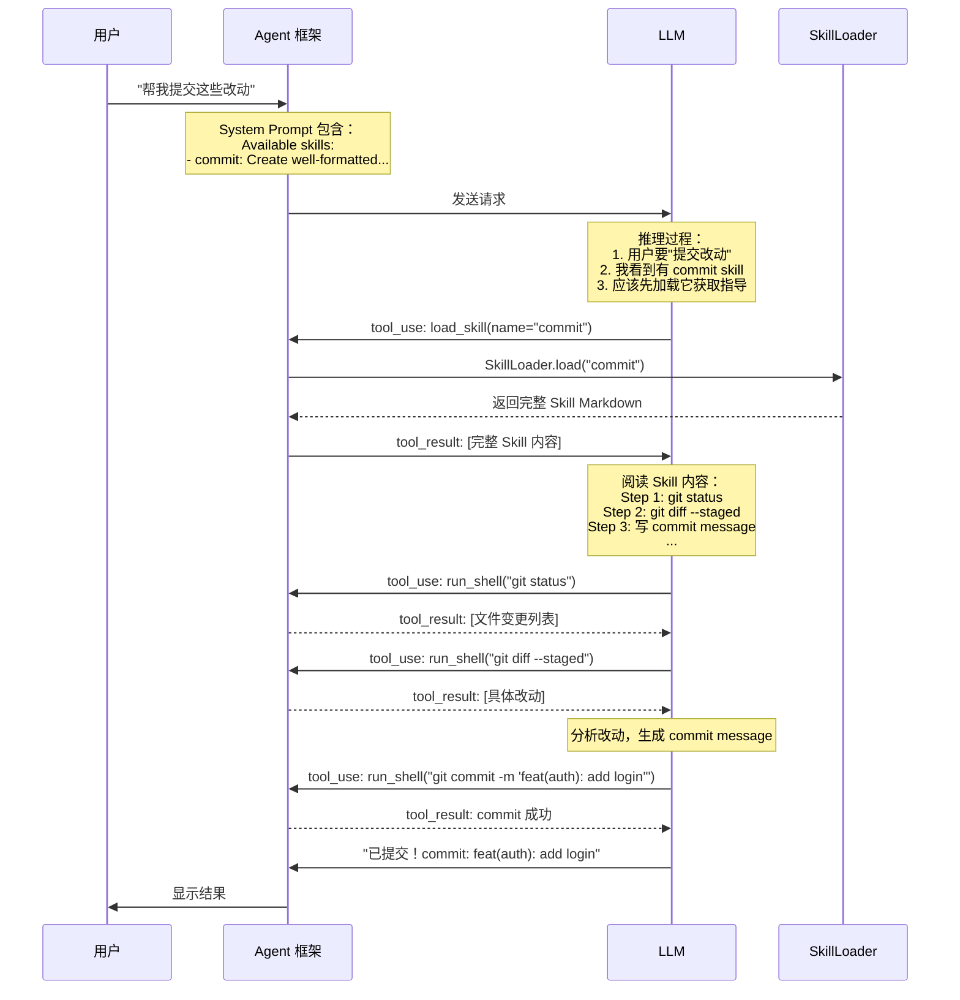

### 6.3 load_skill 工具的定义

在 Agent 的工具列表中，`load_skill`（或 `Skill`）被定义为一个可调用的工具：

```json
{
  "name": "load_skill",
  "description": "Load the full content of a skill to get detailed instructions for a task. Use this when you need specialized guidance for a specific task type.",
  "input_schema": {
    "type": "object",
    "properties": {
      "name": {
        "type": "string",
        "description": "The name of the skill to load (from the available skills list)"
      }
    },
    "required": ["name"]
  }
}
```

这个工具没有副作用——它只返回文本。但它改变了 LLM 的"知识状态"：加载前，LLM 只知道 Skill 的名字；加载后，LLM 拥有了完整的执行指南。

### 6.4 LLM 如何决定是否加载 Skill？

这是一个关键问题。LLM 的决策基于以下因素：

1. **用户请求的语义**：用户说"帮我提交代码"→ 语义匹配 "commit" skill
2. **Skill 的 description**：description 中的关键词与用户请求的关联度
3. **LLM 自身的判断能力**：即使用户没有直接说"commit"，但说了"保存我的进度"，LLM 也能推断需要 commit skill

**决策流程**：

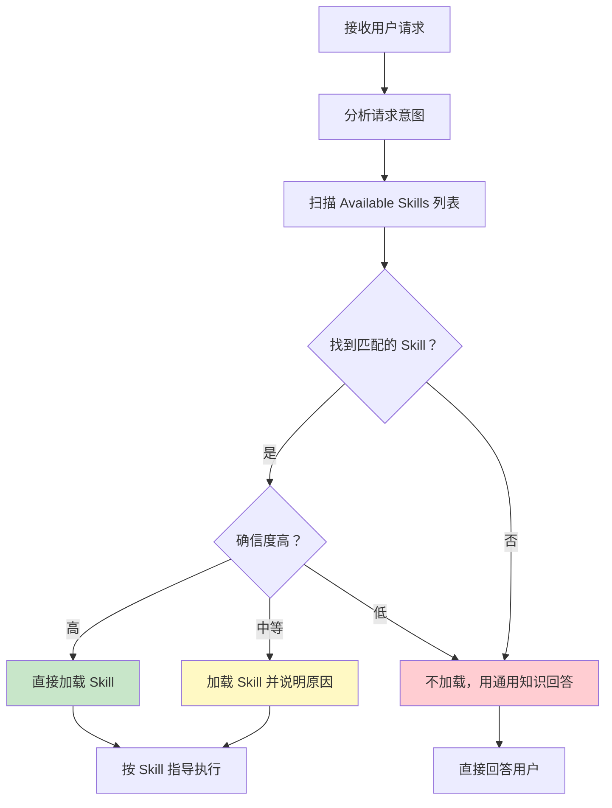

**影响触发准确率的因素**：

| 因素 | 影响 | 优化方式 |
|------|------|---------|
| description 质量 | 直接影响匹配准确度 | 使用精准的动词和名词 |
| Skill 数量 | 太多会增加误触概率 | 控制在 20-30 个以内 |
| 名称清晰度 | 模糊名称导致混淆 | 使用 descriptive 命名 |
| 用户表述 | 模糊请求增加判断难度 | 提供 whenToUse 字段 |

### 6.5 完整示例模拟

让我们模拟一个完整的交互过程：

```
═══════════════════════════════════════════════
System Prompt（部分）:
═══════════════════════════════════════════════
You are a helpful coding assistant.

Available skills:
  - commit: Create well-formatted git commits following conventional commits
  - code-review: Review code changes for bugs, style issues, and best practices  
  - deploy-staging: Deploy application to staging environment
  - create-pr: Create pull requests with structured descriptions

═══════════════════════════════════════════════
用户消息:
═══════════════════════════════════════════════
帮我 review 一下 src/auth.ts 的改动，然后提交

═══════════════════════════════════════════════
LLM 推理过程（内部）:
═══════════════════════════════════════════════
用户要求两件事：
1. Review src/auth.ts → 匹配 "code-review" skill
2. 提交代码 → 匹配 "commit" skill
我应该先加载两个 skill

═══════════════════════════════════════════════
LLM 输出:
═══════════════════════════════════════════════
我来帮你 review 代码并提交。让我先获取相关的指导。

[tool_use: load_skill(name="code-review")]
[tool_use: load_skill(name="commit")]

═══════════════════════════════════════════════
系统返回（两个 tool_result）:
═══════════════════════════════════════════════
tool_result 1: [code-review skill 的完整内容]
tool_result 2: [commit skill 的完整内容]

═══════════════════════════════════════════════
LLM 继续执行:
═══════════════════════════════════════════════
好的，我已获取指导。先 review 代码。

[tool_use: run_shell("git diff src/auth.ts")]
→ [得到文件改动]

根据 code-review skill 的检查清单：
- 逻辑正确性：...
- 安全性：发现一个潜在的 XSS 问题...
- 性能：OK
- 代码风格：建议将函数拆分...

Review 完成，现在按 commit skill 的步骤提交：

[tool_use: run_shell("git add src/auth.ts")]
[tool_use: run_shell("git commit -m 'feat(auth): add token refresh mechanism'")]
→ [commit 成功]

已完成！以下是 review 总结和 commit 信息：
- Review 发现 1 个安全建议、1 个代码风格建议
- 已提交: feat(auth): add token refresh mechanism
```

---

## 7. Skill 的总体工作流程

### 7.1 生命周期全览

一个 Skill 从创建到使用，经历以下完整的生命周期：

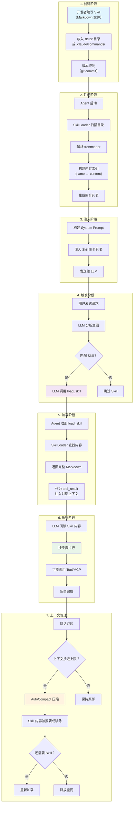

### 7.2 各阶段详细说明

#### 阶段 1：创建

Skill 的创建通常由以下角色完成：
- **团队 Lead**：定义团队规范类的 Skill（代码风格、commit 规范等）
- **DevOps 工程师**：定义部署和运维类的 Skill
- **资深开发者**：定义最佳实践和架构类的 Skill
- **任何团队成员**：提出新 Skill 或改进现有 Skill

Skill 应该像代码一样进行版本控制和 code review。

#### 阶段 2：注册

Agent 启动时，SkillLoader 做的事情非常简单：
1. 遍历指定目录，找到所有 `.md` 文件
2. 解析每个文件的 YAML frontmatter
3. 把 `{name: string, description: string, content: string}` 存入内存

这个过程是一次性的，不会在运行时重复执行。

#### 阶段 3：注入

只把简介列表放入 System Prompt。关键设计点：
- 简介格式固定：`- name: description`
- 一个 Skill 的简介只占约 10-20 token
- 即使有 100 个 Skill，简介列表也只有 1000-2000 token

#### 阶段 4：触发

LLM 看到用户请求和 Skill 列表后，自主决定是否加载。这个决策完全是 LLM 的推理行为——没有硬编码的规则或关键词匹配。

#### 阶段 5：加载

`load_skill` 工具返回完整 Markdown 内容。内容作为 `tool_result` 进入对话上下文，和其他工具结果一样。

#### 阶段 6：执行

LLM 阅读 Skill 内容后，按照其中的步骤执行。它可能需要：
- 调用本地 Tool（如 `run_shell`、`read_file`）
- 调用 MCP Tool（如 `github.create_pr`）
- 直接回答用户（如果 Skill 只提供知识，不需要操作）

#### 阶段 7：上下文管理

这是容易被忽视但非常重要的阶段。Skill 内容一旦加载，就会一直留在对话上下文中（直到被压缩）。在长对话中，早期加载的 Skill 可能不再需要，但仍占用上下文空间。

---

## 8. Token 消耗优化与上下文污染

### 8.1 Token 消耗分析

让我们量化 Skill 在不同阶段的 token 消耗：

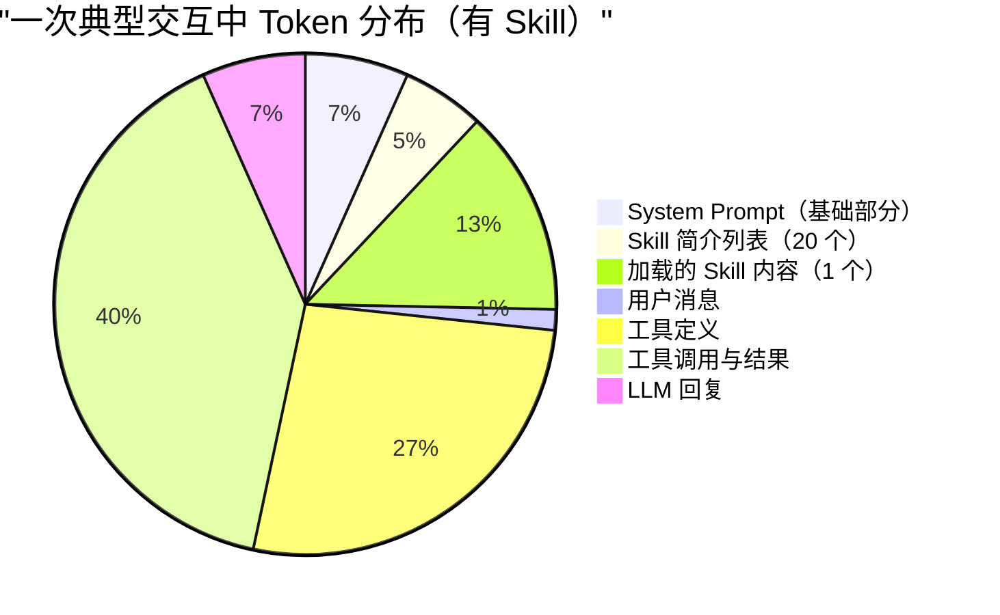

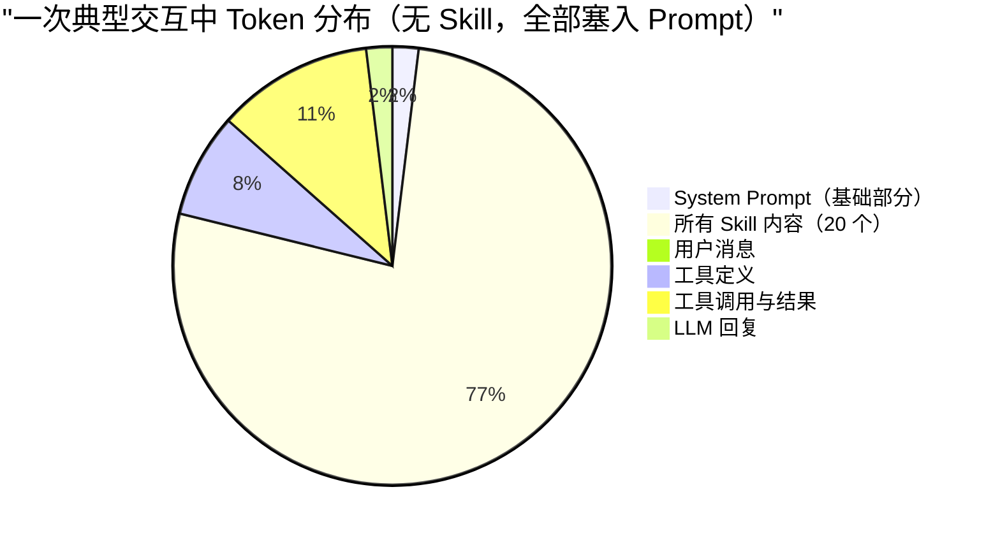

对比可见，渐进式披露从 20,000 token 降低到 1,400 token（简介 400 + 按需加载 1000）。

### 8.2 降低 Token 消耗的策略

**策略一：渐进式披露（核心策略）**

这是最重要的优化，已经详细讨论过。效果：节省 90%+ 的上下文空间。

**策略二：Skill 分层**

把大 Skill 拆成小模块，只加载需要的部分：

```
deploy/
├── SKILL.md          # 主 Skill（概述 + 通用步骤）
├── staging.md         # 子 Skill（staging 环境特有步骤）
├── production.md      # 子 Skill（production 环境特有步骤）
└── rollback.md        # 子 Skill（回滚步骤）
```

用户说"部署到 staging"→ 只加载主 Skill + staging.md，不加载 production.md 和 rollback.md。

**策略三：精简内容**

对比两个版本的同一 Skill：

版本 A（冗长版，~2000 token）：

```markdown
# Git Commit Skill

## Background
When working with git, it's very important to follow good practices for 
commit messages. This helps team members understand what changes were made
and why. Good commit messages make it easier to review code, find bugs,
and understand the history of the project. There are many conventions for
commit messages, but we follow the Conventional Commits specification...
（省略大段背景介绍）

## Steps
1. First, you should run the `git status` command to see what files have 
   been changed. This will show you a list of modified, added, and deleted 
   files. Make sure to review this list carefully to understand what will 
   be included in the commit...
（省略冗长的步骤描述）
```

版本 B（精简版，~800 token）：

```markdown
# Git Commit Skill

## Steps
1. Run `git status` → check changed files
2. Run `git diff --staged` → review staged changes
3. Determine commit type: feat|fix|refactor|docs|test|chore
4. Write message: `type(scope): description`
5. Run `git commit -m "<message>"`

## Rules
- First line < 72 chars
- Imperative mood ("add" not "added")
- Reference issues: #123
- Breaking changes: add BREAKING CHANGE in body

## Examples
Good: feat(auth): add OAuth2 login
Bad: fixed stuff
```

版本 B 信息密度更高，LLM 一样能准确遵循。

**策略四：上下文压缩后恢复**

在 Claude Code 中，当上下文接近上限时会触发 AutoCompact 压缩。压缩后，之前加载的 Skill 内容可能被摘要或移除。

为了确保关键 Skill 不丢失，Claude Code 有一个恢复机制：

```
POST_COMPACT_SKILLS_TOKEN_BUDGET = 25000
```

AutoCompact 后，系统会检查哪些 Skill 仍然在使用中，并在预算范围内重新加载它们。

### 8.3 避免上下文污染

**什么是上下文污染？**

当一个 Skill 被加载后，它的内容会一直留在对话上下文中。如果用户后续的请求与该 Skill 无关，Skill 内容就变成了"噪声"——它不仅浪费 token，还可能误导 LLM。

例如：
1. 用户先让 Agent commit 代码 → 加载了 commit skill
2. 然后用户问了一个关于数据库的问题
3. 上下文中仍有 commit skill 的内容，可能干扰数据库相关的推理

**解决方案**：

1. **自然衰减**：随着对话继续，Skill 内容在上下文中的位置越来越靠前（远离最新消息），LLM 自然会减少对它的关注。

2. **AutoCompact 压缩**：当上下文接近上限时，系统会压缩历史内容，Skill 内容也会被压缩或移除。

3. **一个对话避免加载过多 Skill**：尽量让每个对话聚焦一个主题，减少 Skill 的加载数量。

4. **Skill 内容标记**：在加载时给 Skill 内容加上明确的标记（如 `<skill name="commit">...</skill>`），帮助 LLM 识别哪些是 Skill 内容、哪些是对话内容。

### 8.4 上下文预算管理

一个成熟的 Agent 系统应该有上下文预算管理机制：

```python
class ContextBudget:
    TOTAL_BUDGET = 200000  # 总 token 预算
    SYSTEM_PROMPT_BUDGET = 10000
    SKILL_SUMMARIES_BUDGET = 2000
    LOADED_SKILLS_BUDGET = 5000  # 同时加载的 Skill 总预算
    TOOLS_BUDGET = 5000
    CONVERSATION_BUDGET = 178000  # 剩余给对话
    
    def can_load_skill(self, skill_tokens: int) -> bool:
        """检查是否有预算加载新 Skill"""
        current_skill_tokens = sum(s.tokens for s in self.loaded_skills)
        return current_skill_tokens + skill_tokens <= self.LOADED_SKILLS_BUDGET
```

---

## 9. Skill 的高级用法与进阶模式

### 9.1 条件 Skill

有些 Skill 只在特定条件下才应该被加载。可以在 frontmatter 中声明条件：

```yaml
---
name: deploy-production
description: Deploy to production environment (requires approval)
when-to-use: Only when user explicitly says "deploy to production" or "release"
prerequisites:
  - All tests must pass
  - Must be on main branch
  - Requires user confirmation before proceeding
---
```

### 9.2 组合 Skill

一个复杂任务可能需要多个 Skill 协同工作。可以在 Skill 中引用其他 Skill：

```markdown
---
name: release
description: Create a new release including version bump, changelog, and deployment
---

# Release Skill

## Steps
1. Load and follow the "commit" skill for committing any pending changes
2. Bump version number in package.json
3. Update CHANGELOG.md
4. Create a git tag
5. Load and follow the "deploy-production" skill for deployment
6. Create a GitHub release
```

LLM 看到"Load and follow the commit skill"时，会主动调用 `load_skill("commit")`。

### 9.3 参数化 Skill

Skill 可以包含"占位符"，由 LLM 在运行时填充：

```markdown
---
name: create-component
description: Create a new React component following project conventions
---

# Create React Component Skill

## Steps
1. Determine the component name: <COMPONENT_NAME>
2. Determine the directory: src/components/<COMPONENT_NAME>/
3. Create files:
   - <COMPONENT_NAME>.tsx (component)
   - <COMPONENT_NAME>.test.tsx (test)
   - <COMPONENT_NAME>.styles.ts (styles)
   - index.ts (barrel export)
4. Component template:
   ```tsx
   interface <COMPONENT_NAME>Props {
     // props here
   }
   
   export function <COMPONENT_NAME>({ }: <COMPONENT_NAME>Props) {
     return <div>...</div>
   }
   ```
```

LLM 会根据用户请求（如"创建一个 UserProfile 组件"）自动将 `<COMPONENT_NAME>` 替换为 `UserProfile`。

### 9.4 动态 Skill

某些场景下，Skill 的内容需要根据项目状态动态生成。例如：

```python
# 动态 Skill：根据项目的 package.json 生成
class DynamicSkillGenerator:
    def generate_test_skill(self, project_dir: str) -> str:
        pkg = json.load(open(f"{project_dir}/package.json"))
        
        test_framework = "jest"  # default
        if "vitest" in pkg.get("devDependencies", {}):
            test_framework = "vitest"
        elif "mocha" in pkg.get("devDependencies", {}):
            test_framework = "mocha"
        
        return f"""
---
name: run-tests
description: Run project tests using {test_framework}
---

# Test Skill

This project uses **{test_framework}** for testing.

## Steps
1. Run `npm test` to execute all tests
2. For specific file: `npx {test_framework} <file>`
3. For watch mode: `npx {test_framework} --watch`
"""
```

### 9.5 Skill 继承与覆盖

在大型组织中，可能有多层 Skill：

```
组织级 Skill（/org/skills/）
  ↓ 继承
团队级 Skill（/team/skills/）
  ↓ 覆盖
项目级 Skill（/project/skills/）
```

如果项目级有和组织级同名的 Skill，项目级优先。这类似于 CSS 的级联规则或配置文件的覆盖机制。

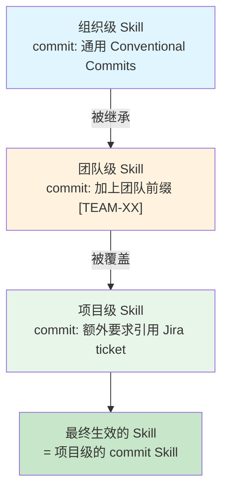

### 9.6 Skill 版本管理

随着项目演进，Skill 也需要迭代更新。建议的版本管理策略：

```yaml
---
name: deploy
description: Deploy application to production
version: "2.1"
changelog:
  - "2.1: Added canary deployment step"
  - "2.0: Switched from EC2 to ECS"
  - "1.0: Initial version"
---
```

结合 Git 版本控制，可以追踪 Skill 的每次变更，也可以在需要时回退到旧版本。

---

## 10. Skill 在真实项目中的应用案例

### 10.1 案例一：前端团队的 Skill 集

一个典型的前端团队可能有以下 Skill：

```
skills/
├── create-component/     # 创建 React 组件
├── create-page/          # 创建新页面（路由 + 组件 + API）
├── write-test/           # 编写测试（组件测试 + E2E 测试）
├── fix-lint/             # 修复 lint 错误
├── optimize-bundle/      # 优化打包体积
├── create-pr/            # 创建 Pull Request
├── review-accessibility/ # 无障碍访问审查
└── i18n/                 # 国际化处理
```

每个 Skill 都针对该团队的技术栈和规范：
- 使用 Next.js + TypeScript + Tailwind CSS
- 组件库使用 Radix UI
- 状态管理使用 Zustand
- 测试使用 Vitest + Testing Library

### 10.2 案例二：后端团队的 Skill 集

```
skills/
├── create-api-endpoint/  # 创建 API 端点
├── db-migration/         # 数据库迁移
├── add-auth/             # 添加认证中间件
├── error-handling/       # 统一错误处理
├── add-logging/          # 添加日志记录
├── performance-tuning/   # 性能优化
├── security-review/      # 安全审查
└── api-docs/             # 生成 API 文档
```

### 10.3 案例三：DevOps 团队的 Skill 集

```
skills/
├── setup-ci/             # 配置 CI/CD pipeline
├── deploy-staging/       # 部署到 staging
├── deploy-production/    # 部署到 production
├── rollback/             # 回滚部署
├── scale-service/        # 扩缩容
├── monitor-alerts/       # 监控告警处理
├── incident-response/    # 事故响应流程
└── cost-optimization/    # 成本优化
```

### 10.4 案例四：跨团队共享的 Skill

某些 Skill 对整个组织都有价值：

```markdown
---
name: incident-response
description: Follow incident response playbook when production issues occur
---

# Incident Response Skill

## 严重程度评估
- P0: 全站不可用 → 立即通知 on-call + 管理层
- P1: 核心功能受影响 → 通知 on-call
- P2: 非核心功能受影响 → 创建 ticket
- P3: 轻微问题 → 常规修复

## P0/P1 响应步骤
1. 确认问题（验证是否真的存在问题）
2. 评估影响范围（多少用户受影响）
3. 通知相关人员（Slack #incidents 频道）
4. 寻找根因
   - 检查最近的部署：`gh run list --limit 5`
   - 检查监控指标：Grafana dashboard
   - 检查错误日志：`kubectl logs <pod>`
5. 决策：回滚还是热修复
   - 如果最近有部署且可能是原因 → 回滚
   - 如果是数据问题 → 热修复
6. 执行修复
7. 验证修复
8. 编写事故报告（postmortem）

## 沟通模板
### 通知消息
"[P{级别}] {服务名} - {问题描述}。影响：{影响描述}。正在排查中。"

### 状态更新
"[更新] {服务名} - {当前状态}。下次更新时间：{时间}"

### 解决通知
"[已解决] {服务名} - {问题已解决}。根因：{根因}。修复方式：{修复方式}"
```

---

## 11. Skill 与其他 Agent 架构的整合

### 11.1 Skill 在 Multi-Agent 架构中的应用

在多 Agent 协作的架构中，Skill 可以作为 Agent 间知识传递的载体：

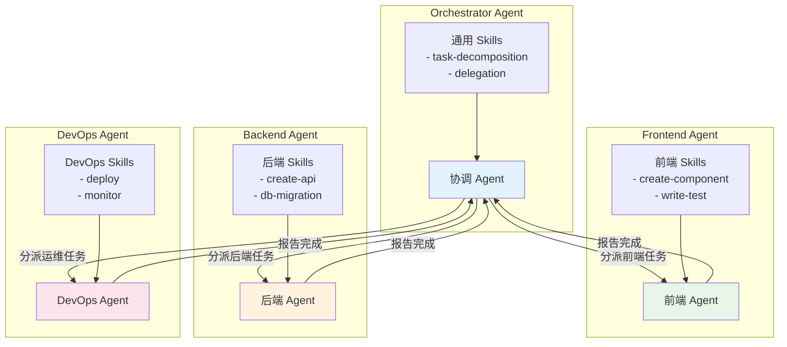

每个 Agent 有自己专属的 Skill 集，同时也可以共享跨团队的 Skill。

### 11.2 Skill 与 RAG 的对比

Skill 和 RAG（Retrieval-Augmented Generation）有相似之处——都是在 LLM 推理前注入额外知识。但它们有本质区别：

| 维度 | Skill | RAG |
|------|-------|-----|
| 知识类型 | 操作指南、流程规范 | 事实性知识、文档 |
| 粒度 | 任务级（完成一个任务） | 段落级（回答一个问题） |
| 检索方式 | LLM 主动加载 | 向量相似度检索 |
| 更新频率 | 低（规范不常变） | 高（文档经常更新） |
| 内容格式 | 结构化步骤 | 非结构化文本 |
| 目的 | 指导行动 | 提供知识 |

**Skill 和 RAG 可以互补**：Skill 告诉 Agent 怎么做（流程），RAG 提供 Agent 需要的信息（事实）。

### 11.3 Skill 在 ReAct 模式中的角色

ReAct（Reasoning + Acting）是常见的 Agent 推理模式。Skill 在其中扮演"预设推理链"的角色：

```
不使用 Skill 的 ReAct:
  Thought: 用户要 commit，我需要先看看改了什么
  Action: git status
  Observation: modified: src/auth.ts
  Thought: 好，只有一个文件改了，我来写 commit message
  Action: git commit -m "update auth"  ← 缺乏规范指导
  
使用 Skill 的 ReAct:
  Thought: 用户要 commit，我看到有 commit skill，先加载
  Action: load_skill("commit")
  Observation: [Skill 内容：步骤、规范、示例]
  Thought: 按 Skill 步骤来，先查状态
  Action: git status
  Observation: modified: src/auth.ts
  Thought: 看看具体改了什么
  Action: git diff src/auth.ts
  Observation: [具体改动]
  Thought: 这是新增了 OAuth 功能，根据 Skill 规范应该用 feat 前缀
  Action: git commit -m "feat(auth): add OAuth2 login support"  ← 遵循规范
```

Skill 提升了 ReAct 链的质量——LLM 不再"盲目"推理，而是有了专业指导。

---

## 12. 最佳实践与工程建议

### 12.1 Skill 开发最佳实践

**实践一：一个 Skill 一个职责**

这是最重要的原则。一个 Skill 应该完整覆盖一个任务类型，但不要试图覆盖多个不相关的任务。

```
好的划分：
├── commit.md          # 只管 commit
├── create-pr.md       # 只管创建 PR
├── deploy-staging.md  # 只管部署到 staging
└── deploy-prod.md     # 只管部署到 production

不好的划分：
├── git-workflow.md    # commit + PR + branch + merge 全塞一起
└── deploy.md          # staging + prod + rollback 全塞一起
```

**实践二：description 是决定性的**

LLM 靠 description 决定是否加载 Skill。如果 description 写得不好，两种问题都会出现：
- 该加载时不加载（description 太模糊，LLM 匹配不上）
- 不该加载时加载（description 太宽泛，LLM 误匹配）

编写好 description 的清单：
- [ ] 包含核心动词（create, review, deploy, fix...）
- [ ] 提及目标对象（commits, PRs, components, APIs...）
- [ ] 不超过 20 个英文单词
- [ ] 不与其他 Skill 的 description 混淆

**实践三：步骤用编号，规则用列表**

```markdown
## Steps (用编号 → 有顺序)
1. First step
2. Second step
3. Third step

## Rules (用列表 → 无顺序)
- Rule one
- Rule two
- Rule three
```

**实践四：控制 Skill 长度**

| 长度 | 评价 | 适用场景 |
|------|------|---------|
| < 300 token | 太短，信息可能不足 | 极简规范 |
| 300-800 token | 精简高效 | 大多数场景 |
| 800-1500 token | 详细但不冗长 | 复杂流程 |
| 1500-2500 token | 偏长，考虑拆分 | 包含大量示例的场景 |
| > 2500 token | 太长，建议拆分 | — |

**实践五：团队共享，版本控制**

Skill 文件应该放在项目 repo 中，和代码一起：
- 版本控制（git 追踪变更）
- Code Review（Skill 变更也需要 review）
- 团队共享（所有人使用同一套 Skill）
- 持续改进（根据使用反馈迭代）

**实践六：测试你的 Skill**

在正式使用前，用几个典型场景测试 Skill 的效果：

```
测试清单：
[ ] LLM 在需要时正确触发加载
[ ] LLM 在不需要时不误触发
[ ] LLM 加载后能正确遵循步骤
[ ] LLM 能处理 Skill 中描述的异常情况
[ ] Token 消耗在可接受范围内
```

### 12.2 挑战与局限

| 挑战 | 说明 | 解决思路 |
|------|------|---------|
| **Skill 质量参差** | 写得不好的 Skill 会误导 Agent | 建立评估框架 + Code Review 流程 |
| **触发不准确** | LLM 不知道何时该加载 | 优化 description + 增加 whenToUse 字段 |
| **上下文膨胀** | 同时加载多个大 Skill | 分层设计 + 压缩策略 + 限制加载数量 |
| **工具依赖** | Skill 引用了 Agent 没有的工具 | 声明 allowed-tools + 编写优雅降级方案 |
| **缺乏标准** | 不同 Agent 系统的 Skill 格式不同 | 期待行业标准出现，目前只能各自约定 |
| **LLM 遵循度** | LLM 可能不完全按 Skill 步骤执行 | 步骤要清晰具体 + 通过测试验证 |
| **版本冲突** | 多人同时修改同一 Skill | Git 版本控制 + 明确 owner |
| **跨项目复用** | 不同项目的规范不同 | 分层设计（组织/团队/项目级） |

### 12.3 常见反模式

**反模式一：大而全的 Skill**

```markdown
# Everything Skill
## Steps
1. 写代码...
2. 写测试...
3. 做 review...
4. 提交...
5. 部署...
```

问题：太大、太泛，不聚焦。

**反模式二：过度依赖特定工具**

```markdown
## Steps
1. Run `npx prisma migrate dev`
2. Run `npx prisma generate`
```

如果项目换了 ORM（比如从 Prisma 换到 Drizzle），这个 Skill 就完全失效了。更好的做法是同时提供通用原则。

**反模式三：只有知识没有步骤**

```markdown
# Database Skill
我们使用 PostgreSQL，版本 15，hosted on AWS RDS。
主数据库在 us-east-1，只读副本在 us-west-2。
连接池使用 PgBouncer，最大连接数 100...
```

这个 Skill 只有知识，没有操作步骤。Agent 读了之后知道了一些信息，但不知道要做什么。应该加上具体的步骤。

**反模式四：description 不匹配内容**

```yaml
---
name: deploy
description: Deploy to production  # 说的是 production
---

# Deploy Skill
## Steps
1. Deploy to staging first...  # 内容却包含 staging
```

Description 和内容不匹配会导致触发不准确。

---

## 13. 疑惑解答——常见误区与深度辨析

### Q1: Skill 就是最佳实践说明书？如果涉及工具调用怎么办？

**你的理解基本正确——Skill 本质上就是"用自然语言写的最佳实践指南"。**

关于 Skill 是否会触发工具调用，这里需要精确区分：

**Skill 本身不会直接触发工具调用。** 它只是文本——被 LLM 看到后，LLM **自主决定**是否需要调用工具来执行 Skill 中描述的步骤。

完整的因果链：

```
Skill 内容: "Step 1: Run `git status` to check changes"
  ↓
LLM 阅读 Skill 内容
  ↓
LLM 推理: "Skill 要求我运行 git status，我需要调用 run_shell 工具"
  ↓
LLM 输出: tool_use: run_shell(command="git status")
  ↓
Agent 框架执行工具调用
  ↓
工具返回结果: tool_result: "M src/auth.ts"
  ↓
LLM 继续按 Skill 步骤执行下一步
```

**关键点**：是 LLM 在"阅读" Skill 后自主决定调用工具，而不是 Skill "触发"了工具调用。Skill 只是"建议"，LLM 是"决策者"。

**如果 Agent 没有对应的工具怎么办？**

这是一个真实存在的问题。处理方式：

1. **LLM 会自适应**：LLM 看到 Skill 要求 `run_shell`，但发现自己的工具列表中没有 `run_shell`，它会尝试用其他方式完成（或告诉用户它做不到）。

2. **allowed-tools 字段**：Skill 可以声明需要的工具，Agent 在加载前可以检查是否具备。

3. **优雅降级**：好的 Skill 应该考虑工具不可用的情况：

```markdown
## Steps
1. Run `git status` to check changes
   - If shell execution is not available, ask the user to run 
     `git status` and paste the output
```

### Q2: Skill 可以指导使用 MCP 吗？

**可以，完全可以。** Skill 中可以写"使用 GitHub MCP 创建 PR"：

```markdown
## Steps
1. Prepare PR title and body
2. Use github.create_pull_request tool to create the PR
   - title: <generated title>
   - body: <generated body>
   - base: main
   - head: <current branch>
```

但如果 Agent 没有接入 GitHub MCP，这一步就无法执行。LLM 会自适应——尝试用其他方式（如 `gh` CLI 命令）或报告无法完成。

**本质上**：Skill 是"建议"而非"命令"。它告诉 LLM "最好这样做"，但 LLM 会根据自身可用的工具集来决定实际操作。这正是自然语言指南的灵活性——它不像代码那样要求精确匹配，而是允许 LLM 根据情况变通。

### Q3: Skill 里只放知识，不指导工具调用？

**不，Skill 通常会同时包含知识和操作指导。** 一个好的 Skill 是"知识 + 操作"的混合体：

```markdown
# Database Migration Skill

## Knowledge (领域知识——纯信息，不触发工具)
- 我们使用 Prisma 做数据库迁移
- 迁移文件命名格式: YYYYMMDDHHMMSS_description
- 所有 migration 必须是可逆的（有 up 和 down）
- 主数据库是 PostgreSQL 15

## Steps (操作指导——会引导 LLM 调用工具)
1. Read `prisma/schema.prisma` to understand current schema
2. Make the required schema changes
3. Run `npx prisma migrate dev --name <descriptive_name>`
4. Review the generated SQL
5. Run `npx prisma generate` to update the client
6. Update affected TypeScript types
```

"Knowledge" 部分是纯知识，LLM 阅读后增加了背景理解。
"Steps" 部分会引导 LLM 调用工具来执行具体操作。
两者通常混合在一个 Skill 中，这是正常的、也是推荐的做法。

### Q4: Skill 和 System Prompt 中的指令有什么区别？

| | System Prompt 指令 | Skill |
|---|---|---|
| **何时可见** | 始终可见 | 按需加载 |
| **上下文成本** | 每次请求都消耗 | 只在加载时消耗 |
| **适用范围** | 全局性规则 | 特定任务指导 |
| **修改影响** | 影响所有交互 | 只影响加载了该 Skill 的交互 |
| **适合放什么** | 身份设定、通用规则、安全约束 | 任务步骤、领域规范、操作指导 |

经验法则：
- **放 System Prompt**：Agent 身份、通用规则、安全约束、输出格式
- **做 Skill**：具体任务的步骤、特定领域的规范、项目级约定

### Q5: 如果两个 Skill 的指导冲突了怎么办？

这是一个真实的问题。例如，commit skill 说"保持简洁"，而 code-review skill 说"commit message 要详细描述所有改动"。

处理方式：
1. **预防**：编写 Skill 时避免与其他 Skill 冲突
2. **优先级**：在 frontmatter 中声明优先级
3. **LLM 判断**：LLM 通常能根据上下文判断哪个指导更适用
4. **用户裁决**：如果冲突无法自动解决，告知用户并请求指导

### Q6: Skill 能在不同 Agent 之间共享吗？

**理论上可以，实际上有限制。**

Skill 的 body 内容（Markdown 格式的操作指南）是通用的——任何能理解自然语言的 LLM 都能使用。

但 frontmatter 格式可能不同：
- Claude Code 期望 `name` 和 `description` 字段
- 其他 Agent 可能使用不同的字段名
- 加载机制可能不同（有的用 tool_use，有的用其他方式）

未来可能出现标准化的 Skill 格式，使得跨 Agent 共享成为现实。

### Q7: Skill 和 Prompt Engineering 是什么关系？

Skill 本质上就是一种**模块化的 Prompt Engineering**。

传统的 Prompt Engineering 把所有指导写在一个 prompt 中。Skill 把指导拆成独立模块，按需加载。

可以说 Skill 是 Prompt Engineering 的最佳实践的产物——它解决了"一个 prompt 装不下所有知识"的问题。

### Q8: Skill 的安全性问题

Skill 内容是纯文本，没有直接的安全风险。但间接风险存在：

1. **Prompt Injection**：如果 Skill 内容来自不受信任的来源，可能包含恶意指令
2. **工具滥用**：Skill 可能引导 LLM 调用危险的工具（如 `rm -rf /`）
3. **敏感信息泄露**：Skill 中可能包含内部 API key、密码等

防护措施：
- Skill 来源可信（团队内部编写，版本控制）
- 工具有权限控制（即使 Skill 建议执行危险操作，工具层会拦截）
- 代码审查 Skill 内容

---

## 14. 未来展望：Skill 生态的演进方向

### 14.1 标准化

目前 Skill 的格式是各 Agent 系统自行约定的。未来可能出现类似 MCP 的标准协议：

```yaml
# 假想的 Skill Protocol v1.0
apiVersion: skill/v1
kind: Skill
metadata:
  name: commit
  description: Create well-formatted git commits
  version: "1.0"
  author: team-platform
  tags: [git, workflow]
spec:
  triggers:
    - intent: commit_code
    - keywords: [commit, push, save changes]
  requirements:
    tools: [shell, file_read]
  body: |
    # Steps
    1. ...
```

### 14.2 Skill 市场

就像 VS Code 有插件市场、npm 有包管理器一样，未来可能出现 Skill 市场：

```bash
# 假想的 Skill 包管理器
skill install @community/conventional-commits
skill install @company/deploy-aws
skill install @team/code-review
skill update @community/conventional-commits
skill list --installed
```

开发者可以发布和共享自己的 Skill，社区可以评价和改进。

### 14.3 自适应 Skill

未来的 Skill 可能具备自适应能力：

- **学习用户偏好**：Agent 观察到用户总是修改 Skill 某个步骤的输出，自动调整
- **A/B 测试**：同时维护多个版本的 Skill，根据效果自动选择最佳版本
- **自动生成**：根据项目的代码库和历史操作，自动生成 Skill

### 14.4 多模态 Skill

目前 Skill 是纯文本的。未来可能支持多模态：

- **包含图片**：UI 组件创建 Skill 包含设计稿截图
- **包含视频**：复杂操作流程的录屏
- **包含代码模板**：可直接复制使用的代码片段
- **交互式 Skill**：根据用户输入动态调整步骤

### 14.5 Skill 与 Agent 训练的融合

长远来看，Skill 可能成为 Agent 训练数据的一部分：

```
当前：运行时加载 Skill → LLM 实时阅读并遵循
未来：Skill 作为训练数据 → LLM 内化为能力
```

这样，常用的 Skill 不再需要运行时加载——LLM 已经"学会"了这些知识。但这需要解决更新和版本控制的问题。

---

## 15. 总结速记表

### 15.1 Skill 核心属性

| 维度 | 详情 |
|------|------|
| **本质** | 可复用的自然语言任务指南 |
| **格式** | Markdown + YAML frontmatter |
| **感知方式** | 渐进式披露（简介在 System Prompt，全文按需加载） |
| **加载机制** | LLM 调用 load_skill / Skill 工具 |
| **上下文成本** | 简介: ~10-20 token/skill; 全文: 300-2500 token/skill |
| **是否可执行** | 否（纯文本），但可能引导 LLM 调用工具 |
| **标准化程度** | 无标准协议，各 Agent 自行约定 |
| **与 Tool 关系** | Skill 可能引导调用 Tool，但 Skill 本身不是 Tool |
| **与 MCP 关系** | Skill 可以引导使用 MCP，但不依赖 MCP |
| **核心优势** | 按需加载、自然语言灵活性、易于编写和维护 |
| **核心局限** | 无强制执行力、依赖 LLM 理解能力、格式不标准 |

### 15.2 四大概念终极对比表

| 维度 | Function Calling | Tool | MCP | Skill |
|------|-----------------|------|-----|-------|
| **一句话** | LLM 调用工具的语法 | Agent 能做的事 | 连接外部服务的桥 | 做事的经验指南 |
| **本质** | API 协议 | 可执行函数 | 外部服务协议 | 自然语言文本 |
| **角色** | 通信规范 | 执行者 | 连接器 | 顾问 |
| **有副作用** | 无（协议本身） | 有 | 有 | 无 |
| **可执行** | 否（协议） | 是 | 是（远程） | 否 |
| **定义格式** | JSON Schema | 代码函数 | MCP 协议 | Markdown |
| **谁提供** | API 厂商定义 | 开发者编写 | MCP Server | 任何人编写 |
| **何时介入** | LLM 输出时 | LLM 输出后 | LLM 输出后 | **LLM 推理前** |
| **上下文成本** | 工具定义 token | 同左 | 同左 + instructions | 按需加载 |
| **更新方式** | 改代码/配置 | 改代码 | 改 Server | **改 Markdown** |
| **编写门槛** | 中等 | 高 | 高 | **低** |
| **标准化** | 各厂商各异 | 无标准 | Anthropic 推动中 | 无标准 |
| **类比** | 语言 | 手 | 外接设备 | 工作手册 |

### 15.3 何时使用 Skill？

| 场景 | 是否适合用 Skill | 原因 |
|------|-----------------|------|
| 团队有特定的 commit 规范 | 适合 | 规范化的流程，可复用 |
| 一次性的特殊操作 | 不适合 | 直接在对话中告诉 Agent 即可 |
| 复杂的部署流程 | 非常适合 | 步骤多、容易遗漏、需要一致性 |
| 简单的代码格式化 | 不适合 | 用 linter 工具更合适 |
| 新人入职指南 | 适合 | 标准化流程，减少重复说明 |
| 事故响应流程 | 非常适合 | 紧急时刻需要可靠的步骤指导 |
| 个人编码习惯 | 不太适合 | 个人习惯不需要标准化 |
| 跨团队协作规范 | 非常适合 | 统一不同团队的协作方式 |

### 15.4 速查：从零到一创建 Skill

```
Step 1: 确定场景
  → 这个任务是否经常重复？是否有固定流程？
  → 是 → 继续；否 → 不需要 Skill

Step 2: 编写 Skill
  → 创建 Markdown 文件
  → 写好 frontmatter（name + description）
  → 写好 body（步骤 + 规则 + 示例 + 错误处理）

Step 3: 放置文件
  → skills/<name>/SKILL.md 或 .claude/commands/<name>.md

Step 4: 测试
  → 用典型场景测试触发、加载、执行
  → 验证 LLM 是否正确遵循步骤

Step 5: 迭代
  → 根据使用反馈优化 Skill 内容
  → 版本控制，团队 review
```

---

## 附录 A：Skill 编写清单

在发布一个新 Skill 之前，检查以下清单：

- [ ] **name** 使用 kebab-case，清晰描述任务类型
- [ ] **description** 精准、简洁，包含关键动词和目标对象
- [ ] **Steps** 使用编号列表，顺序清晰
- [ ] **Rules** 使用无序列表，每条独立
- [ ] 包含正确和错误的**示例**
- [ ] 包含常见**错误处理**方案
- [ ] **总 token 数**在 300-2500 之间
- [ ] 不包含**敏感信息**（密码、API key 等）
- [ ] description 不与其他 Skill **混淆**
- [ ] **tested**：用至少 3 个场景测试过

---

## 附录 B：Skill 与 Claude Code 的整合细节

### B.1 Claude Code 中 Skill 的实际表现

在 Claude Code 中，Skill 的加载通过 `Skill` 工具实现。当你看到以下日志输出时，说明 Agent 正在使用 Skill：

```
Assistant: 让我加载相关的技能指南。

[Skill: commit]
  Loading skill "commit"...
  Skill loaded successfully.
```

加载完成后，Agent 会按照 Skill 中的步骤逐步执行任务。

### B.2 斜杠命令触发

用户也可以通过斜杠命令直接触发 Skill：

```
用户输入: /commit
→ Agent 直接加载 commit skill（无需 LLM 判断）
→ 按 Skill 步骤执行
```

这种方式绕过了 LLM 的判断阶段，直接加载指定 Skill。适合用户明确知道需要哪个 Skill 的场景。

### B.3 Skill 在 Claude Code 中的完整流转

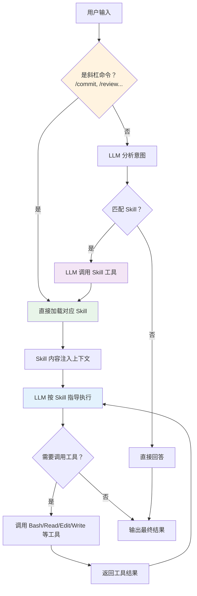

---

## 附录 C：术语表

| 术语 | 英文 | 含义 |
|------|------|------|
| 渐进式披露 | Progressive Disclosure | 先展示摘要，按需展示完整内容 |
| 前置数据 | Frontmatter | Markdown 文件开头的 YAML 元数据块 |
| 上下文窗口 | Context Window | LLM 单次能处理的最大 token 数 |
| 上下文污染 | Context Pollution | 无关内容占用上下文空间影响推理 |
| 工具调用 | Tool Use / Function Calling | LLM 请求执行外部函数 |
| 按需加载 | Lazy Loading | 只在需要时才加载资源 |
| 自动压缩 | AutoCompact | 上下文接近上限时自动压缩历史 |
| 优雅降级 | Graceful Degradation | 条件不满足时提供替代方案 |
| 斜杠命令 | Slash Command | 以 / 开头的快捷命令 |
| 模型上下文协议 | Model Context Protocol (MCP) | Anthropic 提出的外部服务接入标准 |

---

## 附录 D：推荐阅读与参考资源

1. **Claude Code 官方文档**：了解 Skills 和 Commands 的最新用法
2. **Anthropic MCP 规范**：理解 MCP 与 Skill 的配合方式
3. **Conventional Commits**：常用的 commit Skill 所遵循的规范
4. **ReAct 论文**：理解 Agent 推理与行动的交替模式
5. **Lost in the Middle 论文**：理解为什么上下文管理如此重要

---

> **文档版本**: v1.0
> **最后更新**: 2025 年
> **适用对象**: AI Agent 开发者、技术负责人、对 Agent Skills 机制感兴趣的工程师