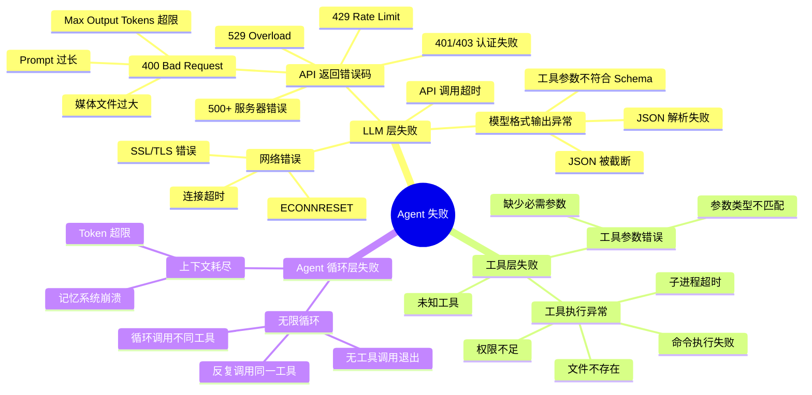
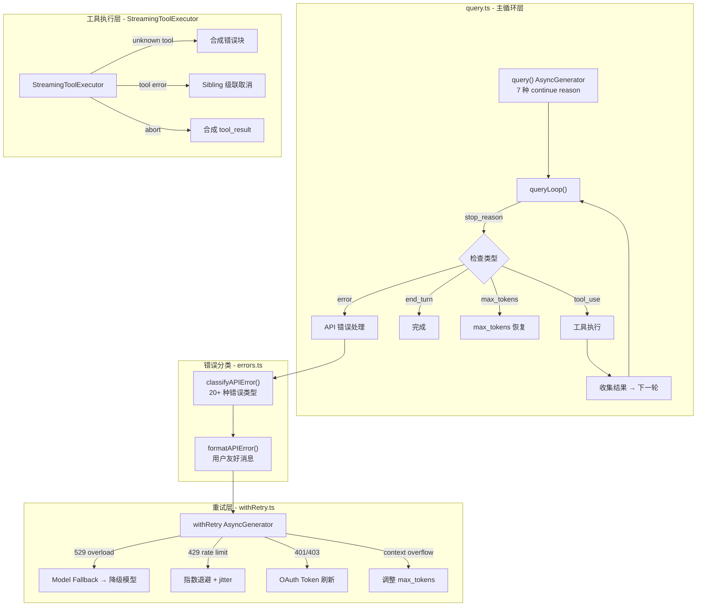
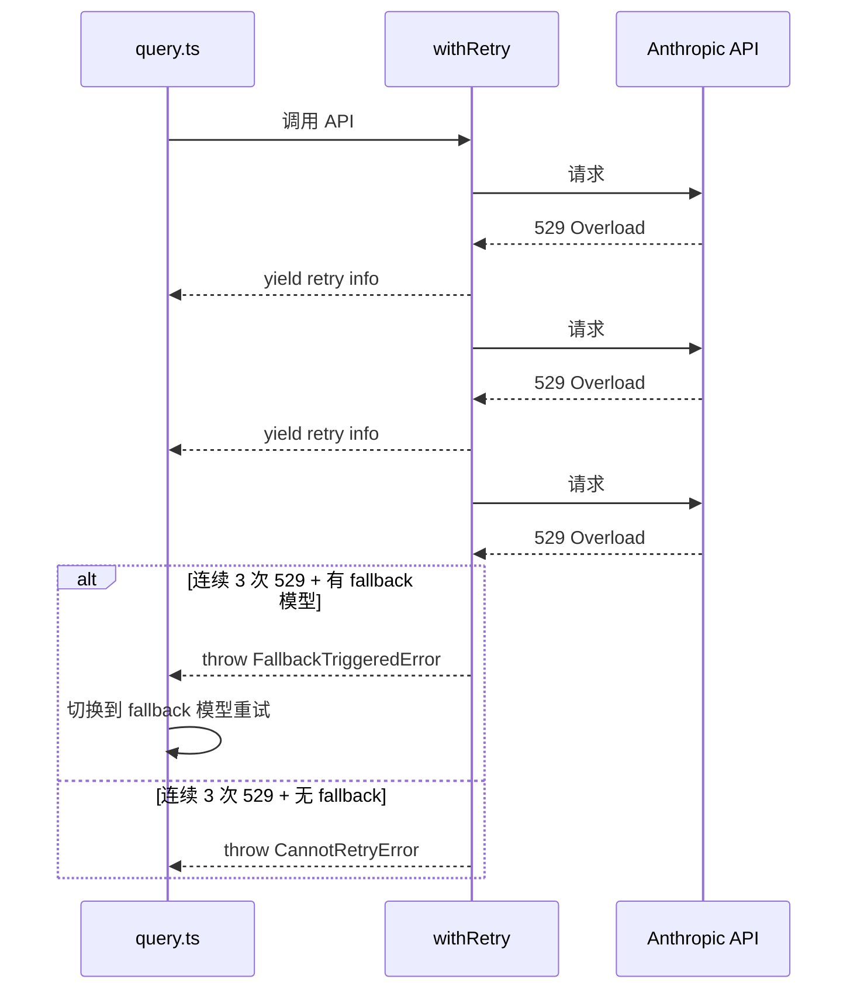
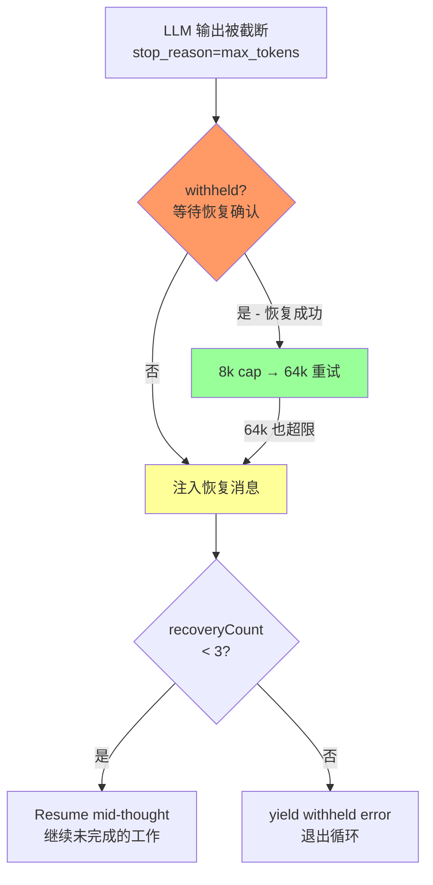
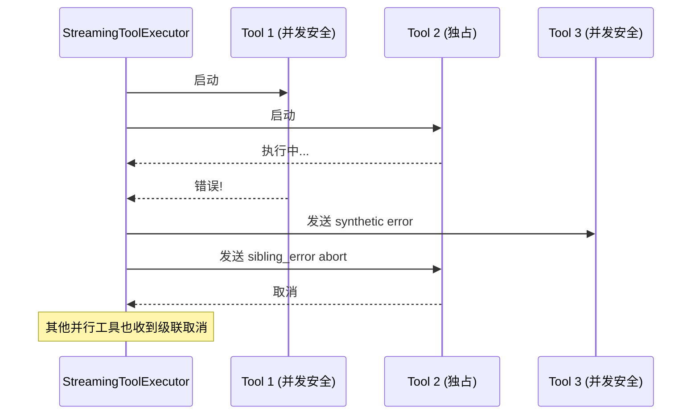
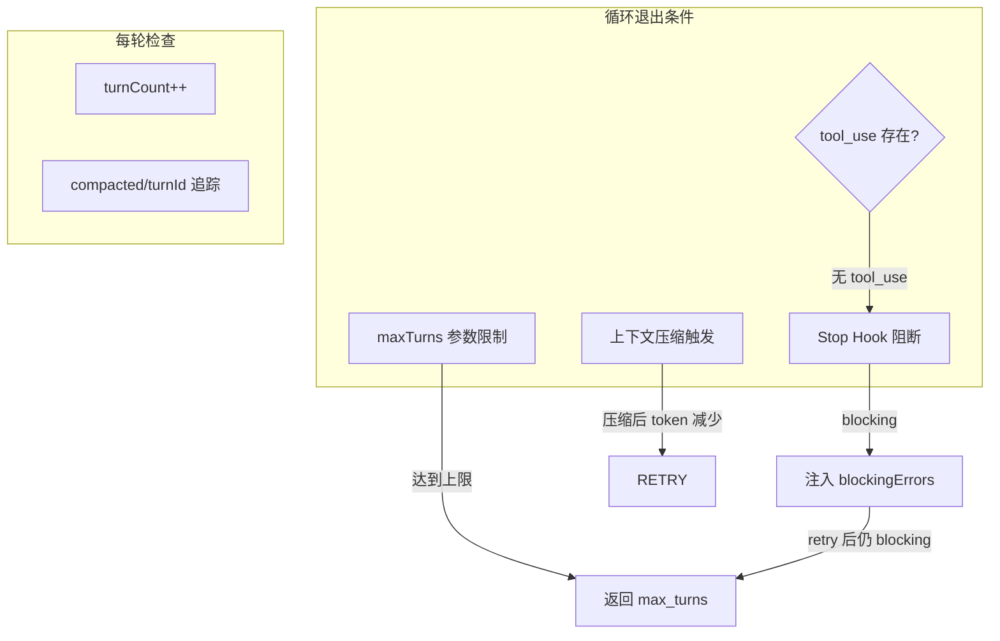
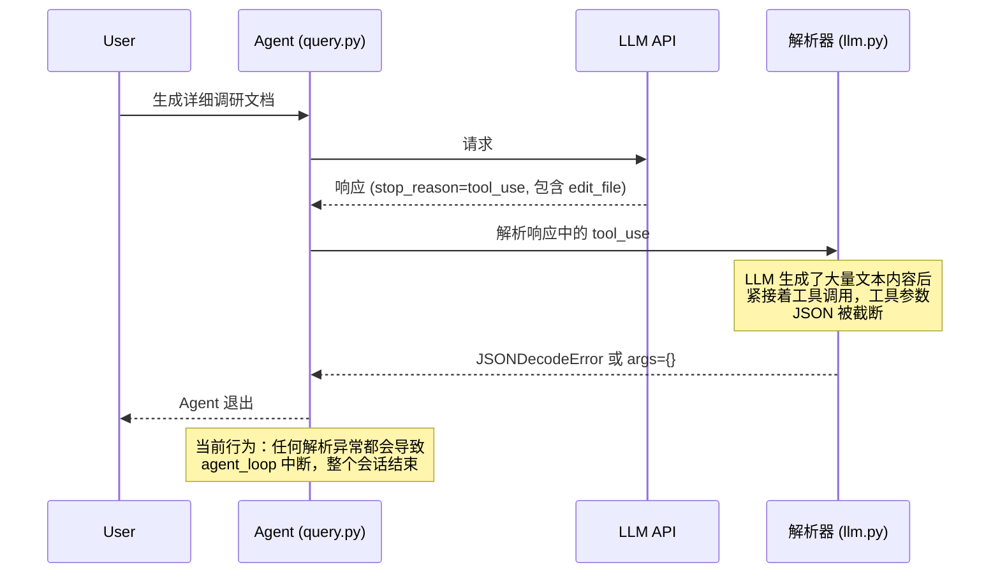
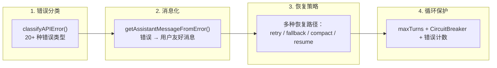

# Agent 失败处理机制调研报告

> 调研范围：Claude Code 源码 (`F:\4-校招\AI Agent 项目\claude-code-source`)
> 参考项目：`F:\4-校招\AI Agent 项目\learn-claude-code\coding agent`

---

## 一、Agent 失败类型分类

在 Agent 运行生命周期中，失败主要分为以下几大类：



---

## 二、Claude Code 错误处理架构

### 2.1 整体架构图



### 2.2 核心文件对应关系

| 功能 | Claude Code 源码文件 | 本项目对应 |
|------|---------------------|-----------|
| Agent 主循环 | `query.ts` (~1730行) | `query.py` (~270行) |
| API 重试 | `services/api/withRetry.ts` (~800行) | 无对应 |
| 错误分类 | `services/api/errors.ts` (~1200行) | 仅有基础 try/except |
| 工具执行 | `services/tools/StreamingToolExecutor.ts` | `query.py` 内串行循环 |
| 上下文压缩 | `services/compact/` | `services/compact.py` |
| 断路器 | 内置于 `compact.ts` | `CircuitBreaker` 类 |
| 模型降级 | `withRetry.ts` FallbackTriggeredError | 无对应 |

---

## 三、Claude Code 失败处理详解

### 3.1 LLM API 层错误处理

#### 3.1.1 withRetry 重试机制

Claude Code 的 `withRetry.ts` 实现了**指数退避 + 多级降级**策略：



**关键设计：**

1. **10 次默认重试**（`DEFAULT_MAX_RETRIES = 10`）
2. **529 特殊处理**：连续 3 次 529 后触发模型降级（`fallbackModel`）
3. **指数退避**：`delay = BASE_DELAY_MS * 2^(attempt-1) + jitter`，上限 32s
4. **Fast Mode 降级**：429/529 时自动从快速模式切回标准速度
5. **持久会话模式**：支持无人值守场景下的长等待重试（最长 6 小时）
6. **SSL/TLS 错误**：检测并提供企业代理Hints

```typescript
// withRetry.ts 核心重试判断
function shouldRetry(error: APIError): boolean {
  // 529 Overload → 重试
  if (is529Error(error)) return true;
  // 429 Rate Limit → 非订阅用户重试
  if (error.status === 429) return !isClaudeAISubscriber();
  // 401 认证失败 → 重试（清除缓存后）
  if (error.status === 401) { clearApiKeyHelperCache(); return true; }
  // 5xx 服务器错误 → 重试
  if (error.status >= 500) return true;
  // 408 超时 → 重试
  if (error.status === 408) return true;
  // 连接错误 → 重试
  if (error instanceof APIConnectionError) return true;
  return false;
}
```

#### 3.1.2 错误分类与用户友好消息

Claude Code 通过 `classifyAPIError()` 将错误分为 **20+ 种类型**，`getAssistantMessageFromError()` 为每种错误生成用户友好的提示：

| 错误类型 | 响应策略 |
|---------|---------|
| `prompt_too_long` (400) | 触发上下文压缩恢复 |
| `max_output_tokens` | 自动提升 max_tokens (8k→64k)，或注入恢复消息 |
| `rate_limit` (429) | 指数退避重试，提示用户等待 |
| `server_overload` (529) | 模型降级或长等待 |
| `auth_error` (401/403) | 刷新 Token 或提示重新登录 |
| `ssl_cert_error` | 提供企业代理配置提示 |
| `media_size_error` | 提示文件过大，建议压缩 |
| `tool_use_mismatch` | 记录日志，提示用户 `/rewind` |
| `connection_error` | 检查网络的提示 |

### 3.2 Max Output Tokens 截断处理

这是用户遇到的核心问题。Claude Code 的处理流程：



**关键代码逻辑（query.ts 1185-1256）：**

```typescript
// MAX_OUTPUT_TOKENS_RECOVERY_LIMIT = 3
const MAX_OUTPUT_TOKENS_RECOVERY_LIMIT = 3

if (isWithheldMaxOutputTokens(lastMessage)) {
  // 第一步：如果用了 8k 默认 cap，自动提升到 64k 重试
  if (capEnabled && maxOutputTokensOverride === undefined) {
    state = { ...state, maxOutputTokensOverride: ESCALATED_MAX_TOKENS }
    continue  // 重试
  }

  // 第二步：注入恢复消息，最多 3 次
  if (maxOutputTokensRecoveryCount < MAX_OUTPUT_TOKENS_RECOVERY_LIMIT) {
    const recoveryMessage = createUserMessage({
      content: `Output token limit hit. Resume directly — no apology, no recap of what you were doing. Pick up mid-thought if that is where the cut happened. Break remaining work into smaller pieces.`,
      isMeta: true,
    })
    state = {
      messages: [...messagesForQuery, ...assistantMessages, recoveryMessage],
      maxOutputTokensRecoveryCount: maxOutputTokensRecoveryCount + 1,
    }
    continue
  }

  // 第三步：恢复耗尽，暴露错误
  yield lastMessage
}
```

### 3.3 工具执行层错误处理

#### 3.3.1 StreamingToolExecutor 的并发控制与错误传播

Claude Code 的 `StreamingToolExecutor` 处理并行工具执行的错误：



**关键机制：**
- `siblingAbortController`：一个工具报错，自动取消其他并行工具
- `discard()`：流式降级时丢弃所有工具结果
- `synthetic error blocks`：为被取消的工具生成假的 `tool_result` 块

#### 3.3.2 未知工具与参数校验

```typescript
// StreamingToolExecutor.ts
addTool(block: ToolUseBlock, assistantMessage: AssistantMessage): void {
  const toolDefinition = findToolByName(this.toolDefinitions, block.name)
  if (!toolDefinition) {
    // 未知工具 → 生成错误结果，不阻断循环
    this.tools.push({
      results: [createUserMessage({
        content: `<tool_use_error>Error: No such tool available: ${block.name}</tool_use_error>`,
        is_error: true,
      })]
    })
    return
  }

  // Zod Schema 校验
  const parsedInput = toolDefinition.inputSchema.safeParse(block.input)
  if (!parsedInput.success) {
    // 参数不符合 Schema → 生成错误结果
  }
}
```

### 3.4 无限循环防护

Claude Code 通过多层机制防止无限循环：



**关键设计：**
1. `maxTurns` 参数硬限制
2. `turnCount` 跟踪，每轮递增
3. `compacted.turnCounter`：压缩后轮次计数
4. Stop Hook 可以 `preventContinuation` 阻断继续
5. **断路器**（`CircuitBreaker`）：连续压缩失败 3 次后跳过压缩

---

## 四、本项目现状分析

### 4.1 当前错误处理覆盖度

| 错误类型 | Claude Code | 本项目 | 备注 |
|---------|------------|-------|------|
| API 调用失败 | ✅ 重试+降级 | ❌ 直接抛异常 |  |
| Max Tokens 截断 | ✅ 自动恢复 | ❌ **直接退出** | **用户反馈问题** |
| JSON 解析失败 | ✅ 降级处理 | ❌ 直接退出 |  |
| 工具执行异常 | ✅ synthetic result | ✅ 返回错误字符串 |  |
| 未知工具 | ✅ synthetic result | ❌ "Unknown tool" 字符串 |  |
| 无限循环 | ✅ maxTurns 限制 | ❌ **无限制** |  |
| 上下文过长 | ✅ 多级压缩 | ✅ L1-L3 压缩 |  |
| 模型降级 | ✅ Fallback | ❌ 无 |  |
| 429/529 限流 | ✅ 指数退避 | ❌ 无 |  |

### 4.2 当前项目核心问题

#### 问题 1：Agent Loop 无防护机制

`query.py` 中的 agent_loop 是纯 while True 结构：

```python
# query.py - 当前实现
while True:
    # ...
    response = state.llm.chat(...)
    if response.stop_reason != "tool_use":
        return  # 只能依赖 LLM 主动结束

    for block in response.content:
        if block.type == "tool_use":
            handler = tool_handlers.get(block.name)
            try:
                output = handler(**block.input)
            except Exception as e:
                output = f"Error: {e}"  # 工具异常不会阻断循环
```

**问题：**
- 无 `maxTurns` 限制
- 无 `turnCount` 跟踪
- 如果 LLM 持续产生 tool_use 但不推进任务，循环将无限进行

#### 问题 2：Max Tokens 截断直接退出

`services/llm.py` 的流式处理中，JSON 解析失败直接崩溃：

```python
# services/llm.py _stream_openai 方法
for idx in sorted(collected_tool_calls.keys()):
    tc = collected_tool_calls[idx]
    try:
        args = _json.loads(tc["arguments"])
    except (_json.JSONDecodeError, TypeError):
        args = {}  # 静默失败，参数为空 dict
```

```python
# 问题：如果 LLM 输出在 tool_use 的 arguments 中被截断
# tc["arguments"] = '{"file_path": "a.txt", "old_string": "hel'  # 不完整的 JSON
# _json.loads() 失败 → args = {} → 工具收到空参数 → 执行失败
```

更深层的问题在 `query.py` 的 agent_loop 中，**没有任何 try/except 包裹 LLM 调用和响应解析**，一旦响应格式异常就直接退出整个 Agent。

#### 问题 3：无 API 错误重试机制

整个项目没有 `withRetry` 类似机制，API 返回 429/529/401 等错误时：
- 429：直接报错退出
- 529：直接报错退出
- 401：直接报错退出
- 网络超时：直接报错退出

#### 问题 4：SubAgent 无错误恢复

`agents/subagent.py` 的 `_run_agent_loop`：

```python
def _run_agent_loop(...) -> str:
    for _ in range(max_turns):
        resp = state.llm.chat(...)  # 任何异常直接传播
        # ...
    return "(subagent failed)"  # 只在 maxTurns 耗尽时返回
```

如果 LLM 在 SubAgent 中输出被截断，异常向上传播，没有任何恢复机制。

### 4.3 现有防御性设计

项目中已有的防御性设计：

1. **CircuitBreaker**（`services/compact.py`）：连续压缩失败 3 次后跳过压缩
2. **TokenTracker**：`get_utilization()` 监控上下文使用率
3. **工具异常捕获**（`query.py:237-240`）：
   ```python
   try:
       output = handler(**block.input)
   except Exception as e:
       output = f"Error: {e}"
   ```
4. **断路器状态机**：CLOSED → HALF_OPEN → OPEN

---

## 五、最小可用性改造方案

### 5.1 改造原则

1. **最小侵入**：不改变现有 Agent 循环结构
2. **按需覆盖**：优先解决用户已触发的实际问题
3. **向后兼容**：不影响现有功能
4. **可测试**：每项改动可独立验证

### 5.2 方案一：修复 Max Tokens 截断导致的 JSON 解析失败

**问题根因**：LLM 输出在流式传输中被截断，`tc["arguments"]` 可能是不完整的 JSON 字符串。

**解决思路**：
- 在 `services/llm.py` 的 `_stream_openai` 中，对 JSON 解析失败做修复性尝试（截取到最后一个完整对象为止）
- 如果完全无法修复，生成一条明确的错误消息而不是静默使用空 dict

**代码改动**（`services/llm.py`）：

```python
# 在 _stream_openai 方法中，替换现有的 JSON 解析逻辑
for idx in sorted(collected_tool_calls.keys()):
    tc = collected_tool_calls[idx]
    try:
        args = _json.loads(tc["arguments"])
    except (_json.JSONDecodeError, TypeError) as e:
        # 尝试修复：如果参数看起来被截断，尝试找到最后一个有效的完整对象
        raw_args = tc["arguments"]
        # 尝试截取到最后一个 '}' 为止
        if raw_args and not raw_args.strip().endswith('}'):
            last_brace = raw_args.rfind('}')
            if last_brace > 0:
                try:
                    args = _json.loads(raw_args[:last_brace + 1])
                except _json.JSONDecodeError:
                    args = {"_parse_error": f"JSON truncated: {str(e)[:50]}"}
            else:
                args = {"_parse_error": f"JSON decode failed: {str(e)[:50]}"}
        else:
            args = {"_parse_error": f"JSON decode failed: {str(e)[:50]}"}
```

**改动影响**：仅修改 `services/llm.py` 一个文件，无功能逻辑变化

**代码工作量**：约 15 行代码

**是否能覆盖用户的场景**：✅ **直接覆盖**。即使 JSON 被截断，工具调用也不会崩溃，而是收到一个带有 `_parse_error` 字段的错误参数，工具本身可以检测到这个字段并返回友好的错误消息。

---

### 5.3 方案二：Agent Loop 增加 maxTurns 限制和错误恢复

**问题根因**：`query.py` 的 agent_loop 是无限制的 `while True`，没有任何退出机制保护。

**解决思路**：
- 在 `query.py` 中增加 `maxTurns` 计数器，达到上限时强制退出
- 增加错误计数，连续错误达到阈值时强制退出
- 工具执行结果中的错误消息反馈给 LLM，让它自己调整策略

**代码改动**（`query.py`）：

```python
# 在 agent_loop 函数中增加
MAX_TURNS = 50  # 防止无限循环
MAX_CONSECUTIVE_TOOL_ERRORS = 5  # 连续工具错误阈值

# 在 while True 循环开始处
turn_count = 0
consecutive_tool_errors = 0

while True:
    turn_count += 1
    if turn_count > MAX_TURNS:
        print(f"\033[31m[Agent reached max turns ({MAX_TURNS})]\033[0m")
        return tracker, breaker

    # ... 现有 LLM 调用逻辑 ...

    # 工具执行结果检查
    for result in results:
        if isinstance(result, dict) and result.get("type") == "tool_result":
            content = str(result.get("content", ""))
            if content.startswith("Error:") or content.startswith("<tool_use_error>"):
                consecutive_tool_errors += 1
                break
    else:
        consecutive_tool_errors = 0  # 本轮无错误，重置计数

    if consecutive_tool_errors >= MAX_CONSECUTIVE_TOOL_ERRORS:
        print(f"\033[31m[Too many consecutive tool errors, stopping]\033[0m")
        return tracker, breaker
```

**改动影响**：仅在 `query.py` 的 agent_loop 中增加计数逻辑，不改变工具调用和消息处理流程

**代码工作量**：约 25 行代码

**是否能覆盖用户的场景**：✅ **覆盖**。即使 LLM 因上下文耗尽导致输出截断，也不会无限重试，Agent 会在 50 轮后安全退出。

---

### 5.4 方案三：API 错误增加优雅降级（可选）

**问题根因**：API 返回 429/529/401 等错误时，整个 Agent 直接崩溃。

**解决思路**：
- 在 `services/llm.py` 的 `chat()` 方法中增加基础重试逻辑（指数退避 3 次）
- 区分"可重试错误"（429/529/网络错误）和"不可重试错误"（400/401/403）

**代码改动**（`services/llm.py`）：

```python
# 在 LLMAdapter 类中增加
MAX_RETRIES = 3
BASE_RETRY_DELAY = 1.0  # 秒

def chat(self, system, messages, tools=None, max_tokens=8000, stream=False, on_text=None):
    last_error = None
    for attempt in range(MAX_RETRIES):
        try:
            # 原有调用逻辑
            if stream:
                return self._stream_anthropic(...)
            return self._call_anthropic(...)
        except Exception as e:
            last_error = e
            error_str = str(e)
            # 判断是否可重试
            retryable = False
            if "429" in error_str or "rate_limit" in error_str.lower():
                retryable = True
            elif "529" in error_str or "overload" in error_str.lower():
                retryable = True
            elif "timeout" in error_str.lower() or "connection" in error_str.lower():
                retryable = True

            if not retryable or attempt >= MAX_RETRIES - 1:
                raise  # 非可重试错误或已达重试上限

            delay = BASE_RETRY_DELAY * (2 ** attempt)  # 指数退避
            print(f"\033[33m[API error, retrying in {delay:.1f}s...]\033[0m")
            time.sleep(delay)

    raise last_error
```

**改动影响**：修改 `services/llm.py`，为所有 LLM 调用增加重试逻辑

**代码工作量**：约 40 行代码

---

### 5.5 方案四：SubAgent 增加错误恢复（可选）

**问题根因**：`agents/subagent.py` 的 `_run_agent_loop` 在 LLM 调用失败时直接返回错误字符串。

**代码改动**（`agents/subagent.py`）：

```python
def _run_agent_loop(...) -> str:
    resp = None
    for _ in range(max_turns):
        try:
            resp = state.llm.chat(system_prompt, messages, tool_defs)
        except Exception as e:
            # LLM 调用失败，尝试恢复
            error_msg = f"[LLM call failed: {e}]"
            messages.append({
                "role": "user",
                "content": error_msg
            })
            # 最多重试 2 次
            for retry_attempt in range(2):
                try:
                    resp = state.llm.chat(system_prompt, messages, tool_defs)
                    break
                except Exception as retry_e:
                    if retry_attempt == 1:
                        return f"(SubAgent failed after retries: {retry_e})"
                    time.sleep(1 * (2 ** retry_attempt))

        messages.append({"role": "assistant", "content": resp.content})
        if resp.stop_reason != "tool_use":
            break

        results = []
        for block in resp.content:
            if block.type == "tool_use":
                handler = tool_handlers.get(block.name)
                try:
                    output = str(handler(**block.input)) if handler else f"Unknown tool: {block.name}"
                except Exception as tool_e:
                    output = f"Error: {tool_e}"
                results.append({
                    "type": "tool_result",
                    "tool_use_id": block.id,
                    "content": truncate_result(output),
                })
        messages.append({"role": "user", "content": results})
```

---

## 六、改造优先级与实施计划

### 6.1 优先级排序

| 优先级 | 方案 | 解决问题 | 工作量 | 影响面 |
|-------|------|---------|-------|-------|
| P0 | 方案一 | JSON 截断解析失败 | 小 | 单一文件 |
| P0 | 方案二 | Agent 无限循环 | 小 | 单一文件 |
| P1 | 方案三 | API 429/529 崩溃 | 中 | 单一文件 |
| P2 | 方案四 | SubAgent 错误恢复 | 小 | subagent.py |

### 6.2 实施步骤

**Step 1：修复 JSON 截断解析失败**（方案一）
- 文件：`services/llm.py`
- 时间：预计 30 分钟
- 验证：模拟一个被截断的 tool_use 响应

**Step 2：增加 Agent Loop 防护**（方案二）
- 文件：`query.py`
- 时间：预计 30 分钟
- 验证：设置极小的 max_turns，观察是否正确退出

**Step 3：API 重试机制**（方案三）
- 文件：`services/llm.py`
- 时间：预计 1 小时
- 验证：使用 mock server 模拟 429/529 错误

---

## 七、针对用户具体场景的分析

### 7.1 场景回放

用户描述：**"让他生成一份详细的调研文档，曾经触发过字数超过 max_tokens 导致 json 被截断（只提升 max_tokens 治标不治本，总有超限的时候），json 解析失败，从而整个 agent 直接退出的问题"**



### 7.2 方案能否覆盖此场景？

| 方案 | 覆盖情况 | 说明 |
|------|---------|------|
| 方案一 | ✅ **完全覆盖** | JSON 解析失败不再导致崩溃，工具收到错误参数后可返回友好错误 |
| 方案二 | ✅ **覆盖** | 即使进入无限重试模式，50 轮后也会安全退出 |

**场景分析**：
- 根因：LLM 生成了大量文本 + 工具调用，输出接近 `max_tokens` 限制
- 当前问题：JSON 被截断 → `JSONDecodeError` → `except` 捕获 → `args = {}` → 工具收到空参数 → 执行失败 → 整个 Agent 退出
- 方案一修复：`JSONDecodeError` 时尝试修复，修复失败则设置 `_parse_error` 字段，工具可检测并返回友好消息（如 "参数解析失败，请重试"），Agent 循环继续

### 7.3 为什么提升 max_tokens 治标不治本？

Claude Code 的设计哲学是：**不需要预设一个足够大的 max_tokens**，而是在触发时自动恢复：

```typescript
// query.ts 的策略：
// 1. 8k cap 触发 → 尝试 64k 重试
// 2. 64k 也触发 → 注入 "Resume mid-thought" 恢复消息
// 3. 3 次恢复失败 → 退出并暴露错误
```

这种设计的优势：
- 不需要为每个请求预设巨大 max_tokens（节省成本）
- 即使超大输出，也能通过恢复消息让 LLM 继续
- 不会因为某个超大响应耗尽整个上下文的 token 预算

---

## 八、Claude Code 架构亮点总结

### 8.1 错误处理设计原则

1. **Never Fail Silently**：所有错误都有分类、记录和用户可见的提示
2. **Recovery First**：优先尝试恢复，而不是直接退出
3. **Layered Defense**：多层防护，单一机制失效不会导致灾难
4. **Observability**：所有错误都有埋点，便于线上诊断

### 8.2 关键设计模式



### 8.3 本项目对齐建议

对于一个校园招聘项目级别的 Agent 实现，**不必完全对齐 Claude Code 的复杂度**，但以下设计值得借鉴：

| 优先级 | 设计 | 理由 |
|-------|------|------|
| 必须 | maxTurns 限制 | 防止无限循环 |
| 必须 | JSON 截断修复 | 防止解析失败导致崩溃 |
| 应该 | 工具执行 try/except | 工具异常不阻断 Agent |
| 应该 | API 可重试错误处理 | 429/529 等临时错误 |
| 可以 | CircuitBreaker | 防止压缩失败级联 |
| 可以 | Model Fallback | 超载时降级到更小模型 |

---

## 九、附录：Claude Code 源码关键位置

| 功能 | 文件路径 | 关键行号 |
|------|---------|---------|
| Agent 主循环 | `query.ts` | 241-1729 |
| Max Tokens 恢复 | `query.ts` | 1185-1256 |
| Prompt Too Long 恢复 | `query.ts` | 1062-1183 |
| API 重试逻辑 | `services/api/withRetry.ts` | 170-517 |
| 错误分类 | `services/api/errors.ts` | 965-1161 |
| 错误消息化 | `services/api/errors.ts` | 425-934 |
| 工具执行器 | `services/tools/StreamingToolExecutor.ts` | 40-400 |
| 合成错误块 | `StreamingToolExecutor.ts` | 153-205 |
| 上下文压缩 | `services/compact/compact.ts` | 全文 |
| 断路器 | `services/compact/compact.ts` | CircuitBreaker 类 |
