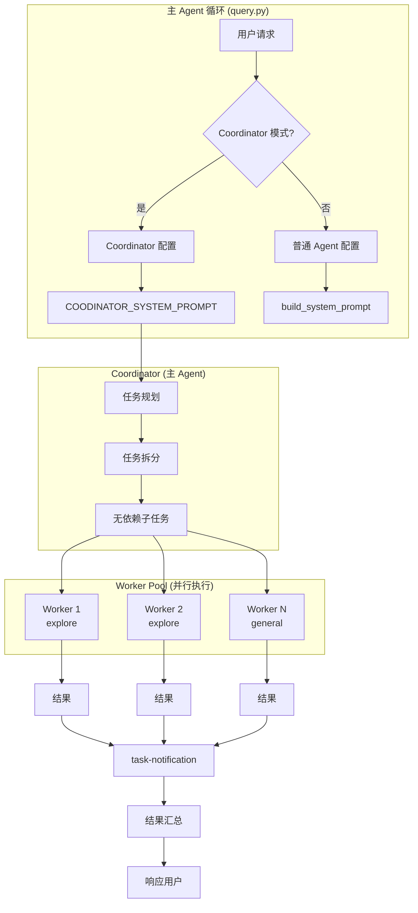
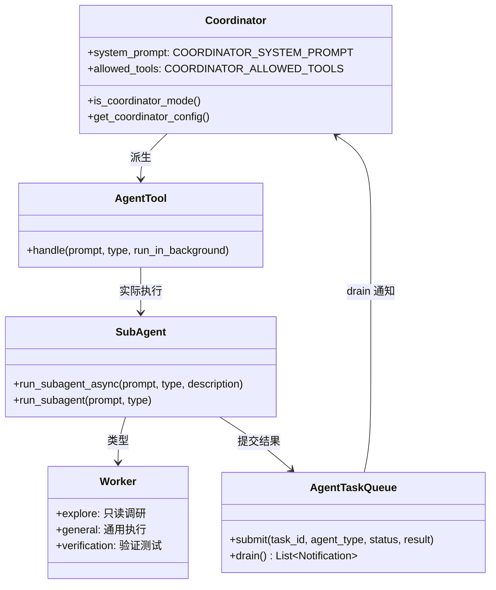
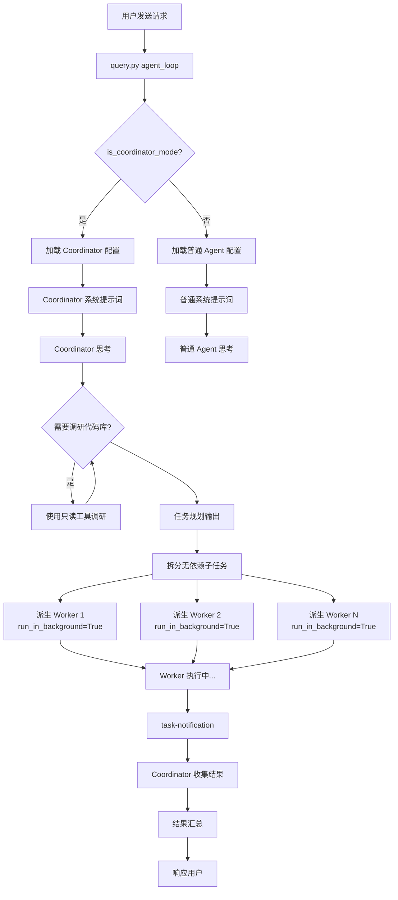
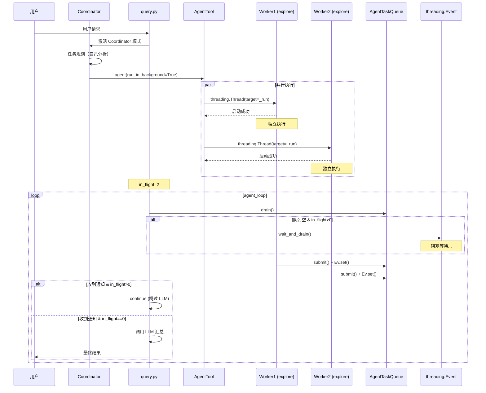
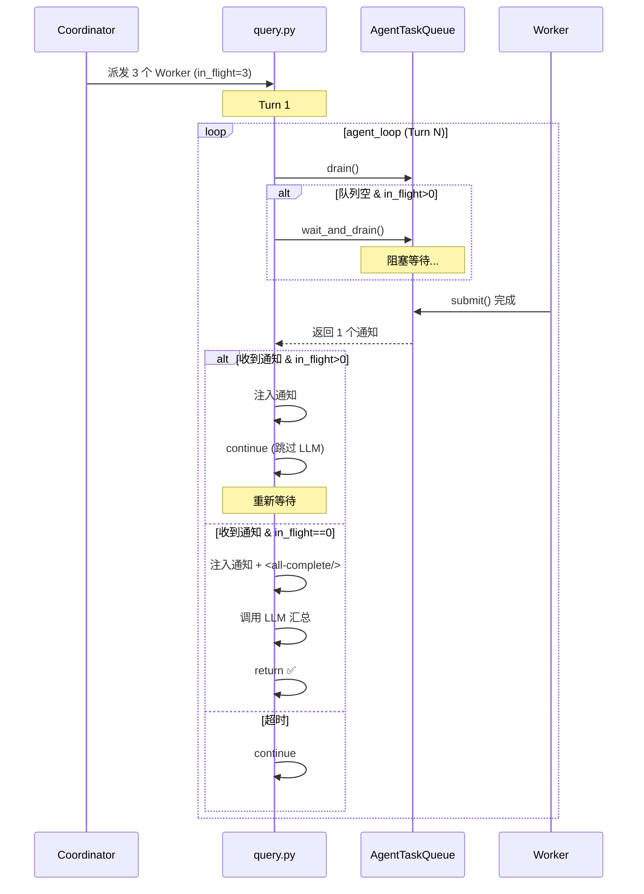
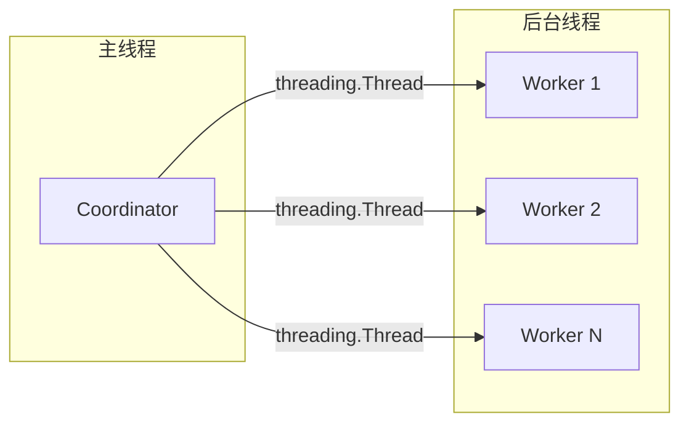
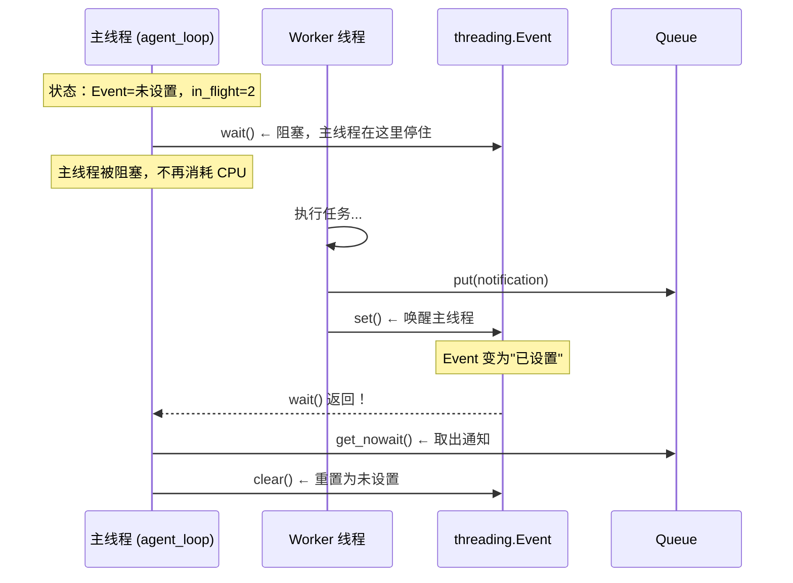
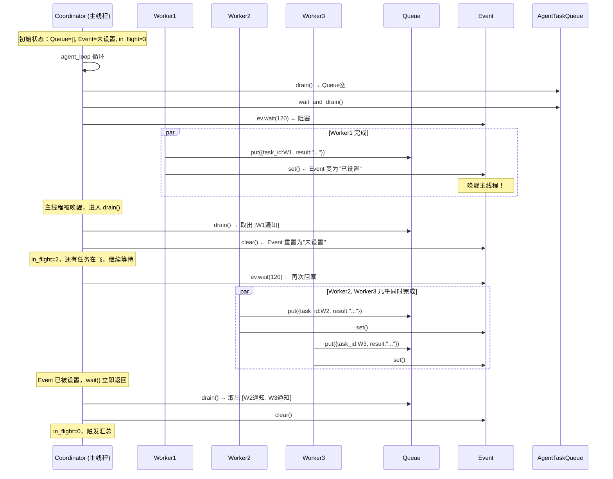
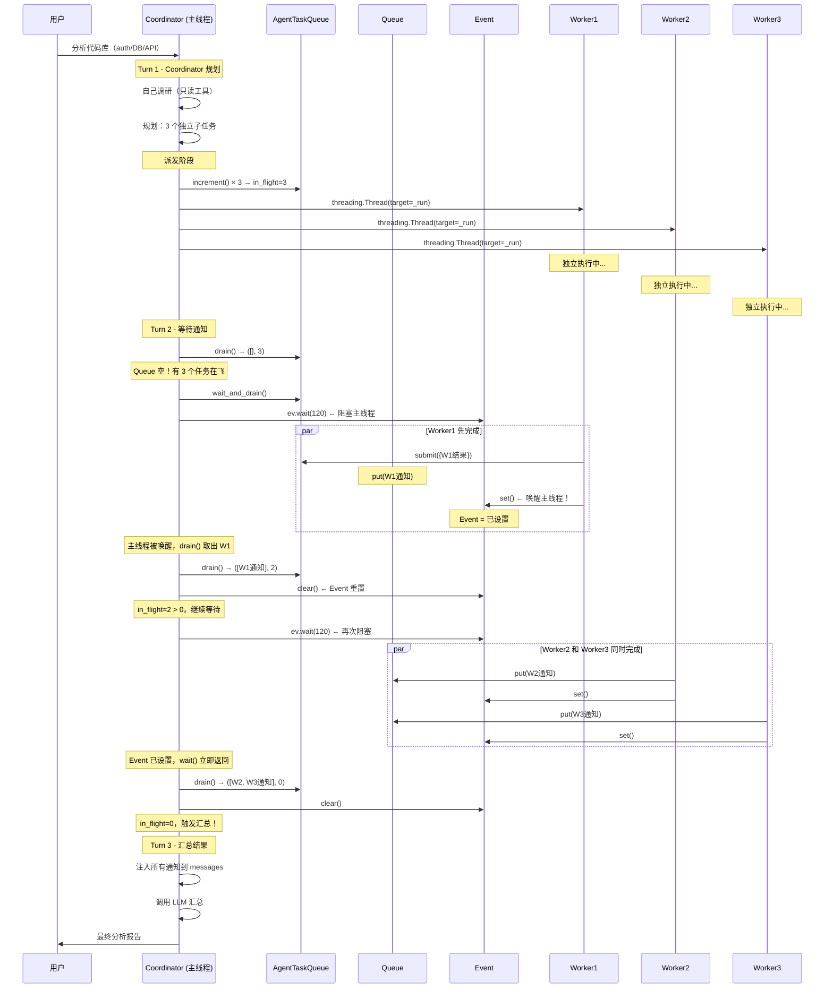

# Coordinator 协调者模式详解

## 一、概述

Coordinator（协调者）模式是主 Agent 的一种运行模式，通过环境变量 `COORDINATOR_MODE=1` 激活。

**核心思想**：协调者负责任务规划，将复杂任务拆分为无依赖的子任务，并行派生 Worker 执行，最后汇总结果响应用户。

---

## 二、系统架构

### 2.1 架构图



### 2.2 组件关系图



---

## 三、总体工作流程

### 3.1 完整流程图



### 3.2 时序图（并行执行）



---

## 四、通信机制

### 4.1 核心组件

| 组件 | 文件 | 职责 |
|------|------|------|
| `AgentTool.handle()` | `tools/AgentTool.py` | 统一入口，路由到 SubAgent |
| `run_subagent_async()` | `agents/subagent.py` | 异步执行，后台线程 |
| `AgentTaskQueue` | `agents/task_queue.py` | 任务队列，存储/通知结果 |
| `task-notification` | query.py | 结果注入到消息列表 |

### 4.2 通信流程（代码解析）

#### 1. Coordinator 派生 Worker

```python
# tools/AgentTool.py - AgentTool.handle() 被调用
def handle(
    prompt: str,
    description: str = "",
    type: str = "general",
    run_in_background: bool = False,
) -> str:
    config = get_agent_config(type)
    should_async = run_in_background or config.get("background", False)

    if should_async:
        from agents.subagent import run_subagent_async
        return run_subagent_async(prompt, type, description)
```

**日志输出**：
```
[Coordinator] 启动 Worker: 分析认证系统 (type: explore, id: agent-a1b2c3d4)
```

#### 2. 异步 Worker 后台执行 + 计数追踪

```python
# agents/subagent.py - run_subagent_async()

def run_subagent_async(prompt, agent_type, description):
    task_id = f"agent-{uuid.uuid4().hex[:8]}"

    # 派发时 +1（追踪进行中数量）
    state.agent_tasks.increment()

    def _run():
        try:
            result = run_subagent(prompt, agent_type)
            # 完成后提交结果到队列
            state.agent_tasks.submit(task_id, agent_type, "completed", result[:2000])
        except Exception as e:
            state.agent_tasks.submit(task_id, agent_type, "error", str(e))

    threading.Thread(target=_run, daemon=True).start()
```

#### 3. 结果通知到 Coordinator（含进行中计数）

```python
# query.py - agent_loop() 中收集通知

# 异步 Agent 通知
if state.agent_tasks:
    # drain() 返回 (通知列表, 仍在执行的数量)
    agent_notifs, in_flight = state.agent_tasks.drain()
    if agent_notifs:
        parts = []
        for n in agent_notifs:
            parts.append(
                f"<task-notification>\n"
                f"  <task-id>{n['task_id']}</task-id>\n"
                f"  <type>{n['agent_type']}</type>\n"
                f"  <status>{n['status']}</status>\n"
                f"  <result>{n['result']}</result>\n"
                f"</task-notification>"
            )
        # 告知 Coordinator 还有多少 Worker 在执行
        if in_flight > 0:
            parts.append(f"<in-flight-count>{in_flight}</in-flight-count>")
        msg = {"role": "user", "content": "\n".join(parts)}
        messages.append(msg)
```

### 4.3 消息标签

```xml
<!-- Coordinator 收到的消息格式 -->

<!-- 部分 Worker 完成，仍有 Worker 在执行 -->
<task-notification>...</task-notification>
<in-flight-count>2</in-flight-count>

<!-- 所有 Worker 都完成了 -->
<task-notification>...</task-notification>
<all-complete/>
```

Coordinator 根据标签判断：
- **`<in-flight-count>N`**：还有 N 个 Worker 在执行，继续等待
- **`<all-complete/>`**：所有 Worker 都完成了，触发汇总

### 4.4 阻塞等待机制

**问题**：协调者派发异步子任务后，可能出现：
1. 通知还没到达（Worker 还在跑）
2. 收到部分通知，但还有任务在飞，LLM 回复纯文本"我正在等待"

**解决方案**：

1. **阻塞等待**：没有通知但有任务在飞时，阻塞等待直到有通知
2. **部分结果处理**：收到通知后，如果还有任务在飞，跳过 LLM 调用继续等待
3. **只有全部完成才调用 LLM**：当 `in_flight == 0` 时才进行汇总

```python
# query.py - agent_loop() 循环顶部

if state.agent_tasks and is_coordinator_mode():
    agent_notifs, in_flight = state.agent_tasks.drain()
    has_new_notifications = bool(agent_notifs)

    # 没有通知但有任务在飞 → 阻塞等待
    if not has_new_notifications and in_flight > 0:
        print(f"[Coordinator] 等待 {in_flight} 个 Worker 完成...")
        agent_notifs, in_flight = state.agent_tasks.wait_and_drain(timeout=120)

        if not agent_notifs:
            print(f"[Coordinator] 等待超时，继续等待...")
            continue

        has_new_notifications = True

    # 收到通知 → 注入消息
    if agent_notifs:
        # 注入 task-notification 到 messages
        ...

    # 关键修复：收到通知但还有任务在飞 → 跳过 LLM 调用
    if has_new_notifications and in_flight > 0:
        print(f"[Coordinator] 已收集结果，仍有 {in_flight} 个任务在运行，继续等待...")
        continue
```

**工作流程**：



**关键设计**：
- **只 drain() 一次**：在循环顶部 drain()，避免重复调用导致通知丢失
- **has_new_notifications 标志**：记录是否收到过通知
- **continue 跳过 LLM**：收到部分结果但还有任务在飞时，不调用 LLM 避免过早汇总

### 4.6 AgentTaskQueue 实现

```python
# agents/task_queue.py

class AgentTaskQueue:
    def __init__(self):
        self._results: Queue = Queue()
        self._in_flight: int = 0  # 进行中的任务计数
        self._lock = threading.Lock()
        self._event = threading.Event()  # 有新通知时 set()

    def increment(self):
        """派发 Worker 时调用，计数 +1"""
        with self._lock:
            self._in_flight += 1

    def submit(self, task_id: str, agent_type: str, status: str, result: str):
        """Worker 完成时调用，提交结果并唤醒等待者"""
        with self._lock:
            self._results.put({
                "task_id": task_id,
                "agent_type": agent_type,
                "status": status,
                "result": result,
            })
            self._in_flight = max(0, self._in_flight - 1)
            self._event.set()  # 唤醒阻塞等待者

    def wait_and_drain(self, timeout: float = 120) -> tuple[list, int]:
        """
        阻塞等待直到有通知到达，然后返回所有待处理的通知。
        用于 Coordinator 模式：没有通知但还有任务在执行时，阻塞等待。
        """
        self._event.wait(timeout=timeout)
        return self.drain()

    def drain(self) -> tuple[list, int]:
        """获取所有通知并返回剩余进行中的任务数"""
        with self._lock:
            notifications = []
            while not self._results.empty():
                notifications.append(self._results.get_nowait())
            self._in_flight = max(0, self._in_flight)
            if self._results.empty():
                self._event.clear()
            return notifications, self._in_flight
```

---

## 五、提示词工程

### 5.1 Coordinator 系统提示词

位置：`agents/coordinator.py::COORDINATOR_SYSTEM_PROMPT`

```python
COORDINATOR_SYSTEM_PROMPT = """\
You are an Orchestrator — a project manager that decomposes complex requests \
into independent sub-tasks, delegates to Workers, and synthesizes results.

## YOUR RESPONSIBILITIES

1. **Plan**: Analyze request, decompose into independent sub-tasks
2. **Delegate**: Spawn Workers to execute sub-tasks in parallel
3. **Synthesize**: Collect results and present final output to user

## DECOMPOSITION RULES

**CRITICAL**: Sub-tasks must be truly independent:
- Each Worker works on DIFFERENT files or topics
- No Worker waits for another Worker
- Each outputs a self-contained result

**If tasks have dependencies, they CANNOT run in parallel.**

## DELEGATION

- Use `agent(run_in_background=True)` for parallel execution
- Provide each Worker: task description, target files, expected output

## RESULT SYNTHESIS

After Workers complete, check for these tags:
- `<in-flight-count>N</in-flight-count>`: N Workers still running, WAIT for more
- `<all-complete/>`: ALL Workers done, proceed to synthesize immediately

**IMPORTANT**: When you see `<all-complete/>`, do NOT wait — synthesize and respond immediately.

## PARALLEL EXAMPLE

User: "Analyze this codebase: auth system, database, API, tests"

Output:
```
1. [Worker: explore] Analyze auth system
   - Files: auth/*.py
   - Output: Auth architecture summary

2. [Worker: explore] Analyze database models
   - Files: models/*.py, db/*.py
   - Output: DB schema summary

3. [Worker: explore] Analyze API endpoints
   - Files: api/*.py, routes/*.py
   - Output: API inventory

4. [Worker: explore] Analyze test coverage
   - Files: tests/*.py
   - Output: Test status report

PARALLEL: All 4 tasks — no dependencies, different files
```
"""
```

### 5.2 提示词设计要点

| 要点 | 说明 |
|------|------|
| **职责明确** | Plan → Delegate → Synthesize 三步走 |
| **无依赖强调** | CRITICAL 标记，子任务必须独立 |
| **并行示例** | 给出 4 个调研任务的完整示例 |
| **工具约束** | 强调用 `run_in_background=True` |
| **汇流判断** | `<in-flight-count>` 等待，`<all-complete/>` 立即汇总 |

### 5.3 Worker 类型对比

| 类型 | 工具集 | 适用场景 | 异步默认 |
|------|--------|---------|---------|
| `explore` | READ_ONLY_TOOLS | 调研、分析 | 否 |
| `general` | GENERAL_TOOLS | 任意任务 | 否 |
| `verification` | READ_ONLY_TOOLS | 验证、测试 | **是** |

---

## 六、并行化实现

### 6.1 并行原理



### 6.2 异步编程实现

```python
# agents/subagent.py - 并行执行核心

import threading
import uuid

def run_subagent_async(
    prompt: str,
    agent_type: str = "general",
    description: str = "",
) -> str:
    task_id = f"agent-{uuid.uuid4().hex[:8]}"

    def _run():
        # 后台线程执行
        result = run_subagent(prompt, agent_type)
        # 结果存入共享队列
        state.agent_tasks.submit(task_id, agent_type, "completed", result[:2000])

    # 启动后台线程
    threading.Thread(target=_run, daemon=True).start()
    return f"Worker started (id: {task_id})"
```

**关键点**：
- `daemon=True`：主线程退出时自动销毁
- `state.agent_tasks.submit()`：结果存入队列，不阻塞
- `Event.wait()`：主线程阻塞等待，直到 Worker 完成

### 6.3 完整工作流程

```python
# agents/subagent.py - Worker 执行
def run_subagent_async(prompt, agent_type, description):
    task_id = f"agent-{uuid.uuid4().hex[:8]}"
    state.agent_tasks.increment()  # 计数 +1

    def _run():
        result = run_subagent(prompt, agent_type)
        state.agent_tasks.submit(task_id, agent_type, "completed", result)

    threading.Thread(target=_run, daemon=True).start()

# query.py - 主线程等待
while True:
    agent_notifs, in_flight = state.agent_tasks.drain()

    if not agent_notifs and in_flight > 0:
        # 阻塞等待，直到有通知
        agent_notifs, in_flight = state.agent_tasks.wait_and_drain(timeout=120)
        if not agent_notifs:
            continue

    if agent_notifs:
        # 注入通知到 messages
        ...

    if has_new_notifications and in_flight > 0:
        continue  # 跳过 LLM 调用，继续等待

    # 调用 LLM 汇总
    response = state.llm.chat(...)
```

---

## 七、threading 与 Queue 机制

### 7.1 什么是 threading（线程）

**线程**是操作系统调度的最小单位，一个进程可以包含多个线程。同一进程内的线程共享内存空间，可以直接访问相同的数据。

**为什么需要线程？**
- **并发执行**：当一个任务需要等待 I/O（如网络请求、文件读写）时，CPU 空闲。此时可以启动新线程处理其他任务。
- **不阻塞主循环**：主线程（agent_loop）不会被 Worker 的执行时间阻塞。

**threading.Thread 的关键参数**：

```python
import threading

# 创建一个线程
t = threading.Thread(target=worker_function, args=(arg1, arg2))

# daemon=True：主线程退出时，子线程自动销毁
t.daemon = True

# 启动线程
t.start()
```

### 7.2 什么是 Queue（队列）

**队列**是线程安全的 FIFO（先进先出）数据结构。多个线程可以安全地往队列中添加或取出数据，无需额外的锁。

**为什么需要 Queue？**
- **线程间通信**：Worker 线程执行完成后，需要一种方式通知主线程。"放入队列"是一种优雅的方案。
- **解耦**：Worker 不需要知道谁在等待结果，只需要把结果放入队列。

**queue.Queue 的关键 API**：

```python
from queue import Queue

q = Queue()

# 放入数据（阻塞，直到队列有空位）
q.put(item)

# 取出数据（阻塞，直到队列有数据）
item = q.get()

# 非阻塞取出（如果没有数据，立即抛出 Empty 异常）
item = q.get_nowait()

# 检查是否为空
q.empty()
```

### 7.3 threading.Event（事件）— 核心唤醒机制

**事件**是一种简单的同步原语。一个线程等待事件被"设置"，另一个线程可以设置事件。

**为什么需要 Event？**
- **阻塞等待**：主线程调用 `event.wait()` 阻塞自己，直到 Worker 完成并调用 `event.set()`。
- **唤醒机制**：`wait()` 会阻塞，直到另一个线程调用 `set()`。
- **节省 CPU**：不同于轮询，阻塞等待不消耗 CPU 资源。

**Event 的关键 API**：

```python
import threading

event = threading.Event()

# 等待事件（阻塞，直到事件被设置）
event.wait()  # 可以设置超时：event.wait(timeout=5)

# 设置事件（唤醒等待的线程）
event.set()

# 清除事件（恢复为未设置状态）
event.clear()
```

### 7.4 Event 在项目中的实际使用

```python
# agents/task_queue.py

class AgentTaskQueue:
    def __init__(self):
        self._results: Queue = Queue()
        self._in_flight: int = 0
        self._lock = threading.Lock()
        self._event = threading.Event()  # ① 创建事件（初始为未设置状态）

    def submit(self, task_id, agent_type, status, result):
        """Worker 完成后调用"""
        with self._lock:
            self._results.put({...})  # 把通知数据放入 Queue
            self._in_flight -= 1
            self._event.set()  # ② Worker 调用 set()，唤醒主线程

    def wait_and_drain(self, timeout=120):
        """主线程调用"""
        self._event.wait(timeout=timeout)  # ③ 主线程阻塞等待
        return self.drain()
```

**Event.set() 的特点**：可以多次调用，都是有效的。如果 Worker 1 和 Worker 2 都完成了，它们各自调用一次 `set()`，效果等同于调用一次。

**完整工作流程**：



### 7.5 Queue 和 Event 的完整协作流程

#### 灵魂拷问：有了 Event 为什么还需要 Queue？

**Event 的作用**：通知"有数据到达了"（唤醒阻塞的主线程）
**Queue 的作用**：存储"具体的数据内容"（Worker 提交的通知正文）

两者缺一不可：
- **只有 Event**：线程醒了，但不知道数据在哪
- **只有 Queue**：无法高效阻塞等待，必须轮询

#### 完整流程（多 Worker 场景）

假设派发了 3 个 Worker，它们完成时间不同。完整流程：



**关键点**：
1. **主线程只在 Event 处阻塞一次**：第一个 Worker 完成时 `set()`，主线程立即唤醒
2. **drain() 一次性取出所有通知**：无论有多少通知在 Queue 里，每次 drain() 都全部取出
3. **Event 可以多次 set()**：Worker 2 和 Worker 3 都调用 `set()`，但 Event 已经设置了，不会重复阻塞

#### 代码对应关系

```python
# query.py - agent_loop() 完整流程

while True:
    # 1. 非阻塞尝试获取通知（Queue 空时立即返回）
    agent_notifs, in_flight = state.agent_tasks.drain()

    # 2. 没有通知但还有任务在飞 → 阻塞等待
    if not agent_notifs and in_flight > 0:
        agent_notifs, in_flight = state.agent_tasks.wait_and_drain(timeout=120)
        # 内部调用：self._event.wait(timeout) 阻塞主线程
        # Worker 完成时调用：self._event.set() 唤醒主线程

        if not agent_notifs:
            continue  # 超时，重新尝试 drain()

    # 3. 注入通知到 messages
    if agent_notifs:
        for n in agent_notifs:
            messages.append(f"<task-notification>...</task-notification>")

    # 4. 仍有任务在飞，跳过 LLM 调用，继续等待
    if in_flight > 0:
        continue

    # 5. 所有任务完成，调用 LLM 汇总
    response = state.llm.chat(...)
```

### 7.6 为什么 Event 不能替代 Queue？

假设只用 Event（不用 Queue）：

```python
# 错误设计：不用 Queue
class BrokenTaskQueue:
    def __init__(self):
        self._event = threading.Event()
        self._data = None  # 只能存一份数据！

    def submit(self, result):
        self._data = result  # 新数据覆盖旧数据
        self._event.set()

    def wait_and_get(self):
        self._event.wait()
        return self._data  # 只能返回一份数据！
```

**问题**：如果 Worker 1 先完成，Worker 2 后完成，`_data` 会被覆盖，Worker 1 的结果丢失。

**Queue 的优势**：FIFO 队列，可以存储任意数量的通知，按顺序取出，不丢失。

### 7.7 AgentTaskQueue 中的协同工作

| API | 模块 | 作用 | 输入 | 输出 |
|-----|------|------|------|------|
| `threading.Thread(target=func)` | threading | 创建线程 | `target`: 执行的函数 | Thread 对象 |
| `thread.start()` | threading | 启动线程 | 无 | - |
| `threading.Lock()` | threading | 创建锁 | 无 | Lock 对象 |
| `with lock:` | threading | 自动管理锁 | 无 | - |
| `queue.Queue()` | queue | 创建线程安全队列 | 无 | Queue 对象 |
| `queue.put(item)` | queue | 放入数据（阻塞） | 任意对象 | - |
| `queue.get()` | queue | 取出数据（阻塞） | 无 | 取出的对象 |
| `queue.get_nowait()` | queue | 非阻塞取出 | 无 | 取出的对象或 Empty |
| `queue.empty()` | queue | 检查队列是否为空 | 无 | bool |
| `threading.Event()` | threading | 创建事件 | 无 | Event 对象 |
| `event.wait(timeout)` | threading | 等待事件（可超时） | timeout: 秒 | bool（是否超时） |
| `event.set()` | threading | 设置事件（唤醒） | 无 | - |
| `event.clear()` | threading | 清除事件 | 无 | - |

### 7.6 AgentTaskQueue 完整代码

```python
# agents/task_queue.py

class AgentTaskQueue:
    """
    三个组件各司其职：
    - Queue: 存放通知数据（可能多个 Worker 同时完成）
    - in_flight: 计数（追踪还有多少 Worker 在执行）
    - Event: 同步原语（唤醒阻塞等待的主线程）
    """

    def __init__(self):
        self._results: Queue = Queue()      # 存放通知的队列
        self._in_flight: int = 0            # 进行中的任务计数
        self._lock = threading.Lock()        # 保护 _in_flight
        self._event = threading.Event()       # 唤醒主线程

    def increment(self):
        """派发 Worker 时调用，计数 +1"""
        with self._lock:
            self._in_flight += 1

    def submit(self, task_id, agent_type, status, result):
        """Worker 完成后调用：放入数据 + 唤醒主线程"""
        with self._lock:
            self._results.put({
                "task_id": task_id,
                "agent_type": agent_type,
                "status": status,
                "result": result,
            })
            self._in_flight -= 1
            self._event.set()  # ← 唤醒主线程

    def drain(self) -> tuple[list, int]:
        """非阻塞获取：返回所有已到达的通知 + 剩余进行中的任务数"""
        with self._lock:
            notifications = []
            while not self._results.empty():
                notifications.append(self._results.get_nowait())
            if self._results.empty():
                self._event.clear()
            return notifications, self._in_flight

    def wait_and_drain(self, timeout=120) -> tuple[list, int]:
        """阻塞等待：等待 Event 被 set() 后，返回所有已到达的通知"""
        self._event.wait(timeout=timeout)  # ← 阻塞主线程
        return self.drain()
```

### 7.7 全流程梳理（从派发到汇总）

以下是多 Worker 并行执行的完整时序：



### 7.8 关键设计思想

| 问题 | 解答 |
|------|------|
| **Queue 存什么？** | `submit()` 时放入 dict：`{task_id, agent_type, status, result}` |
| **何时放入？** | Worker 执行完成时，在 `_run()` 线程内调用 |
| **何时取出？** | 主线程在 `drain()` 或 `wait_and_drain()` 时取出 |
| **为什么需要 Queue？** | Event 只能发出"有数据"的信号，数据本身要存在 Queue 里 |
| **主线程会被多次阻塞吗？** | 不会。每个 Worker 完成只触发一次 `set()`，主线程唤醒后一次性用 `drain()` 取完所有通知。下一个 Worker 完成时再次 `set()`，主线程再次阻塞 → 唤醒 → drain() 取完。 |
| **一个 Worker 完成 vs 两个 Worker 同时完成** | 无区别。`drain()` 会一次性取出 Queue 里所有通知，无论来自几个 Worker。 |

### 7.9 为什么 Event 不能替代 Queue？

假设只用 Event（不用 Queue）：

```python
# 错误设计：不用 Queue
class BrokenTaskQueue:
    def __init__(self):
        self._event = threading.Event()
        self._data = None  # 只能存一份数据！

    def submit(self, result):
        self._data = result  # 新数据覆盖旧数据
        self._event.set()

    def wait_and_get(self):
        self._event.wait()
        return self._data  # 只能返回一份数据！
```

**问题**：如果 Worker 1 先完成，Worker 2 后完成，`_data` 会被覆盖，Worker 1 的结果丢失。

**Queue 的优势**：FIFO 队列，可以存储任意数量的通知，按顺序取出，不丢失。

### 7.10 项目中使用的 API 汇总

| API | 模块 | 作用 |
|-----|------|------|
| `threading.Thread(target=func)` | threading | 创建后台线程 |
| `thread.start()` | threading | 启动线程 |
| `queue.Queue()` | queue | 创建线程安全 FIFO 队列 |
| `queue.put(item)` | queue | 放入数据（线程安全） |
| `queue.get_nowait()` | queue | 非阻塞取出数据 |
| `queue.empty()` | queue | 检查队列是否为空 |
| `threading.Lock()` | threading | 创建锁（保护计数器） |
| `threading.Event()` | threading | 创建事件（同步原语） |
| `event.wait(timeout)` | threading | 阻塞等待（可超时） |
| `event.set()` | threading | 设置事件（唤醒等待者） |
| `event.clear()` | threading | 清除事件（重置状态） |

### 7.11 阻塞等待 vs 轮询

**轮询方式（低效）**：
```python
while True:
    notifs = queue.get_nowait()  # 非阻塞获取
    if notifs:
        # 处理通知
    else:
        time.sleep(1)  # CPU 空转等待
        continue
```

**阻塞等待方式（高效）**：
```python
while True:
    notifs = queue.get()  # 阻塞，直到有数据
    # 处理通知
```

| 方式 | CPU 消耗 | 响应延迟 |
|------|---------|---------|
| 轮询 | 高（持续空转） | 最大 1 秒 |
| Event + Queue | 极低（睡眠状态） | 几乎立即 |

---

## 八、日志系统

### 8.1 日志级别与格式

| 阶段 | 日志格式 | 颜色 |
|------|---------|------|
| 启动 Worker | `[Coordinator] 启动 Worker: {任务} (type: {类型}, id: {ID})` | 青色 |
| 执行中 | `[Worker:{类型}] 任务进行中... (id: {ID})` | 黄色 |
| 完成 | `[Worker:{类型}] 完成 (id: {ID})` | 绿色 |
| 失败 | `[Worker:{类型}] 失败: {错误} (id: {ID})` | 红色 |
| 通知 | `✓ Agent [{类型}] {状态}` | 紫色 |

### 8.2 示例输出

```
用户: 分析这个代码库的认证系统、数据库模型、API接口

[Coordinator] 启动 Worker: 分析认证系统 (type: explore, id: agent-a1b2c3d4)
[Coordinator] 启动 Worker: 分析数据库模型 (type: explore, id: agent-e5f6g7h8)
[Coordinator] 启动 Worker: 分析API接口 (type: explore, id: agent-i9j0k1l2)

[Worker:explore] 任务进行中... (id: agent-a1b2c3d4)
[Worker:explore] 任务进行中... (id: agent-e5f6g7h8)
[Worker:explore] 任务进行中... (id: agent-i9j0k1l2)

  ✓ Agent [explore] completed
  ✓ Agent [explore] completed
  ✓ Agent [explore] completed
```

---

## 九、工具白名单

### 9.1 Coordinator 工具集

```python
COORDINATOR_ALLOWED_TOOLS = frozenset({
    "agent",         # 派生 Worker
    "read_file",     # 读取文件（规划阶段调研）
    "list_files",    # 列出文件（规划阶段调研）
    "grep_search",   # 搜索代码（规划阶段调研）
    "run_shell",     # 运行命令（规划阶段调研）
})
```

**约束**：`write_file` 和 `edit_file` 不在白名单中，Coordinator 不直接修改文件。

### 9.2 工具集过滤

```python
# query.py - 模式切换时过滤工具

if is_coordinator_mode():
    coord_config = get_coordinator_config()
    allowed = coord_config["allowed_tools"]
    # 只保留白名单中的工具
    tool_defs = [d for d in all_defs if d["name"] in allowed]
    tool_handlers = {k: v for k, v in all_handlers.items() if k in allowed}
```

---

## 十、后续优化方向

| 方向 | 说明 | 优先级 |
|------|------|--------|
| **任务依赖分析** | 智能分析任务间的依赖关系，自动决定串行/并行 | 高 |
| **动态调整** | 根据负载动态调整 Worker 数量 | 中 |
| **结果缓存** | 相同任务避免重复执行 | 中 |
| **超时处理** | Worker 执行超时时的重试/取消机制 | 中 |
| **进度展示** | 更详细的任务进度展示 | 低 |
| **Fork 模式** | 引入 Claude Code 的 Fork 模式，支持上下文继承 | 低 |

---

## 十一、总结速记表

### 11.1 核心概念

| 概念 | 说明 |
|------|------|
| Coordinator | 主 Agent 的一种模式，负责规划+分发+汇总 |
| Worker | 子 Agent，执行具体子任务 |
| task-notification | Worker 完成后的结果通知 |
| AgentTaskQueue | 结果队列，连接 Worker 和 Coordinator |

### 11.2 激活方式

```bash
COORDINATOR_MODE=1 python main.py
```

### 11.3 工具集

| 工具 | Coordinator | Worker (explore) | Worker (general) |
|------|-------------|------------------|------------------|
| agent | ✅ | - | - |
| read_file | ✅ | ✅ | ✅ |
| list_files | ✅ | ✅ | ✅ |
| grep_search | ✅ | ✅ | ✅ |
| run_shell | ✅ | ✅ | ✅ |
| write_file | ❌ | ❌ | ✅ |
| edit_file | ❌ | ❌ | ✅ |

### 11.4 工作流程

```
1. Coordinator 接收请求
2. 自己调研代码库（只读工具）
3. 规划并拆分无依赖子任务
4. 派生多个 Worker 并行执行 (run_in_background=True)
   - increment() 计数 +1
5. 每轮调用 drain() 获取通知
   - drain() 返回 (notifications, in_flight)
6. 如 in_flight > 0，等待；如 in_flight == 0，触发汇总
7. 汇总结果并响应用户
```

### 11.5 并行条件

| 条件 | 说明 |
|------|------|
| 无文件冲突 | 子任务操作不同文件 |
| 无依赖关系 | 一个任务不依赖另一个的结果 |
| 独立上下文 | 每个 Worker 有独立的 prompt |

### 11.6 适用场景

| 适合 | 不适合 |
|------|--------|
| 调研任务（代码分析、审计） | 强依赖的复杂重构 |
| 并行文档生成（不同章节） | 需要共享上下文的实现 |
| 多模块独立分析 | 顺序执行的验证任务 |

---

## 附录：文件索引

| 文件 | 职责 |
|------|------|
| `agents/coordinator.py` | Coordinator 模式配置和提示词 |
| `agents/subagent.py` | SubAgent 执行逻辑和日志 |
| `agents/task_queue.py` | AgentTaskQueue 任务队列 |
| `agents/definitions.py` | Worker 类型定义 |
| `tools/AgentTool.py` | agent 工具入口 |
| `query.py` | 主循环，模式切换，通知收集 |
