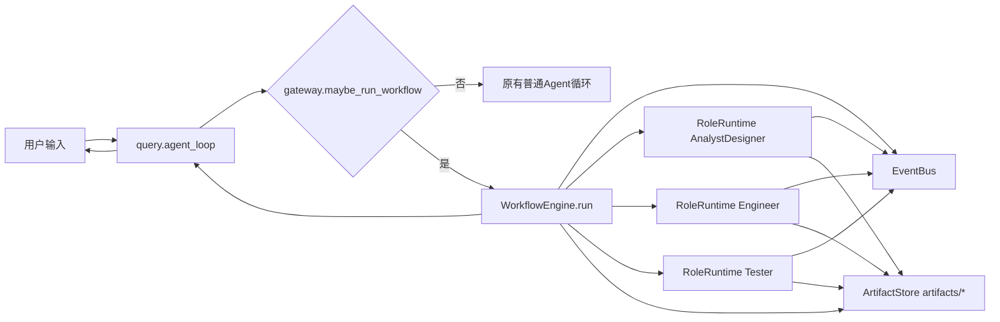
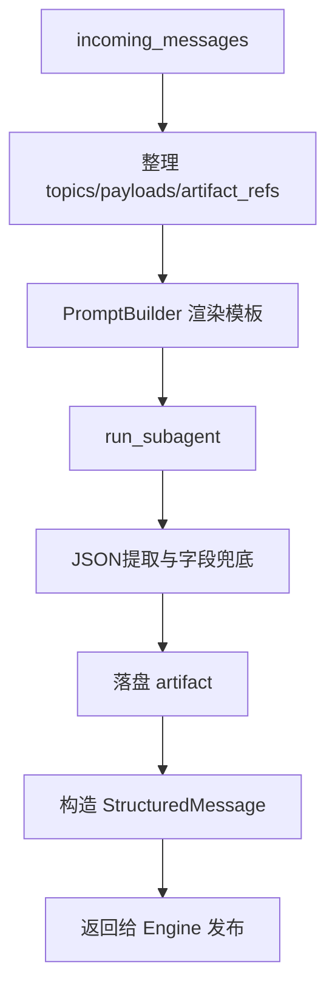

# MetaGPT简化版多Agent协作模式实现详解（模块化重排版）

本文不再按“1、2、3、4”碎片化讲流程，而是按真实代码模块组织。
你可以把它当成一份“读代码导航手册”：每个模块内集中讲职责、状态、关键函数、数据流、故障点。

---

## 文档导航（按模块）

1. 运行全景：一次请求如何穿过系统
2. 入口与路由模块：query + gateway
3. 编排引擎模块：WorkflowEngine
4. 通信总线模块：EventBus（订阅发布实现细节）
5. 角色执行模块：RoleRuntime（prompt -> subagent -> message）
6. 结构化输出模块：structured_output（畸形输出兜底）
7. 公共工作空间模块：ArtifactStore（内存空间 + 磁盘空间）
8. 配置与扩展模块：loader + defaults + custom registry
9. 提示词构建模块：PromptBuilderForWorkflow
10. 终态与故障治理模块：失败回路、升级、停机条件
11. 可观测与调试模块：event_log、artifact、最小排障路径
12. 真实运行快照与故障注入

---

## 运行全景：一次请求如何穿过系统



核心结论：

1. 主会话仍由 query 维持，workflow 是一个可选分支。
2. workflow 内部通信是“消息总线 + 文件引用”双通道。
3. 结束后控制权回到主会话，不会退出 REPL。

---

## 入口与路由模块：query + gateway

### 模块职责

1. 识别本轮输入是否触发 workflow。
2. 解析 workflow_id 与 requirement。
3. 执行 WorkflowEngine 并把结果转成可读回复。
4. 将控制权交回主循环。

### 触发规则

1. 显式命令：`/workflow [workflow_id] requirement`
2. 隐式开关：`SOP_MODE=1` 时把当前用户输入当 requirement

### 控制流关键点

```python
handled, workflow_reply = maybe_run_workflow(messages)
if handled:
    ...
    return tracker, breaker
```

这段意味着：命中 workflow 后，本轮普通工具循环不会继续；但只结束“本轮”，不会结束“会话”。

---

## 编排引擎模块：WorkflowEngine

对应职责：把各角色执行链串起来，并治理终止条件。

### 引擎启动阶段

在 `run(requirement, workflow_id)` 内做 4 件事：

1. 加载配置：`cfg = loader.load(workflow_id)`
2. 初始化运行组件：`EventBus`、`ArtifactStore`、`PromptBuilderForWorkflow`
3. 为每个角色创建 `RoleRuntime`
4. 注册订阅关系并发布初始消息 `user.requirement`

### 引擎循环阶段

```python
for _ in range(cfg.max_steps):
    for role in cfg.roles:
        incoming = bus.consume(role.name)
        if not incoming:
            continue
        produced = runtimes[role.name].execute(...)
        for msg in produced:
            bus.publish(msg)
            ...终态判断/失败治理...
```

语义重点：

1. 串行轮次推进，不是并行 worker。
2. 每个角色一轮内消费“当前 inbox 全量消息”。
3. 角色产物通过 publish 回流总线，驱动下游。

### 引擎终止条件

1. 命中终态 topic（默认：`test.passed`、`workflow.escalated`、`workflow.failed`）
2. 无任何角色有进展（`progressed=False`）
3. 达到 `max_steps`

---

## 通信总线模块：EventBus（订阅发布实现细节）

这是你最关心的通信核心。

### 内部状态结构

```python
self._subscriptions: dict[str, set[str]] = defaultdict(set)
self._inboxes: dict[str, deque[StructuredMessage]] = defaultdict(deque)
self._event_log: list[StructuredMessage] = []
```

对应含义：

1. `_subscriptions`：topic -> 角色集合
2. `_inboxes`：角色 -> 待消费消息队列
3. `_event_log`：全量发布日志（可回放）

### 订阅实现

```python
def subscribe(self, role_name: str, topics: list[str]) -> None:
    for topic in topics:
        self._subscriptions[topic].add(role_name)
```

要点：

1. 一个角色可订阅多个 topic。
2. set 保证不重复订阅。

### 发布实现

```python
def publish(self, message: StructuredMessage) -> None:
    self._event_log.append(message)
    role_names = set(self._subscriptions.get(message.topic, set()))
    role_names.update(self._subscriptions.get("*", set()))

    if message.send_to:
        role_names = {name for name in role_names if name in message.send_to}

    for role_name in role_names:
        self._inboxes[role_name].append(message)
```

逐步解释：

1. 先记日志，再路由，保证所有发布可追溯。
2. 精确 topic 匹配 + 通配 `*` 订阅。
3. `send_to` 非空时做二次过滤，实现定向投递。
4. 消息进入各角色 inbox，等待引擎下一次 consume。

### 消费实现

```python
def consume(self, role_name: str) -> list[StructuredMessage]:
    inbox = self._inboxes.get(role_name)
    if not inbox:
        return []
    items = list(inbox)
    inbox.clear()
    return items
```

语义是“批量取出并清空”，不会重复消费。

---

## 角色执行模块：RoleRuntime

RoleRuntime 是每个角色的统一执行壳层。

### 执行链



### execute 的关键分层

1. 上游消息展开：`incoming_topics / incoming_payloads / incoming_artifact_refs`
2. 提示词渲染：`prompt_builder.build_role_prompt(...)`
3. 角色执行：`run_subagent(prompt, role.agent_type, role.name)`
4. 结果保障：`_parse_output(raw_output)`
5. 持久化：`_persist_artifacts(parsed, raw_output)`
6. 消息构造：`_build_messages(parsed, artifact_refs)`

### Tester 特殊发布逻辑

Tester 不是固定发布默认 topic，而是判定：

```python
verdict = str(parsed.get("verdict", "fail")).strip().lower()
blocker_count = int(parsed.get("blocker_count") or 0)
is_passed = verdict == "pass" and blocker_count == 0
```

因此 `verdict=pass` 但 blocker 非 0 不会通过。

---

## 结构化输出模块：structured_output

目标：让 workflow 不被 LLM 输出抖动轻易打断。

### 三级保障

1. Prompt 层：模板要求“只输出一个 JSON 对象”。
2. 解析层：先找 fenced json，再尝试花括号截取。
3. 字段层：`ensure_fields` 补齐关键字段并附加 `raw_output`。

### 关键函数

1. `extract_json_object(text)`
2. `ensure_fields(data, required_fields, raw_text)`

### 结果语义

1. 即使解析失败，仍返回结构化字典。
2. 关键缺失字段被补默认值。
3. 原始输出被保留，便于回溯。

---

## 公共工作空间模块：ArtifactStore（内存 + 磁盘）

这一章直接回答“公共工作空间在哪里、放什么”。

### 磁盘公共空间

`ArtifactStore("artifacts")` 以工作目录为根，落盘路径在 `WORKDIR/artifacts/*`。

内部要点：

1. `safe_path` 约束写入边界，防路径逃逸。
2. 写入后返回 `WORKDIR` 相对路径，便于在消息里引用。

常见返回引用：

1. `artifacts/analysis/analysis_design.md`
2. `artifacts/code/delivery_manifest.json`
3. `artifacts/test/test_report.json`

### 内存公共空间

每次 `WorkflowEngine.run` 创建一个新的 `EventBus`，它就是该次运行的共享黑板：

1. 订阅表 `_subscriptions`
2. 角色 inbox `_inboxes`
3. 发布日志 `_event_log`

### 双通道通信模型

1. 语义通道：EventBus 传 `StructuredMessage`。
2. 大内容通道：artifact 文件 + `artifact_refs`。

这比“把所有内容塞 payload”更稳定，也更节省上下文。

---

## 配置与扩展模块：loader + defaults + custom registry

### 配置来源优先级

1. `.xiaoagent/workflows/pipelines`（自定义 pipeline）
2. `workflows/defaults/*.yaml`（内置默认）

### 默认三角色配置（metagpt-lite-3role）

1. AnalystDesigner：订阅 `user.requirement`，发布 `analysis.done`
2. Engineer：订阅 `analysis.done`、`test.failed`，发布 `code.submitted`
3. Tester：订阅 `code.submitted`，发布 `test.passed` 或 `test.failed`

### 角色覆盖机制

`agents/custom_registry.py` 支持从 `.xiaoagent/workflows/roles` 加载同名角色配置并覆盖。

---

## 提示词构建模块：PromptBuilderForWorkflow

### 职责

把 runtime 上下文拼成角色 prompt，避免拼接逻辑散落在代码中。

### 注入字段

1. requirement
2. incoming_topics
3. incoming_payloads
4. artifact_refs
5. fix_round / max_fix_rounds

### 好处

1. prompt 与执行逻辑解耦。
2. 模板可独立迭代。
3. 不改代码即可调角色行为。

---

## 终态与故障治理模块

### 失败回路

当收到 `test.failed`：

1. `fix_round += 1`
2. 未超上限：继续 Engineer -> Tester
3. 超上限：发布 `workflow.escalated` 并返回

### 终态判定

命中配置里的终态 topic 即立即返回结果。

### 停滞判定

一整轮没有任何角色消费消息时，判定无进展并停止。

---

## 可观测与调试模块

### 三个观测面

1. `WorkflowRunResult`：最终状态、终态 topic、产物清单
2. `event_log`：消息发布顺序与内容
3. `artifacts/*`：各角色结构化输出与 raw_output

### 最小排障路径

1. 看终态是 `passed/failed/escalated/stopped` 哪一种。
2. 看 `event_log` 最后一条消息的 topic/cause_by。
3. 看对应角色产物 json 是否字段异常。
4. 若 Tester 判定异常，先看 `test_report.json` 的 `raw_output`。

---

## 真实运行快照与故障注入

### 真实请求样例

请求：

```text
/workflow metagpt-lite-3role 为当前项目新增 /healthz 健康检查端点，并补充最小测试
```

典型 topic 演进：

1. `user.requirement`
2. `analysis.done`
3. `code.submitted`
4. `test.passed` 或 `test.failed`

典型产物演进：

1. `artifacts/analysis/*`
2. `artifacts/code/*`
3. `artifacts/test/*`

### 故障注入：Tester 输出畸形 JSON

注入示例：

```text
测试结果如下：
verdict: pass
blocker_count: zero
通过项：2
（没有合法JSON）
```

系统行为：

1. `extract_json_object` 返回 `None`
2. `ensure_fields` 补齐必填字段并保留 `raw_output`
3. Tester topic 判定走保守路径，通常发布 `test.failed`
4. 触发修复回路，避免误判通过

风险提示：当前 `blocker_count=int(...)` 若拿到非数字字符串可能抛异常，建议后续改为 try/except 并保守回退。

---

## 结语：这份实现的本质

这套 MetaGPT-lite 实现，本质是一个“可配置的串行事件编排器”：

1. 用 EventBus 做角色解耦通信。
2. 用 RoleRuntime 统一角色执行壳。
3. 用 ArtifactStore 把大内容外置，消息只传引用。
4. 用 structured_output 对抗 LLM 输出不稳定。
5. 用 fix_round 和终态 topic 做失败治理。

如果你按“模块职责 -> 状态结构 -> 关键函数 -> 观测面”阅读，就能不依赖源码也掌握实现细节。
