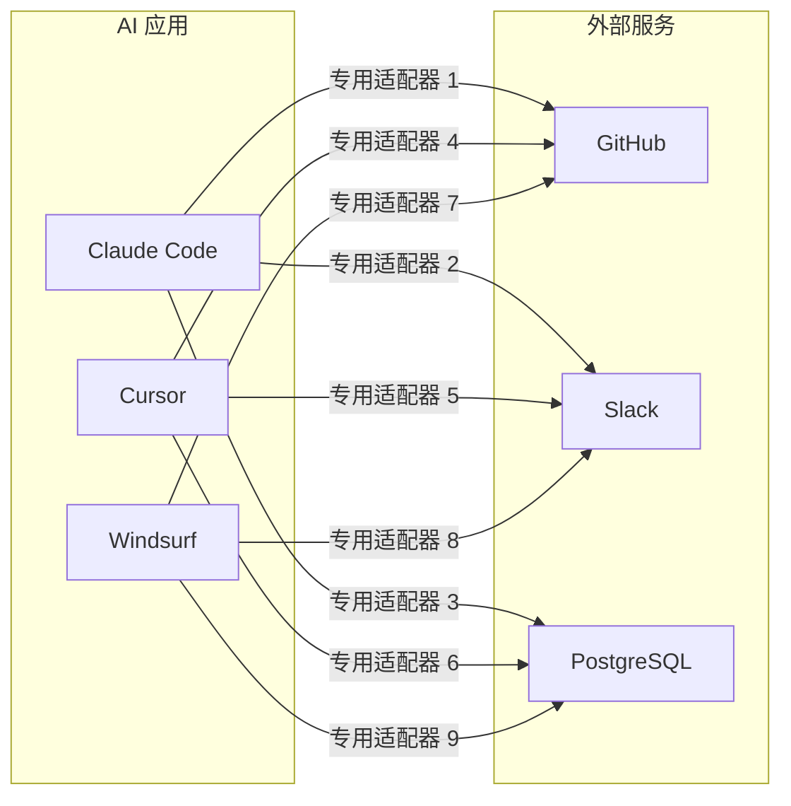
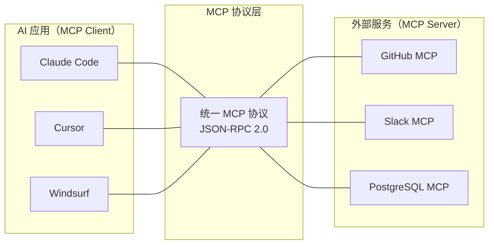
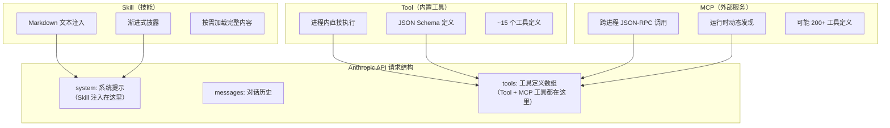
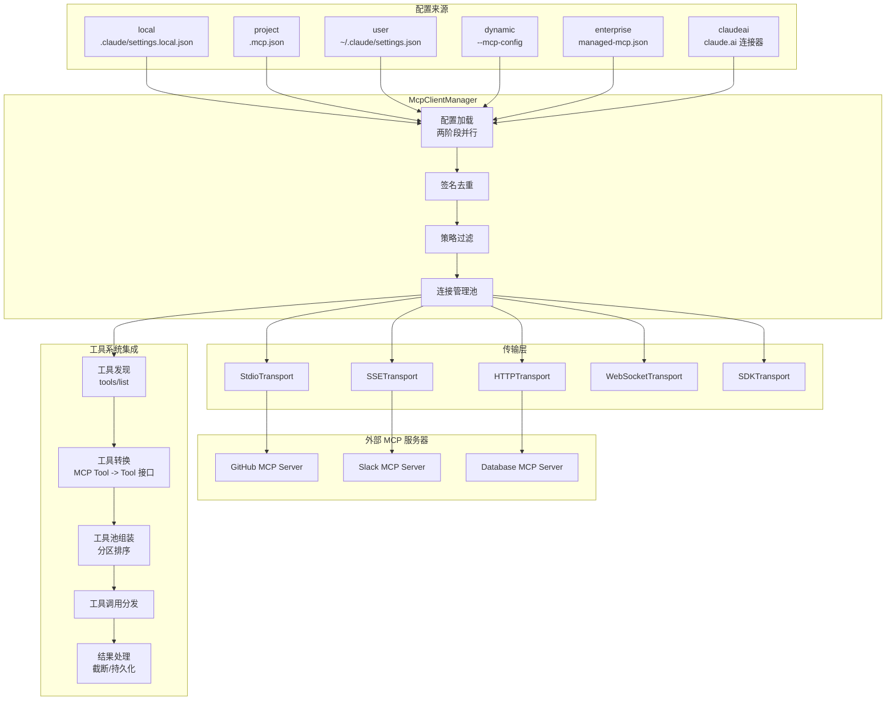
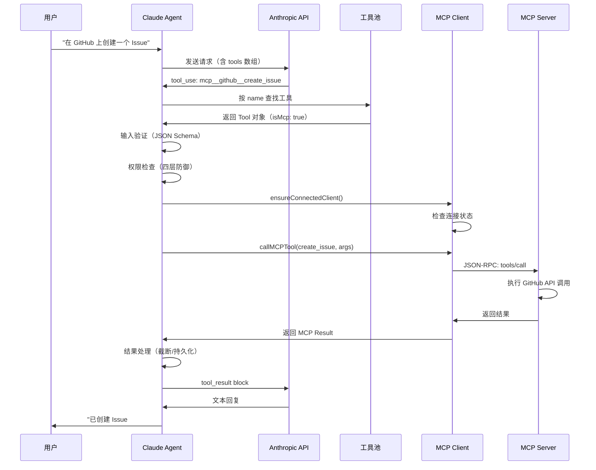
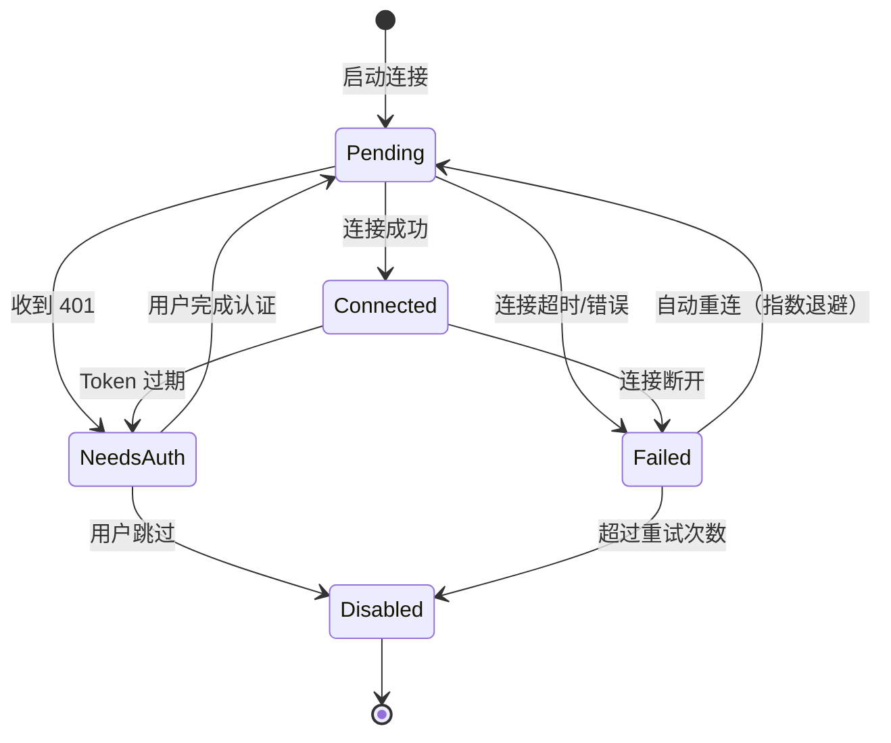
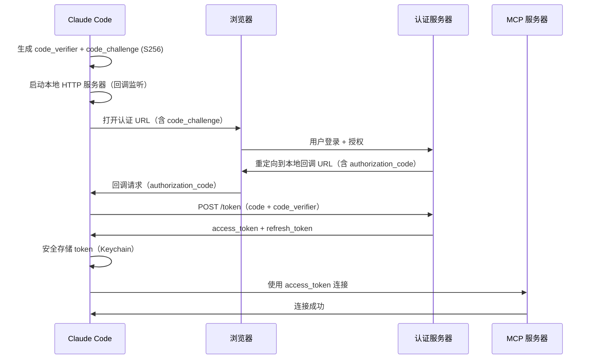
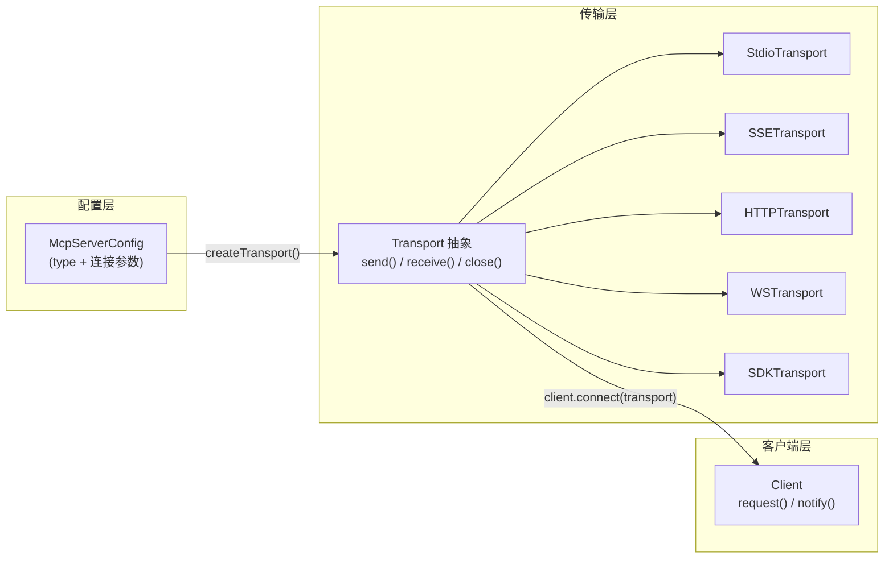

# Claude Code MCP 集成：深度源码调研报告 v2

> 本文档基于 Claude Code 源码的实际分析，在 v1 基础上进行了大幅扩展和重构。重点增加了 Tool/Skill/MCP 三者的本质区别辨析、常见疑惑解答、更详细的模块级源码分析，以及多处 mermaid 架构图。适合有一定 Agent 开发经验、希望深入理解 CC MCP 设计决策的读者。

---

## 目录

1. [MCP 的含义、动机与必要性](#1-mcp-的含义动机与必要性)
2. [Tool、Skill 与 MCP 的区别](#2-toolskill-与-mcp-的区别)
3. [CC 的 MCP 设计亮点](#3-cc-的-mcp-设计亮点)
4. [MCP 整体架构](#4-mcp-整体架构)
5. [分模块详解](#5-分模块详解)
   - 5.1 配置与发现
   - 5.2 连接生命周期
   - 5.3 工具转换
   - 5.4 工具调用链
   - 5.5 Instructions 注入
   - 5.6 认证系统
6. [工程设计分析](#6-工程设计分析)
7. [总结速记表](#7-总结速记表)

---

## 1. MCP 的含义、动机与必要性

### 1.1 MCP 是什么？

**MCP（Model Context Protocol）** 是 Anthropic 提出的开放标准协议，定义了 AI 应用（Client）与外部工具/数据服务（Server）之间的通信规范。

最直观的类比是 **USB 协议**：

| 类比维度 | USB 协议 | MCP 协议 |
|----------|---------|---------|
| 统一什么 | 计算机与外设的物理/逻辑接口 | AI Agent 与外部服务的通信接口 |
| 解决什么 | 每种外设不再需要专用端口 | 每个外部服务不再需要定制集成代码 |
| 核心价值 | 即插即用 | 即接即用——MCP 服务器一次实现，所有 MCP 客户端都能调用 |
| 发现机制 | USB 设备枚举 | `tools/list`、`resources/list`、`prompts/list` |
| 能力协商 | USB 描述符 | MCP `initialize` 能力交换 |

### 1.2 没有 MCP 的世界 vs 有 MCP 的世界

**Without MCP：N x M 问题**

假设市场上有 N 个 AI 应用（Claude Code、Cursor、Windsurf...）和 M 个外部服务（GitHub、Slack、PostgreSQL...），每个 AI 应用需要为每个外部服务写一套专门的集成代码。总集成量 = N x M。



**With MCP：N + M 问题**

每个 AI 应用实现一次 MCP Client，每个外部服务实现一次 MCP Server。总工作量 = N + M。



### 1.3 MCP 的核心价值

| 维度 | 没有 MCP | 有 MCP |
|------|---------|--------|
| 工具开发者 | 为每个 AI 平台写适配器（N x M 问题） | 实现一次 MCP Server，所有客户端可用 |
| AI 应用开发者 | 为每个工具写集成代码 | 实现一次 MCP Client，接入整个生态 |
| 集成成本 | O(N x M) | O(N + M) |
| 安全标准 | 每个集成自定义安全策略 | 统一的安全协议和能力协商 |
| 工具发现 | 硬编码工具列表 | 运行时动态发现（`tools/list`） |
| 认证 | 每个集成自己实现 | 内置 OAuth 2.0 标准流程 |

### 1.4 MCP 协议三层架构

```
+---------------------------------------------------+
| 应用层 (Application Layer)                         |
|   Tools（工具）/ Resources（资源）/ Prompts（模板） |
+---------------------------------------------------+
| 协议层 (Protocol Layer)                            |
|   JSON-RPC 2.0 消息格式                            |
|   能力协商 (Capability Negotiation)                 |
|   tools/list, tools/call, resources/list 等方法    |
+---------------------------------------------------+
| 传输层 (Transport Layer)                           |
|   stdio | SSE | HTTP Streamable | WebSocket | SDK |
+---------------------------------------------------+
```

MCP 服务器可以提供三类能力：

| 能力类型 | 说明 | 发现方法 | 在 CC 中的映射 |
|---------|------|---------|-------------|
| **Tools** | 可调用的工具函数 | `tools/list` | 映射为 `Tool` 对象，通过 API `tools` 参数传递 |
| **Resources** | 可读取的数据资源 | `resources/list` | 通过 `ListMcpResourcesTool` / `ReadMcpResourceTool` 访问 |
| **Prompts** | 提示模板 | `prompts/list` | 映射为斜杠命令（`/mcp__server__prompt`） |

---

## 2. Tool、Skill 与 MCP 的区别

这是理解 Claude Code 架构时最容易混淆的概念。三者在本质、传递方式、token 消耗上有根本性区别。

### 2.1 三层架构总览



### 2.2 Tool（内置工具）

**本质：进程内函数调用。**

内置工具是直接在 Agent 进程内执行的函数，通过 Anthropic API 的 `tools` 参数传递给模型。

**关键特征：**

- **传递方式**：通过 API 的 `tools` 参数传递，这是一个独立于 system prompt 的"专门槽位"
- **格式**：每个工具是一个 JSON 对象，包含 `name`、`description`、`input_schema`
- **执行**：模型输出 `tool_use` block → Agent 在进程内直接调用 `tool.call()` → 结果以 `tool_result` block 返回
- **数量**：CC 内置约 15 个工具（Read、Edit、Bash、Glob、Grep 等）
- **Schema**：使用 Zod 定义（TypeScript 原生类型安全）

```typescript
// 内置工具的定义示例（简化）
const ReadTool: Tool = {
  name: 'Read',
  async prompt() { return '读取文件内容...' },
  inputSchema: z.object({
    file_path: z.string(),
    offset: z.number().optional(),
    limit: z.number().optional(),
  }),
  async call(input) {
    // 直接在进程内读取文件
    return fs.readFile(input.file_path)
  }
}
```

### 2.3 Skill（技能）

**本质：注入到 system prompt 中的 Markdown 知识文本。**

Skill 不是工具——它没有输入输出 Schema，不产生 `tool_use` block。它更像是"给模型看的操作手册"。

**关键特征：**

- **传递方式**：注入到 API 的 `system` 参数中（system prompt 的一部分）
- **格式**：纯 Markdown 文本
- **渐进式披露**：只有简介放在 system prompt 中，完整内容在模型调用 `Skill` 工具时才加载
- **执行**：模型读取 Skill 内容后，按照其中的指导使用现有工具执行任务
- **消耗**：加载后占用 system prompt 空间（消耗 token）

```
# system prompt 中的 Skill 简介（渐进式披露）

Available skills:
- commit: 创建 git commit（使用 Skill 工具加载完整内容）
- review-pr: 审查 Pull Request

# 用户触发 /commit 后，完整内容被加载：
<skill name="commit">
## 创建 Git Commit 的标准流程
1. 运行 git status 查看变更...
2. 运行 git diff 查看具体修改...
3. 分析变更，草拟 commit message...
...
</skill>
```

### 2.4 MCP（外部服务工具）

**本质：通过进程间通信（stdio/HTTP/WebSocket）调用的外部服务。**

MCP 工具在 CC 中被转换为与内置工具相同的 `Tool` 格式，通过 `tools` 参数传递给模型。从模型的角度看，MCP 工具和内置工具在 `tools` 数组中并列出现，没有本质区别。

**关键特征：**

- **工具定义**：转换为 Anthropic Tool 格式，通过 `tools` 参数传递（与内置工具并列）
- **Instructions**：MCP 服务器的使用说明注入 system prompt
- **执行**：模型输出 `tool_use` block → Agent 通过 JSON-RPC 转发到 MCP 服务器 → MCP 服务器执行 → 结果返回
- **发现**：运行时通过 `tools/list` 动态发现

```typescript
// MCP 工具在 API 请求中与内置工具并列
const apiRequest = {
  system: "你是 Claude...\n\n# MCP Server Instructions\n...",
  messages: [...],
  tools: [
    // 内置工具
    { name: "Read", description: "读取文件...", input_schema: {...} },
    { name: "Edit", description: "编辑文件...", input_schema: {...} },
    // MCP 工具（与内置工具格式完全相同）
    { name: "mcp__github__create_issue", description: "创建 Issue...", input_schema: {...} },
    { name: "mcp__slack__send_message", description: "发送消息...", input_schema: {...} },
  ]
}
```

### 2.5 三者对比总表

| 维度 | Tool（内置工具） | Skill（技能） | MCP（外部服务） |
|------|-----------------|--------------|----------------|
| **本质** | 进程内函数 | Markdown 知识文本 | 跨进程/网络的 JSON-RPC 调用 |
| **API 槽位** | `tools` 参数 | `system` 参数 | `tools` 参数（工具定义）+ `system`（instructions） |
| **产生 tool_use** | 是 | 否 | 是 |
| **执行位置** | Agent 进程内 | 不执行——指导模型思考 | 外部 MCP Server 进程 |
| **Schema 定义** | Zod（TypeScript） | 无（纯文本） | JSON Schema（语言无关） |
| **数量级** | ~15 个 | ~10 个 | 可能 200+ 个 |
| **发现方式** | 编译时注册 | 配置文件 + 目录扫描 | 运行时 `tools/list` |
| **token 消耗** | tools 参数消耗 token | system prompt 消耗 token | tools 参数 + system prompt 双重消耗 |
| **延迟加载** | 部分支持（shouldDefer） | 默认渐进式披露 | 默认延迟加载 |

### 2.6 常见疑惑解答

#### Q1: MCP 和通过 tool 写 HTTP 请求有什么区别？

技术上确实可以通过 `run_shell("curl ...")` 调用任何 API。但 MCP 的价值不在于"能不能"，而在于：

| 维度 | curl / HTTP 请求 | MCP 协议 |
|------|-----------------|---------|
| **标准化** | 每个 API 格式不同，需要逐个适配 | 统一 JSON-RPC 协议，实现一次到处可用 |
| **发现性** | 需要查文档，硬编码 endpoint | `tools/list` 自动发现可用工具 |
| **安全性** | 裸 curl 无法管控，模型可以调用任何 URL | 受权限系统管控（deny/allow 规则） |
| **认证** | 手动管理 token、处理过期 | 内置 OAuth 2.0 流程，自动 token 刷新 |
| **类型安全** | 参数和返回值无约束 | JSON Schema 输入输出校验 |
| **错误处理** | 需自行解析 HTTP 状态码 | 统一错误格式，支持重试和重连 |

#### Q2: Tool 的"专门槽位"如何理解？

Anthropic API 的请求格式有三个独立参数：

```json
{
  "system": "...",           // 槽位 1: System Prompt
  "messages": [...],         // 槽位 2: 对话历史
  "tools": [...]             // 槽位 3: 工具定义
}
```

这三个是 API 层面的独立参数，不是简单的字符串拼接。服务端内部如何处理这些槽位是 Anthropic 的实现细节——可能会将 tools 格式化为模型理解的特殊格式注入模型输入，但关键是：**这个过程对开发者透明，由 API 保证格式正确**。

从 token 消耗角度看，tools 参数**确实消耗 token**（模型需要"看到"这些信息才能选择工具），但它的格式是 API 优化过的（可能比手写在 system prompt 中更紧凑高效）。

#### Q3: Skill 为什么放 system prompt 而不开"槽位"？

因为 Skill 不是工具——它是**知识/指令**。它没有输入输出 schema，不产生 `tool_use` block，不需要模型"调用"它。它更像是"给模型看的文档"，和 system prompt 的性质一致，放在 system prompt 中是语义正确的选择。

如果 Skill 也放在 `tools` 中，模型会试图"调用"它（生成 `tool_use` block），但 Skill 没有执行逻辑，这会导致错误。

#### Q4: MCP 为什么"占用大量上下文空间"？

两个层面的消耗：

1. **工具定义（tools 参数）**：每个 MCP 服务器可能提供 10-50 个工具，每个工具有 name + description + input_schema。假设 10 个服务器 x 20 个工具 = 200 个工具定义，全部通过 `tools` 参数传给模型，消耗大量 token。CC 限制单个描述最大 2048 字符，但乘以 200 仍然可观。

2. **Instructions（system 参数）**：MCP 服务器可以提供使用说明，这些被注入到 system prompt 中。

3. **对比**：内置工具只有约 15 个定义，但 MCP 可能引入 200+ 个。CC 用延迟加载（`shouldDefer` / `ToolSearch`）来缓解——默认只在 system prompt 中列出工具名称，模型通过 `ToolSearch` 按需加载完整 schema。

#### Q5: 三者的 token 消耗模型

```
内置 Tool：~15 个工具定义 * 平均 200 token = 3,000 token（通过 tools 参数）
Skill 简介：~10 个简介 * 平均 50 token = 500 token（在 system prompt 中）
Skill 完整：按需加载 * 平均 2,000 token（追加到 system prompt）
MCP 工具：200 个定义 * 平均 200 token = 40,000 token（不用延迟加载的话）
MCP 延迟：200 个名称 * 平均 5 token = 1,000 token（延迟加载模式）
MCP Instructions：每个服务器平均 500 token * 10 = 5,000 token
```

这就是为什么 CC 默认对 MCP 工具启用延迟加载——将 40,000 token 的消耗降低到约 1,000 token，按需再加载。

---

## 3. CC 的 MCP 设计亮点

Claude Code 的 MCP 集成展现了多个精妙的工程设计，以下逐一分析。

### 亮点 1：统一接口——MCP 工具与内置工具无缝融合

MCP 工具被映射为与内置工具相同的 `Tool<Input, Output, P>` 接口，共享完整的执行流水线（验证 -> 权限 -> Hook -> 执行 -> 结果处理）。新增一个 MCP 服务器不需要修改任何执行逻辑。

```typescript
// 核心桥接模式：MCP 工具映射为内部 Tool 接口
const mcpTool: Tool = {
  ...MCPTool,                    // 继承基础 MCP 工具实现
  name: buildMcpToolName(...),   // mcp__server__tool 格式
  isMcp: true,                   // 标记区分
  mcpInfo: { serverName, toolName },
  async call(args) {
    const client = await ensureConnectedClient(server)
    return await callMCPTool({ client, tool: toolName, args })
  },
}
```

### 亮点 2：7+ 种传输协议全覆盖

| 协议 | 传输方式 | 延迟 | 适用场景 |
|------|---------|------|---------|
| `stdio` | 标准输入/输出管道 | 最低 | **首选**。本地开发工具、CLI 封装 |
| `sse` | Server-Sent Events | 网络延迟 | 远程 HTTP 服务 |
| `sse-ide` | SSE + IDE 元数据 | 本地网络 | IDE 扩展专用 |
| `http` | HTTP Streamable | 网络延迟 | MCP 规范新协议，支持流式 |
| `ws` | WebSocket 全双工 | 网络延迟 | 需要双向实时通信 |
| `ws-ide` | WebSocket + IDE | 本地网络 | IDE 扩展，低延迟双向 |
| `sdk` | 进程内函数调用 | 近零 | SDK 内部调用（如 Chrome MCP） |
| `claudeai-proxy` | Claude.ai 代理 | 网络延迟 | Claude.ai 平台 |

### 亮点 3：两阶段配置加载——快启动 + 延迟补充

```
Phase 1：快速加载（仅本地文件读取，毫秒级）
  |-- getClaudeCodeMcpConfigs() -> plugin < user < project < local
  |-- dynamicMcpConfig（--mcp-config 参数覆盖）
  +-- 开始连接（fire-and-forget）

Phase 2：延迟补充（需要网络请求，与 Phase 1 并行发起）
  |-- fetchClaudeAIMcpConfigsIfEligible()
  |-- filterMcpServersByPolicy() -> 策略过滤
  |-- dedupClaudeAiMcpServers() -> URL 签名去重
  +-- 追加连接 claude.ai 服务器
```

Phase 1 只读本地文件（毫秒级），Phase 2 的 claude.ai 网络请求与 Phase 1 并行发起，实现启动性能隔离。

### 亮点 4：签名去重——基于实际效果而非表面配置

通过内容签名机制判断重复，而非简单比较配置名称：

```typescript
export function getMcpServerSignature(config): string | null {
  const cmd = getServerCommandArray(config)
  if (cmd) return `stdio:${JSON.stringify(cmd)}`   // 本地：命令 + 参数的 JSON
  const url = getServerUrl(config)
  if (url) return `url:${unwrapCcrProxyUrl(url)}`  // 远程：规范化后的 URL
  return null  // SDK 不去重
}
```

这确保了：即使同一个 GitHub MCP 服务器在 user 配置和 claude.ai 连接器中都出现（名称可能不同），也只会建立一个连接。

### 亮点 5：四层权限深度防御

```
第一层：企业策略（deniedMcpServers > allowedMcpServers）
  | 通过
第二层：IDE 工具白名单（仅 executeCode / getDiagnostics）
  | 通过
第三层：用户权限配置（allow/deny 规则匹配）
  | 未匹配
第四层：运行时用户确认（默认 passthrough）
```

即使某一层被绕过，其他层仍然提供保护——经典的 Defense-in-Depth 安全模型。

### 亮点 6：本地/远程分治并发

```typescript
// 本地服务器（stdio/sdk）：低并发，因为 spawn 进程消耗大
const LOCAL_CONCURRENCY = 3

// 远程服务器（sse/http/ws）：高并发，网络 IO 为主
const REMOTE_CONCURRENCY = 20

// 使用 pMap 滑动窗口调度（而非固定批次）
await pMap(localServers, connectServer, { concurrency: LOCAL_CONCURRENCY })
await pMap(remoteServers, connectServer, { concurrency: REMOTE_CONCURRENCY })
```

### 亮点 7：工具命名规范 `mcp__server__tool`

三段式命名不仅避免名称冲突，更在权限检查时提供独立命名空间：

```
mcp__github__create_issue
 |      |        |
 |      |        +-- 原始工具名
 |      +----------- MCP 服务器名
 +------------------ MCP 前缀标识
```

权限规则可以精确匹配到不同粒度：
- `mcp__github__create_issue`：精确匹配单个工具
- `mcp__github__*`：匹配某个服务器的所有工具
- `mcp__*`：匹配所有 MCP 工具（谨慎使用）

### 亮点 8：大结果持久化

MCP 服务器可能返回超大结果（如数据库查询返回大量行、文件内容等）。CC 的处理策略：

- 文本结果超过 `maxResultSizeChars` -> 截断 + 提示
- 二进制 blob 超过 25KB -> 自动保存到 `.claude/mcp-outputs/` 目录，返回文件路径而非内容
- 防止单个 MCP 调用的结果吞掉整个上下文窗口

---

## 4. MCP 整体架构

### 4.1 全局架构图



### 4.2 工具调用时序图



### 4.3 连接状态机

MCP 服务器连接使用 TypeScript 的 discriminated union 精确建模 5 种状态：



```typescript
// 源码：services/mcp/types.ts
export type MCPServerConnection =
  | ConnectedMCPServer    // 已连接，工具可用
  | FailedMCPServer       // 连接失败
  | NeedsAuthMCPServer    // 需要 OAuth 认证
  | PendingMCPServer      // 等待重连（指数退避）
  | DisabledMCPServer     // 已禁用

// Connected 状态包含完整运行时信息
export type ConnectedMCPServer = {
  type: 'connected'
  client: Client                      // MCP SDK 客户端实例
  name: string
  capabilities: ServerCapabilities    // 服务器能力声明
  instructions?: string              // 使用指南
  config: ScopedMcpServerConfig
  cleanup: () => Promise<void>        // 清理函数
}
```

---

## 5. 分模块详解

### 5.1 配置与发现

#### 5.1.1 六种配置来源及优先级

| 优先级 | 来源 | 路径/方式 | 加载阶段 | 说明 |
|--------|------|----------|---------|------|
| 最低 | `claudeai` | claude.ai 网络 API | Phase 2 | claude.ai 连接器配置 |
| ↑ | `plugin` | 插件缓存 | Phase 1 | 第三方插件注册的服务器 |
| ↑ | `user` | `~/.claude/settings.json` | Phase 1 | 用户全局配置 |
| ↑ | `project` | `.mcp.json`（项目根目录） | Phase 1 | 项目级配置（需审批） |
| ↑ | `local` | `.claude/settings.local.json` | Phase 1 | 本地覆盖（不提交 Git） |
| 最高 | `dynamic` | `--mcp-config` 命令行参数 | Phase 1 | 运行时动态注入 |
| **独占** | `enterprise` | `managed-mcp.json` | Phase 1 | 企业管控，启用时跳过其他所有 |

#### 5.1.2 配置文件格式

```json
// .mcp.json（项目级配置示例）
{
  "mcpServers": {
    "github": {
      "type": "stdio",
      "command": "npx",
      "args": ["-y", "@modelcontextprotocol/server-github"],
      "env": {
        "GITHUB_TOKEN": "${GITHUB_TOKEN}"
      }
    },
    "postgres": {
      "type": "stdio",
      "command": "npx",
      "args": ["-y", "@modelcontextprotocol/server-postgres"],
      "env": {
        "DATABASE_URL": "${DATABASE_URL:-postgresql://localhost:5432/mydb}"
      }
    },
    "remote-api": {
      "type": "http",
      "url": "https://mcp.example.com/api",
      "oauth": {
        "clientId": "my-client-id",
        "authorizationUrl": "https://auth.example.com/authorize",
        "tokenUrl": "https://auth.example.com/token",
        "scopes": ["read", "write"]
      }
    }
  }
}
```

**注意环境变量展开**：CC 支持 `${VAR}` 和 `${VAR:-default}` 语法，在配置中引用环境变量，避免硬编码敏感信息（如 token、数据库密码）。

#### 5.1.3 配置 Schema 定义

```typescript
// services/mcp/types.ts：每种传输的精确 Schema
export const McpStdioServerConfigSchema = lazySchema(() =>
  z.object({
    type: z.literal('stdio').optional(),  // 可选，向后兼容
    command: z.string().min(1, 'Command cannot be empty'),
    args: z.array(z.string()).default([]),
    env: z.record(z.string(), z.string()).optional(),
  }),
)

export const McpSSEServerConfigSchema = lazySchema(() =>
  z.object({
    type: z.literal('sse'),
    url: z.string(),
    headers: z.record(z.string(), z.string()).optional(),
    headersHelper: z.string().optional(),   // 动态 header 脚本
    oauth: McpOAuthConfigSchema().optional(),
  }),
)

export const McpHTTPServerConfigSchema = lazySchema(() =>
  z.object({
    type: z.literal('http'),
    url: z.string(),
    headers: z.record(z.string(), z.string()).optional(),
    headersHelper: z.string().optional(),
    oauth: McpOAuthConfigSchema().optional(),
  }),
)

export const McpSdkServerConfigSchema = lazySchema(() =>
  z.object({
    type: z.literal('sdk'),
    name: z.string(),
  }),
)

// 所有配置通过 union 统一
export const McpServerConfigSchema = lazySchema(() =>
  z.union([
    McpStdioServerConfigSchema(),
    McpSSEServerConfigSchema(),
    McpSSEIDEServerConfigSchema(),
    McpWebSocketIDEServerConfigSchema(),
    McpHTTPServerConfigSchema(),
    McpWebSocketServerConfigSchema(),
    McpSdkServerConfigSchema(),
    McpClaudeAIProxyServerConfigSchema(),
  ]),
)
```

#### 5.1.4 工具发现三阶段

```
阶段 1：工具发现
  MCP 服务器 Connected -> tools/list 请求 -> 获取工具名称/描述/Schema

阶段 2：工具映射
  Unicode 清理 -> 前缀决策(mcp__server__tool) -> Tool 对象构造（注解桥接）

阶段 3：工具注册
  权限检查 -> alwaysLoad?
    是 -> 直接注入 tools 参数，模型始终可见
    否 -> 延迟加载（仅名称列表 -> ToolSearch 首次调用时加载完整 Schema）
```

### 5.2 连接生命周期

#### 5.2.1 传输创建

根据配置类型创建对应的传输实例：

```typescript
function createTransport(config: McpServerConfig): Transport {
  switch (config.type) {
    case 'stdio':
    case undefined:  // 默认 stdio
      return new StdioClientTransport({
        command: config.command,
        args: config.args,
        env: { ...process.env, ...expandEnvVars(config.env) },
      })
    case 'sse':
      return new SSEClientTransport(new URL(config.url), {
        requestInit: { headers: config.headers },
      })
    case 'http':
      return new StreamableHTTPClientTransport(new URL(config.url), {
        requestInit: { headers: config.headers },
      })
    case 'ws':
      return new WebSocketClientTransport(new URL(config.url))
    case 'sdk':
      return createLinkedTransportPair()  // 进程内直连
    // ... ide-sse, ide-ws, claudeai-proxy
  }
}
```

#### 5.2.2 客户端初始化

```typescript
async function connectToServer(name: string, config: ScopedMcpServerConfig) {
  const transport = createTransport(config)
  const client = new Client({
    name: 'claude-code',
    version: VERSION,
  }, {
    capabilities: {
      // 声明客户端支持的能力
      roots: { listChanged: true },
    }
  })

  // 连接超时：默认 30 秒
  const CONNECTION_TIMEOUT = 30_000
  await Promise.race([
    client.connect(transport),
    new Promise((_, reject) =>
      setTimeout(() => reject(new Error('Connection timeout')), CONNECTION_TIMEOUT)
    ),
  ])

  // 获取服务器信息
  const serverInfo = client.getServerVersion()
  const capabilities = client.getServerCapabilities()
  const instructions = serverInfo?.instructions

  return {
    type: 'connected',
    client,
    name,
    capabilities,
    instructions,
    config,
    cleanup: () => gracefulShutdown(client, transport),
  }
}
```

#### 5.2.3 优雅退出——三级信号升级

```typescript
async function gracefulShutdown(client: Client, transport: Transport) {
  // 第一级：SIGINT（中断信号）
  transport.send(SIGINT)

  // 等待 100ms
  await delay(100)

  // 第二级：SIGTERM（终止信号）
  transport.send(SIGTERM)

  // 等待 400ms
  await delay(400)

  // 第三级：SIGKILL（强制终止）
  transport.kill(SIGKILL)
}
// 总超时 500ms，保持 CLI 响应性同时给 MCP 服务器足够清理时间
```

#### 5.2.4 错误处理与重连

```typescript
// 指数退避重连策略
const RETRY_CONFIG = {
  maxRetries: 5,
  initialDelay: 1000,    // 1 秒
  maxDelay: 30000,       // 最大 30 秒
  backoffMultiplier: 2,  // 每次翻倍
}

async function reconnectWithBackoff(name: string, config: ScopedMcpServerConfig) {
  for (let attempt = 0; attempt < RETRY_CONFIG.maxRetries; attempt++) {
    const delay = Math.min(
      RETRY_CONFIG.initialDelay * Math.pow(RETRY_CONFIG.backoffMultiplier, attempt),
      RETRY_CONFIG.maxDelay
    )
    await sleep(delay)  // 1s -> 2s -> 4s -> 8s -> 16s

    try {
      return await connectToServer(name, config)
    } catch (error) {
      if (attempt === RETRY_CONFIG.maxRetries - 1) {
        return { type: 'failed', name, error, config }
      }
    }
  }
}
```

#### 5.2.5 连接状态转换全流程

```
[启动]
  |
connectToServer()
  |-- 成功 -> Connected
  |     |-- tools/list -> 工具发现 -> 注册
  |     |-- 运行时连接断开 -> Failed -> reconnectWithBackoff()
  |     +-- Token 过期(401) -> NeedsAuth
  |
  |-- 超时 -> Failed -> reconnectWithBackoff()
  |     |-- 重连成功 -> Connected
  |     +-- 超过 5 次 -> Disabled
  |
  +-- 401 Unauthorized -> NeedsAuth
        |-- 用户完成 OAuth -> Pending -> 重新连接
        +-- 用户跳过 -> Disabled
```

### 5.3 工具转换

#### 5.3.1 MCP Tool -> Anthropic Tool 格式

当 MCP 服务器连接成功后，CC 通过 `tools/list` 获取服务器提供的所有工具，然后将每个工具转换为内部 `Tool` 接口：

```typescript
function convertMcpToolToInternalTool(
  mcpTool: McpToolDefinition,
  serverName: string,
  server: ConnectedMCPServer
): Tool {
  return {
    // 基础属性
    name: buildMcpToolName(serverName, mcpTool.name),  // mcp__server__tool
    isMcp: true,
    mcpInfo: { serverName, toolName: mcpTool.name },

    // Schema：直接使用 MCP 返回的 JSON Schema（不转 Zod）
    inputJSONSchema: mcpTool.inputSchema,

    // 描述：截断防御
    async prompt() {
      const desc = mcpTool.description ?? ''
      return desc.length > MAX_MCP_DESCRIPTION_LENGTH  // 2048 字符
        ? desc.slice(0, MAX_MCP_DESCRIPTION_LENGTH) + '... [truncated]'
        : desc
    },

    // 行为注解桥接
    isConcurrencySafe() {
      return mcpTool.annotations?.readOnlyHint === true
    },
    isDestructive() {
      return mcpTool.annotations?.destructiveHint === true
    },

    // 延迟加载控制
    shouldDefer() {
      return mcpTool._meta?.['anthropic/alwaysLoad'] !== true
    },

    // 核心调用方法
    async call(args, context) {
      const client = await ensureConnectedClient(server)
      const result = await callMCPTool({
        client,
        tool: mcpTool.name,  // 原始工具名（不带前缀）
        args,
        signal: context.abortController.signal,
      })
      return { data: result.content }
    },

    // 权限：默认 passthrough（每次需用户确认）
    userFacingPermissionCheckResult() {
      return 'passthrough'
    },
  }
}
```

#### 5.3.2 命名规范

```typescript
function buildMcpToolName(serverName: string, toolName: string): string {
  // 清理 Unicode 字符，只保留 ASCII 字母数字和下划线
  const cleanServer = sanitizeForToolName(serverName)
  const cleanTool = sanitizeForToolName(toolName)
  return `mcp__${cleanServer}__${cleanTool}`
}

// 示例：
// buildMcpToolName("GitHub", "create_issue")
//   -> "mcp__github__create_issue"

// buildMcpToolName("My DB Server!", "run-query")
//   -> "mcp__my_db_server__run_query"
```

#### 5.3.3 能力注解桥接

MCP 协议定义了工具的行为注解（Annotations），CC 将它们桥接为内部工具系统的决策函数：

| MCP Annotation | CC 决策函数 | 含义 |
|---------------|-----------|------|
| `readOnlyHint: true` | `isConcurrencySafe() -> true` | 工具只读，可以安全并发执行 |
| `destructiveHint: true` | `isDestructive() -> true` | 工具有破坏性，需要额外确认 |
| `openWorldHint: true` | 影响安全评估 | 工具访问外部网络 |

**关键设计理念**：MCP 服务器提供"建议"（Hints），CC 客户端做"最终决策"（Decisions）。服务器可以标记 `readOnlyHint: true`，但 CC 仍然可以出于安全考虑要求用户确认。

#### 5.3.4 描述截断防御

防止 OpenAPI 自动生成的 MCP 服务器倾倒 15-60KB 的 API 文档：

```typescript
const MAX_MCP_DESCRIPTION_LENGTH = 2048  // 字符

async prompt() {
  const desc = tool.description ?? ''
  return desc.length > MAX_MCP_DESCRIPTION_LENGTH
    ? desc.slice(0, MAX_MCP_DESCRIPTION_LENGTH) + '... [truncated]'
    : desc
}
```

### 5.4 工具调用链

#### 5.4.1 调用全流程

```
[模型输出 tool_use block]
     | { name: "mcp__github__create_issue", input: {...} }
     v
[Stage 1] 工具查找
     | 按 name 在工具池中匹配 -> 找到 isMcp:true 的 Tool 对象
     v
[Stage 2] 输入验证
     | MCP 工具使用 inputJSONSchema（JSON Schema 而非 Zod）进行验证
     v
[Stage 3] 并行启动
     | Pre-Tool Hook || Bash 分类器（MCP 工具不触发 Bash 分类器）
     v
[Stage 4] 权限检查
     | MCP 工具默认返回 passthrough -> 每次需要用户确认
     | 除非用户配置了 allow 规则：mcp__github__*
     v
[Stage 5] MCP 工具执行
     | ensureConnectedClient() -> 确保连接仍有效
     | callMCPToolWithUrlElicitationRetry() -> JSON-RPC 调用
     | MCP 服务器执行实际操作 -> 返回结果
     v
[Stage 6] 结果处理
     | 二进制 blob > 25KB -> 自动保存到 .claude/mcp-outputs/
     | 文本结果 -> mapToolResult 处理
     | 超大文本 -> 截断 + 提示
     v
[Stage 7] Post-Tool Hook
     | postToolUse / postToolFail
     v
[Stage 8] 消息发射
     | tool_result block -> 返回给模型
```

#### 5.4.2 核心调用函数

```typescript
async function callMCPTool({
  client,
  tool,
  args,
  signal,
}: {
  client: Client,
  tool: string,
  args: Record<string, unknown>,
  signal: AbortSignal,
}): Promise<McpResult> {
  // 请求超时：60 秒（单次 RPC 调用）
  const REQUEST_TIMEOUT = 60_000

  // 工具调用超时：100,000 秒（~27.8 小时，长时间运行的工具）
  const TOOL_CALL_TIMEOUT = 100_000_000

  try {
    const result = await client.request(
      {
        method: 'tools/call',
        params: {
          name: tool,       // 原始工具名，不带 mcp__ 前缀
          arguments: args,
        },
      },
      { signal, timeout: TOOL_CALL_TIMEOUT }
    )
    return result
  } catch (error) {
    if (error instanceof McpSessionExpiredError) {
      // 会话过期 -> 标记服务器需要重连
      markServerAsNeedsReconnect(client)
      throw error
    }
    if (error instanceof McpAuthError) {
      // 认证失败 -> 标记为 needs-auth
      markServerAsNeedsAuth(client)
      throw error
    }
    throw new McpToolCallError(`MCP tool call failed: ${error.message}`)
  }
}
```

#### 5.4.3 连接保活

```typescript
async function ensureConnectedClient(server: MCPServerConnection): Promise<Client> {
  if (server.type !== 'connected') {
    // 服务器不在连接状态 -> 尝试重连
    const reconnected = await reconnectWithBackoff(server.name, server.config)
    if (reconnected.type !== 'connected') {
      throw new McpToolCallError(
        `MCP server "${server.name}" is not connected (status: ${reconnected.type})`
      )
    }
    return reconnected.client
  }

  // 检查连接是否仍然活跃（心跳检测）
  try {
    await server.client.ping()
  } catch {
    // ping 失败 -> 重连
    const reconnected = await reconnectWithBackoff(server.name, server.config)
    if (reconnected.type !== 'connected') {
      throw new McpToolCallError(`MCP server "${server.name}" disconnected`)
    }
    return reconnected.client
  }

  return server.client
}
```

#### 5.4.4 错误类型体系

| 错误类型 | 触发条件 | 处理策略 |
|---------|---------|---------|
| `McpToolCallError` | 工具调用失败（网络错误、超时等） | 转为 `tool_result(is_error: true)` 返回模型 |
| `McpAuthError` | 认证失败（401） | 标记 needs-auth，触发 OAuth 流程 |
| `McpSessionExpiredError` | 服务器会话过期 | 标记需要重连，触发重连流程 |
| `McpConnectionError` | 初始连接失败 | 进入指数退避重连 |

所有错误最终转为 `tool_result` block（带 `is_error: true`）返回给模型，模型可以据此决定：重试、使用替代工具、或向用户报告错误。

#### 5.4.5 401 重试与 Token 刷新

```typescript
async function callMCPToolWithUrlElicitationRetry(params) {
  try {
    return await callMCPTool(params)
  } catch (error) {
    if (error instanceof McpAuthError && error.status === 401) {
      // 尝试刷新 token
      const refreshed = await authProvider.refreshToken()
      if (refreshed) {
        // 用新 token 重试一次
        return await callMCPTool(params)
      }
      // 刷新失败 -> 需要用户重新认证
      throw error
    }
    throw error
  }
}
```

#### 5.4.6 内置 Tool 与 MCP 工具执行流水线对比

```
               内置 Tool                    MCP 工具
               ----------                   --------
Stage 1   工具查找(name/alias)          工具查找(mcp__前缀名)
Stage 2   Zod Schema 验证              JSON Schema 验证
          + validateInput()             (无业务验证层)
Stage 3   Pre-Tool Hook ||             Pre-Tool Hook ||
          Bash 分类器(仅 BashTool)      (无 Bash 分类器)
Stage 4   权限检查(7源规则)             权限检查(默认 passthrough)
Stage 5   tool.call()(进程内)           ensureConnectedClient()
                                         -> JSON-RPC tools/call
                                         -> 网络/进程间通信
Stage 6   mapToolResult                mapToolResult
                                         + 二进制 blob 处理
Stage 7   Post-Tool Hook               Post-Tool Hook
Stage 8   消息发射                      消息发射
```

**关键差异的设计原因：**

- **为什么 MCP 默认 passthrough 而非 allow？** 内置工具由 CC 团队开发审核，行为可预测。MCP 工具来自第三方，行为不可预测不可控制，必须让用户知情同意。

- **为什么 MCP 工具用 JSON Schema 而非 Zod？** MCP 协议标准使用 JSON Schema 描述工具参数。如果要求 MCP 服务器提供 Zod Schema，会破坏协议的语言无关性（Zod 是 TypeScript 库）。

- **为什么 MCP 工具默认延迟加载？** 一个用户可能连接几十个 MCP 服务器，每个提供多个工具。如果全部注入 tools 参数，会消耗大量 token。延迟加载只在模型需要时加载，显著节省 token。

### 5.5 Instructions 注入

#### 5.5.1 什么是 MCP Instructions

MCP 服务器可以在连接时提供 `instructions` 字符串，描述如何使用该服务器的工具。CC 将这些 instructions 注入到 system prompt 中，让模型了解每个 MCP 服务器的用法。

#### 5.5.2 注入格式

```typescript
function buildMcpInstructionsSection(
  connectedServers: ConnectedMCPServer[]
): string {
  const serversWithInstructions = connectedServers.filter(s => s.instructions)

  if (serversWithInstructions.length === 0) return ''

  let section = '# MCP Server Instructions\n\n'
  section += 'The following instructions are provided by MCP servers '
  section += 'connected to this session.\n\n'

  for (const server of serversWithInstructions) {
    section += `## ${server.name}\n\n`
    section += `${server.instructions}\n\n`
  }

  return section
}
```

注入后的 system prompt 结构：

```
你是 Claude，一个由 Anthropic 创建的 AI 助手...

# 工具使用指南
...

# MCP Server Instructions

## github
Use these tools to interact with GitHub repositories.
Always use the full repository name (owner/repo) format.

## slack
These tools allow you to send and read Slack messages.
Use channel IDs instead of channel names for reliability.
```

#### 5.5.3 动态边界问题

MCP instructions 被放在 system prompt 的**动态区域**（`DANGEROUS_uncachedSystemPromptSection`），这意味着：

- **优点**：MCP 服务器连接/断开时，instructions 可以实时更新
- **缺点**：动态区域的内容变化会破坏 Prompt Cache 的前缀匹配

这是一个工程权衡：实时性 vs 缓存效率。CC 通过将 MCP instructions 放在 system prompt 的**末尾**来最小化缓存失效的影响——因为 Prompt Cache 是前缀匹配的，只要前面的内容不变，前面的缓存仍然有效。

### 5.6 认证系统

#### 5.6.1 支持的认证方式

| 认证方式 | 场景 | 特点 |
|---------|------|------|
| **OAuth 2.0 + PKCE** | 远程 MCP 服务器 | S256 Code Challenge，防止授权码拦截 |
| **XAA（Cross-App Access）** | 企业免浏览器环境 | 两步 Token 交换，适合 CI/CD |
| **headersHelper** | 自定义认证 | Shell 脚本返回 JSON headers |
| **macOS Keychain** | Token 安全存储 | 系统级安全存储 |

#### 5.6.2 OAuth 2.0 流程



#### 5.6.3 Token 刷新流程

```typescript
class ClaudeAuthProvider {
  private accessToken: string
  private refreshToken: string
  private expiresAt: number

  async getHeaders(): Promise<Record<string, string>> {
    if (Date.now() >= this.expiresAt - 60_000) {
      // Token 即将过期（提前 60 秒刷新）
      await this.refreshAccessToken()
    }
    return { Authorization: `Bearer ${this.accessToken}` }
  }

  private async refreshAccessToken() {
    const response = await fetch(this.tokenUrl, {
      method: 'POST',
      body: new URLSearchParams({
        grant_type: 'refresh_token',
        refresh_token: this.refreshToken,
        client_id: this.clientId,
      }),
    })
    const data = await response.json()
    this.accessToken = data.access_token
    this.refreshToken = data.refresh_token ?? this.refreshToken
    this.expiresAt = Date.now() + data.expires_in * 1000
  }
}
```

#### 5.6.4 needs-auth 缓存

对需要认证的服务器维护 15 分钟 TTL 缓存，避免每次连接都发起 HTTP 401 + OAuth 发现的网络往返：

```typescript
const NEEDS_AUTH_CACHE_TTL = 15 * 60 * 1000  // 15 分钟

const needsAuthCache = new Map<string, {
  timestamp: number,
  authUrl: string,
}>()

function isInNeedsAuthCache(serverSignature: string): boolean {
  const cached = needsAuthCache.get(serverSignature)
  if (!cached) return false
  if (Date.now() - cached.timestamp > NEEDS_AUTH_CACHE_TTL) {
    needsAuthCache.delete(serverSignature)
    return false
  }
  return true
}
```

#### 5.6.5 headersHelper：自定义认证脚本

对于不使用标准 OAuth 的服务器，CC 支持 `headersHelper` 配置——一个 Shell 脚本，运行后返回 JSON 格式的 headers：

```json
{
  "type": "sse",
  "url": "https://internal-mcp.company.com/api",
  "headersHelper": "python3 ~/scripts/get-auth-headers.py"
}
```

```python
# ~/scripts/get-auth-headers.py
import json
import subprocess

# 从公司内部认证系统获取 token
token = subprocess.check_output(["vault", "read", "-field=token", "secret/mcp"])
print(json.dumps({
    "Authorization": f"Bearer {token.decode().strip()}",
    "X-Custom-Header": "value"
}))
```

---

## 6. 工程设计分析

### 6.1 统一的 MCPTool 模板

所有 MCP 工具共享一个基础的 MCPTool 模板，每个具体的 MCP 工具通过展开（spread）继承其基础行为：

```typescript
// 基础模板定义了所有 MCP 工具的共同行为
const MCPTool = {
  // 通用行为
  isReadOnly: () => false,          // 默认非只读
  isDestructive: () => false,       // 默认非破坏性
  isConcurrencySafe: () => false,   // 默认非并发安全

  // 权限
  userFacingPermissionCheckResult: () => 'passthrough',

  // 渲染
  renderToolUseBlock: (block) => renderMcpToolCall(block),
  renderToolResultBlock: (result) => renderMcpToolResult(result),

  // 生命周期钩子
  onBeforeCall: undefined,
  onAfterCall: undefined,
}

// 具体的 MCP 工具覆盖需要定制的属性
const specificMcpTool = {
  ...MCPTool,
  name: 'mcp__github__create_issue',
  isMcp: true,
  // 覆盖：readOnlyHint 桥接
  isConcurrencySafe: () => mcpAnnotations.readOnlyHint === true,
  // 覆盖：具体调用逻辑
  call: async (args) => { /* ... */ },
}
```

**设计优势**：

- **一致性**：所有 MCP 工具默认行为一致，减少 bug
- **可扩展**：新增 MCP 工具只需覆盖需要定制的属性
- **可维护**：修改基础模板自动影响所有 MCP 工具

### 6.2 配置-传输-客户端三层抽象



这三层分离意味着：

- **新增传输协议**：只需实现 Transport 接口，不影响配置和客户端
- **修改配置格式**：只需更新配置解析，不影响传输和客户端
- **升级 MCP SDK**：只需更新客户端层，不影响配置和传输

### 6.3 延迟加载优化

CC 对 MCP 工具的延迟加载策略直接决定了 token 消耗效率：

```
不使用延迟加载：
  200 个 MCP 工具 * 平均 200 token/工具 = 40,000 token（每次 API 调用）

使用延迟加载：
  200 个工具名称 * 5 token/名称 = 1,000 token（每次 API 调用）
  + 按需加载的工具 * 200 token/工具 = 追加 1,000-2,000 token

节省比例：约 95%
```

延迟加载的工作方式：

```xml
<!-- system prompt 中只展示名称列表 -->
<available-deferred-tools>
mcp__slack__slack_send_message
mcp__github__create_pull_request
mcp__postgres__run_query
...
</available-deferred-tools>

<!-- 模型需要使用时，调用 ToolSearch 工具 -->
模型: tool_use { name: "ToolSearch", input: { query: "github create" } }

<!-- ToolSearch 返回匹配工具的完整定义 -->
系统: tool_result {
  tools: [
    { name: "mcp__github__create_issue", description: "...", input_schema: {...} },
    { name: "mcp__github__create_pull_request", description: "...", input_schema: {...} },
  ]
}
```

特殊情况：标记了 `_meta.anthropic/alwaysLoad: true` 的 MCP 工具会跳过延迟加载，始终包含在 tools 参数中。这适用于使用频率极高的核心工具。

### 6.4 分区排序保护 Prompt Cache

CC 的工具池排序策略对 Prompt Cache 效率至关重要：

```
工具池排序规则：
+--------------------------------------+
| 区域 1：内置工具（固定顺序）            |  <-- 高度稳定，几乎不变
|   Read, Edit, Bash, Glob, ...        |
+--------------------------------------+
| 区域 2：Skill 工具（固定顺序）          |  <-- 会话内稳定
|   Skill, ToolSearch, ...             |
+--------------------------------------+
| 区域 3：MCP 工具（按服务器分组）        |  <-- 可能变化（连接/断开）
|   mcp__github__*, mcp__slack__*      |
+--------------------------------------+
```

**设计要点**：

Anthropic API 的 Prompt Cache 通过**字节级前缀匹配**复用缓存。如果 tools 数组的前半部分不变，即使后面的 MCP 工具有变化（服务器连接/断开），前面的缓存仍然有效。

因此 CC 将稳定的内置工具放在前面，不稳定的 MCP 工具放在后面，最大化缓存命中率。

### 6.5 内置 MCP 桥接工具

CC 内置了 4 个专门用于 MCP 交互的桥接工具：

| 工具 | 作用 | 并发安全 | 触发场景 |
|------|------|---------|---------|
| **MCPTool** | 调用单个 MCP 工具（核心代理） | 取决于注解 | 所有 MCP 工具调用 |
| **ListMcpResourcesTool** | 列出 MCP 资源 | 是 | 资源发现 |
| **ReadMcpResourceTool** | 读取 MCP 资源内容 | 是 | 资源消费 |
| **createMcpAuthTool()** | OAuth 认证处理 | - | needs-auth 状态时自动注入 |

#### MCP Resources 桥接

MCP 服务器不仅提供工具，还可以提供**资源**（Resources）——可以读取的数据源。CC 通过两个桥接工具让模型访问这些资源：

```typescript
// 列出资源
const ListMcpResourcesTool: Tool = {
  name: 'mcp__list_resources',
  async call({ server_name }) {
    const server = getConnectedServer(server_name)
    const result = await server.client.request({
      method: 'resources/list',
    })
    return { data: result.resources }
  },
}

// 读取资源
const ReadMcpResourceTool: Tool = {
  name: 'mcp__read_resource',
  async call({ server_name, uri }) {
    const server = getConnectedServer(server_name)
    const result = await server.client.request({
      method: 'resources/read',
      params: { uri },
    })
    return { data: result.contents }
  },
}
```

#### MCP Prompts -> 斜杠命令

MCP 服务器提供的 Prompts 被自动映射为斜杠命令：

```typescript
// MCP prompt -> 斜杠命令
{
  name: 'mcp__github__code_review',  // 用户输入 /mcp__github__code_review
  description: prompt.description ?? '',
  isMcp: true,
  source: 'mcp',
  async getPromptForCommand(args: string) {
    const result = await connectedClient.client.getPrompt({
      name: prompt.name,
      arguments: zipObject(argNames, argsArray),
    })
    return result.messages.map(...)
  },
}
```

### 6.6 IDE 专用白名单工具

对于 IDE 集成的 MCP 服务器（`sse-ide` / `ws-ide`），CC 仅允许两个工具：

| 工具名 | 功能 | 安全考虑 |
|---------|------|---------|
| `mcp__ide__executeCode` | 在 IDE 沙箱中执行代码 | 限制在 IDE 上下文运行 |
| `mcp__ide__getDiagnostics` | 获取编译错误/类型错误 | 只读操作 |

**最小权限原则**——IDE 集成只需这两个核心能力。不在白名单中的工具根本不会注册，模型甚至不知道它们存在。

### 6.7 环境变量展开

CC 在连接 MCP 服务器前会展开配置中的环境变量引用：

```typescript
function expandEnvVars(env?: Record<string, string>): Record<string, string> {
  if (!env) return {}
  const result: Record<string, string> = {}
  for (const [key, value] of Object.entries(env)) {
    result[key] = value.replace(
      /\$\{(\w+)(?::-(.*?))?\}/g,
      (_, name, defaultValue) => {
        return process.env[name] ?? defaultValue ?? ''
      }
    )
  }
  return result
}

// 支持的语法：
// ${VAR}          -> 读取环境变量 VAR
// ${VAR:-default} -> 读取 VAR，不存在则用 default
```

### 6.8 InProcess 传输优化

对于内置的 MCP 服务器（如 Chrome MCP），CC 使用进程内直连（`createLinkedTransportPair`）而非启动子进程：

```typescript
// 传统方式：每个 MCP 服务器一个子进程
// 内存开销：~325MB/进程（Node.js 运行时）

// InProcess 方式：共享进程
const [clientTransport, serverTransport] = createLinkedTransportPair()
// clientTransport -> MCP Client 使用
// serverTransport -> MCP Server 使用
// 两者在同一进程内通过内存管道通信
// 额外内存开销：近零
```

### 6.9 服务器级安全——连接前拦截

企业策略在服务器连接**之前**进行拦截，不会浪费资源去连接被禁止的服务器：

```typescript
function filterMcpServersByPolicy(configs) {
  for (const [name, config] of configs) {
    // SDK 类型豁免策略检查（进程内，安全由宿主保证）
    if (config.type === 'sdk') { allow; continue }

    // 黑名单检查（绝对拒绝）
    if (isMcpServerDenied(name, config)) { block; continue }

    // 白名单检查（不在名单中则拒绝）
    if (allowedMcpServers && !isInAllowlist(name, config)) { block; continue }

    allow
  }
}
```

黑名单支持三种匹配方式：

| 匹配方式 | 适用于 | 示例 |
|---------|--------|------|
| 按服务器名称 | 所有类型 | `{ serverName: "dangerous-server" }` |
| 按命令数组 | stdio | `{ serverCommand: ["npx", "mcp-server-evil"] }` |
| 按 URL 通配符 | 远程服务器 | `{ serverUrl: "https://evil.com/*" }` |

---

## 7. 总结速记表

### 7.1 核心概念速记

| 维度 | 要点 | 关键设计 |
|------|------|---------|
| **MCP 本质** | AI 世界的"USB 接口" | 标准化协议解决 N x M 集成问题 |
| **三大原则** | 协议即契约 / 传输无关 / 安全内嵌 | 贯穿 CC 整个 MCP 实现 |
| **传输协议** | 7+ 种，按场景选择 | stdio 首选；远程用 SSE/HTTP/WS；SDK 零开销 |
| **配置作用域** | 6 层 + enterprise 独占 | dynamic 最高；claudeai 最低 |
| **两阶段加载** | Phase1 本地 + Phase2 网络 | 并行执行，启动性能隔离 |

### 7.2 Tool/Skill/MCP 速记

| 维度 | Tool | Skill | MCP |
|------|------|-------|-----|
| **API 槽位** | `tools` | `system` | `tools` + `system` |
| **执行位置** | 进程内 | 不执行 | 外部进程 |
| **产生 tool_use** | 是 | 否 | 是 |
| **Schema** | Zod | 无 | JSON Schema |
| **数量级** | ~15 | ~10 | 可能 200+ |
| **延迟加载** | 部分 | 渐进式 | 默认 |

### 7.3 工程设计速记

| 维度 | 要点 | 关键设计 |
|------|------|---------|
| **统一接口** | MCP 工具映射为 `Tool` 接口 | `isMcp:true` 标记区分，共享执行流水线 |
| **三段式命名** | `mcp__server__tool` | 命名空间隔离，权限独立 |
| **权限模型** | 四层深度防御 | 企业策略 -> IDE 白名单 -> 用户配置 -> 运行时确认 |
| **MCP 默认权限** | passthrough（每次确认） | 第三方不可信，必须知情同意 |
| **签名去重** | 基于命令/URL 内容 | 防止通过换名称绕过安全 |
| **并发连接** | 本地低并发(3) / 远程高并发(20) | pMap 滑动窗口替代固定批次 |
| **工具发现** | `tools/list` JSON-RPC | 动态发现 + 延迟加载 |
| **行为注解桥接** | MCP Hint -> CC Decision | readOnlyHint -> isConcurrencySafe |
| **连接状态** | 5 种 discriminated union | Connected/Failed/NeedsAuth/Pending/Disabled |
| **错误恢复** | 指数退避自动重连 | 1s -> 2s -> 4s... 最大 30s，最多 5 次 |
| **认证** | OAuth+PKCE / XAA / headersHelper | Keychain 存储，自动刷新 |
| **IDE 集成** | sse-ide/ws-ide + 工具白名单 | 仅允许 executeCode/getDiagnostics |
| **InProcess 传输** | 进程内直连 | 避免 ~325MB 子进程开销 |
| **大结果处理** | 二进制 blob > 25KB 自动保存 | `.claude/mcp-outputs/` 目录 |
| **延迟加载** | MCP 工具默认延迟 | 40,000 -> 1,000 token（约 95% 节省） |
| **分区排序** | 内置工具前、MCP 工具后 | 保护 Prompt Cache 前缀匹配 |
| **Prompt 映射** | MCP Prompts -> 斜杠命令 | `/mcp__github__code_review` |
| **Instructions** | 注入 system prompt 末尾 | 动态区域，最小化缓存失效 |

### 7.4 常见疑惑速记

| 疑惑 | 一句话回答 |
|------|----------|
| MCP 和 curl 有什么区别？ | MCP 是标准协议，提供发现、安全、认证、类型校验；curl 是裸调用 |
| Tool 的"专门槽位"是什么？ | API 的 `tools` 参数，独立于 `system` 和 `messages` |
| Skill 为什么不放 tools？ | Skill 是知识/指令，不是函数，不产生 tool_use |
| MCP 为什么消耗多 token？ | 200+ 工具定义 + Instructions 双重消耗；CC 用延迟加载缓解 |
| MCP 工具为什么默认需确认？ | 第三方不可信，行为不可预测；内置工具由 CC 团队审核 |

---

**一句话总结：** Claude Code 的 MCP 集成通过**统一接口桥接 + 两阶段配置加载 + 7+ 种传输适配 + 四层权限防御 + 签名去重 + 分治并发 + 延迟加载 + 分区排序**的组合设计，将外部 MCP 工具无缝融入内置工具系统。对于自研 Agent 系统，最值得借鉴的是：Tool/Skill/MCP 三层分离的架构思想、统一接口适配模式、以及"默认不信任第三方"的安全哲学。
