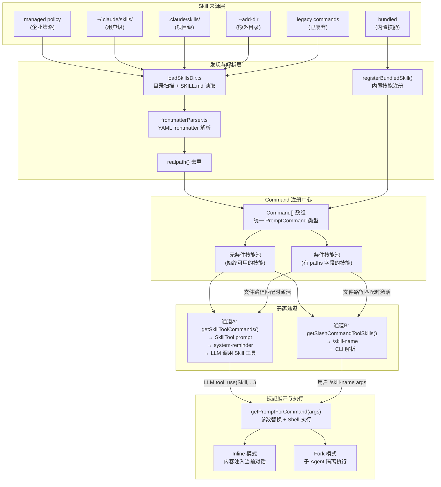
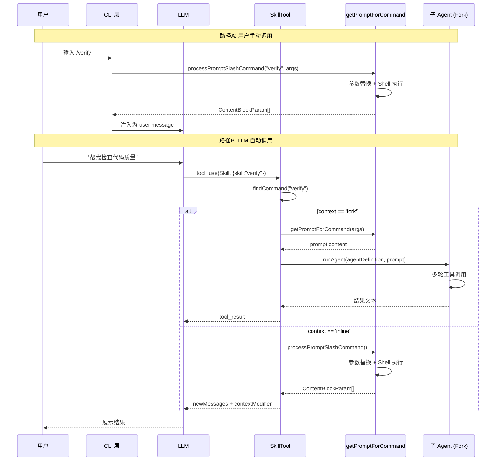
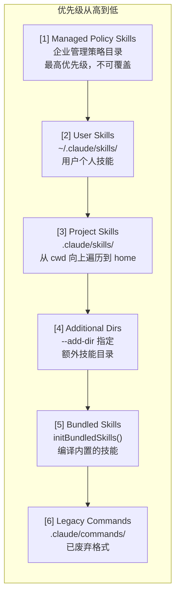
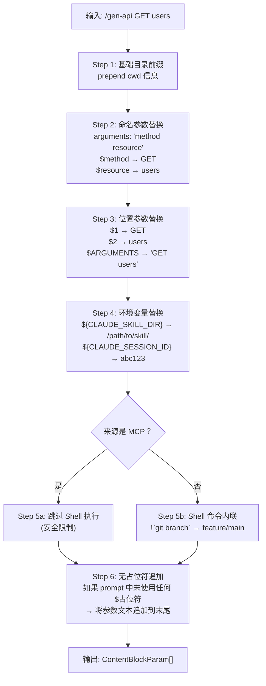
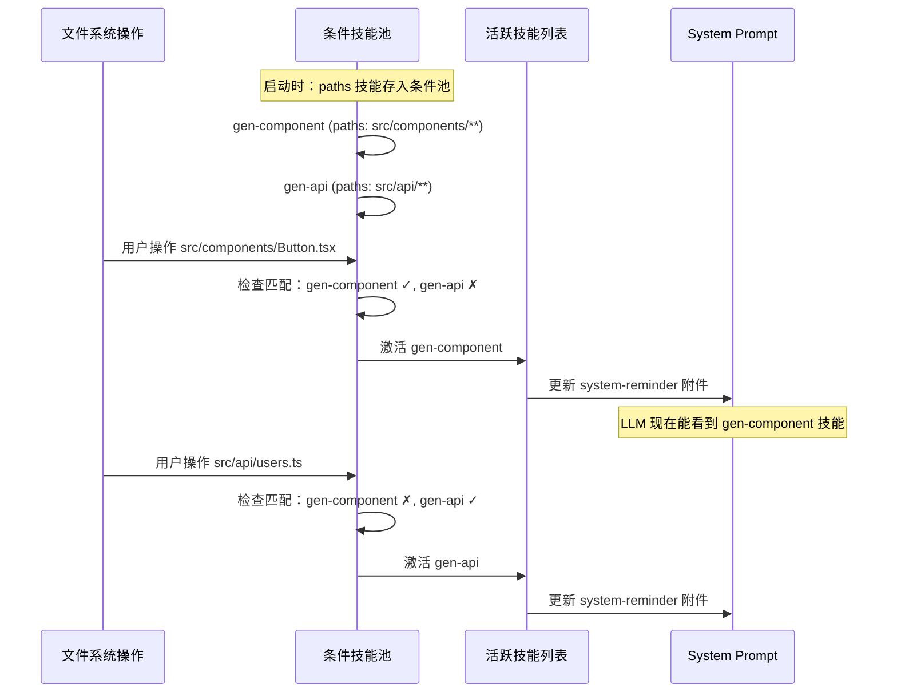
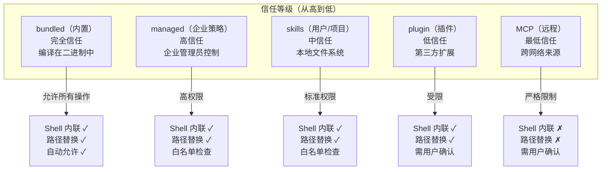
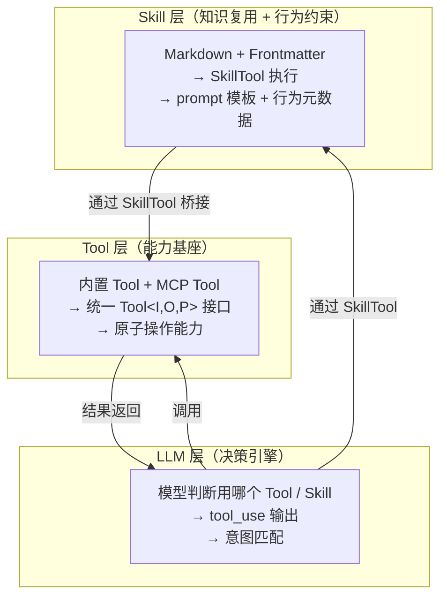

# Claude Code Skills 集成：深度源码调研报告 v2

> 本文档基于 Claude Code 源码的实际分析，在 v1 基础上进行了大幅重构和深化。重点新增了：渐进式披露的三阶段预算算法详解、条件激活的实现细节、Shell 命令内嵌的安全机制、参数替换的完整流水线、Bundled Skills 的注册模式分析，以及多处 mermaid 架构图。适合有一定 Agent 开发经验、希望深入理解 CC Skills 设计决策的读者。

---

## 目录

1. [设计亮点与创新点总览](#1-设计亮点与创新点总览)
2. [整体架构](#2-整体架构)
3. [分模块详解](#3-分模块详解)
   - 3.1 Skill 文件格式与 Frontmatter
   - 3.2 Skill 发现与加载 (loadSkillsDir.ts)
   - 3.3 渐进式披露 (prompt.ts + attachments.ts)
   - 3.4 Skill 调用与展开 (getPromptForCommand)
   - 3.5 SkillTool 工具实现
   - 3.6 条件激活 (paths)
   - 3.7 Bundled Skills
   - 3.8 压缩后技能恢复
4. [工程设计分析](#4-工程设计分析)
5. [Tool / Skill / MCP 三方对比](#5-tool--skill--mcp-三方对比)
6. [总结速记表](#6-总结速记表)

---

## 1. 设计亮点与创新点总览

Claude Code 的 Skills 系统包含 **八大核心创新**，它们共同构成了一个零门槛创建、按需加载、安全可控的 AI 任务自动化框架。

### 1.1 渐进式披露 -- System Prompt 只放约 1% 上下文预算

Skills 系统面临一个根本矛盾：注册的技能越多，system prompt 越大，留给实际对话的上下文越少。CC 的解决方案是 **两层披露**：

- **启动时**：只加载 frontmatter（name + description + whenToUse），通过 `formatCommandsWithinBudget()` 三阶段预算算法控制 token 消耗
- **调用时**：才通过 `getPromptForCommand()` 读取完整的 Markdown 正文

```
总预算 ≈ 1% x 上下文窗口 x 4 chars/token
       ≈ 8KB（对 200K context 窗口）

一个注册了 50 个 Skill 的系统，启动时只消耗约 8KB system prompt 空间
```

### 1.2 双入口调用

用户有两种方式触发技能：

| 入口 | 触发方式 | 场景 |
|------|---------|------|
| 斜杠命令 | 用户输入 `/commit` | 明确知道要用哪个技能 |
| Skill 工具 | LLM 判断后调用 `Skill` tool | 用户表达意图，模型自动匹配 |

两条路径最终汇合到同一个 `processPromptSlashCommand()` 函数。

### 1.3 条件激活（paths）

通过 frontmatter 中的 `paths` 字段，技能可以声明"只在操作匹配路径的文件时才出现"。例如：

```yaml
paths:
  - "src/components/**/*.tsx"
  - "src/hooks/**/*.ts"
```

这个 React 组件生成技能只在用户触及前端文件时才激活，Monorepo 中后端开发者完全看不到它。

### 1.4 参数替换系统

Skills 支持多层参数替换，将静态模板转化为动态内容：

| 占位符 | 说明 | 示例 |
|--------|------|------|
| `$ARGUMENTS` | 完整参数字符串 | `/gen-api GET users` -> `"GET users"` |
| `$ARG_N` / `$1`, `$2` | 位置参数 | `$1` -> `"GET"`, `$2` -> `"users"` |
| `$name` | 命名参数（由 `arguments` 字段定义） | `$method` -> `"GET"` |
| `${CLAUDE_SKILL_DIR}` | 技能所在目录的绝对路径 | `/home/user/.claude/skills/gen-api/` |
| `${CLAUDE_SESSION_ID}` | 当前会话 ID | `abc123` |

### 1.5 Shell 命令内嵌

Skill 正文中的 `` !`command` `` 块在加载时执行，结果替换进 prompt：

```markdown
当前分支是 !`git branch --show-current`，
最近的提交是 !`git log -1 --oneline`。
```

加载后变为：

```markdown
当前分支是 feature/api-refactor，
最近的提交是 a1b2c3d fix: auth token expiry。
```

**安全限制**：来自 MCP 的技能禁用此功能，防止远程技能执行本地命令。

### 1.6 Fork 上下文隔离

技能可声明 `context: 'fork'`，在独立子 Agent 中执行：

- 独立 token 预算（不消耗主对话上下文）
- 独立工具池（可通过 `allowed-tools` 进一步限制）
- 独立对话历史（大量工具调用不污染主对话）
- 支持指定不同模型（如快速检查用 haiku）

### 1.7 多层来源与优先级

```
managed policy (企业) > user (~/.claude/skills/) > project (.claude/skills/)
> additional dirs (--add-dir) > bundled (内置) > legacy commands (已废弃)
```

高优先级覆盖低优先级，企业策略不可被用户或项目覆盖。

### 1.8 预算感知列举

`formatCommandsWithinBudget()` 动态截断描述以适应上下文窗口，三阶段递进降级：

```
Phase 1: 所有技能完整描述 <= 预算 → 直接使用
Phase 2: bundled 保留完整 + 非 bundled 均分剩余预算（描述截断到 250 chars）
Phase 3: 非 bundled 仅显示名称（极端降级）
```

---

## 2. 整体架构

### 2.1 Skills 系统全景架构



### 2.2 Skill 调用时序图



### 2.3 数据流概览

```
SKILL.md 文件
  │
  ├─ frontmatter (YAML) ─→ name, description, whenToUse, paths, ...
  │                          │
  │                          ├─→ 启动时: formatCommandsWithinBudget()
  │                          │   → system-reminder 附件 (skill_listing)
  │                          │   → LLM 可见的技能列表
  │                          │
  │                          └─→ 运行时: 条件激活检查 (paths 匹配)
  │
  └─ body (Markdown) ─────→ 调用时: getPromptForCommand()
                              │
                              ├─→ $ARGUMENTS 替换
                              ├─→ ${CLAUDE_SKILL_DIR} 替换
                              ├─→ !`shell command` 执行
                              └─→ 最终 prompt 内容
```

---

## 3. 分模块详解

### 3.1 Skill 文件格式与 Frontmatter

#### 3.1.1 SKILL.md 完整格式

每个 Skill 是一个目录，必须包含一个 `SKILL.md` 文件：

```
~/.claude/skills/
  gen-api/
    SKILL.md              ← 技能定义文件（必须）
    templates/
      controller.ts.tmpl  ← 附属模板文件
      route.ts.tmpl
    examples/
      crud-example.md     ← 参考示例
```

`SKILL.md` 由 YAML frontmatter + Markdown 正文组成：

```markdown
---
name: gen-api
description: 生成 REST API 端点的完整代码骨架
when_to_use: 当用户需要创建新的 API 端点或 CRUD 操作时
arguments: method resource
argument-hint: "[GET|POST|PUT|DELETE] [resource-name]"
allowed-tools:
  - Read
  - Write
  - Grep
  - Glob
model: inherit
effort: high
context: fork
user-invocable: true
disable-model-invocation: false
paths:
  - "src/api/**/*.ts"
shell: bash
hooks:
  PreToolUse:
    - command: echo "about to use tool"
  PostToolUse:
    - command: echo "tool used"
  Stop:
    - command: npm run test -- --related
---

# API 端点生成器

为资源 $resource 创建 $method 方法的 REST API 实现。

## 上下文收集
1. 使用 Grep 查找现有的路由定义模式
2. 使用 Read 查看 ${CLAUDE_SKILL_DIR}/templates/ 中的模板

## 当前环境
- 分支: !`git branch --show-current`
- 最近提交: !`git log -1 --oneline`
```

#### 3.1.2 Frontmatter 字段速查表

| 字段 | 类型 | 必填 | 默认值 | 作用 |
|------|------|------|--------|------|
| `name` | string | 否 | 目录名 | 技能名称，kebab-case，用户通过 `/name` 调用 |
| `description` | string | 是 | - | 显示描述，也用于 LLM 判断 |
| `when_to_use` | string | 否 | - | LLM 自动触发条件描述（关键字段） |
| `arguments` | string | 否 | - | 空格分隔的命名参数列表，映射到 `$name` 占位符 |
| `argument-hint` | string | 否 | - | 帮助提示，展示在技能列表中 |
| `allowed-tools` | list | 否 | 全部 | 工具白名单（最小权限原则） |
| `model` | string | 否 | inherit | 模型覆盖（haiku/sonnet/opus） |
| `effort` | string/int | 否 | inherit | 思考深度（quick/standard/high） |
| `context` | `'inline'\|'fork'` | 否 | inline | 执行上下文 |
| `agent` | string | 否 | - | fork 时使用的 Agent 类型 |
| `user-invocable` | boolean | 否 | true | 是否可通过 `/name` 手动调用 |
| `disable-model-invocation` | boolean | 否 | false | 是否禁止 LLM 自动触发 |
| `paths` | list | 否 | - | 条件激活路径模式（glob） |
| `hooks` | object | 否 | - | 生命周期钩子（PreToolUse/PostToolUse/Stop） |
| `shell` | `'bash'\|'powershell'` | 否 | bash | Shell 命令执行环境 |

#### 3.1.3 frontmatterParser.ts -- 统一解析器

CC 中 Skills、Agents、Memory 三种 Markdown 配置文件共用同一个 frontmatter 解析器：

```typescript
// frontmatterParser.ts -- 核心解析逻辑
export function parseFrontmatter(content: string): {
  frontmatter: Record<string, unknown>
  body: string
} {
  // 匹配 --- 包裹的 YAML 块
  const match = content.match(/^---\n([\s\S]*?)\n---\n?([\s\S]*)$/)
  if (!match) {
    return { frontmatter: {}, body: content }
  }
  const frontmatter = yaml.parse(match[1])
  const body = match[2]
  return { frontmatter, body }
}
```

**设计要点**：
- 无 frontmatter 的 SKILL.md 也是合法的（正文即全部 prompt 内容）
- YAML 解析失败时记录警告但不阻止加载（容错设计）
- 未知字段不会报错，但会被 `SAFE_SKILL_PROPERTIES` 白名单过滤

### 3.2 Skill 发现与加载 (loadSkillsDir.ts)

#### 3.2.1 六层来源与优先级



#### 3.2.2 加载流程

```typescript
// loadSkillsDir.ts -- 核心加载逻辑（简化）
export async function loadAllSkills(config: SkillConfig): Promise<{
  unconditionalSkills: Command[]
  conditionalSkills: Command[]
}> {
  // Phase 1: 并行加载所有来源
  const [managed, user, project, additional, legacy] = await Promise.all([
    loadSkillsFromDir(config.managedSkillsDir, 'managed'),
    loadSkillsFromDir(config.userSkillsDir, 'skills'),
    loadProjectSkillsDirs(config.cwd),
    loadAdditionalDirs(config.additionalDirs),
    loadLegacyCommands(config.legacyCommandsDirs),
  ])

  // Phase 2: 合并 + realpath 去重
  const all = [...managed, ...user, ...project, ...additional, ...legacy]
  const deduped = deduplicateByRealpath(all)

  // Phase 3: 分离条件技能和无条件技能
  const conditional = deduped.filter(s => s.paths && s.paths.length > 0)
  const unconditional = deduped.filter(s => !s.paths || s.paths.length === 0)

  return { unconditionalSkills: unconditional, conditionalSkills: conditional }
}
```

#### 3.2.3 目录扫描细节

```typescript
// loadSkillsDir.ts:424-445 -- 单目录扫描
const results = await Promise.all(
  entries.map(async (entry): Promise<SkillWithPath | null> => {
    // 只支持目录格式：skill-name/SKILL.md
    if (!entry.isDirectory() && !entry.isSymbolicLink()) {
      return null
    }
    const skillDirPath = join(basePath, entry.name)
    const skillFilePath = join(skillDirPath, 'SKILL.md')
    let content: string
    try {
      content = await fs.readFile(skillFilePath, { encoding: 'utf-8' })
    } catch (e: unknown) {
      if (!isENOENT(e)) {
        logForDebugging(`[skills] failed to read ${skillFilePath}: ${e}`)
      }
      return null
    }
    // 解析 frontmatter，创建 PromptCommand
    const { frontmatter, body } = parseFrontmatter(content)
    return createSkillCommand(entry.name, frontmatter, body, skillDirPath)
  }),
)
```

**关键设计决策**：
- **只支持目录格式**：`skill-name/SKILL.md`，不支持裸 `skill-name.md`。目录格式允许技能附带资源文件。
- **realpath() 去重**：解析符号链接得到规范路径，防止同一技能通过不同路径加载两次。
- **并行加载**：所有来源使用 `Promise.all()` 并行加载，启动性能最优。
- **容错读取**：`ENOENT`（文件不存在）静默忽略，其他错误记录日志但不阻断。

#### 3.2.4 Project Skills 的向上遍历

项目级技能不只在当前目录的 `.claude/skills/` 中查找，而是**从 cwd 向上遍历到 home 目录**，逐层合并：

```
/home/user/projects/myapp/src/
  → 检查 /home/user/projects/myapp/src/.claude/skills/
  → 检查 /home/user/projects/myapp/.claude/skills/
  → 检查 /home/user/projects/.claude/skills/
  → 检查 /home/user/.claude/skills/ (= userSkillsDir，已单独加载)
  → 停止
```

这使得 Monorepo 中的子项目可以有自己的技能，同时继承父目录的技能。

### 3.3 渐进式披露 (prompt.ts + attachments.ts)

#### 3.3.1 System Prompt 中的技能列表

技能不会将完整 prompt 放入 system prompt，而是通过 `system-reminder` 附件注入轻量级的技能列表：

```typescript
// attachments.ts -- 技能列表附件
function createSkillListingAttachment(
  skills: Command[],
  contextBudget: number
): Attachment {
  const formattedList = formatCommandsWithinBudget(skills, contextBudget)
  return {
    type: 'skill_listing',
    content: formattedList,
  }
}
```

LLM 看到的内容类似：

```xml
<system-reminder>
The following skills are available for use with the Skill tool:

- commit: Create a git commit with a well-crafted message based on staged changes.
- review-pr: Review a pull request for code quality, security, and best practices.
- gen-api: 生成 REST API 端点的完整代码骨架
  TRIGGER when: 当用户需要创建新的 API 端点或 CRUD 操作时
</system-reminder>
```

#### 3.3.2 三阶段预算分配算法

`formatCommandsWithinBudget()` 是渐进式披露的核心，它在三个阶段内动态调整每个技能的描述长度：

```typescript
// prompt.ts -- 三阶段预算分配（简化）
export function formatCommandsWithinBudget(
  commands: Command[],
  contextWindowTokens: number
): string {
  // 预算 = 1% 上下文窗口（以 token 计）
  const budgetTokens = Math.floor(contextWindowTokens * 0.01)

  // Phase 1: 尝试全量描述
  const fullText = commands.map(formatFull).join('\n')
  if (roughTokenCount(fullText) <= budgetTokens) {
    return fullText
  }

  // Phase 2: bundled 技能保留完整描述，非 bundled 均分剩余预算
  const bundledText = commands
    .filter(c => c.source === 'bundled')
    .map(formatFull)
    .join('\n')
  const bundledTokens = roughTokenCount(bundledText)
  const remainingBudget = budgetTokens - bundledTokens
  const nonBundled = commands.filter(c => c.source !== 'bundled')
  const perSkillBudget = Math.floor(remainingBudget / nonBundled.length)

  // 每个非 bundled 技能的描述截断到 perSkillBudget
  // 但单个描述不超过 250 chars
  const truncatedText = nonBundled
    .map(c => formatTruncated(c, Math.min(perSkillBudget, 250)))
    .join('\n')

  const phase2Text = bundledText + '\n' + truncatedText
  if (roughTokenCount(phase2Text) <= budgetTokens) {
    return phase2Text
  }

  // Phase 3: 极端降级 -- 非 bundled 仅显示名称
  const namesOnly = nonBundled.map(c => `- ${c.name}`).join('\n')
  return bundledText + '\n' + namesOnly
}
```

**Token 估算公式**：

```typescript
export function roughTokenCountEstimation(text: string): number {
  return Math.ceil(text.length / 4)  // 简单的 4 chars/token 估算
}

export function estimateSkillFrontmatterTokens(skill: Command): number {
  const frontmatterText = [skill.name, skill.description, skill.whenToUse]
    .filter(Boolean)
    .join(' ')
  return roughTokenCountEstimation(frontmatterText)
}
```

#### 3.3.3 预算分配的数值示例

| 场景 | 上下文窗口 | 1% 预算 | 技能数 | 每技能预算 | 策略 |
|------|-----------|---------|--------|-----------|------|
| 小规模 | 200K tokens | 2000 tokens | 10 | 200 tokens | Phase 1（全量） |
| 中规模 | 200K tokens | 2000 tokens | 50 | 40 tokens | Phase 2（截断） |
| 大规模 | 200K tokens | 2000 tokens | 200 | 10 tokens | Phase 3（仅名称） |
| 小窗口 | 32K tokens | 320 tokens | 30 | ~10 tokens | Phase 3（仅名称） |

### 3.4 Skill 调用与展开 (getPromptForCommand)

#### 3.4.1 参数替换的完整流水线

`getPromptForCommand()` 是 Skill 展开的核心函数，执行六步顺序替换：



#### 3.4.2 参数替换源码分析

```typescript
// getPromptForCommand.ts -- 参数替换核心逻辑（简化）
export async function getPromptForCommand(
  command: Command,
  args: string,
  context: SkillContext
): Promise<ContentBlockParam[]> {
  let content = command.body

  // Step 1: 基础目录前缀
  content = `Working directory: ${context.cwd}\n\n${content}`

  // Step 2: 命名参数替换
  if (command.arguments) {
    const argNames = command.arguments.split(/\s+/)
    const argValues = args.split(/\s+/)
    for (let i = 0; i < argNames.length; i++) {
      const name = argNames[i]
      const value = argValues[i] || ''
      // 同时支持 $name 和 ${name}
      content = content.replace(
        new RegExp(`\\$\\{?${name}\\}?`, 'g'),
        value
      )
    }
  }

  // Step 3: 位置参数替换
  const argParts = args.split(/\s+/)
  for (let i = 0; i < argParts.length; i++) {
    content = content.replace(
      new RegExp(`\\$${i + 1}`, 'g'),
      argParts[i]
    )
    content = content.replace(
      new RegExp(`\\$ARGUMENTS\\[${i}\\]`, 'g'),
      argParts[i]
    )
  }
  content = content.replace(/\$ARGUMENTS/g, args)

  // Step 4: 环境变量替换
  if (command.skillRoot) {
    content = content.replace(
      /\$\{CLAUDE_SKILL_DIR\}/g,
      command.skillRoot
    )
  }
  content = content.replace(
    /\$\{CLAUDE_SESSION_ID\}/g,
    context.sessionId
  )

  // Step 5: Shell 命令内联执行（仅非 MCP 技能）
  if (command.source !== 'mcp') {
    content = await executeShellCommandsInPrompt(content, context.cwd)
  }

  // Step 6: 无占位符追加
  if (args && !hasAnyPlaceholder(command.body)) {
    content += `\n\n${args}`
  }

  return [{ type: 'text', text: content }]
}
```

#### 3.4.3 Shell 命令内嵌的执行机制

`` !`command` `` 是 CC Skills 的一个独特特性。它允许技能在加载时动态获取环境信息：

```typescript
// executeShellCommandsInPrompt.ts -- Shell 内联执行
export async function executeShellCommandsInPrompt(
  content: string,
  cwd: string
): Promise<string> {
  // 匹配 !`command` 模式
  const shellPattern = /!\`([^`]+)\`/g

  const replacements: Array<{ match: string; result: string }> = []

  let match
  while ((match = shellPattern.exec(content)) !== null) {
    const command = match[1]
    try {
      // 执行命令，超时 10 秒
      const { stdout } = await execAsync(command, {
        cwd,
        timeout: 10_000,
      })
      replacements.push({
        match: match[0],
        result: stdout.trim(),
      })
    } catch (e) {
      // 执行失败时替换为错误信息
      replacements.push({
        match: match[0],
        result: `[command failed: ${command}]`,
      })
    }
  }

  // 按顺序替换
  let result = content
  for (const { match, result: replacement } of replacements) {
    result = result.replace(match, replacement)
  }
  return result
}
```

**安全要点**：
- 命令执行有 **10 秒超时**
- MCP 来源的技能 **完全禁用** Shell 内联
- 命令在技能的 cwd 中执行，不是全局环境
- 执行失败时以 `[command failed: ...]` 替代，不会阻断技能加载

### 3.5 SkillTool 工具实现

#### 3.5.1 SkillTool 定义

SkillTool 是一个标准的内置 Tool，它作为 LLM 调用 Skill 的桥接层：

```typescript
// SkillTool.ts -- 工具定义（简化）
export const SkillTool = buildTool<SkillInput, SkillOutput>({
  name: 'Skill',
  description: 'Execute a skill within the main conversation',
  inputSchema: z.object({
    skill: z.string().describe('The skill name'),
    args: z.string().optional().describe('Optional arguments for the skill'),
  }),

  async call(input, context): Promise<ToolResult<SkillOutput>> {
    // 1. 标准化技能名
    const name = input.skill.trim().replace(/^\//, '')

    // 2. 查找命令
    const command = findCommand(name, context.allCommands)
    if (!command) {
      return { type: 'error', error: `Skill "${name}" not found` }
    }

    // 3. 检查权限
    if (command.disableModelInvocation) {
      return {
        type: 'error',
        error: `Skill "${name}" can only be invoked by the user via /${name}`,
      }
    }

    // 4. 根据执行模式分派
    if (command.context === 'fork') {
      return executeForkedSkill(command, input.args, context)
    } else {
      return executeInlineSkill(command, input.args, context)
    }
  },
})
```

#### 3.5.2 Inline 执行模式

```typescript
// SkillTool.ts -- Inline 执行
async function executeInlineSkill(
  command: Command,
  args: string,
  context: ToolContext
): Promise<ToolResult<SkillOutput>> {
  // 1. 获取展开后的 prompt 内容
  const contentBlocks = await getPromptForCommand(command, args, context)

  // 2. 记录已调用技能（用于压缩后恢复）
  addInvokedSkill(command.name, command.skillRoot, contentBlocks, context.agentId)

  // 3. 记录遥测
  telemetry.record('tengu_skill_tool_invocation', {
    skill: command.name,
    source: command.source,
    context: 'inline',
  })

  // 4. 构建结果
  return {
    type: 'success',
    // 技能内容作为新的 user message 注入对话
    newMessages: [{
      role: 'user',
      content: contentBlocks,
    }],
    // 上下文修改器：应用技能的元数据覆盖
    contextModifier: {
      ...(command.allowedTools && {
        alwaysAllowRules: command.allowedTools,
      }),
      ...(command.model && {
        mainLoopModel: command.model,
      }),
      ...(command.effort && {
        effortValue: command.effort,
      }),
    },
  }
}
```

#### 3.5.3 Fork 执行模式

```typescript
// SkillTool.ts -- Fork 执行
async function executeForkedSkill(
  command: Command,
  args: string,
  context: ToolContext
): Promise<ToolResult<SkillOutput>> {
  // 1. 获取展开后的 prompt
  const contentBlocks = await getPromptForCommand(command, args, context)

  // 2. 解析 Agent 定义
  const agentDefinition = command.agent
    ? resolveAgentDefinition(command.agent)
    : defaultAgentDefinition

  // 3. 构建隔离工具池
  const filteredTools = command.allowedTools
    ? context.availableTools.filter(t =>
        command.allowedTools!.some(pattern => matchToolName(t.name, pattern))
      )
    : context.availableTools

  // 4. 执行子 Agent
  const agentMessages: Message[] = []
  const agentId = generateAgentId()

  for await (const message of runAgent({
    agentDefinition,
    promptMessages: [{ role: 'user', content: contentBlocks }],
    toolUseContext: context,
    canUseTool: context.canUseTool,
    isAsync: false,
    querySource: 'agent:custom',
    model: command.model,
    availableTools: filteredTools,
    override: { agentId },
  })) {
    agentMessages.push(message)
  }

  // 5. 提取结果
  const resultText = extractLastAssistantText(agentMessages)

  return {
    type: 'success',
    output: `Skill '${command.name}' completed.\n\nResult:\n${resultText}`,
  }
}
```

#### 3.5.4 Inline vs Fork 对比

| 维度 | Inline | Fork |
|------|--------|------|
| **上下文** | 共享主对话上下文 | 独立上下文（不污染主对话） |
| **Token 预算** | 消耗主对话预算 | 独立预算 |
| **工具池** | 继承主对话工具 | 可通过 allowed-tools 限制 |
| **模型** | 可通过 contextModifier 覆盖 | 直接传给 runAgent |
| **结果形式** | 内容注入为 user message | 子 Agent 最终文本 |
| **适用场景** | 快速操作（simplify, debug） | 复杂独立任务（verify, batch） |
| **对话历史** | 技能内容成为对话一部分 | 子 Agent 的工具调用不可见 |
| **实时反馈** | 即时可见 | 等待子 Agent 完成 |

### 3.6 条件激活 (paths)

#### 3.6.1 工作原理

声明了 `paths` 的技能不会出现在启动时的技能列表中，而是存储在"条件技能池"中。当对话中涉及匹配路径的文件时，技能被动态激活：

```typescript
// 条件技能的激活检查（概念性代码）
function checkConditionalSkillActivation(
  filePath: string,
  conditionalSkills: Command[]
): Command[] {
  return conditionalSkills.filter(skill => {
    if (!skill.paths) return false
    return skill.paths.some(pattern =>
      minimatch(filePath, pattern, { matchBase: true })
    )
  })
}
```

#### 3.6.2 条件激活时序



#### 3.6.3 使用场景

| 场景 | paths 模式 | 效果 |
|------|-----------|------|
| React 组件生成 | `src/components/**/*.tsx` | 只在前端组件目录激活 |
| API 路由生成 | `src/api/**/*.ts` | 只在 API 目录激活 |
| 测试生成 | `**/*.test.ts` | 只在测试文件旁激活 |
| 数据库迁移 | `migrations/**/*.sql` | 只在迁移目录激活 |
| Terraform | `infra/**/*.tf` | 只在基础设施代码激活 |

### 3.7 Bundled Skills

#### 3.7.1 注册机制

内置技能通过 `registerBundledSkill()` API 以编程方式注册，不需要文件系统扫描：

```typescript
// bundledSkills.ts -- 注册 API
export function registerBundledSkill(config: {
  name: string
  description: string
  whenToUse?: string
  userInvocable?: boolean
  disableModelInvocation?: boolean
  context?: 'inline' | 'fork'
  allowedTools?: string[]
  isEnabled?: () => boolean
  getPromptForCommand: (args: string) => Promise<ContentBlockParam[]>
}): void {
  const command: Command = {
    type: 'prompt',
    name: config.name,
    description: config.description,
    whenToUse: config.whenToUse,
    source: 'bundled',
    userInvocable: config.userInvocable ?? true,
    disableModelInvocation: config.disableModelInvocation ?? false,
    context: config.context ?? 'inline',
    allowedTools: config.allowedTools,
    isEnabled: config.isEnabled,
    getPromptForCommand: config.getPromptForCommand,
  }
  bundledSkillRegistry.push(command)
}
```

#### 3.7.2 内置技能清单

**代码质量层**

| 技能 | 用途 | 模式 | 关键特性 |
|------|------|------|---------|
| `verify` | 验证代码变更正确性 | fork | 独立 Agent 执行，工具限只读 |
| `simplify` | 代码简化与重构审查 | inline | 共享上下文，引用刚写的代码 |
| `debug` | 调试辅助诊断 | inline | 直接在主对话中交互 |

**工作流层**

| 技能 | 用途 | 模式 | 关键特性 |
|------|------|------|---------|
| `batch` | 批量文件处理 | fork | fork 隔离，大量工具调用 |
| `commit` | Git 提交 | inline | disableModelInvocation=true |
| `review-pr` | PR 审查 | fork | 只读工具池 |
| `stuck` | 帮模型脱困 | inline | 循环检测后的"解围"指令 |
| `skillify` | 将 prompt 转为 Skill | inline | 元技能 -- 用技能创建技能 |

**配置层**

| 技能 | 用途 | 模式 | 关键特性 |
|------|------|------|---------|
| `update-config` | 配置 settings.json | inline | 不需要手动编辑 JSON |
| `remember` | 记忆管理（CLAUDE.md） | inline | 运行时门控：`isAutoMemoryEnabled()` |
| `keybindings-help` | 快捷键帮助 | inline | 纯信息展示 |

**Feature-gated 层**

| 技能 | Feature Flag | 用途 |
|------|-------------|------|
| `loop` | AGENT_TRIGGERS | 定时循环执行 |
| `schedule` | AGENT_TRIGGERS_REMOTE | 远程调度 |
| `claude-api` | BUILDING_CLAUDE_APPS | Claude API 辅助 |

#### 3.7.3 与文件系统技能的关键区别

```
文件系统技能                          内置技能
─────────────                       ──────────
SKILL.md 文件                        编译在二进制中
运行时文件读取                        无 I/O 开销
任何用户可创建                        开发团队编写
优先级低于 managed/user               优先级最低（可被覆盖）
无运行时门控                          支持 isEnabled() 门控
```

#### 3.7.4 资源文件安全提取

部分内置技能需要在运行时提取资源文件到磁盘（如模板文件）：

```typescript
// 安全文件写入 -- 防止符号链接攻击
async function safeWriteFile(path: string, content: string): Promise<void> {
  const fd = await fs.open(path, 
    fs.constants.O_WRONLY | 
    fs.constants.O_CREAT | 
    fs.constants.O_NOFOLLOW |  // 不跟随符号链接
    fs.constants.O_EXCL         // 文件必须不存在
  )
  await fd.writeFile(content)
  await fd.close()
}

// 惰性单例提取 -- 多个并发调用共享同一个 Promise
let extractionPromise: Promise<string> | null = null

function ensureResourcesExtracted(): Promise<string> {
  extractionPromise ??= doExtractResources()  // ??= 操作符
  return extractionPromise
}
```

### 3.8 压缩后技能恢复

#### 3.8.1 问题背景

长对话中触发 autocompact 后，之前调用的 Skill 内容可能被压缩丢失。CC 通过记录和重建机制确保技能行为在压缩后仍然一致。

#### 3.8.2 实现机制

```typescript
// 每次技能调用时记录
export function addInvokedSkill(
  name: string,
  skillRoot: string | undefined,
  content: ContentBlockParam[],
  agentId: string
): void {
  invokedSkills.push({
    name,
    skillRoot,
    content,
    agentId,
    timestamp: Date.now(),
  })
}

// 压缩后恢复
export function createSkillAttachmentIfNeeded(
  agentId: string
): Attachment | null {
  const relevant = invokedSkills
    .filter(s => s.agentId === agentId)
    .sort((a, b) => b.timestamp - a.timestamp)  // 最近优先

  if (relevant.length === 0) return null

  // 预算控制
  const TOTAL_BUDGET = 25_000  // 25K chars
  const PER_SKILL_LIMIT = 5_000  // 5K chars per skill

  let totalUsed = 0
  const included: InvokedSkill[] = []

  for (const skill of relevant) {
    const size = JSON.stringify(skill.content).length
    const clampedSize = Math.min(size, PER_SKILL_LIMIT)
    if (totalUsed + clampedSize > TOTAL_BUDGET) break
    included.push(skill)
    totalUsed += clampedSize
  }

  // 构建恢复附件
  const text = included
    .map(s => `Previously invoked skill: ${s.name}\n${truncate(s.content, PER_SKILL_LIMIT)}`)
    .join('\n\n')

  return {
    type: 'invoked_skills',
    content: text,
  }
}
```

**预算控制参数**：
- 总预算：25K chars（所有已调用技能的恢复内容总和）
- 单技能上限：5K chars
- 优先级：最近调用的优先保留

---

## 4. 工程设计分析

### 4.1 Command 类型：统一的抽象基座

CC 使用 `Command` 类型（定义在 `src/types/command.ts`）统一了所有可调用实体：

```typescript
type Command = {
  type: 'prompt'           // 标识为 Skill 类型
  name: string
  description: string
  whenToUse?: string
  source: 'bundled' | 'plugin' | 'skills' | 'mcp' | 'managed'
  // ... 其他元数据字段
  getPromptForCommand(args: string, context: SkillContext): Promise<ContentBlockParam[]>
}
```

这个统一类型使得：
- built-in、bundled、plugin、skills、mcp 来源的技能共用一套加载/展示/执行逻辑
- `getPromptForCommand()` 是扩展点 -- 每种来源实现自己的内容加载策略
- 排序、去重、预算分配算法不需要关心具体来源

### 4.2 安全属性白名单 (SAFE_SKILL_PROPERTIES)

```typescript
const SAFE_SKILL_PROPERTIES = new Set([
  'name',
  'description',
  'when_to_use',
  'argument-hint',
  'arguments',
  'user-invocable',
  'disable-model-invocation',
  // 注意：allowed-tools、model、hooks 等 *不在* 白名单中
])
```

**设计原则**：只包含安全属性的技能可以自动允许执行，否则需要用户确认。新增属性默认不在白名单中 -- **"默认拒绝" 比 "默认允许" 更安全**。

这意味着：
- 一个只有 `name + description` 的简单技能 -> 自动允许
- 一个声明了 `allowed-tools: [Bash]` 的技能 -> 需要用户确认
- 一个声明了 `hooks` 的技能 -> 需要用户确认
- 未来新增的任何 frontmatter 字段 -> 默认需要确认（前向兼容安全）

### 4.3 信任边界按来源分级



关键安全差异：

```typescript
// MCP 来源的技能禁用 Shell 命令内联
if (command.source !== 'mcp') {
  content = await executeShellCommandsInPrompt(content, cwd)
}

// MCP 来源的技能不替换本地路径变量
if (command.source !== 'mcp') {
  content = content.replace(/\$\{CLAUDE_SKILL_DIR\}/g, command.skillRoot)
}
```

### 4.4 Write-Once Registry 模式

内置技能的注册使用 "Write-Once Registry" 模式打破循环依赖：

```typescript
// bundledSkillRegistry.ts -- 无依赖的叶子模块
let builders: SkillBuilder[] | null = null

export function registerBundledSkillBuilders(b: SkillBuilder[]): void {
  builders = b  // 生产者初始化时写入
}

export function getBundledSkillBuilders(): SkillBuilder[] | null {
  return builders  // 消费者运行时读取
}
```

**为什么需要这个模式？**

在打包成二进制后，动态 `import()` 无法解析模块路径。通过无依赖的叶子模块作为注册中心，生产者（bundled skill 定义文件）在初始化时写入，消费者（skill 加载器）在运行时读取，避免了直接依赖导致的循环引用。

### 4.5 contextModifier -- 技能对主循环的影响

Inline 模式的技能可以通过 `contextModifier` 修改主循环的行为：

```typescript
// contextModifier 应用链
contextModifier: {
  // 1. 追加工具白名单到 alwaysAllowRules
  alwaysAllowRules: command.allowedTools,
  
  // 2. 覆盖主循环模型
  mainLoopModel: command.model,
  
  // 3. 覆盖工作量级别
  effortValue: command.effort,
}
```

这使得技能不仅注入内容，还能**改变 Agent 后续的行为模式**。例如一个 `quick-check` 技能可以将模型切换为 haiku 并设置 `effort: low`。

---

## 5. Tool / Skill / MCP 三方对比

### 5.1 核心异同总表

| 维度 | 内置 Tool | Skill | MCP 工具 |
|------|----------|-------|---------|
| **代码内类型** | `Tool<Input,Output,P>` | `PromptCommand` | 映射为 `Tool`（`isMcp:true`） |
| **定义格式** | TypeScript 代码 | Markdown + YAML | JSON Schema（MCP 协议） |
| **注册方式** | `buildTool()` 编译时 | `registerBundledSkill()` / 文件扫描 | `tools/list` 动态发现 |
| **调用方式** | LLM 直接 `tool_use` | 通过 SkillTool 间接 / 用户 `/command` | LLM 直接 `tool_use` |
| **执行方式** | 进程内 `call()` | 注入 prompt（inline）/ 子 Agent（fork） | JSON-RPC 代理 |
| **输入验证** | Zod safeParse + validateInput | 参数替换（弱验证） | JSON Schema 验证 |
| **权限默认** | 部分自动允许（只读工具） | 安全属性白名单自动允许 | passthrough（每次确认） |
| **结果形式** | `ToolResult<Output>` | 对话消息 / 子 Agent 文本 | MCP content array |
| **安全边界** | 共享进程权限 | 可限制工具白名单（fork 模式） | 进程隔离 / 网络隔离 |
| **延迟加载** | `shouldDefer` 标记 | 始终懒加载（只预加载 frontmatter） | MCP 工具默认延迟 |
| **可扩展性** | 修改代码 | 创建 Markdown 文件 | 实现 MCP 协议 |
| **错误处理** | 进程内异常 -> tool_result | prompt 注入无显式错误机制 | 网络错误 / 认证过期 |
| **适用场景** | 原子操作（读文件、执行命令） | 组合流程（审查、验证、生成） | 连接外部服务 |

### 5.2 执行流水线对比

```
           内置 Tool              Skill                    MCP 工具
           ─────────             ──────                   ──────
Stage 1    工具查找(name)         SkillTool 查找           工具查找(mcp__前缀名)
Stage 2    Zod Schema 验证       参数替换(弱验证)           JSON Schema 验证
Stage 3    Pre-Tool Hook         Pre-Tool Hook            Pre-Tool Hook
Stage 4    权限检查(7源规则)      安全属性白名单检查         权限检查(默认passthrough)
Stage 5    tool.call()           Inline: 注入 prompt      ensureConnectedClient()
           (进程内)               Fork: 子 Agent 执行       → JSON-RPC tools/call
Stage 6    mapToolResult         contextModifier 应用      mapToolResult + blob 处理
Stage 7    Post-Tool Hook        Post-Tool Hook           Post-Tool Hook
Stage 8    消息发射               消息发射                   消息发射
```

### 5.3 三者的分层关系



### 5.4 设计决策解析

**Q: 为什么 Skill 通过 SkillTool 间接调用，而非直接注册为独立 Tool？**

Skill 的本质是 prompt 模板，不是函数调用。它没有严格的输入 Schema（只有文本参数），执行方式也与 Tool 完全不同（注入对话 vs 函数调用）。通过 SkillTool 桥接，保持了 Tool 接口的纯粹性，同时让 Skill 融入统一的执行流水线。

**Q: 为什么 Skill 使用 Markdown 而非 TypeScript 定义？**

降低创建门槛是首要目标。任何用户都能写 Markdown，但不是所有用户都会 TypeScript。Markdown + frontmatter 格式同时满足了"人类可读"和"机器可解析"的需求，且 Git diff 清晰。

**Q: 为什么 Skill 需要两种执行模式？**

- **Inline** 适合快速行为修改（如 `simplify` -- 审查刚写的代码，需要看到对话上下文）
- **Fork** 适合复杂独立任务（如 `verify` -- 运行完整测试套件，大量工具调用会污染主对话上下文；同时可以限制工具集实现安全隔离）

---

## 6. 总结速记表

### 6.1 核心概念速记

| 维度 | 要点 | 关键设计 |
|------|------|---------|
| **Skill 本质** | 提示词模板 + 元数据 + 执行上下文 | "AI Shell 脚本" -- 自动化 AI 任务 |
| **定义格式** | Markdown + YAML frontmatter | 零门槛，人类可读，版本控制友好 |
| **代码内类型** | `PromptCommand` | 通过 `SkillTool` 桥接到 Tool System |
| **调用方式** | 双重：用户 `/name` + 模型自动 | `whenToUse` 字段让模型理解何时触发 |
| **执行模式** | Inline（共享上下文）/ Fork（隔离） | `context: fork` 实现权限+上下文+模型隔离 |
| **来源层级** | 6 层：managed > user > project > additional > bundled > legacy | 高优先级覆盖低优先级 |
| **懒加载** | 只预加载 frontmatter，内容按需 | 三阶段 Token 预算分配算法 |
| **条件激活** | `paths` 字段匹配文件路径 | Monorepo 友好，减少选择负担 |
| **参数系统** | $ARGUMENTS / $N / 命名参数 | 六步顺序替换 + Shell 内联 + 环境变量 |
| **安全模型** | SAFE_SKILL_PROPERTIES 白名单 | 前向兼容安全，新属性默认需审批 |
| **MCP 安全** | 禁用 Shell 内联 + 不替换本地路径 | 安全策略按来源递减 |
| **压缩恢复** | addInvokedSkill -> 压缩后重建 | 25K 总预算 / 5K 单技能，最近优先 |

### 6.2 Frontmatter 字段分类

| 分类 | 字段 | 安全白名单 |
|------|------|-----------|
| **标识** | name, description, when_to_use | 是 |
| **参数** | arguments, argument-hint | 是 |
| **可见性** | user-invocable, disable-model-invocation | 是 |
| **执行控制** | context, agent, model, effort | 否（需确认） |
| **安全约束** | allowed-tools | 否（需确认） |
| **条件** | paths | 否（需确认） |
| **钩子** | hooks | 否（需确认） |
| **环境** | shell | 否（需确认） |

### 6.3 Skill 来源与优先级

| 优先级 | 来源 | 路径 | 谁控制 |
|--------|------|------|--------|
| 1（最高） | Managed Policy | 企业管理目录 | 企业管理员 |
| 2 | User Skills | `~/.claude/skills/` | 个人用户 |
| 3 | Project Skills | `.claude/skills/` (向上遍历) | 项目团队 |
| 4 | Additional Dirs | `--add-dir` 参数 | 命令行指定 |
| 5 | Bundled Skills | 编译内置 | CC 开发团队 |
| 6（最低） | Legacy Commands | `.claude/commands/` | 已废弃 |

### 6.4 关键源文件

| 文件 | 职责 |
|------|------|
| `src/types/command.ts` | Command/PromptCommand 类型定义 |
| `src/skills/loadSkillsDir.ts` | 技能发现与目录扫描 |
| `src/skills/bundledSkills.ts` | 内置技能注册 |
| `src/skills/frontmatterParser.ts` | YAML frontmatter 统一解析 |
| `src/skills/getPromptForCommand.ts` | 参数替换与内容展开 |
| `src/skills/executeShellCommandsInPrompt.ts` | Shell 命令内联执行 |
| `src/tools/SkillTool/SkillTool.ts` | SkillTool 工具实现 |
| `src/skills/prompt.ts` | 预算分配与技能列表格式化 |
| `src/skills/attachments.ts` | system-reminder 附件生成 |
| `src/skills/invokedSkills.ts` | 压缩后技能恢复 |

### 6.5 设计模式总结

| 模式 | 在 Skills 中的应用 | 适用场景 |
|------|-------------------|---------|
| **渐进式披露** | frontmatter 预览 -> 按需全量加载 | 上下文窗口有限的 Agent 系统 |
| **双入口调用** | 用户 `/cmd` + LLM Skill tool | 需要手动和自动两种触发方式 |
| **分层来源覆盖** | managed > user > project > bundled | 多层配置合并的系统 |
| **安全白名单（前向兼容）** | SAFE_SKILL_PROPERTIES | 安全敏感的插件/扩展系统 |
| **Write-Once Registry** | bundledSkillRegistry | 打包二进制中打破循环依赖 |
| **Markdown-as-Config** | SKILL.md = YAML + Markdown | 需要"配置+内容"混合体的系统 |
| **条件激活** | paths glob 匹配 | Monorepo/多模块项目 |
| **上下文修改器** | contextModifier 改变主循环行为 | 技能需要影响后续执行环境 |
| **压缩后恢复** | addInvokedSkill + createSkillAttachment | 支持上下文压缩的 Agent 系统 |

---

**一句话总结**：Claude Code 的 Skills 系统通过 **Markdown-as-Config 格式 + 双入口调用 + Inline/Fork 双模式执行 + 六层分层加载 + 条件激活 + 渐进式披露预算分配 + 压缩后恢复 + 信任边界分级** 的组合设计，实现了一个零门槛创建、按需加载、安全可控的 AI 任务自动化框架。其核心设计洞察是：**Skill 不是 Tool 的简单封装，而是"指导 Agent 如何思考和行动的专家知识模板"** -- 它通过 SkillTool 桥接融入 Tool System 的执行流水线，同时保持了 Markdown 定义的低门槛和高可读性。
