# Claude Code 子Agent与多Agent编排：深度源码调研报告 v2

> 本文档基于 Claude Code 源码的实际分析，纠正和补充了 v1 版本中的理解偏差。相比 v1，本版本更加关注源码层面的实现细节、设计决策背后的工程考量，以及各模块之间的精确交互关系。

---

## 目录

1. [子Agent与多Agent编排的含义、动机与必要性](#1-子agent与多agent编排的含义动机与必要性)
2. [Claude Code 的设计亮点与创新点](#2-claude-code-的设计亮点与创新点)
3. [整体架构概览](#3-整体架构概览)
4. [内置Agent类型详解（4种）](#4-内置agent类型详解4种)
5. [Simple SubAgent 模式](#5-simple-subagent-模式)
6. [Fork SubAgent 模式（核心创新）](#6-fork-subagent-模式核心创新)
7. [Coordinator 模式](#7-coordinator-模式)
8. [Swarm 团队模式](#8-swarm-团队模式)
9. [工具过滤与安全体系](#9-工具过滤与安全体系)
10. [同步 vs 异步执行决策](#10-同步-vs-异步执行决策)
11. [工程设计分析（抽象、扩展性、复用性）](#11-工程设计分析)
12. [疑惑解答](#12-疑惑解答)
13. [总结速记表](#13-总结速记表)

---

## 1. 子Agent与多Agent编排的含义、动机与必要性

### 1.1 基本概念

**子Agent（Subagent）** 是由主Agent在执行过程中动态创建的独立Agent实例。每个子Agent拥有独立的系统提示、工具集、对话上下文和生命周期，代表了AI系统中"分治策略"的工程实现。

**多Agent编排（Multi-Agent Orchestration）** 是在系统中协调多个Agent实例协同工作的完整机制，涵盖任务分解与分配、Agent之间的通信与信息共享、并行执行的调度与冲突管理、结果的聚合与综合、故障的检测与恢复。

### 1.2 LLM 的固有限制——为什么单Agent不够

LLM 本质上是无状态的，每次推理都是一次独立的函数调用。虽然通过对话历史可以模拟状态，但受到根本性限制：

| 限制 | 具体表现 | 工程影响 |
|------|----------|----------|
| **上下文窗口有限** | 即使200K token也不足以容纳大型项目全貌 | 长对话中早期信息被压缩或丢失 |
| **注意力衰减** | 上下文越长，模型对关键信息的注意力越分散 | 中间结果累积导致推理质量下降 |
| **无并行能力** | 单次API调用本质上是串行的 | 可并行的子任务被迫串行执行 |
| **无隔离机制** | 所有信息共享同一上下文 | 一次错误的推理可能污染后续所有判断 |
| **成本线性增长** | 每轮对话输入全量历史token | 对话越长，每轮成本越高 |

### 1.3 多Agent架构解决的六大核心问题

| 核心问题 | 单Agent困境 | 多Agent方案 |
|----------|-------------|-------------|
| **任务分解** | 模型需要在一次上下文中处理所有子任务 | 将复杂任务拆解为独立子任务，分配给专用Agent |
| **专业分工** | 同一个模型被要求既搜索又编码又验证 | 不同Agent配备不同工具集、模型和行为约束 |
| **并行加速** | 独立子任务只能串行执行 | Fork/Coordinator/Swarm支持真正的并行执行 |
| **安全隔离** | 搜索任务和编辑任务共享同一权限 | Explore Agent只有只读权限，无法修改文件 |
| **成本优化** | 所有任务都用同一个模型 | 搜索用haiku，规划和执行用更强的模型 |
| **故障隔离** | 一个子任务失败导致整个对话中断 | 子Agent失败只影响自身，父Agent可重新调度 |

### 1.4 工程场景论证：OAuth2 需求的分解

以"为用户认证模块添加OAuth2支持"为例，这个需求至少涉及以下环节：

```
需求分析 → 代码调研（API/数据库/前端三个独立方向）
         → 方案设计
         → 数据库迁移编写
         → 后端API实现
         → 前端组件开发
         → 集成测试
         → 验证
```

**单Agent串行执行的问题**：

```
总时间 = T(调研API) + T(调研DB) + T(调研前端) + T(设计) + T(迁移) + T(后端) + T(前端) + T(测试)

假设每步平均2分钟，总时间约16分钟
上下文从0累积到可能超过100K token
后期步骤的推理质量因上下文膨胀而下降
```

**多Agent并行执行**：

```
阶段1（并行）：T(调研API) || T(调研DB) || T(调研前端) → 最慢的那个约2分钟
阶段2（串行）：T(设计综合)                             → 2分钟
阶段3（部分并行）：T(迁移) → T(后端) || T(前端)         → 4分钟
阶段4（并行）：T(测试) || T(验证)                      → 2分钟

总时间约10分钟，且每个Agent有独立的清洁上下文
```

多Agent架构将线性串行流程变成了高效的并行流水线，同时通过上下文隔离保证了每个阶段的推理质量。

---

## 2. Claude Code 的设计亮点与创新点

Claude Code 的多Agent系统展现了多个独到的工程设计理念，以下逐一分析。

### 2.1 三种递进的多Agent模式

```
简单                                                           复杂
 |                                                              |
 v                                                              v
SubAgent模式  -->  Fork模式  -->  Coordinator模式  -->  Swarm团队模式
(委托单任务)     (共享缓存并行)    (中心化编排)         (对等协作)
```

这种递进设计的精妙之处在于：用户（或主Agent）无需预先选择模式，系统根据feature gate和环境变量自动路由到最合适的模式。简单任务不会启动复杂的编排机制，避免了过度工程化。

### 2.2 Fork的Prompt Cache共享——字节级前缀继承（核心创新）

**这是Claude Code最重要的架构创新，也是最容易被低估的设计。**

核心洞察：Anthropic API的Prompt Cache通过**字节级前缀匹配**来复用已处理的token。如果多个API请求共享完全相同的请求前缀（系统提示 + 工具定义 + 对话历史），后续请求可以直接复用缓存，仅对新增部分进行处理。

Fork模式利用这一特性，让多个并行子Agent的API请求共享同一个前缀，从而在继承完整上下文的同时，将token成本降低60%以上。

其设计灵感来自Unix的`fork()`系统调用中的Copy-on-Write机制：不真正复制数据，而是共享同一份数据的引用。

### 2.3 四层工具过滤——纵深防御

Claude Code的工具安全不依赖单一防线，而是通过四层独立的过滤机制实现纵深防御：

```
第1层：ALL_AGENT_DISALLOWED_TOOLS     -- 所有子Agent都受限
第2层：CUSTOM_AGENT_DISALLOWED_TOOLS   -- 非内建Agent额外限制
第3层：ASYNC_AGENT_ALLOWED_TOOLS       -- 异步Agent白名单
第4层：Agent自身的disallowedTools      -- 类型级约束
```

即使某一层存在漏洞（比如有人定义了`disallowedTools: []`的Agent），其他层仍能拦截危险操作。这是经典的Defense-in-Depth安全模型在AI Agent系统中的应用。

### 2.4 对抗性验证Agent——红队测试理念

Verification Agent的设计借鉴了信息安全领域的红队（Red Team）理念：它的目标**不是确认代码能工作**，而是**尽可能证明代码不能工作**。

这种"左手打右手"的自我对抗机制，有效对抗了LLM系统中常见的两种失败模式：
- **验证回避**：模型倾向于找借口不运行测试（"看起来正确"/"环境复杂"）
- **表面正确性陷阱**：代码通过happy path但在边界条件下崩溃

### 2.5 Coordinator的"理解不可委派"原则

Coordinator模式中有一条核心设计原则：**协调者必须消化所有Worker的研究发现后，再编写具体的实施规格，不允许简单转发**。

源码中的表述是"Never write 'based on your findings'"——这意味着协调者不能说"根据你的发现去修复bug"，而必须说"修复 src/auth/validate.ts 第42行的空指针，Session过期时user字段为undefined，在user.id访问前添加null检查"。

这个原则解决了LLM多Agent系统中**信息衰减**的核心问题：如果允许简单转发，每经过一层Agent，信息的精确度就会衰减一次。

### 2.6 声明式自定义Agent

通过 `.claude/agents/*.md` 的Markdown frontmatter定义Agent，让非程序员也能设计专用Agent：

```yaml
---
name: security-auditor
description: 分析代码中的安全漏洞
tools:
  - Bash
  - Read
  - Grep
model: haiku
---

你是一位代码安全审计专家...
```

这种声明式设计将Agent的定义与执行引擎解耦，降低了创建门槛。

### 2.7 上下文隔离的"默认拒绝"设计

`createSubagentContext()` 将所有可变状态**默认设为隔离**，开发者必须**显式opt-in共享**。

这种deny-by-default设计确保新增的子Agent功能天生安全——忘记配置共享不会导致安全漏洞，只会导致功能缺失（更容易发现和修复）。

---

## 3. 整体架构概览

### 3.1 架构总览图

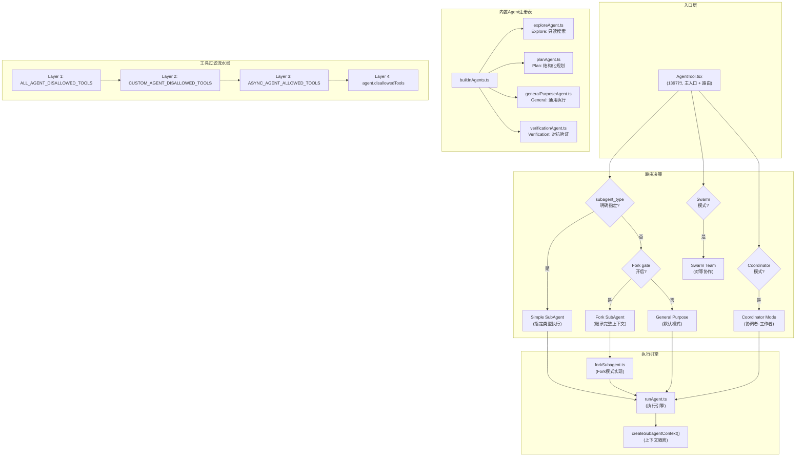

### 3.2 源码文件布局

```
tools/AgentTool/
|-- AgentTool.tsx             # 1397行，主入口 + 路由决策逻辑
|                             # 包含：输入schema定义、类型解析、
|                             # 同步/异步分支、结果格式化
|-- runAgent.ts               # 执行引擎，负责实际运行Agent
|                             # 包含：系统提示构建、工具池组装、
|                             # API调用循环、结果收集
|-- forkSubagent.ts           # Fork模式的核心实现
|                             # 包含：buildForkedMessages()、
|                             # CacheSafeParams校验、递归防护
|-- agentToolUtils.ts         # 工具过滤、生命周期管理
|                             # 包含：四层过滤流水线、
|                             # resolveAgentTools()、结果格式化
|-- loadAgentsDir.ts          # Agent定义类型和加载逻辑
|                             # 包含：CustomAgentDefinition、
|                             # PluginAgentDefinition接口
|-- builtInAgents.ts          # 内置Agent注册表
|                             # 统一管理4种内置Agent的引用
|-- prompt.ts                 # Agent 选择提示构建
|-- constants.ts              # ONE_SHOT_BUILTIN_AGENT_TYPES 等常量
|-- built-in/
|   |-- exploreAgent.ts       # Explore Agent定义
|   |                         # model=haiku, disallowedTools=[Agent,FileEdit,...], omitClaudeMd=true
|   |-- planAgent.ts          # Plan Agent定义
|   |                         # model=inherit, 要求输出"Critical Files for Implementation"
|   |-- generalPurposeAgent.ts # General Purpose Agent定义
|   |                         # tools=['*'], model=undefined
|   +-- verificationAgent.ts  # Verification Agent定义
|                             # background=true ALWAYS, color=red, PASS/FAIL/PARTIAL

coordinator/
+-- coordinatorMode.ts        # 369行，Coordinator模式的完整实现
                              # 包含：协调者系统提示、四阶段工作流、
                              # Scratchpad管理、Continue vs Spawn决策

utils/
|-- forkedAgent.ts            # Fork相关的上下文隔离和消息构建
|                             # 包含：createSubagentContext()实现
|-- teammate.ts               # 队友身份解析和名称管理
|                             # 包含：TeammateIdentity接口
+-- swarm/                    # Swarm团队模式的后端实现
    |-- tmuxBackend.ts        # Tmux后端：创建/管理tmux分屏面板
    |-- itermBackend.ts       # iTerm2后端：原生iTerm2面板
    +-- inProcessBackend.ts   # 进程内后端：AsyncLocalStorage隔离
```

### 3.3 数据流概览

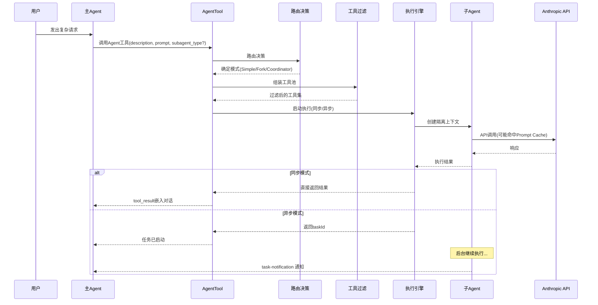

### 3.4 AgentTool 的输入参数

```typescript
{
  description: string,                          // 3-5词任务描述（必填）
  prompt: string,                               // 完整任务指令（必填）
  subagent_type?: string,                       // 专用Agent类型
  model?: 'sonnet' | 'opus' | 'haiku',         // 模型覆盖
  run_in_background?: boolean,                  // 异步执行
  name?: string,                                // 可寻址名称
  isolation?: 'worktree' | 'remote'             // 隔离模式
}
```

**关键设计：prompt必须自包含**——Worker无法看到父Agent的对话历史（Fork模式除外）。这意味着每个prompt都需要包含文件路径、行号、具体修改内容等完成任务所需的全部信息。

### 3.5 路由决策逻辑

AgentTool的路由决策是整个系统的"交通枢纽"：

```typescript
// 类型解析的核心逻辑
const effectiveType = subagent_type
  ?? (isForkSubagentEnabled() ? undefined : GENERAL_PURPOSE_AGENT.agentType);
const isForkPath = effectiveType === undefined;
```

决策树：

```
subagent_type 明确指定？
  |-- 是 --> 使用指定类型（显式指定优先）
  +-- 否 --> Fork实验开启？
        |-- 是 --> Fork路径（继承完整上下文）
        +-- 否 --> 默认 general-purpose
```

---

## 4. 内置Agent类型详解（4种）

### 4.1 注册机制

4种内置Agent在 `builtInAgents.ts` 中统一注册。**它们不是预先创建的实例**，而是Agent定义（Definition），在LLM调用 `agent` 工具时才被实例化。

LLM的决策依据是每个Agent定义中的 `whenToUse` 描述。AgentTool的 `prompt()` 方法向系统提示注入所有可用Agent的描述信息，LLM根据任务需求选择最合适的类型，通过 `subagent_type` 参数传递给AgentTool。

### 4.2 Explore Agent（只读代码探索专家）

```typescript
// built-in/exploreAgent.ts 核心配置
{
  agentType: 'Explore',
  model: isAnthropic ? 'inherit' : 'haiku',  // 外部用户用haiku降成本
  disallowedTools: [
    'Agent',           // 不能创建子Agent
    'ExitPlanMode',    // 不参与Plan模式控制
    'FileEdit',        // 不能编辑文件
    'FileWrite',       // 不能写文件
    'NotebookEdit'     // 不能编辑Notebook
  ],
  omitClaudeMd: true,  // 省略CLAUDE.md，节省token（~5-15 Gtok/周）
  type: 'ONE_SHOT',    // 一次性执行，无agentId/SendMessage开销
  getSystemPrompt: () => `You are an Explore agent...
    READ-ONLY exploration mode with strict restrictions...`
}
```

**设计决策分析**：

- **为什么外部用户用haiku？** 搜索任务不需要强推理能力，haiku的速度和成本优势更重要。内部用户用inherit是因为Anthropic内部有不同的计费模型。
- **为什么omitClaudeMd=true？** Explore Agent只做搜索，不需要知道commit message格式、代码风格规范等项目级配置。省略CLAUDE.md每周可节省5-15 Gtok。
- **为什么是ONE_SHOT类型？** Explore Agent执行完就返回结果，不需要被后续消息寻址（agentId）或接收追加指令（SendMessage），跳过这些基础设施开销（~135 chars x 34M runs/week 的节省）。
- **"双重锁"设计**：系统提示中声明只读约束（软约束）+ disallowedTools物理禁止编辑工具（硬约束）。即使LLM"幻觉"想要修改文件，工具层也会拦截。

### 4.3 Plan Agent（结构化规划智能体）

```typescript
// built-in/planAgent.ts 核心配置
{
  agentType: 'Plan',
  model: 'inherit',    // 规划需要强推理，继承父级模型
  disallowedTools: [   // 与Explore相同的禁止列表
    'Agent', 'ExitPlanMode', 'FileEdit', 'FileWrite', 'NotebookEdit'
  ],
  omitClaudeMd: true,
  type: 'ONE_SHOT',
  getSystemPrompt: () => `...4-step process: Understand -> Explore -> Design -> Detail
    Must include "Critical Files for Implementation" section...`
}
```

**设计决策分析**：

- **为什么model用inherit而非haiku？** 规划任务需要深度推理能力来分析依赖关系、评估风险、设计实施步骤。haiku在这类任务上表现不够好。
- **为什么也禁止修改工具？** Plan Agent只负责"想清楚怎么做"，不负责"动手做"。如果允许Plan Agent直接编辑，会模糊规划和执行的边界。
- **"Critical Files for Implementation"要求**：Plan Agent必须在输出中列出3-5个关键文件路径。这个约束确保规划结果是**可操作的**——后续的General Agent可以直接定位到这些文件开始实施。
- **为什么Plan也省略CLAUDE.md？** 如果Plan Agent看到"使用camelCase"这样的规则，它可能在规划阶段就纠结命名细节，而这些应该在实现阶段处理。Plan关注"做什么"而非"怎么做"。

### 4.4 General Purpose Agent（通用执行智能体）

```typescript
// built-in/generalPurposeAgent.ts 核心配置
{
  agentType: 'general-purpose',
  tools: ['*'],         // 全部工具，最大灵活性
  model: undefined,     // 使用默认子Agent模型
  // 无disallowedTools（依赖全局安全层）
  // omitClaudeMd: false（保留，因为可能需要遵守代码规范）
  getSystemPrompt: () => `General-purpose agent for researching complex questions,
    searching for code, and executing multi-step tasks...`
}
```

**设计决策分析**：

- **为什么tools=['*']？** 设计哲学是"默认信任，边界后移"——不在类型级别做工具限制，依赖四层全局过滤确保安全。这给了General Agent最大的灵活性。
- **为什么model=undefined？** 使用系统配置的默认子Agent模型，而非强制指定。这允许运维通过配置调整所有General Agent的模型，无需修改代码。
- **为什么保留CLAUDE.md？** General Agent可能需要编辑代码，因此需要知道项目的代码风格、commit规范等约定。

### 4.5 Verification Agent（对抗性验证智能体）

```typescript
// built-in/verificationAgent.ts 核心配置
{
  agentType: 'verification',
  background: true,     // 始终后台运行——硬编码，不是可选的
  color: 'red',         // 红色标记，强调对抗性质
  disallowedTools: [    // 与Explore相同——不能修改项目文件
    'Agent', 'ExitPlanMode', 'FileEdit', 'FileWrite', 'NotebookEdit'
  ],
  getSystemPrompt: () => `VERIFICATION-ONLY task.
    Cannot edit/write files IN PROJECT DIRECTORY (tmp dir allowed).
    Must output VERDICT: PASS / FAIL / PARTIAL...
    DO NOT make excuses to skip verification...`
}
```

**设计决策分析**：

- **为什么background=true是硬编码的？** 三个原因：(1) 验证结果"可以等待"，用户只需最终裁决；(2) 释放主线程，用户可继续交互；(3) 强制独立工作，不会因等待用户输入中断验证流程。
- **为什么color=red？** 视觉上区分验证Agent（红色=警告/对抗）和普通Agent，让用户在终端中一眼识别正在运行的验证任务。
- **PASS/FAIL/PARTIAL裁决格式**：结构化的裁决输出让父Agent可以程序化地判断验证结果，而非解析自然语言。
- **"VERIFICATION-ONLY"约束**：禁止修改项目文件，但允许写入tmp目录（测试可能需要创建临时文件）。

**对抗性设计的两个防范目标**：

1. **验证回避**：模型倾向于找借口不运行测试（"看起来正确"/"环境复杂"）--> 系统提示列出常见借口，要求必须实际执行验证
2. **表面正确性陷阱**：代码通过happy path但在边界条件下崩溃 --> 要求特别关注"不明显"的失败模式

### 4.6 内置Agent对比总表

| 维度 | Explore | Plan | General Purpose | Verification |
|------|---------|------|-----------------|--------------|
| **agentType** | `'Explore'` | `'Plan'` | `'general-purpose'` | `'verification'` |
| **权限级别** | 只读 | 只读 | 全部 | 只读（tmp除外） |
| **模型** | haiku(外部)/inherit(内部) | inherit | undefined(默认) | inherit |
| **disallowedTools** | Agent,FileEdit,FileWrite,NotebookEdit,ExitPlanMode | 同Explore | 无 | 同Explore |
| **omitClaudeMd** | true | true | false | false |
| **执行类型** | ONE_SHOT | ONE_SHOT | 标准 | 标准(但始终后台) |
| **background** | 可选 | 可选 | 可选 | **始终true** |
| **color** | 默认 | 默认 | 默认 | **red** |
| **输出要求** | 搜索结果汇总 | 结构化计划+关键文件 | 任务完成报告 | PASS/FAIL/PARTIAL |
| **心智模型** | 搜索引擎 | 架构师 | 全栈工程师 | 红队测试员 |
| **适用场景** | 代码考古、依赖分析 | 方案设计、风险评估 | 代码实现、bug修复 | 质量验证、安全审计 |

### 4.7 LLM如何选择Agent类型

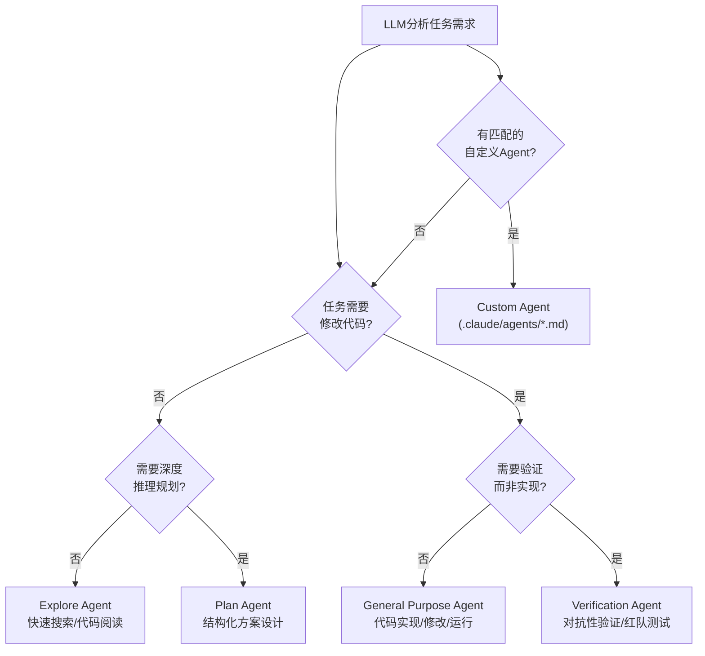

AgentTool的 `prompt()` 方法将所有可用Agent的 `whenToUse` 描述注入到系统提示中，LLM根据这些描述判断当前任务最适合哪种Agent类型，然后在调用agent工具时通过 `subagent_type` 参数指定。

**如果没有指定subagent_type**，路由逻辑如下：
- Fork gate开启 --> 隐式进入Fork路径（继承完整上下文）
- Fork gate未开启 --> 默认使用general-purpose Agent

---

## 5. Simple SubAgent 模式

### 5.1 设计定位

Simple SubAgent是最基础的多Agent模式。它的核心特征是**独立上下文**——子Agent从零开始，不继承父Agent的对话历史。

这种设计的理由：
1. **隔离性**：不被父Agent对话中无关信息干扰
2. **成本控制**：避免传输完整对话历史的token开销
3. **并行安全**：多个子Agent不会因共享可变历史产生竞态条件

### 5.2 五阶段工作流程

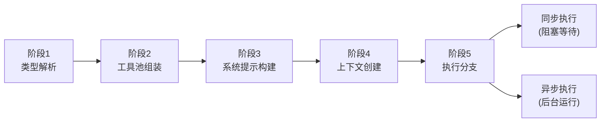

#### 阶段1：类型解析

```typescript
// 类型解析的核心逻辑
const effectiveType = subagent_type
  ?? (isForkSubagentEnabled() ? undefined : GENERAL_PURPOSE_AGENT.agentType);

// 从活跃Agent列表中查找匹配定义
const selectedAgent = agentDefinitions.activeAgents.find(
  a => a.agentType === effectiveType
);

// 区分"不存在"和"被权限拒绝"——给出不同错误提示
if (!selectedAgent) {
  const isBlocked = agentDefinitions.blockedAgents.find(
    a => a.agentType === effectiveType
  );
  if (isBlocked) {
    return { error: "This agent type is blocked by policy" };
  }
  return { error: "Unknown agent type: " + effectiveType };
}
```

当Agent未找到时，系统区分"不存在"和"被策略阻止"两种情况，给出不同的错误提示，帮助LLM理解问题并调整策略。

#### 阶段2：工具池组装

```typescript
// 子Agent的工具池独立于父级构建
const workerPermissionContext = {
  ...appState.toolPermissionContext,
  mode: selectedAgent.permissionMode ?? 'acceptEdits'
  // 子Agent默认permissionMode='acceptEdits'
  // 因为它已经由父Agent委托了明确任务
};

const workerTools = assembleToolPool(workerPermissionContext, appState.mcp.tools);
// 工具池经过四层过滤（详见第9节）
```

**permissionMode默认值的设计考量**：子Agent被父Agent委托了明确的任务，如果每次编辑都需要用户确认，会严重影响效率。`acceptEdits` 允许子Agent自动执行编辑操作。

#### 阶段3：系统提示构建

```
普通路径（Simple SubAgent）:
  getSystemPrompt()                        -- Agent定义中的系统提示生成函数
  + enhanceSystemPromptWithEnvDetails()    -- 注入环境信息（绝对路径等）
  + 用户prompt作为独立的user消息

Fork路径（详见第6节）:
  直接使用父级已渲染的系统提示字节           -- 不重新计算，保证缓存一致
```

#### 阶段4：上下文创建

通过 `createSubagentContext()` 创建隔离的执行上下文。核心原则是"默认隔离，显式共享"（详见第9.2节）。

#### 阶段5：执行分支

```typescript
const shouldRunAsync = (
  run_in_background === true ||
  selectedAgent.background === true ||
  isCoordinator ||
  forceAsync ||       // fork experiment
  assistantForceAsync
) && !isBackgroundTasksDisabled;

if (shouldRunAsync) {
  // 创建 LocalAgentTask 后台运行
  // 立即返回 taskId 给父Agent
  // 完成后通过 <task-notification> 通知
} else {
  // 进程内直接执行
  // 父Agent阻塞等待子Agent完成
  // 结果直接作为 tool_result 嵌入对话
}
```

### 5.3 同步 vs 异步执行对比

| 维度 | 同步模式 | 异步模式 |
|------|----------|----------|
| **执行方式** | 进程内直接执行 | LocalAgentTask后台运行 |
| **父Agent行为** | 阻塞等待子Agent完成 | 立即收到taskId，继续其他工作 |
| **结果传递** | 直接作为tool_result嵌入对话 | 通过`<task-notification>` XML投递 |
| **适用场景** | 快速搜索/探索（<120秒） | 长时间运行的实现/验证任务 |
| **自动转换** | 超过120秒自动转后台 | 不适用 |
| **默认行为** | Simple SubAgent默认同步 | 可通过run_in_background=true显式指定 |

### 5.4 异步结果通知格式

```xml
<task-notification>
  <task-id>ae9a65ee22594487c</task-id>
  <status>completed</status>
  <summary>Agent "research query engine" completed</summary>
  <result>... 详细结果内容 ...</result>
  <usage>
    <total_tokens>71330</total_tokens>
    <tool_uses>21</tool_uses>
    <duration_ms>81748</duration_ms>
  </usage>
</task-notification>
```

通知通过XML格式结构化传递，包含了任务ID（用于关联）、状态、摘要、详细结果和资源使用统计。

### 5.5 ONE_SHOT类型的优化

Explore和Plan Agent被标记为 `ONE_SHOT` 类型（在 `constants.ts` 的 `ONE_SHOT_BUILTIN_AGENT_TYPES` 中）。ONE_SHOT的含义是：

```
标准Agent启动流程：
  1. 分配agentId（用于后续寻址）
  2. 注册SendMessage处理器
  3. 注入消息协议说明到系统提示
  4. 执行任务
  5. 等待可能的后续消息
  
ONE_SHOT Agent启动流程：
  1. 执行任务
  2. 返回结果
```

省去了agentId分配和SendMessage支持的开销，适合"执行一次就返回"的场景。按规模计算（~135 chars x 34M runs/week），这个优化节省了相当可观的token。

### 5.6 流程示例

```
主Agent (运行中)
   |
   |-- 分析任务：需要搜索项目中所有TODO注释
   |
   |-- 调用 AgentTool({
   |     description: "search TODOs",
   |     prompt: "搜索项目中所有TODO注释，按文件分类汇总，
   |              项目根目录在 /workspace/my-project",
   |     subagent_type: "Explore"
   |   })
   |
   |-- [阶段1] 类型解析 --> 找到 Explore Agent 定义
   |-- [阶段2] 工具池：Grep, Glob, Read, Bash（排除FileEdit/FileWrite）
   |-- [阶段3] 系统提示：只读约束 + 环境信息
   |-- [阶段4] createSubagentContext() 创建隔离上下文
   |-- [阶段5] 同步执行（搜索通常很快）
   |
   |   Explore子Agent开始工作（独立上下文，无父历史）：
   |   |-- Grep("TODO", pattern="**/*.ts")
   |   |-- Read(匹配到的文件片段)
   |   +-- 生成分类汇总报告
   |
   |-- 收到结果（作为tool_result嵌入主Agent对话）
   +-- 主Agent根据结果决定下一步
```

---

## 6. Fork SubAgent 模式（核心创新）

### 6.1 解决的核心问题

Fork模式解决的是一个**经济学问题**：如何让多个并行子Agent共享父Agent的上下文，而不产生巨额token开销？

**问题场景**：主Agent已经积累了50K+ token的对话历史。现在需要并行派出3个子Agent做不同方向的调研。

| 方案 | 上下文继承 | token成本 | 问题 |
|------|-----------|-----------|------|
| **A: Simple SubAgent** | 无（冷启动） | 低 | 子Agent不知道之前讨论了什么 |
| **B: 复制上下文** | 完整复制 | 3 x 62K = 186K | 成本爆炸 |
| **C: Fork模式** | 共享缓存前缀 | 62K + 600 = 62.6K | 最优解 |

Fork模式是方案C的工程实现。

### 6.2 Unix fork() 类比

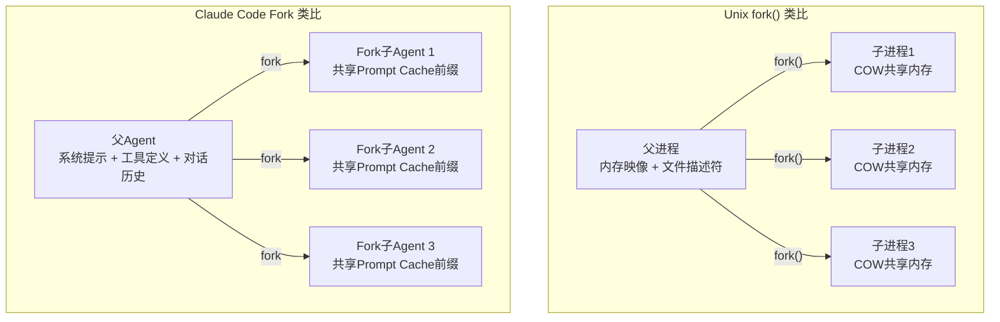

| 类比维度 | Unix fork() | Claude Code Fork |
|----------|-------------|------------------|
| 触发时机 | 父进程调用fork() | 主Agent调用Agent工具（未指定type） |
| 继承内容 | 内存映像、文件描述符 | 系统提示、工具定义、对话历史 |
| 共享机制 | Copy-on-Write内存页 | Prompt Cache字节前缀 |
| 分叉后关系 | 父子进程独立运行 | 主/子Agent并行运行 |
| 资源节省 | 只在写入时复制内存页 | 共享前缀不重复处理 |

### 6.3 FORK_AGENT 定义

```typescript
export const FORK_AGENT = {
  agentType: 'fork',
  tools: ['*'],             // 全部工具——保持与父级工具定义字节一致
  maxTurns: 200,            // 较高的上限，因为fork可能处理复杂任务
  model: 'inherit',         // 继承父级模型——保持缓存一致
  permissionMode: 'bubble', // 权限请求冒泡到父级终端
  useExactTools: true,      // 直接使用父工具池，不重新解析
  getSystemPrompt: () => '', // 故意返回空——如果被调用说明代码路径错误
}
```

**关键设计决策详解**：

- **tools=['*']**：不是为了给Fork子Agent所有工具，而是为了保持工具定义的字节一致性。实际上Fork子Agent通过 `useExactTools: true` 直接使用父级的工具池，不做任何过滤和重新解析。
- **model='inherit'**：必须继承父级模型，否则不同模型会导致API请求参数不同，破坏缓存前缀匹配。
- **permissionMode='bubble'**：独特设计——权限请求"冒泡"到父级终端。因为Fork子Agent是"父级的延伸"，不是独立的新Agent。
- **getSystemPrompt: () => ''**：这是**故意设计的陷阱**——Fork不使用自己的提示，而是通过 `override.systemPrompt` 传入父级已渲染的提示字节。如果代码路径错误调用了这个函数，空字符串会导致明显异常（而非微妙的缓存失效），更容易排查问题。

### 6.4 buildForkedMessages()——缓存共享的核心算法

这个函数是Fork机制的精华所在，它构建出能最大化Prompt Cache命中的消息序列。

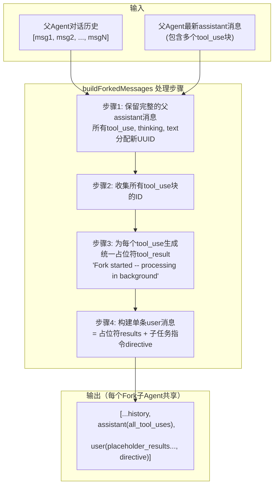

**步骤详解**：

**步骤1：保留完整的父assistant消息**

父Agent的最新assistant消息可能包含多个内容块：thinking块、text块、多个tool_use块。buildForkedMessages保留所有这些块，只是为tool_use块分配新的UUID（避免ID冲突）。

**步骤2：收集所有tool_use块**

从assistant消息中提取所有tool_use块的ID，为后续生成占位符做准备。

**步骤3：生成统一占位符tool_result**

```typescript
// 关键：占位符是所有Fork子Agent共享的固定字符串！
const placeholder = "Fork started -- processing in background";

// 每个tool_use对应一个占位符tool_result
const placeholderResults = toolUseIds.map(id => ({
  type: 'tool_result',
  tool_use_id: id,
  content: placeholder  // 固定字符串，所有Fork共享
}));
```

**这个固定字符串是缓存命中的关键**。如果每个Fork使用不同的占位符文本，缓存前缀就会在这里分叉，所有后续内容都无法共享缓存。

**步骤4：构建最终user消息**

```typescript
// 占位符 + 指令 = 一条user消息
const userMessage = {
  role: 'user',
  content: [
    ...placeholderResults,           // 所有Fork共享的前缀部分
    { type: 'text', text: directive } // 每个Fork不同的指令（唯一差异点）
  ]
};
```

**最终消息结构**：

```
[...完整对话历史, assistant(完整消息含所有tool_use), user(占位符results... + 指令)]
 ^^^^^^^^^^^^^^^^^^^^^^^^^^^^^^^^^^^^^^^^^^^^^^^^^^^^^^^^^^^^^^^^^^^^^^^^^   ^^^^
                     所有Fork共享的缓存前缀                                  唯一差异
```

### 6.5 CacheSafeParams——五维缓存契约

```typescript
export type CacheSafeParams = {
  systemPrompt: SystemPrompt;           // 系统提示必须字节一致
  userContext: { [k: string]: string };  // 用户上下文（CLAUDE.md等）
  systemContext: { [k: string]: string }; // 系统注入的上下文（Git状态等）
  toolUseContext: ToolUseContext;        // 工具定义 + 模型选择
  forkContextMessages: Message[];       // 对话历史前缀消息
};
```

```
五维度全部一致 --> 缓存命中，仅处理增量
任一维度偏离 --> 完整重新处理，无缓存效益
```

这就是为什么Fork模式对字节一致性要求如此严格——即使一个空格的差异也会导致缓存失效。类比HTTP缓存中的ETag，比对的是内容的精确哈希值。

### 6.6 缓存效率计算

```
假设场景：
- 系统提示 + 工具定义：约10,000 token
- 父对话历史：约50,000 token
- 父assistant最新消息（含3个tool_use）：约2,000 token
- 每个Fork子Agent的指令文本：约200 token

缓存前缀总计：10,000 + 50,000 + 2,000 = 62,000 token

不使用Fork模式（完整复制上下文）：
  每个子Agent：62,000 token
  3个子Agent总计：186,000 input token

使用Fork模式（共享Prompt Cache前缀）：
  父请求已建立缓存：62,000 token（已处理并缓存）
  3个Fork子Agent各自：
    - 缓存命中部分：62,000 token（缓存价格，比正常便宜得多）
    - 新增部分：约200 token/个（正常价格）
  
  有效总成本：62,000(缓存基准) + 600(增量) = 62,600 token
  vs 无Fork的 186,000 token
  
  节省比例：(186,000 - 62,600) / 186,000 约 66%
```

### 6.7 递归Fork防护

Fork子Agent保留了Agent工具（因为移除会改变工具定义字节，破坏缓存前缀），但在运行时通过**双重检测**阻止递归调用：

```typescript
// 第一道防线：querySource检查（主防线，抗消息压缩）
if (toolUseContext.options.querySource === 
    `agent:builtin:${FORK_AGENT.agentType}`)

// 第二道防线：消息扫描（后备，检测FORK_BOILERPLATE_TAG）
|| isInForkChild(toolUseContext.messages)
```

**为什么需要两道防线？**

| 防线 | 机制 | 优点 | 潜在风险 |
|------|------|------|----------|
| querySource | 设置在context的options上 | 不受消息自动压缩影响 | 某些边缘路径可能未正确传递 |
| 消息扫描 | 检测FORK_BOILERPLATE_TAG标记 | 覆盖querySource未传递的情况 | 消息可能被压缩导致tag丢失 |

两道防线互补：querySource抗压缩，消息扫描抗传递遗漏。

**为什么禁止递归Fork？**
- **资源爆炸**：每层Fork创建新API连接和工具实例，呈指数级增长
- **缓存失效**：每层Fork的上下文都略有不同，命中率急剧下降
- **调试地狱**：嵌套Fork结构使错误追踪极其复杂

### 6.8 Fork子Agent的行为约束

Fork子Agent在运行时受到以下约束（通过系统提示中的指令注入，带有 `fork_boilerplate_tag` 标记）：

```
Fork子Agent规则：
1. 你是 fork -- 不要产生子Agent（递归防护已硬编码阻止）
2. 不要对话或提问（没有AskUserQuestion工具）
3. 不要评论，直接使用工具
4. 工具调用之间不要输出文本
5. 必须提交代码变更（如果有修改），报告中包含commit hash
6. 完成后提交 <500 字的简洁报告
7. 输出格式：Scope -> Result -> Key files -> Files changed -> Issues
```

### 6.9 Fork模式的异步特性

Fork模式**始终异步执行**。这是由代码中的 `forceAsync` 标志控制的：

```typescript
// 当fork gate开启且路径为fork时，forceAsync被设置为true
const forceAsync = isForkSubagentEnabled() && isForkPath;

// forceAsync 直接导致 shouldRunAsync = true
const shouldRunAsync = (
  run_in_background === true ||
  selectedAgent.background === true ||
  isCoordinator ||
  forceAsync ||       // <-- 这里
  assistantForceAsync
) && !isBackgroundTasksDisabled;
```

**为什么Fork必须异步？** 因为Fork的核心价值是并行执行。如果同步运行，一次只能执行一个Fork子Agent，完全失去了并行带来的效率提升和缓存共享的意义。

### 6.10 完整Fork流程图

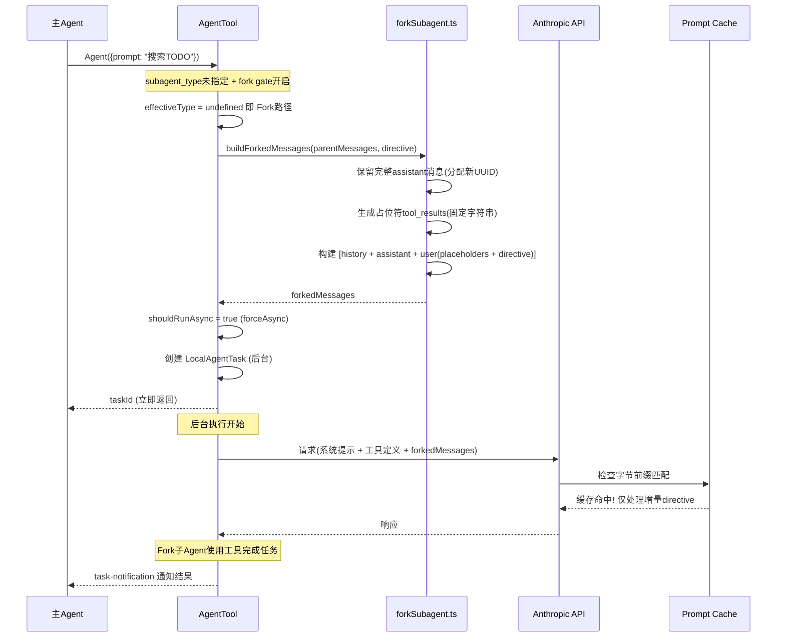

---

## 7. Coordinator 模式

### 7.1 设计定位

当任务需要**有依赖关系的多步骤协作**时，Fork模式的"对等并行"不够用了。Coordinator模式引入一个中央协调者来管理任务分解、阶段依赖、冲突避免和故障恢复。

心智模型：建筑工地的项目经理（Coordinator）不需要亲自砌砖，但需要知道哪些任务可以并行、哪些有依赖关系。

### 7.2 激活条件——双重门控

```
编译时（Feature Gate）：
  代码中是否包含Coordinator功能？
    |-- 否 --> 相关代码不编译进产物（减小二进制体积）
    +-- 是 --> 继续检查

运行时（环境变量）：
  CLAUDE_CODE_COORDINATOR_MODE=1 ？
    |-- 否 --> 使用普通模式（可能激活Fork）
    +-- 是 --> Coordinator模式激活
```

**Feature Gate是编译时优化**——减小产物体积，未启用的代码不占空间。
**环境变量是运行时控制**——遵循最小权限原则，即使代码编译进来也需要显式启用。

### 7.3 与Fork的互斥关系

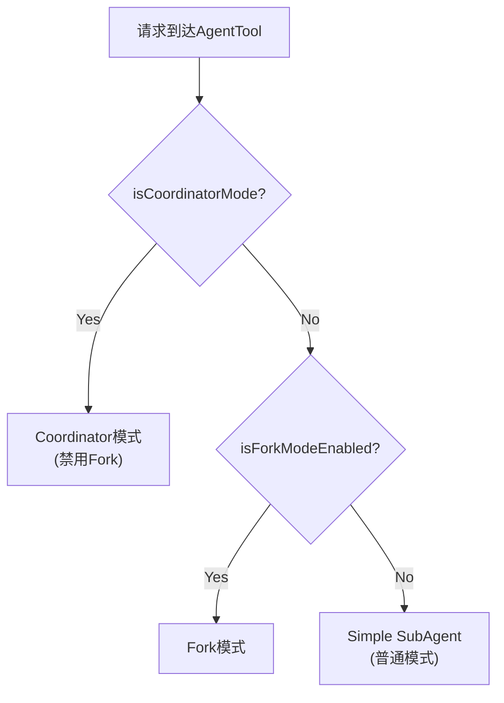

Coordinator模式**优先级高于Fork**。原因：Coordinator已经拥有自己的任务委派和工作流管理模型，不需要Fork的缓存共享机制。两者同时启用会导致语义冲突。

### 7.4 本质：主Agent的模式切换

**关键理解**：Coordinator不是一个独立的Agent循环——当激活时，**主Agent本身变成协调者**：
- 系统提示被替换为 `getCoordinatorSystemPrompt()`（369行的完整协调者提示）
- 工具池被过滤为只保留管理工具
- 所有 spawn 的子Agent自动异步运行

### 7.5 协调者与Worker的工具权力边界

这是Coordinator模式最重要的设计决策之一：**协调者只有管理权，没有执行权**。

**协调者（Coordinator）的工具**：

| 工具 | 用途 | 说明 |
|------|------|------|
| **Agent** | 创建Worker并分配任务 | 唯一的任务派发方式 |
| **SendMessage** | 向Worker发送消息/指令 | 支持点对点和广播 |
| **TaskStop** | 停止方向错误的Worker | 资源回收 |
| **SyntheticOutput** | 输出结构化结果 | 最终结果呈现 |

**协调者没有的工具**：`Read`, `Write`, `Edit`, `Bash`, `Grep`, `Glob` 等**一切**文件操作和命令执行工具。

**Worker的工具**：

| 工具类别 | 具体工具 |
|----------|----------|
| 文件操作 | Read, Write, Edit, Glob, Grep |
| 命令执行 | Bash |
| 搜索 | WebSearch, WebFetch |
| 特殊 | NotebookEdit, Skill, MCP工具 |

Worker默认使用 `acceptEdits` 权限模式——自动接受编辑操作，不需要逐个确认。

### 7.6 Coordinator系统提示（369行）的核心内容

coordinatorMode.ts 包含了369行的Coordinator系统提示，定义了以下核心内容：

1. **角色定位**：你是一个协调者，负责分解和管理复杂任务
2. **四阶段工作流**：Research --> Synthesis --> Implementation --> Verification
3. **"理解不可委派"原则**：必须消化Worker的发现后再给出具体指令
4. **Continue vs Spawn决策规则**：什么时候复用Worker，什么时候新建
5. **并发控制策略**：同一文件一次只有一个Worker操作
6. **Scratchpad使用规范**：如何利用共享文件空间

### 7.7 四阶段标准工作流

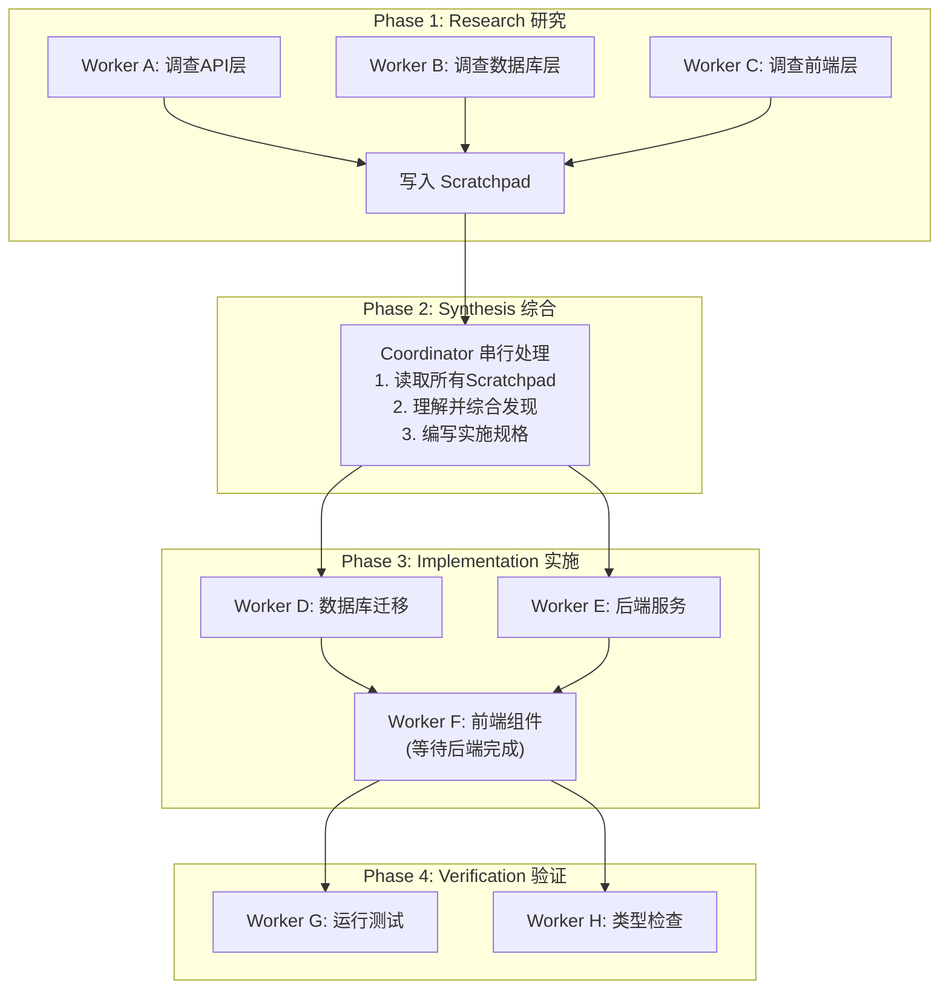

**Phase 1: Research（研究）**
- Worker们并行调查代码库不同区域
- 将发现写入Scratchpad（而非直接报告给Coordinator）
- 只读操作，自由并行，无冲突风险

**Phase 2: Synthesis（综合）**
- Coordinator读取所有Scratchpad文件
- **必须由Coordinator亲自完成**——不能委派给Worker
- 编写包含具体文件路径和修改说明的实施规格
- 体现"理解不可委派"原则

**Phase 3: Implementation（实施）**
- Worker按照Coordinator的具体规格修改代码
- **同一文件集一次只有一个Worker操作**（防止冲突）
- 不同文件集的Worker可以并行

**Phase 4: Verification（验证）**
- Worker验证修改的正确性
- 运行测试、检查类型错误、验证编译通过
- 可与不同区域的实施并行

### 7.8 Scratchpad协作空间

```
路径：.claude/scratchpad/（注入Coordinator的userContext中）

特性：
|-- 无权限提示：Worker可自由读写，不需要权限确认
|-- 持久化知识：一个Worker的发现可被其他Worker读取
|-- 会话隔离：每个会话独立的scratchpad空间
|-- 结构自由：不规定文件结构，Worker自行组织
+-- 跨阶段持久：从Research到Verification全程可用
```

**为什么用文件而不让Worker直接通信？**

消息传递是**瞬时的**——Worker消费消息后，消息就消失了。Scratchpad是**持久的**：
- 可被反复读取
- 支持增量构建（Worker A写了一半，Worker B可以继续）
- Coordinator在Synthesis阶段可以一次性读取所有发现
- 在Verification阶段，Worker可以回看Implementation阶段的记录

### 7.9 "Never write 'based on your findings'" 原则

```
反模式——懒惰委托：
  Agent({ prompt: "Based on your findings, fix the auth bug" })
  
  问题：Worker不知道"findings"是什么，需要重新调查
  信息衰减：每转发一次，精确度下降一次
```

```
正确——综合后的具体指令：
  Agent({ prompt: 
    "Fix the null pointer in src/auth/validate.ts:42.
     The user field on Session is undefined when sessions expire 
     but the token remains cached. 
     Add a null check before user.id access.
     Related test file: tests/auth/validate.test.ts" 
  })
  
  Worker可以直接定位到文件和行号开始工作
```

### 7.10 Continue vs Spawn 决策

| 场景 | 决策 | 原因 |
|------|------|------|
| Worker研究了需要编辑的文件 | **Continue** | Worker已有文件上下文，复用效率更高 |
| 研究范围广但实施范围窄 | **Spawn** | 避免探索阶段的噪声污染实施上下文 |
| 上次方法完全错误 | **Spawn** | 错误上下文会锚定重试思路（认知锚定效应） |
| 验证其他Worker刚写的代码 | **Spawn** | 验证者应以新鲜视角审视 |
| 任务是上一个任务的自然延续 | **Continue** | 保持上下文连续性 |

### 7.11 SendMessage消息传递

| 寻址模式 | 格式 | 使用场景 |
|----------|------|----------|
| **点对点** | `to: "agent-name"` | 向指定Worker发送指令/追加信息 |
| **广播** | `to: "*"` | 向所有Worker发布全局信息 |
| **UDS** | `to: "uds:<socket-path>"` | 跨进程通信（本地） |
| **Bridge** | `to: "bridge:<session-id>"` | 跨会话/远程通信 |

**智能路由**：
- 向**运行中**的Worker发消息 --> 消息排队，Worker下一轮处理
- 向**已停止**的Worker发消息 --> **自动恢复**该Worker

### 7.12 故障恢复策略

| 失败类型 | Coordinator的应对策略 |
|----------|----------------------|
| 工具执行失败 | 分析原因，指导Worker重试或调整策略 |
| maxTurns耗尽 | 评估已完成部分，决定是否Spawn新Worker继续 |
| MCP连接断开 | 降级到不依赖该MCP工具的策略 |
| 上下文过长 | 压缩任务描述或拆分为更小的子任务 |
| Worker输出质量低 | Spawn新Worker，提供更具体的指令 |

### 7.13 完整示例模拟

**场景**："为Express.js应用添加通知系统，支持邮件和站内信"

```
Phase 1: Research（并行）

  +-- Worker "api-researcher" [Explore类型]
  |    任务: "调查Express.js路由结构和中间件链，找到认证中间件和现有通知代码"
  |    工具: Grep, Glob, Read, Bash
  |    输出: /scratchpad/api-analysis.md
  |
  +-- Worker "db-researcher" [Explore类型]  
  |    任务: "调查数据库schema和ORM配置，找到User模型和已有的消息表"
  |    工具: Grep, Glob, Read
  |    输出: /scratchpad/db-analysis.md
  |
  +-- Worker "frontend-researcher" [Explore类型]
       任务: "调查前端框架和组件结构，找到设置页面和通知UI位置"
       工具: Grep, Glob, Read
       输出: /scratchpad/frontend-analysis.md

Phase 2: Synthesis（Coordinator串行）

  Coordinator:
    1. Read(/scratchpad/api-analysis.md)
    2. Read(/scratchpad/db-analysis.md)
    3. Read(/scratchpad/frontend-analysis.md)
    4. 综合理解：
       - Express路由在 src/routes/ 下，使用 express.Router()
       - 数据库用Prisma ORM，schema在 prisma/schema.prisma
       - 前端用React，设置页在 src/pages/Settings.tsx
    5. 编写实施规格到 /scratchpad/implementation-spec.md：
       - DB: 新增 Notification 和 NotificationPreference 模型
       - API: 新增 POST/GET/PUT 等5个端点
       - Frontend: 修改 SettingsPage 新增通知设置选项卡

Phase 3: Implementation（部分并行）

  +-- Worker "db-implementer" [General类型]
  |    任务: "修改prisma/schema.prisma，新增Notification和NotificationPreference模型，
  |           运行 npx prisma migrate dev"
  |    并行: 与service-implementer操作不同文件
  |
  +-- Worker "service-implementer" [General类型]
  |    任务: "在src/services/新建notification.service.ts，
  |           在src/routes/新建notification.routes.ts，实现5个API端点"
  |    并行: 与db-implementer操作不同文件
  |
  +-- Worker "frontend-implementer" [General类型]
       任务: "修改src/pages/Settings.tsx，新增NotificationSettings选项卡"
       等待: 后端Worker完成后开始（需要知道API接口）

Phase 4: Verification

  +-- Worker "verifier" [Verification类型]
       任务: "验证通知系统：运行prisma validate、typecheck、npm test，
              检查API端点的认证中间件、NotificationPreference默认值"
       输出: PASS / FAIL / PARTIAL 裁决
```

---

## 8. Swarm 团队模式

### 8.1 设计定位

Swarm模式在Coordinator的基础上更进一步，支持**持久化的队友（Teammate）实例**在独立的线程/进程中运行，通过**文件信箱系统**实现对等通信。

与Coordinator的核心区别：

| 维度 | Coordinator | Swarm |
|------|-------------|-------|
| 通信拓扑 | 星型（所有通信经协调者） | 网状（Agent间对等通信） |
| Agent生命周期 | 任务级（完成即销毁） | 持久化（跨任务存活） |
| 协调方式 | 中央协调者决策 | Agent自主协调 |
| 执行后端 | 统一进程内 | 多种后端（Tmux/iTerm2/InProcess） |
| 共享资源 | Scratchpad | Scratchpad + 文件信箱 |

### 8.2 三种执行后端

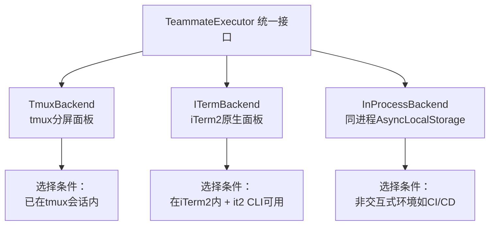

| 后端 | 实现方式 | 特点 | 选择条件 |
|------|----------|------|----------|
| **Tmux** | 创建/管理tmux分屏面板 | 支持隐藏/显示，最常用 | 已在tmux会话内 |
| **iTerm2** | 原生iTerm2面板 | macOS原生体验，更美观 | 在iTerm2内 + it2 CLI可用 |
| **InProcess** | 同一Node.js进程内 | AsyncLocalStorage隔离 | 非交互式环境（CI/CD） |

### 8.3 TeammateExecutor 统一接口

```typescript
interface TeammateExecutor {
  spawn(config: TeammateConfig): Promise<void>;
  // 创建队友，启动独立的执行环境
  
  sendMessage(agentId: string, message: string): Promise<void>;
  // 向指定队友发送消息
  
  terminate(agentId: string, reason: string): Promise<void>;
  // 优雅关闭：等待当前任务完成后退出
  
  kill(agentId: string): Promise<void>;
  // 立即终止：强制终止，不等待
  
  isActive(agentId: string): boolean;
  // 检查队友是否存活
}
```

所有三种后端都实现这个统一接口，使上层代码无需关心具体的执行环境。

### 8.4 文件信箱系统

Swarm模式使用文件系统作为消息传递的底层机制：

```
消息流程：
Agent A 写入文件 --> 信箱目录 --> Agent B 读取文件

信箱路径结构：
~/.claude/teams/{team-name}/mailbox/{agent-id}/
```

**为什么用文件而不用进程间通信（IPC）？**
- 文件系统是最通用的共享介质，所有后端都支持
- 消息自动持久化，不会因进程崩溃丢失
- 支持跨机器共享（如果使用共享文件系统）
- 调试友好，可以直接查看消息文件

### 8.5 团队配置

团队配置存储在用户主目录下：

```
~/.claude/teams/{team-name}/config.json
```

### 8.6 队友生命周期

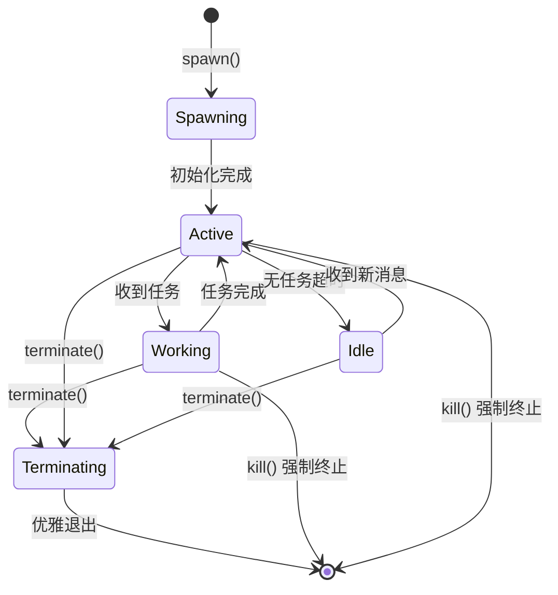

**关键生命周期事件**：
- **spawn**：创建队友实例，初始化执行环境
- **idle超时**：长时间无任务的队友自动进入idle状态，释放资源
- **terminate**：优雅关闭，等待当前工作完成
- **kill**：强制终止，用于队友无响应或方向完全错误的情况

### 8.7 广播消息

```typescript
// 向所有活跃队友发送消息
await executor.sendMessage("*", "项目结构已变更，请重新检查依赖关系");
```

广播适用于全局状态变更通知，比如新的代码提交影响了多个模块、外部依赖版本更新、项目配置变更等。

### 8.8 InProcess后端的上下文隔离

```
Leader Agent (主进程上下文)
      |
      +-- AsyncLocalStorage 上下文隔离层
           |
           |-- Worker 1 (独立TeammateIdentity + AbortController)
           |
           |-- Worker 2 (独立TeammateIdentity + AbortController)
           |
           +-- 共享：API客户端、MCP连接（无状态，线程安全）
```

**为什么API客户端和MCP连接可以共享？** 它们本质上是无状态的连接复用，HTTP客户端和WebSocket连接是线程安全的。

---

## 9. 工具过滤与安全体系

### 9.1 四层过滤流水线

工具过滤是Claude Code多Agent安全体系的核心。每一层都是独立的防线，任一层都能独立拦截危险操作。

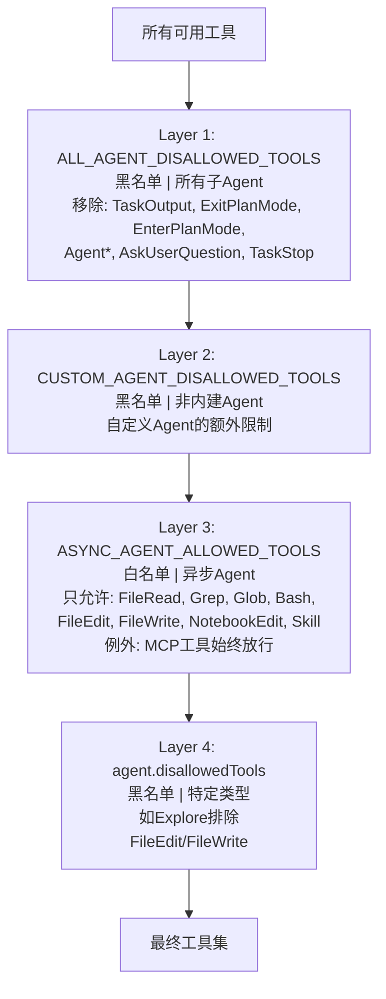

#### Layer 1: ALL_AGENT_DISALLOWED_TOOLS

```typescript
const ALL_AGENT_DISALLOWED_TOOLS = [
  'TaskOutput',       // 只有主Agent应该产出最终结果
  'ExitPlanMode',     // Plan模式控制是主Agent的权限
  'EnterPlanMode',    // 同上
  'Agent',            // 条件性禁止（内建Agent可能保留）
  'AskUserQuestion',  // 子Agent不应该直接与用户交互
  'TaskStop',         // 任务停止是主Agent的权限
];
```

**设计理由**：这些"元工具"（meta-tools）控制着Agent系统本身的行为，只有父级Agent应该拥有这些权限。子Agent应该专注于执行被委派的任务。

注意：Agent工具对于 USER_TYPE === 'ant'（Anthropic内部用户）可能有不同的处理策略。

#### Layer 2: CUSTOM_AGENT_DISALLOWED_TOOLS

对非内建Agent（通过 `.claude/agents/*.md` 定义的自定义Agent）施加额外限制。这一层的目的是防止用户定义的Agent获得过多权限。

内建Agent由Claude Code团队维护，经过充分测试，因此不受这一层限制。

#### Layer 3: ASYNC_AGENT_ALLOWED_TOOLS（白名单模式）

```typescript
const ASYNC_AGENT_ALLOWED_TOOLS = [
  'FileRead', 'Grep', 'Glob', 'Bash',
  'FileEdit', 'FileWrite', 'NotebookEdit',
  'Skill', 'WebSearch', 'WebFetch',
  'ToolSearch', 'Worktree'
];

// 另外还有针对InProcess Teammate的白名单：
const IN_PROCESS_TEAMMATE_ALLOWED_TOOLS = [
  'TaskCreate', 'TaskGet', 'TaskList', 'TaskUpdate',
  'SendMessage', 'Cron*'
];
```

**这是唯一的白名单层**（其他三层都是黑名单）。对于异步Agent，只有列表中的工具被允许。

**例外处理**：
- **MCP工具**（以 `mcp__` 为前缀）始终放行——因为MCP工具是用户显式配置的外部能力，应该尊重用户意图
- **ExitPlanMode**在plan模式下放行——Plan Agent需要这个工具来正常退出plan模式

#### Layer 4: Agent自身的disallowedTools

每种Agent类型可以定义自己的禁止工具列表。例如：

```typescript
// Explore Agent / Plan Agent / Verification Agent
disallowedTools: ['Agent', 'ExitPlanMode', 'FileEdit', 'FileWrite', 'NotebookEdit']

// General Purpose Agent
disallowedTools: []  // 无额外限制，依赖前三层保护
```

### 9.2 上下文隔离：createSubagentContext()

`createSubagentContext()` 为每个子Agent创建隔离的 `ToolUseContext`，核心原则是**"默认隔离，显式共享"**（deny-by-default）。

| 字段 | 隔离方式 | 设计原因 |
|------|----------|----------|
| **readFileState** | 克隆（深拷贝） | 子Agent的文件读取不"污染"父级缓存 |
| **abortController** | 新建子控制器 | 父级中断->子级中断（单向），反过来不会 |
| **getAppState** | 包装（wrapper） | 后台Agent返回`shouldAvoidPermissionPrompts: true` |
| **setAppState** | **默认no-op** | 子Agent的UI状态变更不传播到父级 |
| **setAppStateForTasks** | **始终共享** | 防止子Agent启动的后台进程成为僵尸进程 |
| **queryTracking** | 新chainId + depth+1 | 防止无限递归 + 链路追踪 |
| **contentReplacementState** | 克隆（非新建） | Fork子Agent需要对已知tool_use_id做相同的替换决策 |

**关键设计决策详解**：

**setAppState默认为no-op**：子Agent可能更新进度条、状态指示器等UI状态。如果这些变更传播到父级，会导致UI混乱（多个Agent同时更新同一个状态区域）。

**setAppStateForTasks必须共享**：这是唯一的例外。子Agent可能通过Bash启动后台进程（如测试运行器、开发服务器）。如果这些进程的注册信息到不了根store，子Agent结束时这些进程会成为**僵尸进程**（PPID=1，无人回收）。

**abortController的单向传播**：父级中断时，所有子Agent也应该中断（用户取消操作）。但子Agent中断不应影响父级（一个子任务失败不应该终止整个任务）。

### 9.3 安全设计的纵深防御分析

```
攻击场景：恶意的自定义Agent定义

agents/evil.md:
---
name: evil-agent
tools: ['*']
disallowedTools: []      <-- 企图绕过限制
---
尝试执行 rm -rf / ...

防御层分析：
Layer 1: ALL_AGENT_DISALLOWED_TOOLS --> 移除元工具（部分限制）
Layer 2: CUSTOM_AGENT_DISALLOWED_TOOLS --> 非内建Agent额外限制生效!
Layer 3: ASYNC_AGENT_ALLOWED_TOOLS --> 如果异步，只允许白名单工具
Layer 4: 即使disallowedTools为空，前三层已经过滤了危险工具

结论：即使Layer 4被绕过，前三层仍然提供保护
```

---

## 10. 同步 vs 异步执行决策

### 10.1 决策代码分析

```typescript
const shouldRunAsync = (
  run_in_background === true ||      // 条件1：用户/LLM显式指定后台运行
  selectedAgent.background === true || // 条件2：Agent定义为始终后台
  isCoordinator ||                   // 条件3：Coordinator模式下所有Agent异步
  forceAsync ||                      // 条件4：Fork实验开启时所有Agent异步
  assistantForceAsync                // 条件5：助手/KAIROS模式强制异步
) && !isBackgroundTasksDisabled;     // 总开关：后台任务未被全局禁用
```

**逐条分析**：

| 条件 | 触发来源 | 典型场景 |
|------|----------|----------|
| `run_in_background === true` | LLM在调用agent工具时设置 | LLM判断任务会运行很久 |
| `selectedAgent.background === true` | Agent定义中硬编码 | Verification Agent（始终后台） |
| `isCoordinator` | Coordinator模式激活 | 所有Worker都异步，Coordinator不阻塞 |
| `forceAsync` | Fork实验开启 | Fork的核心价值是并行，必须异步 |
| `assistantForceAsync` | 助手模式 | 特定运行模式下的强制异步 |
| `!isBackgroundTasksDisabled` | 全局配置 | 安全开关，可关闭所有后台任务 |

### 10.2 自动后台化机制

即使最初以同步模式启动的子Agent，如果执行时间超过**120秒**（`CLAUDE_AUTO_BACKGROUND_TASKS`），系统会自动将其转为后台任务：

```
同步子Agent开始执行
    |
    |-- 120秒内完成 --> 正常返回结果（tool_result）
    |
    +-- 超过120秒 --> 自动转为后台任务
                     |
                     |-- 主Agent解除阻塞
                     |-- 收到 "任务已转为后台" 通知
                     +-- 后续通过 <task-notification> 获取结果
```

**为什么是120秒？** 这是一个经验值的权衡：
- 太短（如30秒）：很多正常的代码生成任务会被频繁中断
- 太长（如300秒）：用户等待太久才能继续交互
- 120秒是一个"多数简单任务能完成，复杂任务不会阻塞太久"的平衡点

### 10.3 各模式的异步行为总结

| 模式 | 默认异步? | 可配置? | 原因 |
|------|-----------|---------|------|
| Simple SubAgent | 否（同步） | 是（run_in_background） | 简单任务通常很快完成 |
| Fork SubAgent | **是（始终异步）** | 否（forceAsync硬编码） | 并行是Fork的核心价值 |
| Coordinator Worker | **是（始终异步）** | 否 | 协调者不应被任何Worker阻塞 |
| Swarm Teammate | **是（独立进程）** | 否 | 持久化队友在独立环境运行 |
| Verification Agent | **是（始终后台）** | 否（background=true硬编码） | 验证可以等待，不阻塞用户 |

---

## 11. 工程设计分析

### 11.1 类型体系：BaseAgentDefinition

所有Agent定义基于统一的类型层次结构：

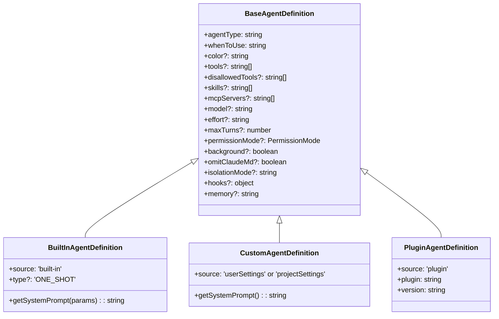

BaseAgentDefinition的字段按功能维度归为四大类：

| 维度 | 字段 | 说明 |
|------|------|------|
| **身份与描述** | agentType, whenToUse, color | Agent的标识和何时使用 |
| **工具与能力** | allowedTools, disallowedTools, skills, mcpServers | Agent能做什么 |
| **执行控制** | model, effort, maxTurns, permissionMode, background | Agent怎么执行 |
| **上下文管理** | omitClaudeMd, isolationMode, hooks, memory | Agent的上下文配置 |

### 11.2 buildTool() 工厂模式与fail-closed默认值

Agent工具的构建遵循**fail-closed**原则（失败时关闭/限制，而非放开）：

```typescript
// 所有默认值偏向安全和限制
maxTurns: agentDefinition.maxTurns ?? 30,          // 有上限，不是Infinity
permissionMode: agentDefinition.permissionMode ?? 'acceptEdits',  // 自动接受但不是root
background: agentDefinition.background ?? false,    // 默认不后台
```

如果某个配置项缺失，默认值总是偏向更安全的选择。

### 11.3 resolveAgentTools() 工具解析

```typescript
function resolveAgentTools(definition: AgentDefinition): Tool[] {
  const { allowedTools, disallowedTools } = definition;
  
  // 支持通配符
  if (allowedTools?.includes('*')) {
    return allTools.filter(t => !disallowedTools?.includes(t.name));
  }
  
  // 支持 Agent(x,y) 语法
  // 例如 allowedTools: ['Bash', 'Read', 'Agent(Explore,Plan)']
  // 表示只允许创建Explore和Plan两种子Agent
  
  // 支持精确列表
  return allTools.filter(t => allowedTools?.includes(t.name));
}
```

`Agent(x,y)` 语法是一个精巧的设计：允许Agent定义精确控制可以创建哪些类型的子Agent，实现了嵌套Agent创建的细粒度控制。

### 11.4 关注点分离

Claude Code的多Agent系统将不同关注点清晰分离到不同文件：

| 关注点 | 文件 | 职责 |
|--------|------|------|
| **路由决策** | AgentTool.tsx | "这个任务应该走哪条路径？" |
| **执行引擎** | runAgent.ts | "如何运行一个Agent？" |
| **缓存优化** | forkSubagent.ts | "如何共享Prompt Cache？" |
| **工具安全** | agentToolUtils.ts | "Agent可以用哪些工具？" |
| **类型注册** | builtInAgents.ts | "有哪些Agent类型？" |
| **上下文隔离** | forkedAgent.ts | "如何隔离子Agent上下文？" |
| **类型定义** | loadAgentsDir.ts | "Agent定义的统一类型系统" |

这种分离使得：
- 添加新的Agent类型只需修改注册表，不影响路由和执行
- 优化缓存策略只需修改forkSubagent.ts，不影响其他路径
- 调整工具过滤规则只需修改agentToolUtils.ts，不影响执行引擎

### 11.5 Feature Gates实现渐进式发布

```typescript
// Feature gate检查
if (isFeatureEnabled('fork_subagent')) { /* Fork模式代码路径 */ }
if (isFeatureEnabled('coordinator_mode')) { /* Coordinator模式代码路径 */ }
```

Feature gates允许：
- **A/B测试**：将新模式逐步推送给部分用户
- **编译时优化**：未启用的代码不编译进产物
- **快速回滚**：如果新模式有问题，关闭gate即可回退
- **组合控制**：不同gate的组合产生不同的行为（如Fork和Coordinator互斥）

### 11.6 扩展性分析

每个扩展点都遵循**开放-封闭原则**（OCP）：对扩展开放，对修改封闭。

| 扩展点 | 如何扩展 | 是否需要修改现有代码 |
|--------|----------|---------------------|
| 新增内置Agent | 在built-in/下新建文件，在builtInAgents.ts注册 | 仅注册表（最小修改） |
| 自定义Agent | 在.claude/agents/下新建.md文件 | 无需修改（自动加载） |
| 插件Agent | 实现PluginAgentDefinition接口 | 无需修改核心代码 |
| 新增执行后端 | 实现TeammateExecutor接口 | 仅后端选择逻辑 |
| 新增工具 | 实现Tool接口 | 自动进入过滤流水线 |
| MCP集成 | Agent声明mcpServers字段 | 无需修改核心代码 |
| Hooks | Agent携带hooks字段 | 无需修改核心代码 |

### 11.7 复用性分析

| 组件 | 被哪些模块复用 | 复用方式 |
|------|---------------|----------|
| `createSubagentContext()` | Simple/Fork/Coordinator/Swarm | 统一的上下文隔离函数 |
| 四层工具过滤 | 所有Agent模式 | 流水线模式，每层独立可组合 |
| `resolveAgentTools()` | 所有Agent类型 | 统一的工具解析函数 |
| `BaseAgentDefinition` | BuiltIn/Custom/Plugin | 类型继承 |
| `TeammateExecutor` | Tmux/iTerm2/InProcess | 接口抽象 |
| `runAgent.ts` | Simple和Fork | 统一的Agent执行引擎 |

### 11.8 自定义Agent系统

通过Markdown frontmatter定义Agent，支持完整的配置能力：

```yaml
---
name: security-auditor
description: 分析代码中的安全漏洞并生成审计报告
tools:
  - Bash
  - Read
  - Grep
  - Glob
disallowedTools:
  - Write
model: haiku
effort: high
permissionMode: default
maxTurns: 30
color: orange
background: true
memory: project
skills:
  - /commit
mcpServers:
  - slack
hooks:
  PreToolUse:
    - matcher: Bash
      command: "audit-log.sh"
---

你是一位代码安全审计专家。你的职责是：
1. 分析代码中潜在的安全漏洞
2. 检查常见攻击向量（XSS、SQL注入、CSRF等）
3. 生成结构化审计报告
4. 提供修复建议
```

加载优先级（低到高）：

```
内置智能体（最低）
  --> 被覆盖
插件智能体
  --> 被覆盖
用户设置（~/.claude/settings.json）
  --> 被覆盖
项目设置（.claude/settings.json）
  --> 被覆盖
Flag设置（CLI启动参数）
  --> 被覆盖
策略设置（企业管理配置，最高优先级）
```

企业可以通过策略设置覆盖同名内置Agent，强制执行安全审查标准。

---

## 12. 疑惑解答

### Q1: 4种内置Agent是什么时候创建的？是否只能创建这4种？

**A:** 4种内置Agent**不是预先创建的实例**，而是**Agent定义（Definition）**，在 `builtInAgents.ts` 中注册。它们就像是"蓝图"或"模板"。

Agent实例的创建时机是：
1. AgentTool的 `prompt()` 方法向系统提示注入每种可用Agent的 `whenToUse` 描述
2. LLM分析当前任务后，决定需要哪种类型的Agent
3. LLM调用 `agent` 工具并传入 `subagent_type` 参数
4. 系统根据 `subagent_type` 查找对应的AgentDefinition并实例化

**可用的Agent类型**：

| 来源 | 类型 | 说明 |
|------|------|------|
| 内置 | Explore, Plan, General Purpose, Verification | builtInAgents.ts中注册 |
| 隐式Fork | 不指定subagent_type + fork gate开启 | 自动进入Fork路径 |
| 自定义 | 用户通过.claude/agents/*.md定义 | loadAgentsDir.ts加载 |
| 插件 | 第三方插件提供 | PluginAgentDefinition |

所以答案是：**不仅限于4种**。在没有自定义/插件Agent的情况下，LLM可以选择4种内置类型 + 隐式Fork路径。有自定义Agent时，选择范围进一步扩大。

### Q2: LLM是如何知道该选择哪种Agent类型的？

**A:** AgentTool的 `prompt()` 方法将所有可用Agent的描述信息注入到系统提示中，具体包括每个Agent的 `whenToUse` 字段。LLM根据这些描述判断当前任务最适合哪种类型。

选择是LLM自主决定的，不是系统自动匹配的。系统只负责提供选项描述和执行选择。

### Q3: Fork模式和Coordinator模式能同时启用吗？

**A:** **不能**，两者是互斥的。代码中的优先级是：

```
Coordinator模式 > Fork模式 > 普通模式
```

如果Coordinator模式激活，Fork模式自动禁用。原因是Coordinator已经拥有自己的任务委派模型，不需要Fork的缓存共享机制。

### Q4: 子Agent可以创建子Agent吗（嵌套）？

**A:** 取决于Agent类型：

| Agent类型 | 能否创建子Agent | 原因 |
|-----------|----------------|------|
| Explore | 不能 | disallowedTools包含Agent |
| Plan | 不能 | disallowedTools包含Agent |
| General Purpose | **理论上可以** | tools=['*']包含Agent工具 |
| Verification | 不能 | disallowedTools包含Agent |
| Fork子Agent | **不能** | 递归防护（querySource + 消息扫描） |

General Purpose Agent理论上可以创建子Agent，但受到 `queryTracking.depth` 的限制（防止无限递归）。Fork子Agent通过双重检测机制被硬性禁止递归。

### Q5: 为什么Fork子Agent保留Agent工具但又禁止使用？

**A:** 这是一个缓存一致性的权衡。

如果从Fork子Agent的工具列表中移除Agent工具，工具定义的字节就会与父Agent不同，导致CacheSafeParams中的toolUseContext维度不匹配，缓存前缀在这里分叉，所有Fork子Agent都无法命中缓存。

所以Fork子Agent**保留Agent工具**（保持工具定义字节一致），但通过**运行时检测**（querySource + 消息扫描）阻止实际调用。这是"编译时保留，运行时阻止"的策略。

### Q6: Scratchpad和SendMessage有什么区别？什么时候用哪个？

**A:**

| 维度 | Scratchpad | SendMessage |
|------|------------|-------------|
| **持久性** | 持久（文件） | 瞬时（消息消费后消失） |
| **访问模式** | 任何Worker可随时读取 | 只有目标Worker接收 |
| **用途** | 共享研究发现、实施规格 | 发送指令、追加信息 |
| **大小** | 无限（文件系统） | 受消息长度限制 |
| **时序** | 异步（读取时间不确定） | 近同步（Worker下一轮处理） |

**选择原则**：
- 需要被多个Worker读取的知识 --> Scratchpad
- 针对特定Worker的指令 --> SendMessage
- 需要持久化的中间结果 --> Scratchpad
- 需要Worker尽快处理的信息 --> SendMessage

### Q7: 120秒自动后台化会不会导致问题？

**A:** 自动后台化的设计考虑了以下边界情况：

- **状态一致性**：后台化前后使用相同的执行引擎，不会丢失状态
- **结果传递**：从同步的tool_result切换到异步的task-notification，格式不同但信息完整
- **用户体验**：用户收到"任务已转为后台"通知，不会误以为任务失败
- **资源管理**：后台化后的Agent受到与正常异步Agent相同的资源管理机制

潜在的问题是：如果LLM期望同步获得结果来做下一步决策，后台化会导致决策延迟。但120秒的阈值在实践中很少导致这种问题。

### Q8: 自定义Agent和内置Agent在安全层面有什么区别？

**A:** 自定义Agent受到比内置Agent更严格的限制：

```
内置Agent经过的过滤层：
  Layer 1: ALL_AGENT_DISALLOWED_TOOLS     [受限]
  Layer 2: CUSTOM_AGENT_DISALLOWED_TOOLS  [不受限]
  Layer 3: ASYNC_AGENT_ALLOWED_TOOLS      [受限，如果异步]
  Layer 4: agent.disallowedTools          [受限]

自定义Agent经过的过滤层：
  Layer 1: ALL_AGENT_DISALLOWED_TOOLS     [受限]
  Layer 2: CUSTOM_AGENT_DISALLOWED_TOOLS  [受限!!! 额外限制]
  Layer 3: ASYNC_AGENT_ALLOWED_TOOLS      [受限，如果异步]
  Layer 4: agent.disallowedTools          [受限]
```

自定义Agent多了Layer 2的限制。这是因为自定义Agent由用户定义，可能包含不安全的配置，需要额外的安全层。

### Q9: ONE_SHOT Agent和标准Agent的具体区别是什么？

**A:** ONE_SHOT Agent（Explore和Plan）跳过了以下基础设施：

| 基础设施 | 标准Agent | ONE_SHOT Agent |
|----------|-----------|----------------|
| agentId分配 | 是 | 跳过 |
| SendMessage处理器注册 | 是 | 跳过 |
| 消息协议说明注入 | 是（~135 chars） | 跳过 |
| 后续消息接收 | 支持 | 不支持 |
| 多轮交互 | 支持 | 不适用 |

ONE_SHOT的核心价值是减少token开销。按规模计算（135 chars x 34M runs/week），这个优化节省了相当可观的资源。

---

## 13. 总结速记表

### 13.1 四种模式全面对比

| 维度 | Simple SubAgent | Fork SubAgent | Coordinator | Swarm Team |
|------|----------------|---------------|-------------|------------|
| **架构模型** | 父-子（串行/异步） | 去中心化并行 | 中心化协调者-工作者 | 对等网状 |
| **上下文共享** | 无（自包含prompt） | 字节级继承完整上下文 | Worker只看到分配任务 | 信箱通信 |
| **缓存效率** | 无共享（冷启动） | 极高（共享前缀，节省60%+） | 无共享 | 无共享 |
| **是否阻塞** | 默认同步阻塞 | 始终异步 | 始终异步 | 始终异步 |
| **通信方式** | tool_result返回 | task-notification | 协调者中转 + Scratchpad | 文件信箱 |
| **任务分配** | 父Agent显式调用 | 隐式并行继承 | 协调者显式分配 | Agent自主协调 |
| **故障恢复** | 父Agent收到错误 | 主Agent收到通知 | 协调者重新分配/Spawn | Agent自主处理 |
| **资源开销** | 低 | 低（共享缓存） | 较高（协调者常驻） | 中等（持久进程） |
| **适用场景** | 简单独立子任务 | 独立的并行搜索/调研 | 复杂多步骤协调任务 | 长期并行协作 |
| **心智模型** | 委托一个助手 | 派出多个侦察兵 | 项目经理+工人 | 自组织团队 |
| **互斥关系** | 与Fork/Coord兼容 | 与Coordinator互斥 | 与Fork互斥 | 独立模式 |
| **Agent生命周期** | 任务级 | 任务级 | 任务级 | 持久化 |
| **执行后端** | 进程内 | 进程内 | 进程内 | Tmux/iTerm2/InProcess |

### 13.2 内置Agent对比表

| 维度 | Explore | Plan | General Purpose | Verification |
|------|---------|------|-----------------|--------------|
| **agentType** | `'Explore'` | `'Plan'` | `'general-purpose'` | `'verification'` |
| **角色** | 只读搜索专家 | 结构化规划专家 | 全栈执行者 | 红队验证专家 |
| **权限** | 只读 | 只读 | 全部 | 只读（tmp除外） |
| **模型** | haiku(外部)/inherit(内部) | inherit | undefined(默认) | inherit |
| **omitClaudeMd** | true | true | false | false |
| **执行类型** | ONE_SHOT | ONE_SHOT | 标准 | 标准 |
| **background** | 可选 | 可选 | 可选 | 始终true |
| **color** | 默认 | 默认 | 默认 | red |
| **disallowedTools** | Agent,FileEdit,FileWrite,NotebookEdit,ExitPlanMode | 同Explore | 无 | 同Explore |
| **输出格式** | 搜索结果汇总 | 结构化计划+关键文件 | 任务报告 | PASS/FAIL/PARTIAL |
| **设计理念** | 高速低成本搜索 | 深度规划推理 | 最小约束灵活执行 | 对抗性破坏测试 |

### 13.3 安全机制速记表

| 层级 | 名称 | 类型 | 作用范围 | 关键内容 |
|------|------|------|----------|----------|
| L1 | ALL_AGENT_DISALLOWED_TOOLS | 黑名单 | 所有子Agent | TaskOutput, ExitPlanMode, EnterPlanMode, Agent*, AskUserQuestion, TaskStop |
| L2 | CUSTOM_AGENT_DISALLOWED_TOOLS | 黑名单 | 自定义Agent | 非内建Agent的额外限制 |
| L3 | ASYNC_AGENT_ALLOWED_TOOLS | **白名单** | 异步Agent | FileRead, Grep, Glob, Bash, FileEdit, FileWrite, Skill等; MCP始终放行 |
| L4 | agent.disallowedTools | 黑名单 | 特定类型 | Explore/Plan/Verification各自的限制 |
| -- | createSubagentContext | 隔离机制 | 所有子Agent | 默认隔离，显式共享 |
| -- | 递归防护 | 双重检测 | Fork子Agent | querySource + FORK_BOILERPLATE_TAG |

### 13.4 关键设计原则速记

| 原则 | 含义 | 在系统中的体现 |
|------|------|----------------|
| **关注点分离** | 路由、执行、优化分离到不同模块 | AgentTool(路由) / runAgent(执行) / forkSubagent(优化) |
| **最小权限** | Agent只拥有完成任务所需的最小工具集 | Explore无写权限，Coordinator无执行工具 |
| **默认安全** | 可变状态默认隔离 | createSubagentContext() deny-by-default |
| **纵深防御** | 四层独立的工具过滤 | L1-L4流水线，任一层可独立拦截 |
| **字节级一致** | 缓存共享要求精确匹配 | CacheSafeParams五维检查 |
| **理解不可委派** | 协调者必须消化发现后再指令 | "Never write based on your findings" |
| **对抗性验证** | 主动尝试证明代码有问题 | Verification Agent红队理念 |
| **双重锁** | 提示层软约束 + 工具层硬约束 | Explore的系统提示 + disallowedTools |
| **fail-closed** | 配置缺失时默认限制 | maxTurns默认30，background默认false |
| **开放-封闭** | 对扩展开放，对修改封闭 | 新增Agent类型不修改路由逻辑 |
| **声明式配置** | Markdown定义Agent | .claude/agents/*.md |
| **停止-恢复** | Worker按需激活 | SendMessage向已停止Worker发消息自动恢复 |

### 13.5 模式选择决策快速参考

```
你需要什么？
|
|-- 简单的只读搜索/分析
|   +-- Simple SubAgent (Explore 类型)
|
|-- 需要结构化的实施方案
|   +-- Simple SubAgent (Plan 类型)
|
|-- 简单的代码修改
|   +-- Simple SubAgent (General Purpose 类型)
|
|-- 验证代码修改是否正确
|   +-- Simple SubAgent (Verification 类型，始终后台)
|
|-- 多个独立方向的并行搜索（且需要共享上下文）
|   +-- Fork SubAgent (缓存高效，始终异步)
|
|-- 有依赖关系的复杂多步骤任务
|   +-- Coordinator 模式 (四阶段工作流)
|
+-- 持久化的团队协作
    +-- Swarm 团队模式 (对等通信，多后端)
```

---

> **一句话总结**：Claude Code 的多Agent系统通过 **4种递进式编排模式（SubAgent -> Fork -> Coordinator -> Swarm）** + **4种专业化内置Agent（Explore/Plan/General/Verification）** + **4层纵深工具过滤** + **deny-by-default上下文隔离** + **Fork Prompt Cache共享创新**，构建了一个在安全性、成本效率和灵活性之间取得精妙平衡的生产级多Agent框架。

---

> **文档版本**: v2
> **分析基础**: Claude Code 源码实际分析
> **关键文件**: AgentTool.tsx(1397行), coordinatorMode.ts(369行), forkSubagent.ts, agentToolUtils.ts, builtInAgents.ts, built-in/*.ts, forkedAgent.ts, teammate.ts, swarm/*.ts, loadAgentsDir.ts, constants.ts, prompt.ts
