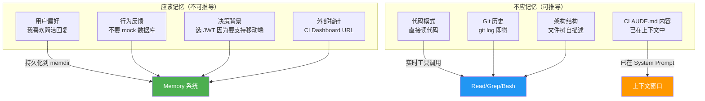
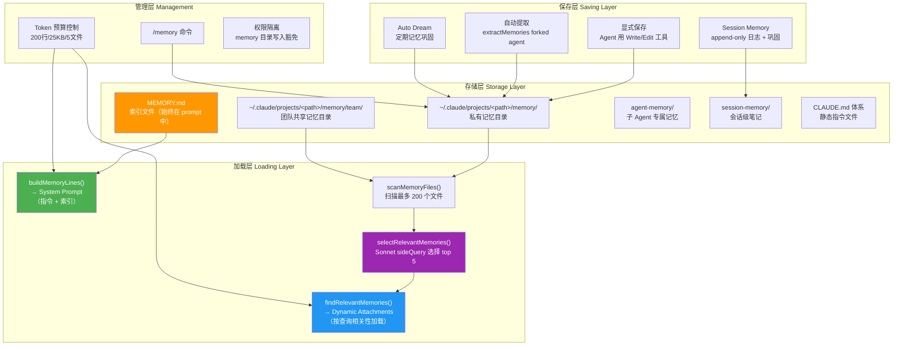
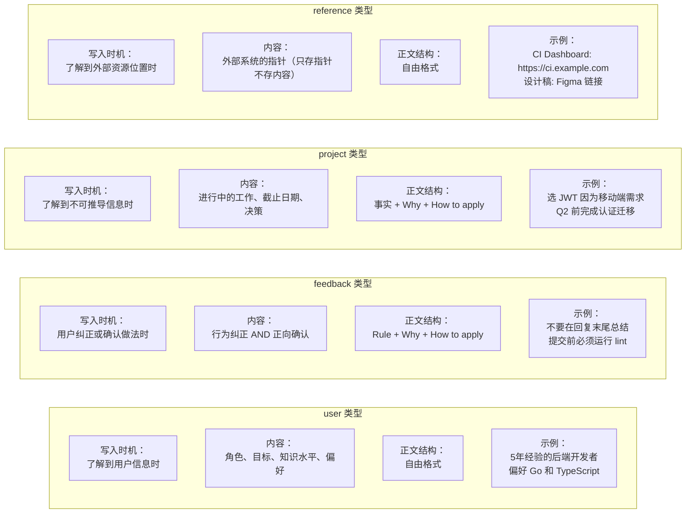
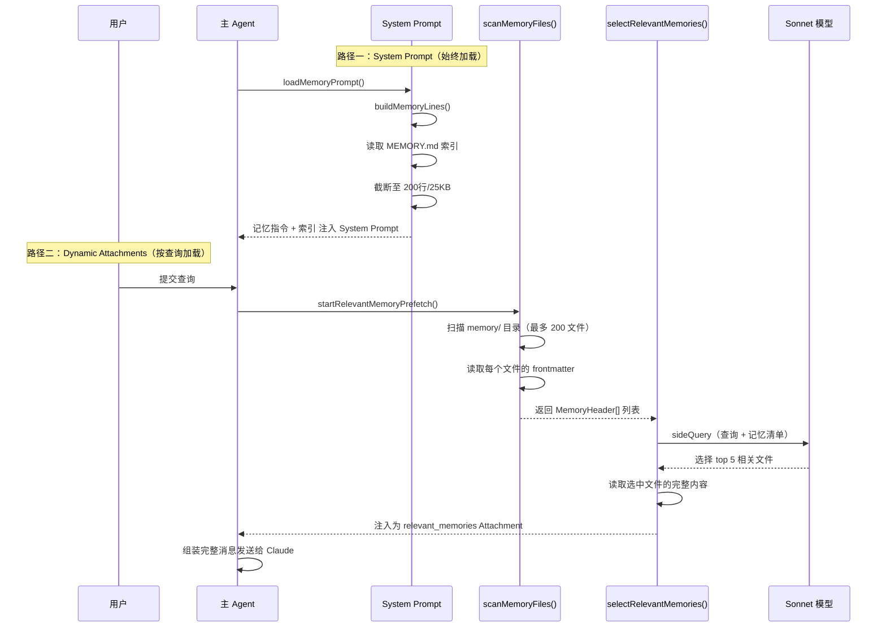
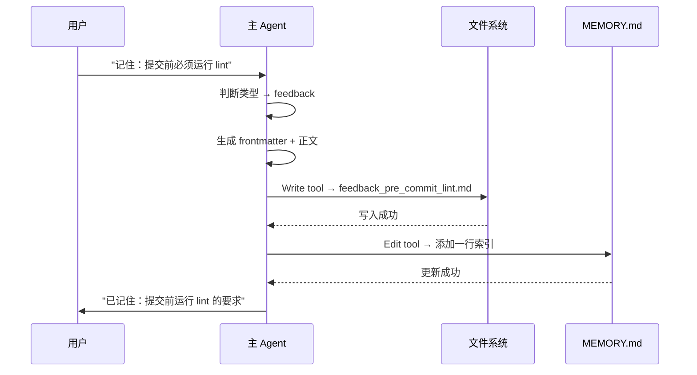
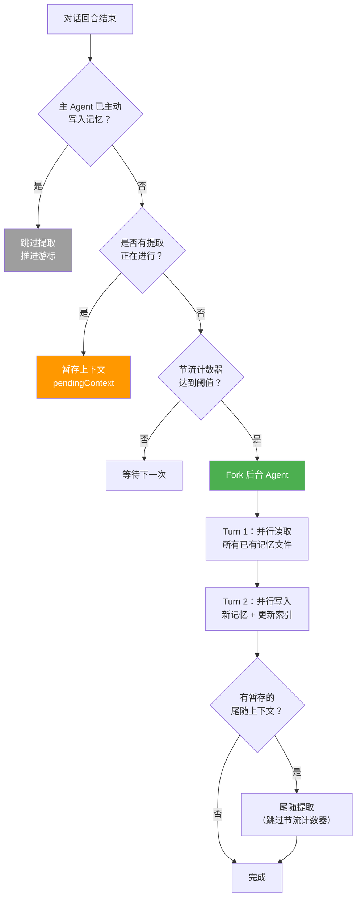
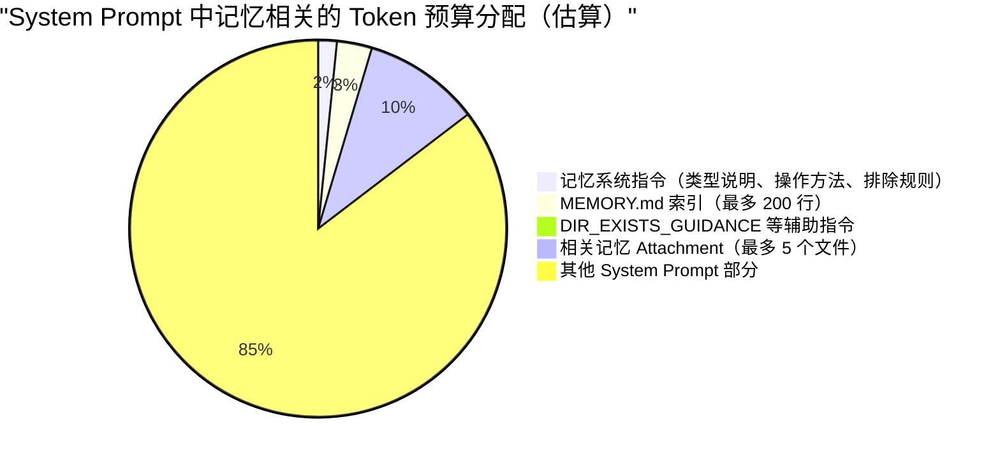
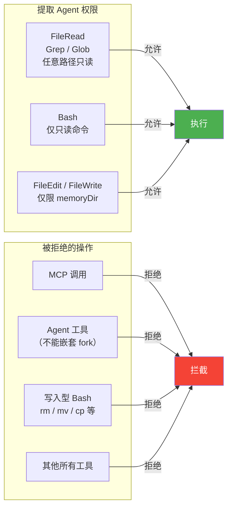
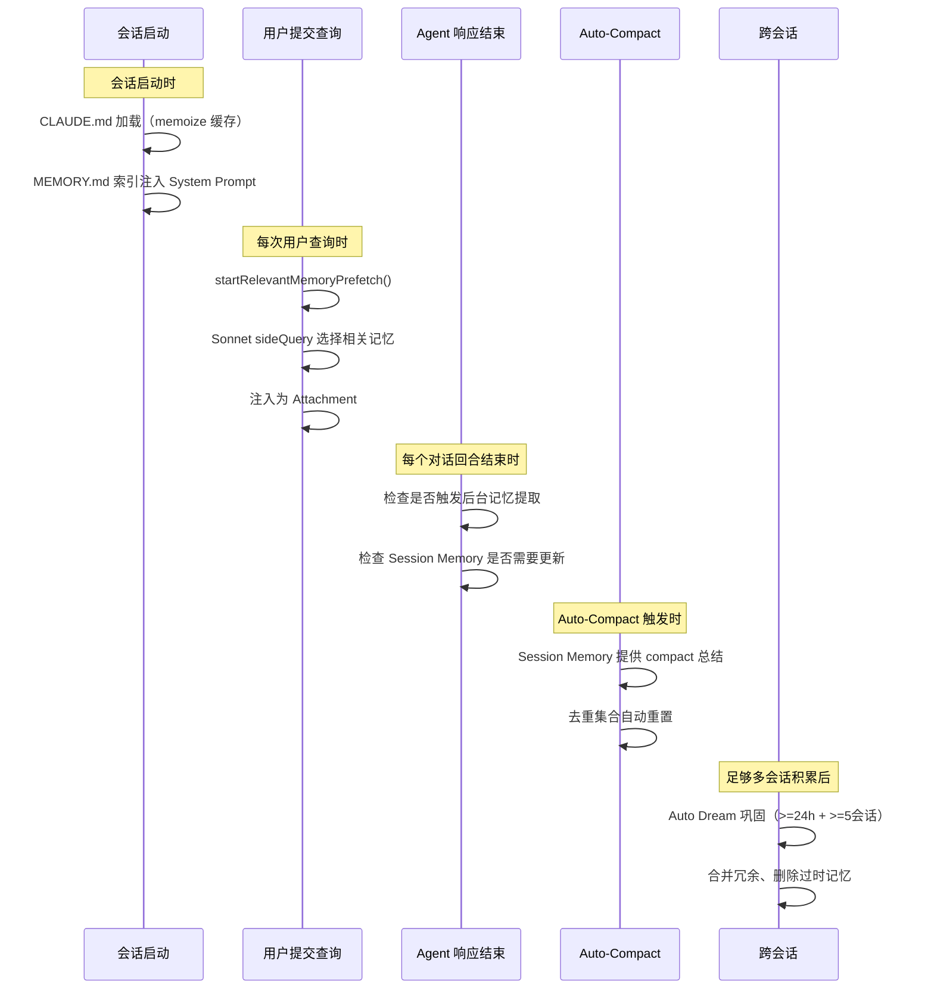
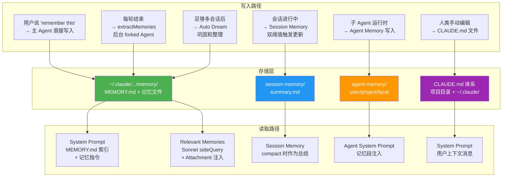

# Claude Code 记忆系统：深度源码调研报告 v2

> 版本：v2 | 基于 Claude Code 开源代码分析 | 2026-04-05

---

## 一、AI Agent 中 Memory 的含义、动机与必要性

### 1.1 什么是 Agent Memory？

在 AI Agent 领域，**Memory（记忆）** 是指 Agent 跨越单次对话边界、持久化保存和召回信息的能力。它让 Agent 从一个"无状态的问答工具"进化为一个"有上下文感知、能持续学习的协作伙伴"。

核心定义：**Memory 是 Agent 跨会话持久化的知识存储**——让 Agent "记住"用户偏好、项目上下文、历史决策、行为反馈。

### 1.2 为什么 Agent 需要记忆？

LLM 天生是**无状态**的——每次 API 调用都从零开始。没有 Memory 系统的 Agent 会面临三个核心痛点：

| 痛点 | 表现 | 根因 |
|------|------|------|
| **用户偏好丢失** | 用户告诉 Agent "我用 bun 不用 npm"，下次对话它就忘了 | 无跨会话持久化 |
| **行为纠正失效** | 用户纠正了三次"不要 mock 数据库"，第四次它可能又 mock 了 | 反馈未记录 |
| **上下文重建成本高** | 每次对话都要重新了解项目背景、架构决策、团队约定 | 无项目记忆 |

> **没有记忆的 Agent 永远是新手**：每次都要重新了解用户偏好、重新踩同样的坑、重新探索同样的代码库。

### 1.3 认知科学视角下的 Memory 分类

参考认知科学对人类记忆的分层模型，Agent Memory 可以做如下映射：

| 人类记忆类型 | 时间尺度 | Agent 对应概念 | CC 中的实现 |
|---|---|---|---|
| 感觉记忆 | 毫秒级 | 单次 API 调用的输入 | — |
| 工作记忆（短期记忆） | 秒 ~ 分钟 | 上下文窗口（Context Window） | 当前对话消息 |
| 长期记忆 | 天 ~ 年 | 持久化的 Memory 系统 | memdir 体系 |

长期记忆又可细分为：

- **语义记忆**（事实性知识）：用户是谁、项目用什么技术栈 → 对应 CC 的 `user` / `project` / `reference` 类型
- **程序记忆**（习惯性知识）：用户喜欢什么、不喜欢什么 → 对应 CC 的 `feedback` 类型
- **情景记忆**（具体事件回忆）：CC 不直接支持，但 Session Memory 在单会话内提供了类似能力

### 1.4 记忆系统的核心约束原则

Claude Code 的记忆系统有一个根本性的设计约束：

> **只记忆不可从当前项目状态推导的信息。**

这个约束不是为了省存储空间，而是为了**防止记忆与现实漂移**。代码模式、架构、文件结构和 Git 历史都是自描述的——从代码本身读取永远比从记忆中回忆更准确。

**信息获取成本对比——人类 vs Agent：**

```
人类开发者:
  记住文件结构 → 几小时的阅读和理解
  下次需要时回忆 → 几秒钟（如果有记忆）
  → 记忆的价值 = 节省的重新阅读时间

Agent:
  实时读取文件结构 → 几毫秒的工具调用
  每次重新获取的成本 → 几百个 token
  → 记忆的价值 ≈ 0（因为实时获取成本极低）
```

因此，记忆系统应该专注于保存**"实时获取不到"的信息**——人的偏好、决策的背景、外部的链接。



---

## 二、Claude Code 记忆系统的设计亮点

### 2.1 核心创新点总结

| # | 创新点 | 描述 |
|---|--------|------|
| 1 | **闭合四类型分类法** | `user/feedback/project/reference` 四种类型，每种有明确的写入条件和排除规则，不让 AI 自由存储 |
| 2 | **渐进式注入** | MEMORY.md 索引始终在 System Prompt，具体记忆文件按相关性动态加载 |
| 3 | **双层存储** | private（个人）+ team（共享），通过 TEAMMEM feature gate 控制 |
| 4 | **自动提取** | 对话结束时用 forked agent 自动提取记忆（fire-and-forget，只读权限） |
| 5 | **严格的"不存什么"规则** | 避免重复存储可以从代码/git/CLAUDE.md 推导的信息 |
| 6 | **Token 预算控制** | MEMORY.md 200行/25KB 上限，单文件 40KB，每次最多加载 5 个相关记忆 |
| 7 | **相关性选择** | 用 Sonnet 模型做 sideQuery 选择最相关的 5 个记忆文件 |
| 8 | **提取 Agent 权限隔离** | 只能读和写 memory 目录，不能执行任意命令 |
| 9 | **Prompt 与代码协同** | 代码保证前置条件（如目录存在），Prompt 告知 AI 前置条件已满足 |
| 10 | **缓存感知架构** | forked Agent 与主 Agent 共享工具列表，最大化 Prompt Cache 命中率 |
| 11 | **Auto Dream 记忆巩固** | 类似人类睡眠记忆巩固，定期自动整理和优化记忆 |

### 2.2 Prompt 与代码协同设计模式

这是 CC 记忆系统中一个非常精妙的设计模式，值得单独强调。

```typescript
// memdir/memdir.ts:116-118
export const DIR_EXISTS_GUIDANCE =
  'This directory already exists — write to it directly with the Write tool (do not run mkdir or check for its existence).'
```

源码注释写道：*Shipped because Claude was burning turns on ls/mkdir -p before writing.* 

解决方案不是改代码逻辑，而是在 Prompt 中告诉 AI "目录已经存在，直接写"。同时，代码层面通过 `ensureMemoryDirExists()` 保证这个承诺成立。

> **设计哲学：改环境 + 告知 AI，优于仅改 Prompt 或仅改代码。**

---

## 三、整体架构

### 3.1 系统架构全景图



### 3.2 存储目录结构

```
~/.claude/projects/<sanitized-git-root>/memory/
├── MEMORY.md                          # 索引文件（<=200行，<=25KB）
├── user_role_backend_dev.md           # 用户角色记忆
├── feedback_no_summary.md             # 行为反馈记忆
├── project_auth_migration_q2.md       # 项目决策记忆
├── reference_ci_dashboard.md          # 外部指针记忆
├── team/                              # 团队共享记忆（TEAMMEM gate）
│   ├── MEMORY.md
│   └── ...
└── logs/                              # Assistant 模式日志
    └── 2026/03/2026-03-15.md
```

路径解析有三级优先级：

```typescript
// memdir/paths.ts:223-235
export const getAutoMemPath = memoize(
  (): string => {
    const override = getAutoMemPathOverride() ?? getAutoMemPathSetting()
    if (override) return override
    const projectsDir = join(getMemoryBaseDir(), 'projects')
    return (
      join(projectsDir, sanitizePath(getAutoMemBase()), AUTO_MEM_DIRNAME) + sep
    ).normalize('NFC')
  },
  () => getProjectRoot(),
)
```

1. **环境变量覆盖**：`CLAUDE_COWORK_MEMORY_PATH_OVERRIDE`
2. **Settings 覆盖**：`autoMemoryDirectory`（排除 projectSettings——防止恶意仓库将路径指向 `~/.ssh`）
3. **默认路径**：基于 Git 根目录的 sanitized 路径

**安全设计亮点**：`findCanonicalGitRoot()` 确保所有 Git worktree 共享同一个记忆目录，避免同一仓库的不同 worktree 各自维护一份记忆。

---

## 四、记忆文件格式

### 4.1 Frontmatter 格式规范

每条记忆是一个独立的 Markdown 文件，带 YAML frontmatter：

```markdown
---
name: pre-commit-lint-requirement
description: Must run npm run lint before every commit; CI failed for a full day due to unlinted code
type: feedback
---

**Rule**: Run `npm run lint` before every code commit.

**Why:** A previous commit with unlinted code caused CI to fail for an entire day, blocking the team.

**How to apply:** Before using git commit, always run `npm run lint` first and fix any errors.
```

三个 frontmatter 字段的设计意图：

| 字段 | 作用 | 谁使用 |
|------|------|--------|
| `name` | 文件标识符，同时也是 MEMORY.md 中的链接文本 | 人类浏览、文件命名 |
| `description` | 一行描述——**召回系统的核心依据** | Sonnet 模型做相关性判断 |
| `type` | 四类型分类（user/feedback/project/reference） | 决定正文结构和写入条件 |

### 4.2 Frontmatter 解析器

CC 使用共享的 `frontmatterParser.ts` 解析模块，记忆、技能、Agent 都复用同一套解析逻辑：

```typescript
// memdir/frontmatterParser.ts
export function parseFrontmatter(content: string, filePath?: string): FrontmatterResult {
  const lines = content.split('\n')
  if (lines[0]?.trim() !== '---') return { frontmatter: {}, body: content }

  let endIdx = -1
  for (let i = 1; i < lines.length; i++) {
    if (lines[i].trim() === '---') { endIdx = i; break }
  }
  if (endIdx === -1) return { frontmatter: {}, body: content }

  // 解析 key: value 对
  const frontmatter: Record<string, string> = {}
  for (let i = 1; i < endIdx; i++) {
    const colonIdx = lines[i].indexOf(':')
    if (colonIdx === -1) continue
    const key = lines[i].slice(0, colonIdx).trim()
    const value = lines[i].slice(colonIdx + 1).trim()
    if (key) frontmatter[key] = value
  }

  const body = lines.slice(endIdx + 1).join('\n').trim()
  return { frontmatter, body }
}
```

设计选择：不使用 `js-yaml` 等库，因为 frontmatter 只是简单的 `key: value`，不涉及嵌套、数组、多行字符串等复杂 YAML 特性。手写解析器零依赖且足够健壮。

### 4.3 MEMORY.md 索引文件

MEMORY.md 是所有记忆文件的轻量索引，格式如下：

```markdown
# Memory Index

- **[简洁回复偏好](feedback_no_summary.md)** (feedback) — 不要尾部总结
- **[后端开发者](user_role_backend_dev.md)** (user) — 5年经验的 Go/TypeScript 开发者
- **[认证选型](project_auth_migration_q2.md)** (project) — 选 JWT 因为要支持移动端
- **[CI Dashboard](reference_ci_dashboard.md)** (reference) — https://ci.example.com
```

每行一条记忆，包含名称、链接、类型和描述。这个索引**始终**被加载到 System Prompt 中，让 Agent 知道有哪些记忆可用。

---

## 五、四种记忆类型详解

### 5.1 类型定义

```typescript
// memdir/memoryTypes.ts:14-19
export const MEMORY_TYPES = ['user', 'feedback', 'project', 'reference'] as const
```

### 5.2 类型对比总览



### 5.3 各类型详解

#### user 类型——用户画像

**写入时机**：当 Agent 了解到关于用户的信息时（角色、目标、知识水平、技术偏好）。

**核心目的**：让 Agent 根据用户画像调整未来的行为。对 5 年经验的后端开发者和对前端新手，Agent 应该用不同的语言和深度。

**正文结构**：自由格式。

**示例**：
```markdown
---
name: user-role-backend-senior
description: Senior backend developer with 5 years of Go and TypeScript experience
type: user
---
User is a senior backend engineer with ~5 years of experience.
Primary languages: Go and TypeScript.
Prefers concise, technical explanations without hand-holding.
Familiar with microservices, Docker, Kubernetes.
```

**不应保存的内容**：对用户的负面评价。

#### feedback 类型——行为反馈

**写入时机**：当用户纠正了 Agent 的行为，或者确认了 Agent 做得好的地方。

**核心目的**：指导 Agent 未来的行为。这是最重要的记忆类型——它直接影响 Agent 的行为质量。

**正文结构**：Rule → Why → How to apply（三段式）。

**为什么 feedback 同时记录成功和失败？** 源码注释解释：

> 如果你只保存纠正，你会避免过去的错误，但会偏离用户已经验证过的好方法，并可能变得过于谨慎。

**示例**：
```markdown
---
name: no-summary-at-end
description: User explicitly asked to omit summary paragraphs at the end of responses
type: feedback
---
**Rule**: Do not add summary or recap sections at the end of responses.

**Why:** User finds summaries redundant — they can see the diff and code changes themselves.

**How to apply:** After completing the task, end the response directly. Do not add "In summary..." or "To recap..." paragraphs.
```

**不应保存的内容**：仅保存纠正而忽视确认。

#### project 类型——项目上下文

**写入时机**：当 Agent 了解到不可从代码或 Git 推导的项目信息时。

**核心目的**：为后续请求提供决策背景。

**正文结构**：事实 + Why + How to apply。

**示例**：
```markdown
---
name: auth-jwt-decision
description: Chose JWT over sessions for authentication because mobile app needs stateless auth
type: project
---
**Decision**: Use JWT-based authentication instead of server-side sessions.

**Why:** The product roadmap includes a mobile app in Q3. Mobile clients work better with stateless JWT tokens than with session cookies.

**How to apply:** When implementing auth-related features, use the JWT middleware in `src/middleware/auth.ts`. Do not introduce session-based patterns.
```

**不应保存的内容**：可从 `git log` 推导的历史、可从代码读取的架构。

#### reference 类型——外部资源指针

**写入时机**：当 Agent 了解到外部资源的位置时。

**核心目的**：知道去哪里找信息。只存指针，不存系统的具体内容。

**示例**：
```markdown
---
name: ci-dashboard
description: URL for the CI/CD dashboard where build statuses can be checked
type: reference
---
CI Dashboard: https://ci.example.com/project/my-app
Linear Board: https://linear.app/team/my-team
Design Specs: https://figma.com/file/abc123
```

### 5.4 "什么不该保存"——至关重要的排除规则

这些排除规则**即使用户明确要求保存也生效**。如果用户说"记住这个 PR 列表"，Agent 应该反问"其中什么是令人惊讶或不显而易见的"——那才是值得保存的部分。

| 不应保存的内容 | 原因 | 应该怎么做 |
|---|---|---|
| 代码模式和架构 | 从代码本身读取更准确 | 用 Read/Grep 工具实时获取 |
| Git 历史和 PR 列表 | `git log` 即得 | 用 Bash 工具实时查询 |
| 调试解决方案 | 修复已在代码中 | 直接读代码 |
| CLAUDE.md 中的内容 | 已在 System Prompt 中 | 无需重复存储 |
| 临时任务详情 | 用 tasks/todo 更合适 | 用 Session Memory 或 task 系统 |
| 文件结构描述 | 一次重构就过时 | 用 Glob/ls 实时获取 |

---

## 六、记忆加载机制（渐进式注入）

CC 的记忆加载采用**渐进式注入**策略：轻量索引始终在上下文中，详细内容按需动态加载。这是一个在"全量加载"和"按需加载"之间的精巧平衡。

### 6.1 两条加载路径



### 6.2 路径一：System Prompt（MEMORY.md 索引）

`loadMemoryPrompt()` 根据启用状态做三路分发：

```
loadMemoryPrompt()
    ├── KAIROS && active? → buildAssistantDailyLogPrompt() [日志追加模式]
    ├── TEAMMEM && enabled? → buildCombinedMemoryPrompt() [私有+团队双目录]
    ├── AutoMem enabled? → buildMemoryLines() [单目录模式]
    └── disabled → return null
```

`buildMemoryLines()` 的核心逻辑：

1. 读取 MEMORY.md 索引文件
2. 截断保护（200行 + 25KB 双重限制）
3. 生成记忆系统指令（类型说明、操作方法、排除规则）
4. 注入 `DIR_EXISTS_GUIDANCE`（避免 Agent 浪费 turn 检查目录）
5. 通过 `systemPromptSection('memory', ...)` 注册为缓存段

```typescript
// memdir/memdir.ts:34-38
export const ENTRYPOINT_NAME = 'MEMORY.md'
export const MAX_ENTRYPOINT_LINES = 200
export const MAX_ENTRYPOINT_BYTES = 25_000
```

截断实现（`truncateEntrypointContent()`）的双重保护：

1. **行截断（200 行）**：保护 Agent 的理解效率——200 行以上的索引需要 Agent 花费更多 token 理解
2. **字节截断（25KB）**：捕捉行数在 200 以内但单行极长的异常（实际观察到 197KB 在 200 行内的情况）

截断顺序也有讲究——先按行截断再按字节截断，两种情况都有对应保护。

### 6.3 路径二：Dynamic Attachments（相关记忆）

#### 阶段一：扫描（scanMemoryFiles）

```typescript
// memdir/memoryScan.ts:35-77
export async function scanMemoryFiles(
  memoryDir: string, signal: AbortSignal,
): Promise<MemoryHeader[]> {
  const entries = await readdir(memoryDir, { recursive: true })
  const mdFiles = entries.filter(f => f.endsWith('.md') && basename(f) !== 'MEMORY.md')

  // 并行读取每个文件的前 30 行 frontmatter
  const headerResults = await Promise.allSettled(
    mdFiles.map(async (relativePath) => {
      const { content, mtimeMs } = await readFileInRange(filePath, 0, FRONTMATTER_MAX_LINES)
      const { frontmatter } = parseFrontmatter(content, filePath)
      return { filename, filePath, mtimeMs, description, type }
    }),
  )

  // 按修改时间降序排序，最多 200 个
  return results.sort((a, b) => b.mtimeMs - a.mtimeMs).slice(0, MAX_MEMORY_FILES)
}
```

**单遍扫描设计**：`readFileInRange` 内部 `stat` 获取 `mtimeMs`，读取和排序不需要两轮 syscall。

#### 阶段二：选择（selectRelevantMemories）

```typescript
// memdir/findRelevantMemories.ts:77-141
const result = await sideQuery({
  model: getDefaultSonnetModel(),
  system: SELECT_MEMORIES_SYSTEM_PROMPT,
  messages: [{
    role: 'user',
    content: `Query: ${query}\n\nAvailable memories:\n${manifest}${toolsSection}`
  }],
  max_tokens: 256,
  output_format: { type: 'json_schema', schema: { /* selected_memories: string[] */ } },
})
```

用 **Sonnet 模型做一个轻量 side query**：传入用户查询和记忆清单（文件名 + 描述），选择最多 5 个相关文件。

**为什么用 Sonnet 而非关键词匹配？** 语义相关性评估更准确。例如用户问"部署流程"时，关键词匹配可能错过标题为"CI/CD 注意事项"的记忆，但 Sonnet 能理解语义关联。

**反直觉的 recentTools 设计**：如果最近使用了某些工具，这些工具的参考文档不应被召回（AI 已经在使用它了），但相关的已知问题/注意事项仍应被召回——正在使用时恰恰是这些警告最重要的时候。

#### 注入为 Attachment

选中的记忆内容以 `relevant_memories` Attachment 形式注入到用户消息中：

```typescript
// 注入时带有预计算的新鲜度标记
// memdir/memoryAge.ts:15-20
export function memoryAge(mtimeMs: number): string {
  const d = memoryAgeDays(mtimeMs)
  if (d === 0) return 'today'
  if (d === 1) return 'yesterday'
  return `${d} days ago`
}
```

**为什么预计算 memoryAge？** 如果在每次 API 调用时重新计算，"saved 3 days ago" 可能变成 "saved 4 days ago"——不同的字节会导致 **Prompt Cache 失效**。预计算保证了跨 turn 的字节稳定性。

#### Session-level 去重

```typescript
// utils/attachments.ts
export function collectSurfacedMemories(messages: ReadonlyArray<Message>) {
  const paths = new Set<string>()
  let totalBytes = 0
  for (const m of messages) {
    if (m.type === 'attachment' && m.attachment.type === 'relevant_memories') {
      for (const mem of m.attachment.memories) {
        paths.add(mem.path)
        totalBytes += mem.content.length
      }
    }
  }
  return { paths, totalBytes }
}
```

**精巧的 compact 自动重置**：通过扫描 messages 而非追踪状态来去重。当 compact 发生时，旧的 attachment 消息被删除，`surfacedPaths` 自然被重置——那些记忆可以被合理地重新注入到压缩后的上下文中。

---

## 七、记忆保存机制

### 7.1 显式保存（用户触发）

当用户说"记住这个"或者 Agent 判断有值得记住的信息时，Agent 使用 Write/Edit 工具直接操作记忆文件。

**两步流程**：
1. 写入记忆文件（如 `feedback_no_summary.md`）
2. 更新 MEMORY.md 索引（添加一行指针）



### 7.2 自动提取（后台 Agent）

这是 CC 记忆系统最精妙的部分之一。每次对话回合结束时，系统会自动运行一个后台 Agent，从对话中萃取值得记住的信息。

#### 触发机制

```typescript
// services/extractMemories/extractMemories.ts:598-603
export async function executeExtractMemories(
  context: REPLHookContext,
  appendSystemMessage?: AppendSystemMessageFn,
): Promise<void> {
  await extractor?.(context, appendSystemMessage)
}
```

在 `handleStopHooks`（对话循环结束时）被 fire-and-forget 调用。

#### 核心流程



#### 互斥控制——三个核心状态

```typescript
// services/extractMemories/extractMemories.ts:556-564
if (inProgress) {
  logForDebugging('[extractMemories] extraction in progress — stashing for trailing run')
  pendingContext = { context, appendSystemMessage }
  return
}
```

闭包作用域管理的三个核心状态：
- `lastMemoryMessageUuid`：游标，标记上次处理到哪条消息
- `inProgress`：互斥锁，防止并行执行
- `pendingContext`：暂存最新上下文等当前提取完成后执行 trailing run

这是一个**优雅的合并模式**：不排队所有请求，只保留最新的一个。

#### 主 Agent 与提取 Agent 的互斥

```typescript
// services/extractMemories/extractMemories.ts:348-360
if (hasMemoryWritesSince(messages, lastMemoryMessageUuid)) {
  logForDebugging('[extractMemories] skipping — conversation already wrote to memory files')
  const lastMessage = messages.at(-1)
  if (lastMessage?.uuid) {
    lastMemoryMessageUuid = lastMessage.uuid
  }
  return
}
```

`hasMemoryWritesSince()` 扫描助手消息中的 `tool_use` 块，检查是否有 Edit/Write 操作目标路径在记忆目录范围内。**避免了主 Agent 和后台 Agent 同时写同一个记忆文件的竞态。**

#### Forked Agent 的权限沙箱

```
提取 Agent 权限白名单：
  允许：FileRead、Grep、Glob（任意路径，只读）
  允许：Bash（仅只读命令：ls, find, grep, cat, stat...）
  允许：FileEdit/FileWrite（仅限 memoryDir 内的路径）
  拒绝：MCP、Agent、写入型 Bash、其他所有工具
```

**最小权限原则的完美体现**——即使后台 Agent 的 Prompt 被注入攻击，它也无法对记忆目录之外的文件系统造成影响。

#### 缓存感知的关键设计

提取 Agent 通过 `runForkedAgent()` 创建，与主对话**共享完全相同的 System Prompt 和工具列表**。关键约束：

> **工具列表是 API 缓存 key 的一部分。** 如果 forked Agent 使用与主 Agent 不同的工具集，缓存就无法命中。这就是为什么工具权限过滤使用 `canUseTool` 回调而非不同的工具列表——**接口一致，行为可变。**

```
无缓存共享时：提取 Agent 重新发送 80,000 tokens → $0.24
有缓存共享时：提取 Agent 复用缓存 → $0.008（仅缓存读取费用）
节省：96.7%
```

#### 提取策略：两步并行

提取 Prompt 指导 Agent 采用两步并行策略：

> *turn 1 — issue all FileRead calls in parallel for every file you might update; turn 2 — issue all FileWrite/FileEdit calls in parallel.*

限制 `maxTurns: 5`，防止 Agent 进入验证兔子洞（rabbit-hole）。

---

## 八、Token 预算与上下文管理

### 8.1 预算约束总览

| 约束项 | 限制值 | 设计意图 |
|--------|--------|----------|
| MEMORY.md 最大行数 | 200 行 | 保护 Agent 的理解效率 |
| MEMORY.md 最大字节 | 25 KB | 防止单行极长的异常情况 |
| 单个记忆文件最大 | 40 KB | 防止记忆文件无限膨胀 |
| 目录最大文件数 | 200 个 | 扫描性能保证 |
| 每次查询加载的相关记忆 | 最多 5 个 | 上下文空间控制 |
| 选择器模型 | Sonnet | 低成本高质量的语义匹配 |
| 选择器 max_tokens | 256 | sideQuery 的输出限制 |
| Session Memory 总上限 | 12,000 tokens | compact 后的总结大小控制 |
| Session Memory 单 section | 2,000 字符 | 防止单个部分膨胀 |

### 8.2 预算分配可视化



### 8.3 预算控制的层级策略

```
Layer 1: 源头控制
  → "什么不该保存" 规则减少记忆总量
  → 闭合四类型防止类型爆炸

Layer 2: 索引控制
  → MEMORY.md 200行/25KB 双重截断
  → 目录最多 200 个文件

Layer 3: 加载控制
  → 每次最多 5 个相关记忆
  → Sonnet sideQuery 选择相关性最高的

Layer 4: 注入控制
  → Session-level 去重（已注入的不重复注入）
  → compact 后自动重置去重集合

Layer 5: 巩固控制
  → Auto Dream 定期合并冗余记忆
  → 减少总文件数量
```

---

## 九、安全与权限

### 9.1 记忆目录的写入豁免

CC 的权限系统有一套 `DANGEROUS_DIRECTORIES` 检查机制，会阻止 Agent 写入敏感目录。但记忆目录需要特殊处理——它是 Agent 合法的写入目标。

解决方案：记忆目录有写入豁免（write carve-out），绕过 `DANGEROUS_DIRECTORIES` 检查。

### 9.2 提取 Agent 的权限隔离



### 9.3 路径安全

- **sanitizePath()** 对 Git 根目录做安全化处理，防止路径遍历攻击
- **projectSettings 排除**：`autoMemoryDirectory` 设置排除 projectSettings 来源——防止恶意仓库将记忆路径指向 `~/.ssh` 等敏感目录
- **findCanonicalGitRoot()** 确保 worktree 共享记忆目录，不创建重复路径

### 9.4 权限控制的技术实现

工具权限过滤使用 `canUseTool` **回调而非不同的工具列表**。这是因为：

1. 工具列表是 API 缓存 key 的一部分
2. 不同的工具列表 → 缓存失效
3. `canUseTool` 回调在运行时过滤 → 接口一致，行为可变

---

## 十、五层多粒度记忆架构

CC 不是单一的记忆存储，而是构建了一个**五层+记忆架构**，每层解决不同时间尺度和不同粒度的需求。

### 10.1 架构层次

```
┌─────────────────────────────────────────────────────┐
│  Layer 6: Auto Dream — 记忆巩固与整理                 │
├─────────────────────────────────────────────────────┤
│  Layer 5: Relevant Memories — 按需智能召回             │
├─────────────────────────────────────────────────────┤
│  Layer 4: Agent Memory — 子Agent专属记忆               │
├─────────────────────────────────────────────────────┤
│  Layer 3: Session Memory — 当前会话结构化笔记           │
├─────────────────────────────────────────────────────┤
│  Layer 2: Auto Memory (memdir) — AI自主学习知识库       │
├─────────────────────────────────────────────────────┤
│  Layer 1: CLAUDE.md — 静态指令与规则                    │
└─────────────────────────────────────────────────────┘
```

### 10.2 各层详解

#### Layer 1: CLAUDE.md——静态指令

CLAUDE.md 是最基础的"记忆"形式。它本质上不是 AI 自主写入的记忆，而是**人类预写的指令文件**。

四种来源，按优先级从低到高：

| 类型 | 位置 | 版本控制 | 作用范围 |
|---|---|---|---|
| Managed | `/etc/claude-code/CLAUDE.md` | 否 | 组织级全局 |
| User | `~/.claude/CLAUDE.md` | 否 | 个人全局 |
| Project | `CLAUDE.md`, `.claude/CLAUDE.md`, `.claude/rules/*.md` | 是 | 项目级团队共享 |
| Local | `CLAUDE.local.md` | 否 | 个人项目级 |

**加载顺序与优先级相反**：Managed 最先加载但优先级最低，Local 最后加载但优先级最高。利用 LLM 的 recency bias——靠后的内容关注度更高。

#### Layer 2: Auto Memory (memdir)——AI 自主知识库

这是记忆系统的**核心层**。与 CLAUDE.md 由人类编写不同，memdir 中的内容**完全由 AI 生成和维护**。包含四种类型的记忆文件和 MEMORY.md 索引。

#### Layer 3: Session Memory——会话级笔记

**设计动机**：当对话变得很长需要 auto-compact 时，如何保留关键的会话上下文？

Session Memory 使用固定的 10 段 Markdown 模板：

```
# Session Title — 5-10 字简短标题
# Current State — 当前正在做什么
# Task specification — 用户要求构建什么
# Files and Functions — 重要文件列表
# Workflow — 常用 bash 命令
# Errors & Corrections — 遇到的错误和修复
# Codebase and System Documentation — 重要系统组件
# Learnings — 什么有效什么无效
# Key results — 关键输出
# Worklog — 逐步操作日志
```

**模板不可变 + 内容可变**：每个 section 有固定标题和斜体描述行，AI 只能修改描述行之后的内容。

**双阈值触发机制**：

```typescript
// Token 增长阈值（5000 tokens）AND (Tool call 计数阈值（3次）OR 无 tool call 的自然暂停)
return (hasMetTokenThreshold && hasMetToolCallThreshold) ||
       (hasMetTokenThreshold && !hasToolCallsInLastTurn)
```

Token 阈值是必要条件——即使 tool call 阈值满足，token 没增长就不触发，防止过度提取。

#### Layer 4: Agent Memory——子 Agent 专属记忆

为自定义子 Agent 提供独立的记忆空间。一个 "explorer" Agent 学到的代码导航技巧和一个 "test-runner" Agent 学到的测试模式是不同的。

三种作用域：

| Scope | 默认路径 | 版本控制 | 适用场景 |
|---|---|---|---|
| `user` | `<memoryBase>/agent-memory/<type>/` | 否 | 跨项目通用知识 |
| `project` | `<cwd>/.claude/agent-memory/<type>/` | 是 | 项目特定知识 |
| `local` | `<cwd>/.claude/agent-memory-local/<type>/` | 否 | 本地特定知识 |

#### Layer 5: Relevant Memories——按需智能召回

已在第六章详细分析。核心是 scanMemoryFiles → selectRelevantMemories → Attachment 注入的三步流程。

#### Layer 6: Auto Dream——记忆巩固

类似于人类睡眠时的记忆巩固过程。当积累了足够多的会话后，系统自动运行 `/dream` 技能来整理和优化记忆。

**三重门控**：

```typescript
// services/autoDream/autoDream.ts:95-100
function isGateOpen(): boolean {
  if (getKairosActive()) return false  // KAIROS 模式用自己的 dream
  if (getIsRemoteMode()) return false
  if (!isAutoMemoryEnabled()) return false
  return isAutoDreamEnabled()
}
```

通过后还需满足：
1. **时间门控**：距上次巩固 >= 24 小时
2. **会话门控**：此期间至少有 5 个新会话
3. **锁门控**：无其他进程正在巩固（文件锁）

**失败回滚**：如果巩固失败，回滚锁的 mtime 让时间门控重新通过，下次会话会再次尝试。防止"梦被永久打断"。

### 10.3 各层对比表

| 维度 | CLAUDE.md | Auto Memory | Session Memory | Agent Memory | Relevant Memories | Auto Dream |
|---|---|---|---|---|---|---|
| **生命周期** | 永久 | 跨会话 | 单次会话 | 跨会话 | 每用户 turn | 跨会话 |
| **内容来源** | 人类手动 | AI 自主/后台提取 | AI 后台提取 | 子 Agent | 从已有记忆选择 | 系统自动 |
| **存储位置** | 项目/用户目录 | `~/.claude/.../memory/` | `session-memory/` | `agent-memory/` | 内存(Attachment) | 回写 memory/ |
| **核心职责** | 静态指令规则 | 持久化知识 | 会话状态笔记 | Agent 专属知识 | 按需召回 | 整理优化 |
| **注入方式** | System Prompt | 索引→SP;内容→Att | compact 时 | Agent SP | user message | 不直接注入 |
| **大小限制** | 无硬限制 | 200行/25KB索引 | 12000 tokens | 同 Auto Memory | 每次最多 5 个 | 不涉及 |

---

## 十一、触发时机全景图



### 典型场景匹配

| 场景 | 最适合的记忆层 | 原因 |
|---|---|---|
| "我们团队统一用 ESLint + Prettier" | CLAUDE.md (Project) | 团队共享的静态规范，适合签入 Git |
| "我喜欢简洁回复，不要总结" | Auto Memory (feedback) | 个人偏好，跨会话有效 |
| "认证模块选 JWT 因为要支持移动端" | Auto Memory (project) | 决策背景，不可从代码推导 |
| "当前正在重构 UserService 的第 3 步" | Session Memory | 当前会话的临时工作状态 |
| "测试 Agent 在这个项目应该用 Vitest" | Agent Memory (project) | 子 Agent 的项目特定知识 |
| 用户问"部署流程"→自动注入 CI/CD 记忆 | Relevant Memories | 按需语义匹配 |
| 积累了 20 条相似的 feedback 记忆 | Auto Dream | 合并冗余，精简为 5 条核心规则 |

---

## 十二、工程设计分析

### 12.1 代码复用

- **buildMemoryLines()** 是可复用的核心函数——auto memory、agent memory、team memory 都使用同一套构建逻辑
- **frontmatterParser.ts** 跨模块共享——记忆、技能、Agent 都复用同一套 YAML frontmatter 解析
- **systemPromptSection** 缓存机制——只要 MEMORY.md 内容不变，Prompt Cache 命中率不受影响

### 12.2 缓存策略

```
memoize(getMemoryFiles()) — 带手动 reset 的缓存
  ├── 缓存 key: getProjectRoot()
  ├── 首次调用: 遍历文件系统
  ├── 后续调用: 直接返回缓存
  └── reset: 记忆文件变更时手动触发

systemPromptSection('memory', ...) — 缓存段
  ├── 内容不变 → Prompt Cache 命中
  └── 内容变更 → 只重新计算该段

memoryAge() — 预计算
  ├── 问题: 实时计算会导致缓存失效
  ├── 方案: 在 prefetch 时计算并冻结
  └── 效果: 跨 turn 字节稳定
```

### 12.3 异步设计

- **startRelevantMemoryPrefetch()**: 在用户提交查询时就开始异步预取相关记忆，不阻塞主流程
- **fire-and-forget 目录创建**: Agent Memory 的 `ensureMemoryDirExists()` 在 sync 路径中被 fire-and-forget 调用
- **extractMemories**: 后台 Agent fire-and-forget 执行，不阻塞主对话

### 12.4 关键源码文件索引

| 文件路径 | 核心职责 |
|----------|----------|
| `memdir/memdir.ts` | MEMORY.md 索引管理、截断保护、DIR_EXISTS_GUIDANCE |
| `memdir/memoryTypes.ts` | 四类型定义和提示词 |
| `memdir/paths.ts` | 路径解析（三级优先级）、sanitizePath |
| `memdir/memoryScan.ts` | 文件扫描（scanMemoryFiles） |
| `memdir/findRelevantMemories.ts` | Sonnet sideQuery 选择相关记忆 |
| `memdir/memoryAge.ts` | 新鲜度标记预计算 |
| `memdir/frontmatterParser.ts` | 共享的 frontmatter 解析器 |
| `services/extractMemories/extractMemories.ts` | 后台自动提取（互斥、游标、权限沙箱） |
| `services/SessionMemory/sessionMemory.ts` | 会话级记忆（双阈值触发） |
| `services/SessionMemory/prompts.ts` | 10 段 Markdown 模板 |
| `services/autoDream/autoDream.ts` | Auto Dream 记忆巩固（三重门控） |
| `tools/AgentTool/agentMemory.ts` | Agent Memory 三种 scope |
| `utils/claudemd.ts` | CLAUDE.md 四层加载与遍历 |
| `context.ts` | getUserContext 注入路径 |

---

## 十三、可迁移的设计模式

### 模式 1：分类法驱动的记忆质量

不要让 AI 自由存储任何东西——定义一个闭合的分类法，每种类型有明确的写入条件和排除规则。特别重要的是定义"什么不应该存储"。

**为什么闭合分类优于自由标签？**
- 自由标签导致：标签膨胀（"preference"/"pref"/"user-pref" 指的是同一个东西）、分类模糊、索引膨胀
- 闭合分类让每种类型有**明确的保存触发条件和正文结构**

### 模式 2：索引-内容分离 + 智能召回

将记忆分为轻量索引（<=200 行）和按需召回的详细内容。用轻量模型做 side query 选择最多 5 个相关文件注入。

**核心收益**：索引 ~1500 tokens 始终在上下文中，而不是所有记忆（可能数万 tokens）都占用上下文。

### 模式 3：后台提取 + 主 Agent 互斥

不要在主对话流中做记忆提取（会增加延迟），而是用 fire-and-forget 的后台 Agent。通过互斥机制避免重复写入。

**关键互斥规则**：如果主 Agent 已经写了记忆，后台提取自动跳过。

### 模式 4：Prompt 与代码协同

如果模型反复犯某个错误（如检查目录是否存在），优先考虑改变环境（预创建目录）而非改变提示词。然后在 Prompt 中告知 AI 前置条件已满足。

### 模式 5：缓存感知的接口设计

保持工具列表等缓存相关参数不变，将差异化逻辑放在运行时的行为控制中（`canUseTool` 回调）。

**核心原理**：API 缓存 key 包含工具列表 → 工具列表不同 → 缓存失效 → 大幅增加成本。

### 模式 6：预计算保证缓存稳定

对于可能随时间变化的计算结果（如 "3 days ago" → "4 days ago"），在注入时预计算并冻结，避免跨 turn 的字节变化导致缓存失效。

### 模式 7：记忆是线索而非结论

记忆被当作"时间点快照"，使用前必须验证当前状态。这是因为记忆可能过时——代码可能已经重构，决策可能已经改变。

---

## 十四、记忆系统完整数据流



---

## 十五、总结速记表

### 15.1 记忆层速记

| 记忆层 | 一句话描述 | 生命周期 | 写入者 | 触发时机 | 存储格式 | 大小限制 | 注入方式 |
|---|---|---|---|---|---|---|---|
| **CLAUDE.md** | 人类预写的静态指令 | 永久 | 人类 | 会话启动(memoize) | Markdown | 无硬限制 | System Prompt |
| **Auto Memory** | AI 自主学习知识库 | 跨会话 | AI/后台Agent | 显式/每轮结束 | MD+YAML | 200行/25KB索引 | 索引→SP; 内容→Att |
| **Session Memory** | 会话级结构化笔记 | 单次会话 | 后台Agent | 双阈值触发 | 10段模板MD | 12000 tokens | compact时注入 |
| **Agent Memory** | 子Agent专属记忆 | 跨会话 | 子Agent | Agent运行时 | 同Auto Memory | 同Auto Memory | Agent的SP |
| **Relevant Memories** | 按需智能召回 | 每用户turn | 系统自动 | 每次查询 | Attachment | 最多5个文件 | user message |
| **Auto Dream** | 定期记忆巩固 | 跨会话 | 系统自动 | >=24h+>=5会话 | 回写memory/ | 不涉及 | 优化存储层 |

### 15.2 四类型速记

| 类型 | 一句话 | 写入时机 | 正文结构 | 不应保存 |
|------|--------|----------|----------|----------|
| user | 用户画像 | 了解到用户信息时 | 自由格式 | 负面评价 |
| feedback | 行为纠正+确认 | 用户纠正/确认时 | Rule+Why+How | 只记纠正忽视确认 |
| project | 项目决策背景 | 不可推导信息时 | 事实+Why+How | 可从git/代码推导的 |
| reference | 外部指针 | 了解到资源位置时 | 自由格式 | 系统具体内容 |

### 15.3 核心设计哲学速记

| # | 设计哲学 | 一句话解释 |
|---|----------|-----------|
| 1 | 只存不可推导信息 | 能从代码/Git 读到的就不要记 |
| 2 | 约束即自由 | 闭合四类型 > 自由标签 |
| 3 | 记忆是线索非结论 | 使用前必须验证当前状态 |
| 4 | 后台不阻塞前台 | fire-and-forget + 互斥 |
| 5 | 接口一致行为可变 | 共享工具列表，运行时过滤权限 |
| 6 | 改环境优于改提示词 | 预创建目录 + 告知 AI 已存在 |
| 7 | 双层防御优于单层 | 行截断 + 字节截断 |
| 8 | 预计算保证缓存 | memoryAge 预计算避免 cache 失效 |
| 9 | 成功和失败都记 | feedback 同时记录纠正和确认 |
| 10 | 缓存感知全局化 | forked Agent 共享 SP/工具列表 → 96.7% 成本节省 |

### 15.4 关键数值速记

```
MEMORY.md 索引上限:     200 行 / 25 KB
单个记忆文件上限:        40 KB
目录最大文件数:          200 个
每次加载相关记忆:        最多 5 个
选择器模型:             Sonnet
选择器输出限制:          256 tokens
Session Memory 上限:    12,000 tokens
Session Memory 单段:    2,000 字符
Auto Dream 时间门控:    >= 24 小时
Auto Dream 会话门控:    >= 5 个新会话
提取 Agent maxTurns:    5
缓存共享节省:           96.7%
```

---

> **核心结论**：Claude Code 的记忆系统不是简单的"存取"机制，而是一个精心设计的多层架构。它在"记什么"（闭合四类型 + 排除规则）、"怎么记"（显式 + 自动提取 + 巩固）、"怎么读"（渐进式注入 + 语义召回）、"怎么省"（Token 预算 + 缓存感知）四个维度上都有深思熟虑的设计决策。每个决策都在"信息完整性"和"上下文有效性"之间寻找最优平衡点。
