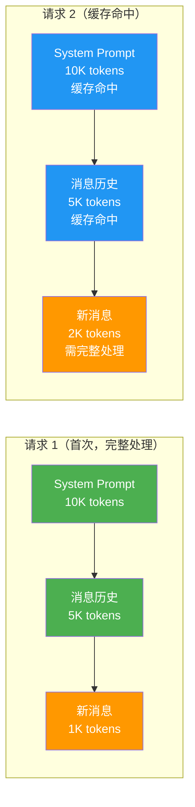
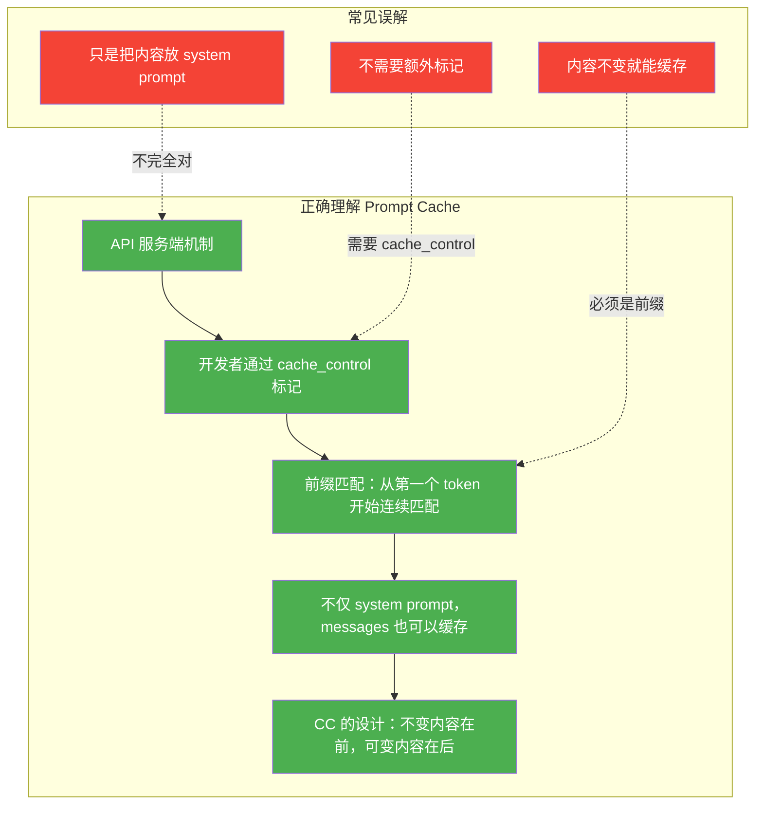
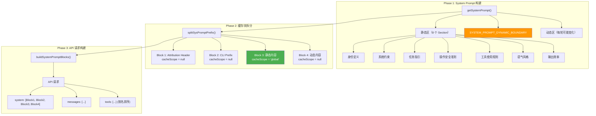
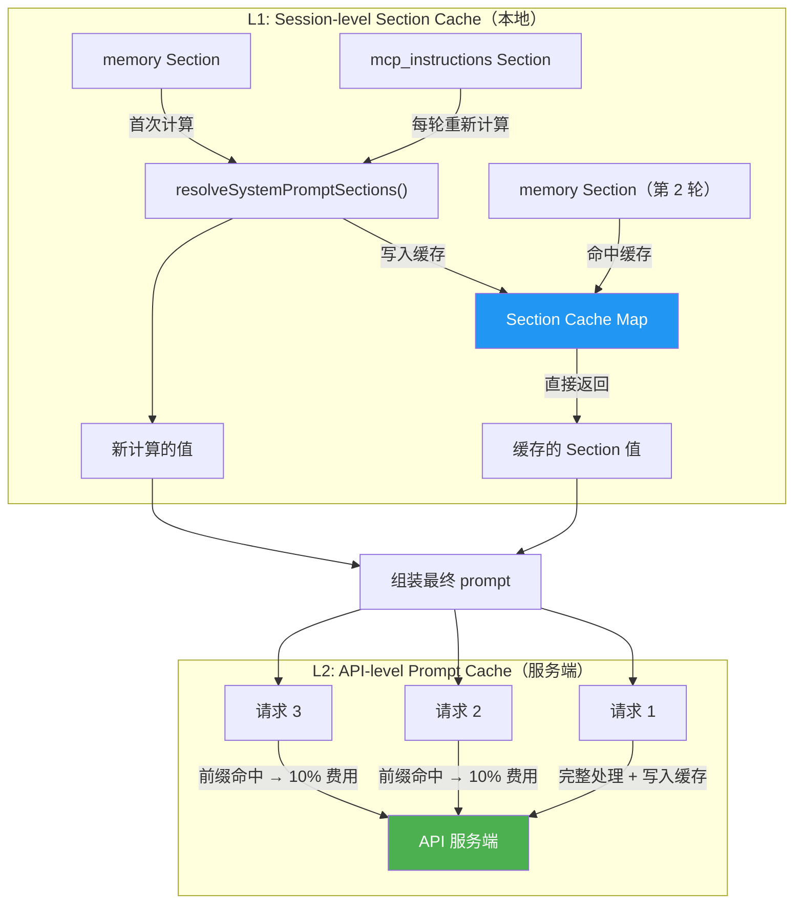
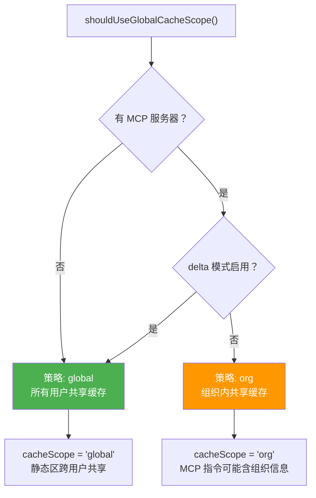
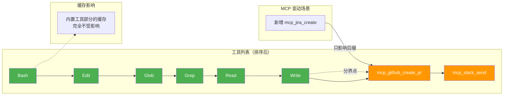
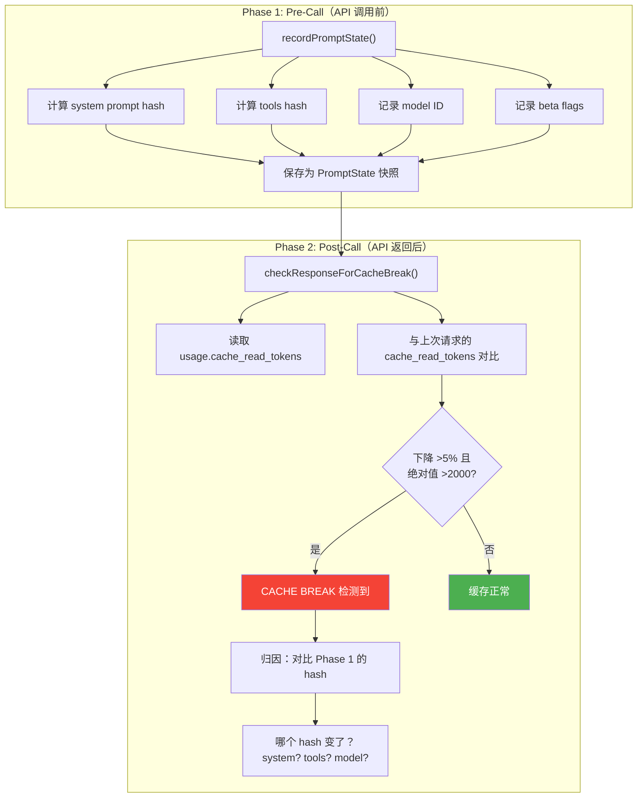
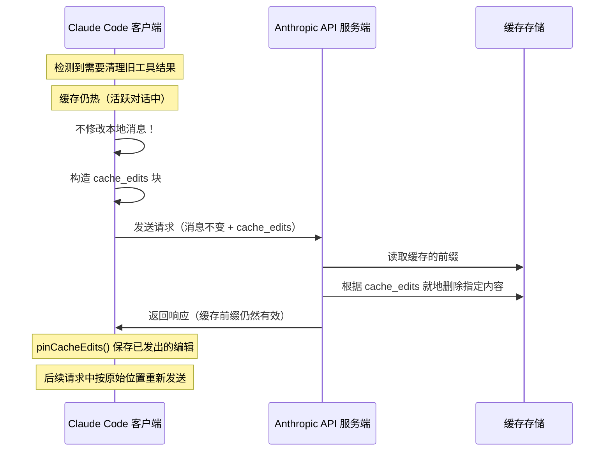
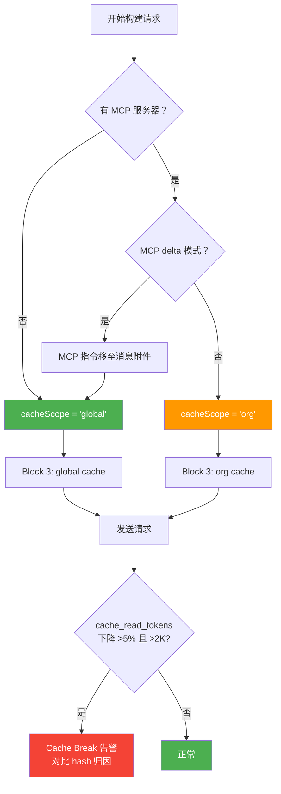

# Claude Code Prompt Cache 深度调研

---

## 目录

1. [Prompt Cache 的含义、动机与作用](#1-prompt-cache-的含义动机与作用)
   - 1.1 什么是 Prompt Cache
   - 1.2 工作原理：前缀匹配机制
   - 1.3 纠正常见误解
   - 1.4 为什么 Coding Agent 必须关注 Prompt Cache
2. [Claude Code 的 Prompt Cache 设计全景](#2-claude-code-的-prompt-cache-设计全景)
   - 2.1 八大设计亮点总览
   - 2.2 整体架构
3. [静态/动态分界线：SYSTEM_PROMPT_DYNAMIC_BOUNDARY](#3-静态动态分界线system_prompt_dynamic_boundary)
   - 3.1 设计动机
   - 3.2 分界线的实现
   - 3.3 静态区与动态区内容
4. [两层缓存体系：L1 Section Cache + L2 API Cache](#4-两层缓存体系l1-section-cache--l2-api-cache)
   - 4.1 L1：Session-level Section Cache
   - 4.2 L2：API-level Prompt Cache
   - 4.3 两层缓存的协作关系
5. [缓存块拆分与 cache_control 标记](#5-缓存块拆分与-cache_control-标记)
   - 5.1 splitSysPromptPrefix() 详解
   - 5.2 三种缓存策略自动选择
   - 5.3 buildSystemPromptBlocks() 最终转换
6. [工具列表的缓存稳定性](#6-工具列表的缓存稳定性)
   - 6.1 分区排序策略
   - 6.2 MCP 工具变动的隔离
7. [Cache Break Detection：缓存失效检测](#7-cache-break-detection缓存失效检测)
   - 7.1 两阶段检测机制
   - 7.2 精确归因
8. [Cache Edits：服务端就地编辑](#8-cache-edits服务端就地编辑)
   - 8.1 MicroCompact 路径 B
   - 8.2 pinned edits 机制
9. [TTL 锁存机制](#9-ttl-锁存机制)
   - 9.1 问题背景
   - 9.2 锁存实现
10. [DANGEROUS_ 命名约定：工程文化防线](#10-dangerous_-命名约定工程文化防线)
11. [数值估算与成本分析](#11-数值估算与成本分析)
12. [端到端工作流程模拟](#12-端到端工作流程模拟)
13. [设计总结与速记表](#13-设计总结与速记表)

---

## 1. Prompt Cache 的含义、动机与作用

### 1.1 什么是 Prompt Cache

Prompt Cache 是 Anthropic API 提供的**前缀缓存机制**。其核心思想是：如果连续两次 API 请求的前缀（system prompt + 消息历史的前 N 个 token）**完全一致**，则第二次请求可以**复用服务端已处理的前缀**，从而大幅降低成本和延迟。

这不是 Claude Code 自己发明的机制，而是 Anthropic API 层面提供的基础设施。Claude Code 所做的，是**精心设计请求结构**，最大化利用这一机制。

用一个类比来理解：

> 想象你每天早上给老板发邮件汇报工作。邮件的前半段（公司名称、部门、自我介绍、汇报格式说明）每天都一样，只有最后一段（今天的具体工作内容）不同。如果邮件系统能够缓存前半段，每天只需要传输后半段，通信效率会大幅提升。Prompt Cache 就是这个"邮件系统的前半段缓存"。

### 1.2 工作原理：前缀匹配机制

Prompt Cache 的核心是**前缀匹配**——从请求的第一个 token 开始，连续匹配到最后一个被标记了 `cache_control` 的 block 为止。



**关键数值**：

| 指标 | 数值 |
|------|------|
| 缓存命中 token 的费用 | 原价的 **10%** |
| 缓存写入 token 的费用 | 原价的 **125%**（首次写入有 25% 溢价） |
| 默认 TTL | **5 分钟** |
| 付费用户 TTL | **1 小时** |
| 最小缓存单位 | **1024 tokens**（前缀不足此长度则不缓存） |

**请求 1**：16K tokens 全部按原价计费（其中标记了 `cache_control` 的部分按 125% 计费，写入缓存）。

**请求 2**：前缀 15K tokens 命中缓存，只按 10% 计费；新增的 2K tokens 按原价计费。

**效果计算**：假设每次请求有 15K 不变前缀 + 2K 新增内容
- 无缓存：100 轮 x 17K = 1,700K token 计费
- 有缓存：首次 17K + 99 轮 x (15K x 10% + 2K) = 17K + 99 x 3.5K = 363.5K
- **节省约 79%**

### 1.3 纠正常见误解

> "Prompt Cache 就是把不变的 prompt 放在 system prompt 中？"

**这个理解不完全正确。** 需要从三个层面纠正：

**误解 1：缓存只发生在 system prompt 中**

事实上，缓存是按**前缀匹配**的，不区分内容在 `system` 参数还是 `messages` 参数中。只要从请求的第一个 token 开始，连续匹配到某个标记了 `cache_control` 的 block 为止，整个前缀都可以被缓存。这意味着 messages 中的早期对话历史也能受益于缓存。

**误解 2：只要内容不变就能命中缓存**

不对。缓存要求的是**前缀**完全一致。如果你在 system prompt 的中间插入了一段动态内容（比如当前时间），即使后面的内容完全相同，从插入点开始的所有内容都无法命中缓存。这就是为什么 Claude Code 要把动态内容放在最后面。

**误解 3：开发者只需要把内容放对位置就行**

实际上还需要：
- 通过 `cache_control: { type: 'ephemeral' }` **显式标记**哪些 block 需要缓存
- 选择合适的 `scope`（`global` 表示跨用户共享，`org` 表示组织内共享）
- 确保标记点之前的内容真的稳定不变



### 1.4 为什么 Coding Agent 必须关注 Prompt Cache

Coding Agent 的使用模式天然适合 Prompt Cache，因为每次 API 调用都会重复发送大量相同的内容：

| 重复内容 | 每轮大小（估算） | 100 轮累计 |
|----------|-----------------|-----------|
| System Prompt（身份、规则、约束） | ~3K-5K tokens | 300K-500K |
| 工具定义（Tool Schemas） | ~2K-5K tokens | 200K-500K |
| 对话历史前缀 | 逐轮增长，平均 ~20K | ~1000K |
| **总计重复** | | **1.5M-2M tokens** |

如果没有 Prompt Cache，100 轮对话的成本大约是：
- 2M input tokens x $3/M (Claude Sonnet) = **$6**

如果有 Prompt Cache（假设 80% 命中率）：
- 命中部分：1.6M x $0.3/M = $0.48
- 未命中部分：0.4M x $3/M = $1.2
- **总计 $1.68，节省 72%**

对于一个活跃的开发团队，每天可能有数百个会话，月成本差异可达数千美元。这就是为什么 Claude Code 团队在 Prompt Cache 优化上投入了如此多的工程精力。

---

## 2. Claude Code 的 Prompt Cache 设计全景

### 2.1 八大设计亮点总览

Claude Code 的 Prompt Cache 策略不是一个简单的"加上 cache_control 标记"就完事的方案，而是一套**端到端的缓存工程体系**。以下是八大核心设计亮点：

| 编号 | 设计亮点 | 核心价值 |
|------|---------|---------|
| 1 | **SYSTEM_PROMPT_DYNAMIC_BOUNDARY** | 显式标记静态/动态分界，最大化前缀匹配长度 |
| 2 | **三种缓存策略自动选择** | global（无 MCP）/ org（有 MCP）/ none，适配不同场景 |
| 3 | **DANGEROUS_ 命名约定** | 工程文化防线，提醒开发者这会破坏缓存 |
| 4 | **两层缓存** | L1 Session-level 本地缓存 + L2 API-level 服务端缓存 |
| 5 | **Cache Edits** | 通过 `cache_edits` API 在服务端就地删除，不打断前缀匹配 |
| 6 | **TTL 锁存** | 1h TTL 资格在会话开始时锁存，防止中途变化导致缓存失效 |
| 7 | **Cache Break Detection** | 两阶段检测（pre-call hash + post-call token 对比），精确归因 |
| 8 | **分区排序** | 工具列表中内置工具和 MCP 工具分区排序，MCP 变动只影响后缀 |

### 2.2 整体架构



整个流程可以概括为三个阶段：

1. **构建阶段**：`getSystemPrompt()` 组装 System Prompt 数组，包含静态区和动态区，中间用 `SYSTEM_PROMPT_DYNAMIC_BOUNDARY` 分隔
2. **拆分阶段**：`splitSysPromptPrefix()` 将数组拆分为最多 4 个缓存块，每个块有独立的 `cacheScope`
3. **请求阶段**：`buildSystemPromptBlocks()` 将缓存块转换为 API 请求格式，添加 `cache_control` 标记

---

## 3. 静态/动态分界线：SYSTEM_PROMPT_DYNAMIC_BOUNDARY

### 3.1 设计动机

Prompt Cache 的前缀匹配机制意味着：**任何动态内容的位置越靠后，可缓存的前缀就越长。** 但一个真实的 System Prompt 中，有些内容天然是静态的（比如"你是 Claude Code"），有些则必须动态生成（比如当前工作目录、已连接的 MCP 服务器列表）。

如果不做分区，动态内容可能散落在 prompt 的各处，导致前缀匹配在遇到第一个动态内容时就断裂。比如：

```
[静态规则] [当前时间] [静态工具规则] [静态风格指引]
                ↑
           这里变了，后面全部无法缓存！
```

Claude Code 的解决方案是引入一个**显式的边界标记**，强制所有静态内容放在边界之前，所有动态内容放在边界之后：

```
[静态规则] [静态工具规则] [静态风格指引] | BOUNDARY | [当前时间] [MCP 指令]
←——————— 全部可缓存 ——————————→           ←—— 不缓存 ——→
```

### 3.2 分界线的实现

```typescript
// 边界标记常量
export const SYSTEM_PROMPT_DYNAMIC_BOUNDARY = '__SYSTEM_PROMPT_DYNAMIC_BOUNDARY__'
```

在 `getSystemPrompt()` 中的使用：

```typescript
return [
  // ========== 静态区（全局缓存） ==========
  getSimpleIntroSection(),         // 身份 + 安全指令
  getSimpleSystemSection(),        // 基础系统约束
  getSimpleDoingTasksSection(),    // 任务执行指引（条件化）
  getActionsSection(),             // 操作安全准则
  getUsingYourToolsSection(),      // 工具使用规则
  getSimpleToneAndStyleSection(),  // 语气与风格
  getOutputEfficiencySection(),    // 输出效率

  // ========== 分界线 ==========
  ...(shouldUseGlobalCacheScope()
    ? [SYSTEM_PROMPT_DYNAMIC_BOUNDARY]
    : []),

  // ========== 动态区（不缓存） ==========
  ...resolvedDynamicSections,
].filter(s => s !== null)
```

注意 `shouldUseGlobalCacheScope()` 的条件判断——只有在使用全局缓存时才插入分界线。如果不使用全局缓存（例如有 MCP 服务器时降级为 `org` scope），分界线就不需要了，因为整个 prompt 的缓存策略不同。

### 3.3 静态区与动态区内容

**静态区**（边界之前，跨用户/跨会话完全一致）：

| Section | 函数 | 内容 |
|---------|------|------|
| 身份定义 | `getSimpleIntroSection()` | "你是 Claude Code" + 安全指令 |
| 系统约束 | `getSimpleSystemSection()` | 输出说明、权限模式、Prompt 注入防御 |
| 任务指引 | `getSimpleDoingTasksSection()` | 反过度工程、反过早抽象等代码风格 |
| 操作准则 | `getActionsSection()` | 可逆/不可逆操作分级 |
| 工具规则 | `getUsingYourToolsSection()` | 专用工具优先、Bash 使用限制 |
| 语气风格 | `getSimpleToneAndStyleSection()` | 简洁、直接、技术性 |
| 输出效率 | `getOutputEfficiencySection()` | 避免冗余输出 |

**动态区**（边界之后，每会话/每轮可能不同）：

| Section | 函数 | cacheBreak | 变化原因 |
|---------|------|-----------|---------|
| 会话工具指引 | `session_guidance` | false | 按工具列表生成，会话内不变 |
| 记忆 | `memory` | false | 加载 CLAUDE.md 等记忆文件 |
| 环境信息 | `env_info_simple` | false | OS、目录等，会话内不变 |
| 语言偏好 | `language` | false | 用户语言设置 |
| 输出风格 | `output_style` | false | 用户配置的输出样式 |
| MCP 指令 | `mcp_instructions` | **true** | MCP 服务器随时连接/断开 |

注意 MCP 指令是唯一一个 `cacheBreak: true` 的 Section，原因是 MCP 服务器可以在对话过程中动态连接和断开。

---

## 4. 两层缓存体系：L1 Section Cache + L2 API Cache

Claude Code 设计了两层缓存体系，分别解决不同层面的性能问题。

### 4.1 L1：Session-level Section Cache（本地层）

**问题**：每轮对话都需要重新组装 System Prompt，但大部分 Section 的内容在整个会话期间不会变化。例如，`memory` Section 需要读取 CLAUDE.md 文件，这涉及文件 I/O；如果每轮都重新读取，既浪费时间又没有意义。

**解决方案**：在本地维护一个 Section 缓存，同一 Section 在会话中只计算一次。

```typescript
// constants/systemPromptSections.ts

type SystemPromptSection = {
  name: string         // Section 名称（缓存键）
  compute: ComputeFn   // 计算函数
  cacheBreak: boolean  // 是否破坏缓存
}

// 可缓存的 Section：计算一次，缓存到 /clear 或 /compact
export function systemPromptSection(name, compute) {
  return { name, compute, cacheBreak: false }
}

// 不可缓存的 Section：每轮重新计算
export function DANGEROUS_uncachedSystemPromptSection(name, compute, _reason) {
  return { name, compute, cacheBreak: true }
}
```

解析逻辑：

```typescript
export async function resolveSystemPromptSections(
  sections: SystemPromptSection[],
): Promise<(string | null)[]> {
  const cache = getSystemPromptSectionCache()
  
  return Promise.all(
    sections.map(async s => {
      // cacheBreak: false 且已有缓存 → 直接返回
      if (!s.cacheBreak && cache.has(s.name)) {
        return cache.get(s.name) ?? null
      }
      // 否则重新计算并写入缓存
      const value = await s.compute()
      setSystemPromptSectionCacheEntry(s.name, value)
      return value
    }),
  )
}
```

**缓存生命周期**：从会话开始到用户执行 `/clear` 或 `/compact` 命令时清除。

### 4.2 L2：API-level Prompt Cache（服务端层）

这就是 Anthropic API 提供的 Prompt Cache。通过在请求的 `system` 参数中为特定 block 添加 `cache_control` 标记，告诉 API 服务端缓存该 block。

```typescript
// API 请求中的 system 参数
system: [
  {
    type: 'text',
    text: '... 静态内容 ...',
    cache_control: { type: 'ephemeral', scope: 'global' }
  },
  {
    type: 'text',
    text: '... 动态内容 ...'
    // 没有 cache_control，不缓存
  }
]
```

### 4.3 两层缓存的协作关系



**两层缓存的分工**：

| 维度 | L1 Section Cache | L2 API Prompt Cache |
|------|-----------------|-------------------|
| 位置 | 本地进程内存 | API 服务端 |
| 粒度 | 单个 Section | 整个前缀 |
| 成本 | 零（本地） | 缓存写入 125%，读取 10% |
| TTL | 会话生命周期 | 5 分钟 / 1 小时 |
| 清除条件 | /clear, /compact | 超时自动失效 |
| 解决的问题 | 避免重复计算（文件 I/O 等） | 避免重复传输和处理 token |

**协作效果**：L1 确保本地不做重复计算，L2 确保 API 层不做重复处理。二者叠加，使得 100 轮对话中，System Prompt 的大部分内容只需要计算一次、传输一次、处理一次。

---

## 5. 缓存块拆分与 cache_control 标记

### 5.1 splitSysPromptPrefix() 详解

当 `getSystemPrompt()` 返回的字符串数组被传递到 API 层时，`splitSysPromptPrefix()` 负责将其拆分为最多 4 个缓存块。

```typescript
// utils/api.ts — global cache 路径
if (useGlobalCacheFeature && boundaryIndex !== -1) {
  for (let i = 0; i < systemPrompt.length; i++) {
    const block = systemPrompt[i]
    if (!block || block === SYSTEM_PROMPT_DYNAMIC_BOUNDARY) continue
    
    if (block.startsWith('x-anthropic-billing-header')) {
      attributionHeader = block       // Block 1: 计费标记
    } else if (CLI_SYSPROMPT_PREFIXES.has(block)) {
      systemPromptPrefix = block      // Block 2: 身份前缀
    } else if (i < boundaryIndex) {
      staticBlocks.push(block)        // Block 3: 静态内容
    } else {
      dynamicBlocks.push(block)       // Block 4: 动态内容
    }
  }
}
```

拆分结果：

```
Block 1: Attribution Header
  内容: x-anthropic-billing-header: v1.2.3-abc123
  cacheScope: null
  原因: 包含版本号和 fingerprint，每次构建不同

Block 2: CLI Sysprompt Prefix  
  内容: You are Claude Code, Anthropic's official CLI...
  cacheScope: null
  原因: 不同入口模式（CLI / VSCode / Agent）有不同取值

Block 3: 核心静态内容
  内容: 系统约束 + 任务指引 + 安全准则 + 工具规则 + 风格
  cacheScope: 'global'
  原因: 所有用户、所有会话完全一致，可全局共享缓存

Block 4: 动态内容
  内容: 环境信息 + 语言偏好 + MCP 指令 + 记忆 + 配置
  cacheScope: null
  原因: 每会话可能不同
```

**为什么 Block 1 和 Block 2 不缓存？**

直觉上可能觉得"Block 1 和 Block 2 也很短，缓存了也没坏处"。但实际上，由于这两个 block 在不同版本/模式下会变化，如果标记了缓存，会导致：
1. Block 1 变了 → Block 3 的全局缓存也跟着失效（前缀断裂）
2. 不如把它们排除在缓存之外，让 Block 3 始终是独立可缓存的

这里体现了一个重要的设计权衡：**宁可让几百 token 不缓存，也不能让几千 token 的缓存因为前缀变化而失效。**

### 5.2 三种缓存策略自动选择

Claude Code 根据运行环境自动选择缓存策略：



| 策略 | 条件 | cacheScope | 适用场景 |
|------|------|-----------|---------|
| **global** | 无 MCP 或 delta 模式 | `'global'` | 纯内置工具，所有用户 prompt 完全一致 |
| **org** | 有 MCP 且非 delta | `'org'` | MCP 指令可能包含组织特定信息 |
| **none** | fallback | `null` | 不使用缓存 |

**为什么 MCP 会影响缓存策略？** MCP 服务器可以携带 `instructions`（指令），这些指令会被注入到 System Prompt 中。不同组织可能连接不同的 MCP 服务器，导致 System Prompt 不同。如果仍然使用 `global` scope，不同组织的请求会互相覆盖缓存。

**delta 模式的优化**：当启用 `isMcpInstructionsDeltaEnabled()` 时，MCP 指令改为通过消息附件传递，而不是写入 System Prompt。这样 System Prompt 的静态区就不受 MCP 影响，可以安全使用 `global` scope。

### 5.3 buildSystemPromptBlocks() 最终转换

拆分后的块通过 `buildSystemPromptBlocks()` 转换为 API 请求格式：

```typescript
// services/api/claude.ts
export function buildSystemPromptBlocks(
  systemPrompt: SystemPrompt,
  enablePromptCaching: boolean,
  options?: { skipGlobalCacheForSystemPrompt?: boolean },
): TextBlockParam[] {
  return splitSysPromptPrefix(systemPrompt, options).map(block => ({
    type: 'text' as const,
    text: block.text,
    // 仅对有 cacheScope 的块添加 cache_control
    ...(enablePromptCaching && block.cacheScope !== null && {
      cache_control: getCacheControl({
        scope: block.cacheScope,
      }),
    }),
  }))
}
```

最终发送给 API 的格式：

```json
{
  "system": [
    { "type": "text", "text": "x-anthropic-billing-header: ..." },
    { "type": "text", "text": "You are Claude Code..." },
    { 
      "type": "text", 
      "text": "# System\n- All text you output...\n# Doing Tasks\n...",
      "cache_control": { "type": "ephemeral", "scope": "global" }
    },
    { "type": "text", "text": "# Environment\nOS: macOS...\n# Memory\n..." }
  ],
  "messages": [...],
  "tools": [...]
}
```

---

## 6. 工具列表的缓存稳定性

### 6.1 分区排序策略

工具定义是 API 请求的重要组成部分，通常有 2K-5K tokens。如果工具列表的顺序不稳定，会破坏缓存。

Claude Code 使用**分区排序**策略确保工具列表的稳定性：

```typescript
// tools.ts — assembleToolPool()
return uniqBy(
  [...builtInTools].sort(byName)       // 内置工具按名排序
    .concat(
      allowedMcpTools.sort(byName)     // MCP 工具按名排序，放在后面
    ),
  'name'
)
```

关键设计：**内置工具在前，MCP 工具在后，各自独立排序。**

### 6.2 MCP 工具变动的隔离



**为什么这样设计？** MCP 服务器可以在对话过程中动态连接/断开，工具列表随之变化。如果内置工具和 MCP 工具混在一起排序，每次 MCP 变动都会打乱整个列表，破坏缓存。分区排序确保 MCP 变动只影响列表的后缀部分，内置工具的缓存前缀始终稳定。

假设内置工具占 3K tokens，MCP 工具占 2K tokens：
- 无分区排序：MCP 变动 → 5K tokens 全部缓存失效
- 有分区排序：MCP 变动 → 只有 2K tokens 失效，3K tokens 继续命中缓存

---

## 7. Cache Break Detection：缓存失效检测

当缓存意外失效时，开发者需要知道**是什么变化导致了失效**。Claude Code 实现了一套两阶段检测机制来解决这个问题。

### 7.1 两阶段检测机制



### 7.2 精确归因

当检测到 Cache Break 时，系统会对比两次请求的 `PromptState` 快照，找出具体是哪个组件变化导致了缓存失效：

| 变化组件 | 可能原因 |
|----------|---------|
| system prompt hash 变了 | MCP 服务器连接/断开、Section 计算结果变化 |
| tools hash 变了 | MCP 工具列表变化、工具启用/禁用 |
| model ID 变了 | 用户切换了模型 |
| beta flags 变了 | feature flag 状态变化 |

**为什么用相对阈值（5%）而不是绝对值？** 因为对话历史在不断增长，`cache_read_tokens` 本身也在增长。一个固定的绝对阈值在长对话中可能太小（正常波动就超过了），在短对话中可能太大（真正的 break 也检测不到）。相对阈值 + 绝对值双重判断，兼顾了灵活性和准确性。

**检测精度**：5% 的相对阈值意味着：
- 100K 缓存 → 5K 下降才触发
- 10K 缓存 → 500 下降但不触发（低于 2000 绝对阈值）
- 50K 缓存 → 2500 下降触发

---

## 8. Cache Edits：服务端就地编辑

### 8.1 MicroCompact 路径 B

MicroCompact 是 Claude Code 上下文管理中的 Level 3 压缩策略。它有两条路径：

- **路径 A（基于时间）**：缓存已过期（用户离开 >5 分钟），直接修改本地消息内容
- **路径 B（缓存编辑）**：缓存仍热（活跃对话中），通过 `cache_edits` API 在服务端就地删除

路径 B 是 Prompt Cache 优化的精华所在。它解决的核心矛盾是：**需要清理旧内容释放空间，但又不能修改本地消息（因为那会改变前缀，导致缓存失效）。**



实现细节：

```typescript
// 步骤 1: 在工具结果块上添加 cache_reference 字段
// cache_reference = tool_use_id，让服务端能定位缓存中的具体位置

// 步骤 2: 构造 cache_edits 块
{
  "type": "cache_edits",
  "edits": [
    { "type": "delete", "cache_reference": "tool_use_id_123" },
    { "type": "delete", "cache_reference": "tool_use_id_456" }
  ]
}

// 步骤 3: 服务端在缓存中就地删除，不需要客户端重新上传前缀

// 步骤 4: 已发出的 cache_edits 通过 pinCacheEdits() 保存
//          在后续请求中按原始位置重新发送（维持缓存一致性）
```

### 8.2 pinned edits 机制

`cache_edits` 不是"发送一次就完事"的——后续请求必须继续携带之前发出的所有 edits，否则服务端会认为缓存状态不一致。

```
请求 N:   消息 [A, B, C, D, E] + cache_edits: [delete C]
请求 N+1: 消息 [A, B, C, D, E, F] + cache_edits: [delete C]  ← 必须重新发送！
请求 N+2: 消息 [A, B, C, D, E, F, G] + cache_edits: [delete C, delete E]
```

`pinCacheEdits()` 和 `consumePendingCacheEdits()` 配合实现了这一机制：已发出的编辑被"钉住"（pinned），在每次请求中自动附带。

**路径 A 与路径 B 的对比**：

| 维度 | 路径 A（基于时间） | 路径 B（缓存编辑） |
|------|------------------|------------------|
| 触发条件 | 距上次 API 调用 >5 分钟 | 工具结果数量超过阈值 |
| 操作方式 | 直接修改本地消息内容 | `cache_edits` API 块 |
| 对缓存的影响 | 缓存本来就要重建 | 保持缓存热度 |
| API 调用 | 零 | 零（编辑在下次正常请求中捎带） |
| 适用场景 | 用户回来后的首次请求 | 活跃对话中的持续清理 |

---

## 9. TTL 锁存机制

### 9.1 问题背景

Anthropic API 的 Prompt Cache TTL 有两个档位：
- 免费/基础用户：**5 分钟**
- 付费订阅用户：**1 小时**

判断依据通常是用户的订阅状态和用量。但这里有一个边界情况：

> 用户 A 是付费订阅用户，开始了一个长会话。在会话进行到第 50 轮时，由于当月用量超出配额，API 返回 overage 状态。此时 TTL 从 1 小时降到 5 分钟。
>
> 结果：之前按 1 小时 TTL 建立的大量缓存突然失效，接下来的请求全部需要重新缓存，造成一次性的成本爆炸。

### 9.2 锁存实现

Claude Code 通过**会话开始时锁存 TTL 资格**来避免这个问题：

```typescript
// 1h TTL 资格在会话开始时锁存
let userEligible = getPromptCache1hEligible()

if (userEligible === null) {
  // 首次判断：根据用户类型和订阅状态
  userEligible = process.env.USER_TYPE === 'ant' 
    || (isSubscriber && !isUsingOverage)
  
  // 锁存！此后不再重新判断
  setPromptCache1hEligible(userEligible)
}
```

**关键设计**：`setPromptCache1hEligible()` 只在 `userEligible === null`（即首次判断）时被调用。一旦锁存，即使用户后来进入 overage 状态，TTL 资格也不会改变。

**锁存的利弊**：

| 利 | 弊 |
|----|-----|
| 避免会话中途 TTL 变化导致缓存雪崩 | 可能在 overage 期间仍享受 1h TTL（小成本） |
| 用户体验一致（会话内性能不突变） | API 侧需要配合支持 |
| 实现简单，一次判断即可 | |

---

## 10. DANGEROUS_ 命名约定：工程文化防线

这是 Claude Code 代码库中一个非常独特的设计——使用**命名约定**来传达工程约束。

```typescript
export function DANGEROUS_uncachedSystemPromptSection(
  name: string,
  compute: ComputeFn,
  _reason: string,     // 必须提供使用原因！
): SystemPromptSection {
  return { name, compute, cacheBreak: true }
}
```

**设计意图分析**：

1. **心理威慑**：任何开发者看到 `DANGEROUS_` 前缀都会本能地"三思而后行"。这不是技术限制（不用这个函数也能实现同样效果），而是工程文化约束。

2. **强制解释**：`_reason` 参数虽然在运行时不使用（加了下划线前缀），但要求调用者必须提供一个字符串解释"为什么这个 Section 必须是不可缓存的"。这是一种**自文档化**的设计。

3. **Code Review 信号**：在代码审查中，`DANGEROUS_uncachedSystemPromptSection` 会立即引起审查者的注意，迫使其思考"这个缓存破坏是否真的必要"。

实际使用中，整个代码库只有一个地方使用了这个函数：

```typescript
DANGEROUS_uncachedSystemPromptSection(
  'mcp_instructions',
  () => isMcpInstructionsDeltaEnabled()
    ? null  // delta 模式时改为消息附件
    : getMcpInstructionsSection(mcpClients),
  'MCP servers connect/disconnect between turns', // 必须说明原因
),
```

这证明了该约定的有效性——开发者确实在尽可能避免使用它，只在真正不可避免时才使用。

---

## 11. 数值估算与成本分析

### 11.1 典型 Coding Agent 会话的 Token 分布

以一个 100 轮的真实编码会话为例（基于 Claude Sonnet 4 定价）：

| 组成部分 | 单次大小 | 是否重复 | 可缓存性 |
|---------|---------|---------|---------|
| System Prompt 静态区 | ~4K tokens | 每轮重复 | 高（global scope） |
| System Prompt 动态区 | ~1K tokens | 每轮重复但可能变化 | 低 |
| 工具定义 | ~3K tokens | 每轮重复 | 高（分区排序后） |
| 对话历史前缀 | 逐轮增长 | 前缀不变 | 中（消息附带 cache_control） |
| 新增消息（用户输入 + 工具结果） | ~2K tokens | 不重复 | 无 |

### 11.2 三种场景的成本对比

**场景 A：无任何缓存优化**

```
每轮发送: System(5K) + Tools(3K) + History(平均30K) + New(2K) = 40K tokens
100 轮总计: 40K x 100 = 4,000K input tokens
费用（$3/M tokens）: $12.00
```

**场景 B：有 Prompt Cache 但无特殊优化**

```
System + Tools 缓存命中率: ~70%（因为动态内容在中间打断前缀）
History 缓存命中率: ~60%（但不够稳定）
每轮平均: 命中部分 25K x 10% + 未命中 15K = 17.5K 等效 tokens
100 轮总计: 17.5K x 100 = 1,750K 等效 tokens
费用: $5.25
节省: 56%
```

**场景 C：有 Prompt Cache + Claude Code 的全套优化**

```
System 静态区（4K）: global cache 命中率 ~99% → 4K x 10% = 0.4K
System 动态区（1K）: 不缓存 → 1K
Tools（3K）: 分区排序，命中率 ~95% → 3K x 10% = 0.3K
History 前缀: 命中率 ~85%（cache edits 保持热度） → 平均 25K x 10% = 2.5K
新增消息: 2K
每轮平均: 0.4 + 1 + 0.3 + 2.5 + 2 + 未命中补偿 ~2K = 8.2K 等效 tokens
100 轮总计: 8.2K x 100 = 820K 等效 tokens
费用: $2.46
节省: 79.5%
```

### 11.3 各优化手段的贡献

| 优化手段 | 节省的 token | 百分比贡献 |
|---------|------------|-----------|
| System Prompt 静态区 global cache | ~396K | 12.5% |
| 工具列表分区排序 | ~285K | 9.0% |
| DYNAMIC_BOUNDARY 最大化前缀 | ~500K | 15.8% |
| Cache Edits 保持热度 | ~800K | 25.2% |
| TTL 锁存（1h vs 5min） | ~700K | 22.1% |
| L1 Section Cache（间接） | ~（减少延迟，不直接减 token） | - |
| **总计节省** | **~3180K** | **79.5%** |

### 11.4 费用总结表

| 场景 | 100 轮输入 Token | 等效费用 | 节省 |
|------|-----------------|---------|------|
| 无缓存 | 4,000K | $12.00 | - |
| 基础缓存 | 1,750K 等效 | $5.25 | 56% |
| CC 全套优化 | 820K 等效 | $2.46 | 79.5% |

---

## 12. 端到端工作流程模拟

### 12.1 会话启动阶段

```
用户启动 Claude Code 会话
      │
      ▼
┌─ TTL 锁存：检查用户是否有 1h TTL 资格
│   → isSubscriber && !isUsingOverage → eligible = true
│   → setPromptCache1hEligible(true)  // 锁存！
│
├─ 构建 System Prompt
│   ├── 静态区 Section 计算（首次，写入 L1 缓存）
│   ├── 插入 DYNAMIC_BOUNDARY
│   └── 动态区 Section 计算（写入 L1 缓存）
│
├─ 组装工具列表
│   ├── 内置工具按名排序
│   └── MCP 工具按名排序（附在内置工具后面）
│
├─ 拆分为缓存块
│   ├── Block 1: Attribution Header (null)
│   ├── Block 2: CLI Prefix (null)
│   ├── Block 3: 静态内容 (global) 
│   └── Block 4: 动态内容 (null)
│
├─ 记录 PromptState（Phase 1 of Cache Break Detection）
│   → hash(system) + hash(tools) + model + betas
│
└─ 发送首次 API 请求
    → 全部 token 按原价计费（含 25% 缓存写入溢价）
    → 服务端建立缓存
```

### 12.2 常规对话轮次（第 2-50 轮）

```
用户发送新消息
      │
      ▼
┌─ 构建 System Prompt
│   ├── 静态区 Section → 命中 L1 缓存（零计算）
│   └── 动态区 Section
│       ├── memory → 命中 L1 缓存
│       ├── env_info → 命中 L1 缓存
│       └── mcp_instructions → 重新计算（DANGEROUS_uncached）
│
├─ 拆分为缓存块（Block 3 内容与上次完全一致）
│
├─ 记录 PromptState
│
├─ 发送 API 请求
│   → Block 3 命中 L2 缓存（10% 费用）
│   → 工具列表前缀命中缓存
│   → 对话历史前缀命中缓存
│   → 只有新增消息按原价计费
│
└─ 检查 Cache Break（Phase 2）
    → cache_read_tokens 与上次对比
    → 正常：无告警
```

### 12.3 MCP 服务器变动场景

```
用户连接新的 MCP 服务器（如 GitHub MCP）
      │
      ▼
┌─ 构建 System Prompt
│   └── mcp_instructions → 重新计算（包含新服务器指令）
│       → System Prompt 动态区内容变化
│
├─ 组装工具列表
│   └── MCP 工具列表变化（新增 GitHub 工具）
│       → 只影响工具列表后缀
│
├─ 记录 PromptState
│   → tools hash 变化！
│
├─ 发送 API 请求
│   → Block 3（静态区）仍然命中缓存
│   → 工具列表前缀（内置工具部分）仍然命中
│   → 工具列表后缀（MCP 部分）缓存失效
│
└─ 检查 Cache Break
    → cache_read_tokens 下降（但可能不超过 5% 阈值）
    → 归因：tools hash 变了
```

### 12.4 长时间离开后回来

```
用户离开 >5 分钟后回来发送消息
      │
      ▼
┌─ TTL 检查
│   → 如果锁存了 1h 资格：缓存可能仍热
│   → 如果是 5min TTL：缓存已过期
│
├─ MicroCompact 触发检查
│   ├── 路径 A（缓存冷）：距上次 >5min
│   │   → 直接修改本地消息（清理旧工具结果）
│   │   → 反正缓存要重建，不怕破坏前缀
│   │
│   └── 路径 B（缓存热，1h TTL 用户）：工具结果过多
│       → 通过 cache_edits 清理
│       → 保持缓存热度
│
└─ 发送 API 请求
    → 缓存冷：全部重新缓存
    → 缓存热：继续享受缓存优惠
```

---

## 13. 设计总结与速记表

### 13.1 核心设计原则

| 原则 | 具体实践 |
|------|---------|
| **前缀最大化** | 静态内容在前，动态内容在后；DYNAMIC_BOUNDARY 显式分界 |
| **变化隔离** | MCP 工具放后缀；delta 模式把 MCP 指令移出 System Prompt |
| **两层缓存** | L1 避免重复计算；L2 避免重复传输和处理 |
| **防御性设计** | DANGEROUS_ 命名警告；TTL 锁存防止雪崩；Cache Break Detection 监控 |
| **渐进降级** | global → org → none，根据环境自动选择最优策略 |

### 13.2 关键函数速查表

| 函数 | 文件 | 作用 |
|------|------|------|
| `getSystemPrompt()` | `constants/prompts.ts` | 组装 System Prompt 数组 |
| `splitSysPromptPrefix()` | `utils/api.ts` | 拆分为 4 个缓存块 |
| `buildSystemPromptBlocks()` | `services/api/claude.ts` | 添加 cache_control，生成 API 格式 |
| `resolveSystemPromptSections()` | `constants/systemPromptSections.ts` | L1 Section Cache 管理 |
| `recordPromptState()` | 缓存检测模块 | Phase 1: 记录状态快照 |
| `checkResponseForCacheBreak()` | 缓存检测模块 | Phase 2: 检测缓存失效 |
| `getCacheControl()` | 缓存工具模块 | 统一生成 cache_control 配置 |
| `shouldUseGlobalCacheScope()` | 缓存策略模块 | 判断是否使用 global scope |
| `assembleToolPool()` | `tools.ts` | 分区排序工具列表 |
| `pinCacheEdits()` | 缓存编辑模块 | 钉住已发出的编辑 |
| `consumePendingCacheEdits()` | 缓存编辑模块 | 获取待发送的编辑 |

### 13.3 常量速查表

| 常量 | 值/含义 |
|------|--------|
| `SYSTEM_PROMPT_DYNAMIC_BOUNDARY` | `'__SYSTEM_PROMPT_DYNAMIC_BOUNDARY__'`，静态/动态分界标记 |
| 缓存命中折扣 | 10%（即 90% 折扣） |
| 缓存写入溢价 | 25% |
| 默认 TTL | 5 分钟 |
| 付费用户 TTL | 1 小时 |
| 最小缓存单位 | 1024 tokens |
| Cache Break 相对阈值 | 5% |
| Cache Break 绝对阈值 | 2000 tokens |

### 13.4 缓存策略决策树



### 13.5 与其他 Agent 框架的对比

| 维度 | Claude Code | 典型 Agent 框架 |
|------|------------|----------------|
| 缓存意识 | 端到端设计 | 通常不考虑 |
| 静态/动态分离 | DYNAMIC_BOUNDARY 显式分界 | 无 |
| 工具列表排序 | 分区排序保护缓存 | 随机或注册顺序 |
| 缓存失效检测 | 两阶段检测 + 精确归因 | 无 |
| 服务端缓存编辑 | cache_edits API | 无（只能客户端修改） |
| TTL 管理 | 锁存防雪崩 | 无 |
| 成本优化 | 可节省 ~80% | 0% |

### 13.6 启示与最佳实践

对于希望在自己的 Agent 项目中利用 Prompt Cache 的开发者，以下是从 Claude Code 设计中提炼的最佳实践：

1. **将 System Prompt 分为静态和动态两部分**：静态部分放前面并标记 `cache_control`，动态部分放后面不标记。即使不用 Anthropic API，这种分层思想也适用于其他支持缓存的 LLM API。

2. **工具定义列表保持稳定排序**：不要每次随机排列工具。如果有动态工具（如 MCP），放在静态工具后面。

3. **监控缓存命中率**：在 API 响应中检查 `cache_read_tokens` 和 `cache_creation_input_tokens`，及时发现缓存失效。

4. **避免在前缀中嵌入高频变化的内容**：如时间戳、随机 ID 等。如果必须包含，放在请求的最后部分。

5. **考虑两层缓存**：本地层避免重复计算，API 层避免重复传输。两者解决不同问题，互不替代。

6. **使用命名约定传达设计约束**：`DANGEROUS_` 前缀比注释更有效，因为它会出现在函数调用处，而不是隐藏在定义处。

---

## 附录 A：Prompt Cache 与上下文管理的交叉点

Prompt Cache 不是一个孤立的功能，它与 Claude Code 的上下文管理系统深度耦合。以下是主要交叉点：

### A.1 MicroCompact 的双路径设计

MicroCompact 的路径选择直接取决于 Prompt Cache 的状态：

| 缓存状态 | 判断方式 | 选择路径 | 原因 |
|----------|---------|---------|------|
| 冷（过期） | 距上次 API 调用 >5 分钟 | 路径 A：直接修改消息 | 反正要重建缓存 |
| 热（有效） | 在 TTL 内 | 路径 B：cache_edits | 保持缓存，避免重传 |

### A.2 Context Collapse 对缓存的影响

Level 4 Context Collapse（上下文折叠）会将整个对话历史替换为一个摘要。这必然会破坏所有消息级别的缓存，但 System Prompt 级别的缓存不受影响（因为 System Prompt 在 messages 之前）。

### A.3 AutoCompact 后的缓存重建

Level 5 AutoCompact 会 fork 一个子 Agent 生成摘要，然后用摘要替换历史消息。此时：
- System Prompt 缓存：不受影响
- 工具列表缓存：不受影响
- 消息历史缓存：完全失效，需要重新建立

---

## 附录 B：完整的 API 请求结构示例

以下是一个真实的 Claude Code API 请求结构示例，展示了 Prompt Cache 标记的完整形态：

```json
{
  "model": "claude-sonnet-4-20250514",
  "max_tokens": 16384,
  "system": [
    {
      "type": "text",
      "text": "x-anthropic-billing-header: claude-code/1.2.3-abc123"
    },
    {
      "type": "text",
      "text": "You are Claude Code, Anthropic's official CLI for Claude."
    },
    {
      "type": "text",
      "text": "# System\n- All text you output outside of tool use is displayed to the user...\n# Doing Tasks\n- Don't add features beyond what was asked...\n# Actions\n- measure twice, cut once...\n# Using Your Tools\n- To read files use Read...\n# Tone and Style\n- Be concise...\n# Output Efficiency\n...",
      "cache_control": {
        "type": "ephemeral",
        "scope": "global"
      }
    },
    {
      "type": "text",
      "text": "# Environment\nOS: macOS 14.0\nCWD: /Users/dev/project\n# Memory\n...\n# Language\nPrefer Chinese responses"
    }
  ],
  "messages": [
    {
      "role": "user",
      "content": "帮我实现一个登录功能"
    }
  ],
  "tools": [
    {
      "name": "Bash",
      "description": "...",
      "input_schema": { "..." : "..." }
    },
    {
      "name": "Edit",
      "description": "...",
      "input_schema": { "..." : "..." }
    }
  ]
}
```

**API 响应中的缓存信息**：

```json
{
  "usage": {
    "input_tokens": 150,
    "output_tokens": 500,
    "cache_creation_input_tokens": 4500,
    "cache_read_input_tokens": 0
  }
}
```

首次请求：`cache_creation_input_tokens = 4500`（静态区被写入缓存）。

后续请求：`cache_read_input_tokens = 4500`（从缓存读取，10% 费用）。

---

## 附录 C：面试/技术讨论中的关键问答

### Q1: Prompt Cache 和 KV Cache 是什么关系？

Prompt Cache 本质上是 KV Cache 的一种**持久化和跨请求复用**。标准 Transformer 推理中，每次请求都会为 prompt 部分计算 KV Cache，请求结束后丢弃。Prompt Cache 将这些 KV 值持久化到存储中，使得后续请求可以直接加载，跳过重复计算。

### Q2: 为什么 Block 1 和 Block 2 不标记缓存？

因为它们包含版本号、模式标识等高频变化的内容。如果标记缓存，它们的变化会导致 Block 3 的全局缓存失效（前缀断裂）。不缓存几百 token 以保护几千 token 的缓存，是合理的权衡。

### Q3: 如果对话历史太长，缓存还有用吗？

有用，但效益递减。对话历史越长，新增消息占总 token 的比例越小，缓存命中率越高。但同时，对话历史本身也在变化（新消息不断加入），只有前缀不变的部分才能命中缓存。Claude Code 通过 cache_edits 和 MicroCompact 来维护尽可能长的稳定前缀。

### Q4: 为什么要锁存 TTL 而不是每次重新判断？

因为 TTL 降级会导致"缓存雪崩"——大量之前建立的缓存突然失效，接下来的几轮请求成本激增。锁存的代价很小（最多在 overage 期间多享受几轮 1h TTL），但避免的风险很大（避免成本尖峰和延迟尖峰）。

### Q5: Cache Break Detection 的 5% 阈值是如何确定的？

这是一个经验值。需要同时满足两个条件：
- **相对下降 >5%**：排除对话历史增长带来的正常波动
- **绝对下降 >2000 tokens**：排除短对话中的噪声

两个条件都满足才触发告警，确保低误报率。

---

*本文档基于 Claude Code 源码分析撰写，涵盖 Prompt Cache 的原理、Claude Code 的设计实现、以及实际工程中的最佳实践。*
