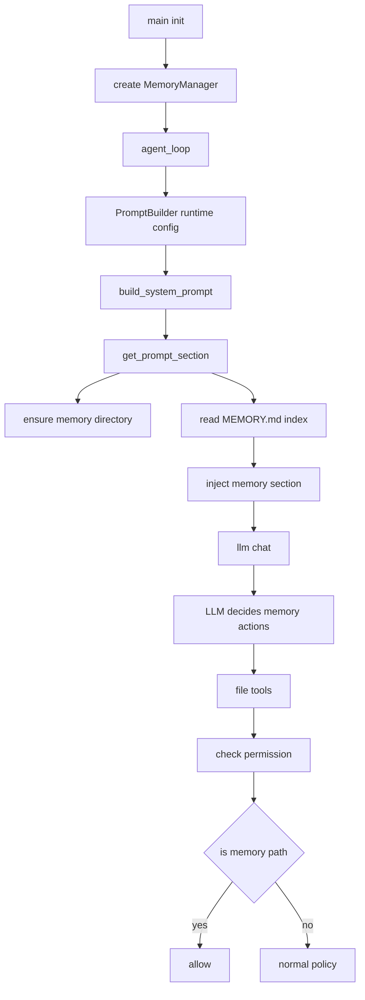
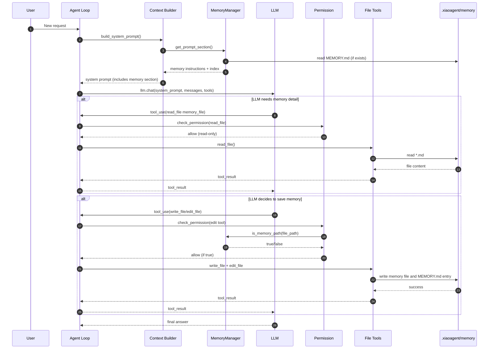
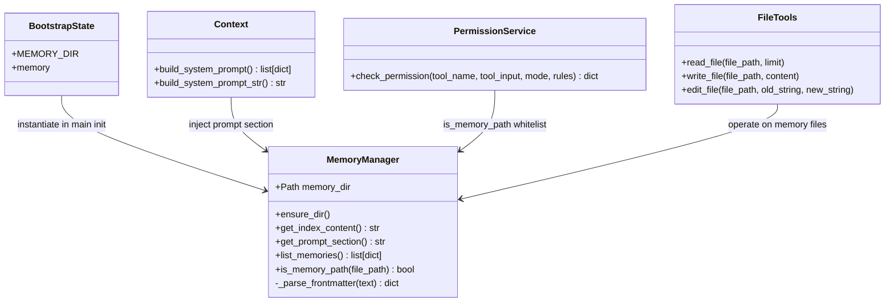

# 当前项目 Memory 机制深度分析（2026-04-26）

## 0. 结论先行

- 该项目已实现基于文件的长期记忆（`MemoryManager`），核心目录为 `.xiaoagent/memory`。
- 在常规 Agent 模式下，长期记忆可以被注入系统提示词并按需通过工具读写，机制是可用的。
- 在 Coordinator 模式与 SOP Workflow 模式下，主提示词被替换/绕过，当前没有自动注入 memory 指令，长期记忆能力基本不可用（除非模型偶然手动访问）。
- 现有实现有若干工程缺口：`MEMORY_TYPES`/`MAX_MEMORY_FILES` 未实际生效、frontmatter 解析对 CRLF 不鲁棒、索引字节截断不精确等。

---

## 1. 架构总览



关键接入点：

1. 初始化：`main.py` 中 `state.memory = MemoryManager()`。
2. Prompt 注入：`context.py` 中 `dynamic_text += state.memory.get_prompt_section()`。
3. 权限放行：`services/permissions.py` 中 memory 路径白名单 `is_memory_path()`。

---

## 2. 存储模型与数据格式

### 2.1 存储目录

- 根目录：`.xiaoagent/memory`
- 索引文件：`MEMORY.md`
- 记忆文件：`*.md`（每条记忆一个文件，带 YAML frontmatter）

`bootstrap/state.py`：

```python
PROJECT_DIR = WORKDIR / ".xiaoagent"
MEMORY_DIR = PROJECT_DIR / "memory"
memory = None
```

### 2.2 MemoryManager 能力

`services/memory.py` 的核心方法：

- `ensure_dir()`：确保目录存在。
- `get_index_content()`：读取 `MEMORY.md`，超限截断（200 行 / 25KB）。
- `get_prompt_section()`：构建 memory 指令 + 当前索引并注入系统提示词。
- `list_memories()`：扫描目录并解析 frontmatter。
- `is_memory_path()`：判断路径是否在 memory 目录内（权限白名单）。

关键代码片段：

```python
def get_prompt_section(self) -> str:
    self.ensure_dir()
    memory_dir_str = str(self.memory_dir)
    index_content = self.get_index_content()
    instructions = """# auto memory
    ...
    """
    if index_content:
        instructions += f"\n\n## Current Memory Index\n\n{index_content}"
    else:
        instructions += f"\n\n## Current Memory Index\n\n(empty — no memories saved yet)"
    return instructions
```

---

## 3. 长期记忆工作流程（读/写触发、写到哪里、如何读写）

## 3.1 何时触发“写记忆”

当前没有代码层自动触发器，触发来源是 **LLM 的决策**，依据 `get_prompt_section()` 注入的行为约束：

- 用户明确要求记住某事：立即保存。
- 用户要求忘记：删除对应条目（通过工具修改文件）。
- 用户反馈形成长期偏好/规则：建议保存到 `feedback`。

也就是说：

- 触发条件在 prompt 语义层，不在 Python 事件回调层。
- 是否写入由模型是否调用 `write_file` / `edit_file` 决定。

## 3.2 写到哪里

目标目录：`.xiaoagent/memory`。

两步写入协议（由 prompt 约束）：

1. 写具体记忆文件（frontmatter + 正文）。
2. 在 `MEMORY.md` 追加一行索引。

示例约束（来自 `get_prompt_section`）：

```markdown
Step 1: Write the memory file (e.g., user_role.md)
Step 2: Add a one-line entry to MEMORY.md
```

## 3.3 如何写（权限和工具路径）

写入工具：

- `write_file`（新建/覆盖）
- `edit_file`（精确替换）

权限关键逻辑（`services/permissions.py`）：

```python
if file_path and tool_name in EDIT_TOOLS:
    from bootstrap import state as _state
    if _state.memory and _state.memory.is_memory_path(file_path):
        return {"action": "allow", "reason": "Memory directory (whitelisted)"}
```

这意味着 memory 目录内的编辑在默认模式下会被自动放行，不再走 confirm。

## 3.4 何时触发“读记忆”

读分两层：

1. **每轮必读索引（轻量）**：`build_system_prompt()` 调 `get_prompt_section()`，把 `MEMORY.md` 内容放入系统提示词。
2. **按需读具体文件（重内容）**：模型在判断相关时主动调用 `read_file` 读取某条记忆文件。

当前实现没有“相关性检索器”或“自动 top-k 召回”，是纯 LLM 自主决策。

---

## 4. 全流程模拟示例（端到端）



示例场景：

- 用户说：“之后都用中文回答，记住这个偏好。”
- LLM 可能执行：
  1. `write_file(.xiaoagent/memory/user_lang_pref.md, ...)`
  2. `edit_file(.xiaoagent/memory/MEMORY.md, old, new)` 追加索引。
- 后续会话里：`MEMORY.md` 索引会自动注入；模型可再按需 `read_file(user_lang_pref.md)`。

## 4.1 详细示例：`MEMORY.md` 和各记忆文件长什么样

下面给出一套可直接落地的示例结构（文件名可按你的团队习惯调整）。

目录结构示例：

```text
.xiaoagent/
  memory/
    MEMORY.md
    user_profile.md
    feedback_testing_rules.md
    project_release_window.md
    reference_issue_tracker.md
```

### 4.1.1 `MEMORY.md` 示例（索引文件）

```markdown
# Memory Index

- [用户画像：后端工程师，偏好中文](user_profile.md) — 回答尽量中文，重点关注可维护性与测试可靠性
- [反馈：测试不要 mock 数据库](feedback_testing_rules.md) — 避免 mock/prod 偏差，优先真实依赖或集成测试
- [项目：发版冻结窗口](project_release_window.md) — 2026-05-10 起进入 freeze，改动需控制风险
- [参考：缺陷跟踪系统](reference_issue_tracker.md) — 线上缺陷统一记录在 Jira PROJ 看板
```

推荐每行格式：

```text
- [标题](文件名.md) — 一句话钩子（说明“为什么这条记忆重要”）
```

### 4.1.2 `user` 类型记忆示例

文件：`user_profile.md`

```markdown
---
name: 用户画像与沟通偏好
description: 用户是后端工程师，偏好中文沟通和可执行建议
type: user
---

用户主要从事 Python 后端开发，关注代码可维护性、测试稳定性、上线风险。
默认使用中文交流；给方案时优先给可直接执行的步骤。

How to apply:
- 回答优先中文
- 修改建议需给落地路径，而不只给概念
- 涉及重构时优先低风险、渐进式方案
```

### 4.1.3 `feedback` 类型记忆示例

文件：`feedback_testing_rules.md`

```markdown
---
name: 测试策略反馈
description: 不要轻易 mock 数据库，优先真实依赖验证
type: feedback
---

规则：不要在关键数据路径测试里过度依赖 mock 数据库。

Why:
历史上出现过 mock 环境通过、生产失败的问题，根因是 SQL 方言和事务行为不一致。

How to apply:
- 核心路径优先使用集成测试（真实 DB 或 TestContainer）
- 若必须 mock，需明确说明覆盖边界和风险
- 提交前提供最小可复现实验步骤
```

### 4.1.4 `project` 类型记忆示例

文件：`project_release_window.md`

```markdown
---
name: 发版冻结窗口
description: 2026-05-10 起进入发布冻结，限制高风险改动
type: project
---

项目决定：2026-05-10 至 2026-05-20 为发版冻结窗口。

Why:
业务大促前需要稳定性优先，减少不可控变更。

How to apply:
- 冻结窗口内仅允许 bugfix 和低风险修复
- 结构性重构、依赖大版本升级延期到窗口后
- PR 说明中必须包含风险评估与回滚方案
```

### 4.1.5 `reference` 类型记忆示例

文件：`reference_issue_tracker.md`

```markdown
---
name: 缺陷跟踪系统入口
description: 线上问题统一在 Jira PROJ 看板跟踪
type: reference
---

外部系统参考：
- Jira 项目：PROJ
- 主要看板：Backend Defects
- 线上故障优先级标签：P0/P1

How to apply:
- 当需要追踪历史故障或定位重复问题时，优先查 Jira PROJ
- 在方案中引用 issue key（例如 PROJ-1024）便于回溯
```

### 4.1.6 从空到有：一次完整写入后的对比示例

初始状态：

`MEMORY.md`

```markdown
# Memory Index

(empty)
```

用户说：

“以后请用中文回答，并且测试不要 mock 数据库，记住这两点。”

写入后状态：

`MEMORY.md`

```markdown
# Memory Index

- [用户画像：后端工程师，偏好中文](user_profile.md) — 回答尽量中文，重点关注可维护性与测试可靠性
- [反馈：测试不要 mock 数据库](feedback_testing_rules.md) — 避免 mock/prod 偏差，优先真实依赖或集成测试
```

同时新增：

- `user_profile.md`（`type: user`）
- `feedback_testing_rules.md`（`type: feedback`）

下次会话时，系统提示词会带上上述索引；模型再按需读取对应 `.md` 文件内容。

## 4.2 常见疑问解答（FAQ）

### Q1：`MEMORY.md` 是否就是“路径 + description”？

可以这样理解，但更准确地说是：

- 它是“记忆索引（pointer list）”，不是记忆正文。
- 每一行通常包含：标题、文件路径、一句话钩子。
- 一句话钩子可以写成 description，也可以写成更强调价值的摘要。

当前项目并没有强制解析 `MEMORY.md` 的字段结构，只是把它整体注入 prompt，因此格式本质是“约定优于约束”。

### Q2：各记忆文件更新是“追加”还是“覆盖”？

当前实现里两种都可能，取决于模型调用的工具和写法：

- 使用 `write_file` 写同一路径：通常是覆盖整个文件。
- 使用 `edit_file`：可以做局部替换，也可以模拟追加。

也就是说，系统层没有“只能追加”的硬限制，属于工具语义决定。

### Q3：如果直接覆盖，旧记忆会不会没了？

会。若对同一记忆文件整文件覆盖且未保留旧内容，历史会丢失。

这也是当前机制的一个工程风险点。建议实践：

1. 对“同一主题记忆”优先 `edit_file` 局部更新，而不是整文件覆盖。
2. 在记忆正文里保留变更轨迹（例如 Added/Updated 时间标记）。
3. 对高价值记忆采用“新文件版本化”策略（例如 `project_release_window_v2.md`）。

### Q4：更新记忆文件后，会自动同步更新 `MEMORY.md` 吗？

当前实现：不会自动同步。

- 现有代码没有 watcher 或事务逻辑去自动维护索引。
- 索引更新依赖模型执行“两步协议”：写记忆文件 + 修改 `MEMORY.md`。

因此会出现两类不一致风险：

1. 文件已更新，但 `MEMORY.md` 没更新（索引滞后）。
2. `MEMORY.md` 已更新，但目标文件不存在或内容过时（悬挂索引）。

推荐在后续优化中加入“索引一致性校验/自动修复”任务，周期性扫描 `.xiaoagent/memory` 并重建或校正 `MEMORY.md`。

---

## 5. 三种运行模式下 memory 是否正常工作

## 5.1 常规 Agent 模式

状态：**有 memory，且可工作**。

原因：

- `PromptBuilder` 在非 coordinator 时使用 `build_system_prompt()`。
- `build_system_prompt()` 会注入 `state.memory.get_prompt_section()`。

## 5.2 Coordinator 模式

状态：**主 Coordinator 无 memory 注入（基本无）**。

原因：

- `PromptBuilder` 在 coordinator 模式直接使用 `COORDINATOR_SYSTEM_PROMPT`。
- 该提示词不包含 memory 指令和 MEMORY.md 索引。
- Coordinator 允许工具集不含 `write_file/edit_file`，自身也不能落盘记忆。

补充：Coordinator 拉起的 worker（subagent）也不继承主 `build_system_prompt()`，其系统提示词来自 `agents/definitions.py`，同样不含 memory 指令。

## 5.3 SOP Workflow 模式

状态：**基本无长期 memory 注入**。

原因：

- `query.agent_loop` 首先调用 `maybe_run_workflow(messages)`。
- 若命中 workflow，直接由 `WorkflowEngine` 执行，并提前 return。
- 各角色（Analyst/Engineer/Tester）的 prompt 来自 `prompts/workflow/*.md`，未拼接 memory section。
- workflow 中的 subagent 使用角色 prompt，不走 `build_system_prompt()`。

---

## 6. 关键关系图



---

## 7. 当前实现是否“正常工作”验证

我做了两组验证：

1. `python eval/eval_memory.py`
- 结果：`23/23`，通过率 100%。
- 说明：memory 核心行为（索引读取、路径白名单、prompt section、frontmatter 解析等）按其评估脚本定义是可工作的。

2. `pytest -q tests/unit/test_memory.py`
- 结果：`9 passed, 3 failed`。
- 失败集中在索引读取相关断言，现象是读取到空字符串。
- 结合代码判断：`get_index_content()` 固定按 UTF-8 读取，而测试中部分 `write_text` 未指定编码，Windows 下可能写成系统默认编码，导致 UTF-8 解码失败后被吞异常并返回空字符串。

综合判断：

- 运行机制总体可用。
- 但在编码一致性、错误可观测性方面存在隐患。

另外，当前工作区还没有实际 `.xiaoagent/` 目录（说明尚未产生真实持久记忆文件，至少在当前目录未初始化到磁盘）。

---

## 8. 是否有明显 bug 需要修复

是，有几个优先级较高的问题。

## 8.1 Bug/缺陷清单

1. `MEMORY_TYPES` 未使用（无类型校验）
- 问题：frontmatter `type` 可以写任意值，系统不会拒绝。
- 风险：数据污染，后续分析/检索困难。

2. `MAX_MEMORY_FILES` 未使用（无数量上限）
- 问题：常量定义了但没有在写入路径执行控制。
- 风险：长期运行可能无限增长，增加 I/O 与 prompt 噪声。

3. frontmatter 解析对 CRLF 不鲁棒
- 现状：`re.match(r"^---\n(.*?)\n---", ...)` 仅匹配 `\n`。
- 风险：Windows 或外部编辑器产生 CRLF 时解析失败。

4. 25KB 截断逻辑不精确
- 现状：先按字符切片 `content[:MAX_INDEX_BYTES]`，不是按字节安全切割。
- 风险：多字节字符（中文）下可能仍超过字节预算，且告警语义不准确。

5. 错误吞没导致可观测性弱
- 现状：`get_index_content()` 的读取异常直接返回空字符串。
- 风险：用户只看到“空索引”，很难发现是编码/权限/损坏问题。

---

## 9. 不足与优化方向（含实施建议）

## 9.1 产品能力层

1. 模式覆盖不一致（最高优先）
- 问题：Coordinator / SOP 模式不接 memory。
- 建议：统一 memory 注入策略。
- 实施：
  - Coordinator：在 `COORDINATOR_SYSTEM_PROMPT` 前拼接 `state.memory.get_prompt_section()`（或在 PromptBuilder 统一拼接）。
  - Workflow：在 `PromptBuilderForWorkflow.build_role_prompt()` 增加可选 memory section 注入。

2. 缺少自动记忆提取
- 现状：完全依赖 LLM 主动调用写工具。
- 建议：增加轻量后处理器（rule-based + 可选 LLM 判别）提取候选记忆，用户确认后落盘。

3. 缺少检索排序
- 现状：只有索引，读取具体文件靠模型自发。
- 建议：增加简易召回层（关键词/BM25 或 embedding top-k）。

## 9.2 工程实现层

1. 增加 MemoryRepository 抽象
- 把读写文件、索引更新、frontmatter 解析从 `MemoryManager` 中拆出，降低耦合并便于测试。

2. 原子写 + 文件锁
- 对 `MEMORY.md` 更新采用原子替换（临时文件 + rename），避免并发写损坏。

3. 编码健壮性
- 统一 UTF-8 写入；读取失败时输出可诊断 warning（而非静默空字符串）。

4. frontmatter 解析升级
- 用成熟 YAML 解析器（`yaml.safe_load`）替代手写解析，支持多行值、引号、CRLF。

5. 指标与可观测性
- 增加 memory telemetry：写入次数、读取次数、命中率、索引长度、失败率。

## 9.3 代码质量层

建议新增测试覆盖：

1. Coordinator/SOP 模式下 memory 注入断言。
2. CRLF frontmatter 解析测试。
3. 多字节字符索引截断（按字节）测试。
4. 并发编辑 `MEMORY.md` 的一致性测试。
5. 写记忆两阶段一致性（文件写成功但索引失败时的补偿/回滚）测试。

---

## 10. 建议的分阶段改造路线

### Phase 1（低风险，快速收益）

- 修复 frontmatter CRLF 兼容。
- 修复索引按字节截断。
- 增加错误日志与测试编码一致性。

### Phase 2（中风险，高收益）

- 统一三种模式的 memory 注入。
- 加入 `type` 校验与 memory file count 上限。
- 增加索引更新原子化。

### Phase 3（演进能力）

- 自动提取候选记忆 + 用户确认。
- 检索排序（top-k）+ relevance 解释。
- 生命周期管理（归档/合并/淘汰）。

---

## 11. 附：关键代码定位清单

- `services/memory.py`：长期记忆核心实现。
- `context.py`：memory 注入 system prompt 的入口。
- `main.py`：MemoryManager 初始化。
- `services/permissions.py`：memory 路径白名单放行。
- `services/prompt_builder.py`：normal/coordinator 模式选择。
- `agents/coordinator.py`：Coordinator 专用提示词与工具约束。
- `workflows/gateway.py`：SOP 模式入口与短路逻辑。
- `workflows/prompting.py`：SOP 角色 prompt 渲染（当前未拼 memory）。
- `agents/definitions.py`：subagent 系统提示词（当前未拼 memory）。
- `tests/unit/test_memory.py`、`eval/eval_memory.py`：memory 测试与评估脚本。
