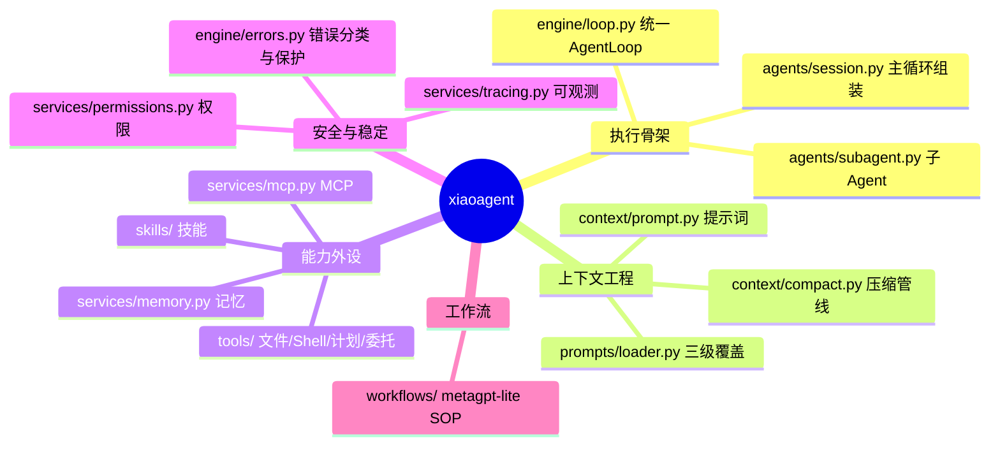
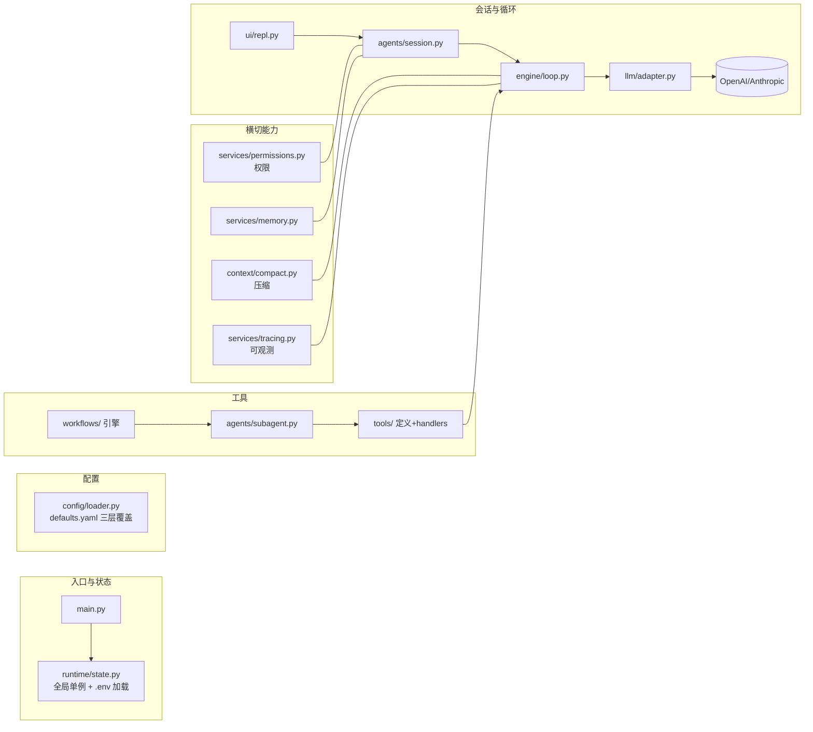
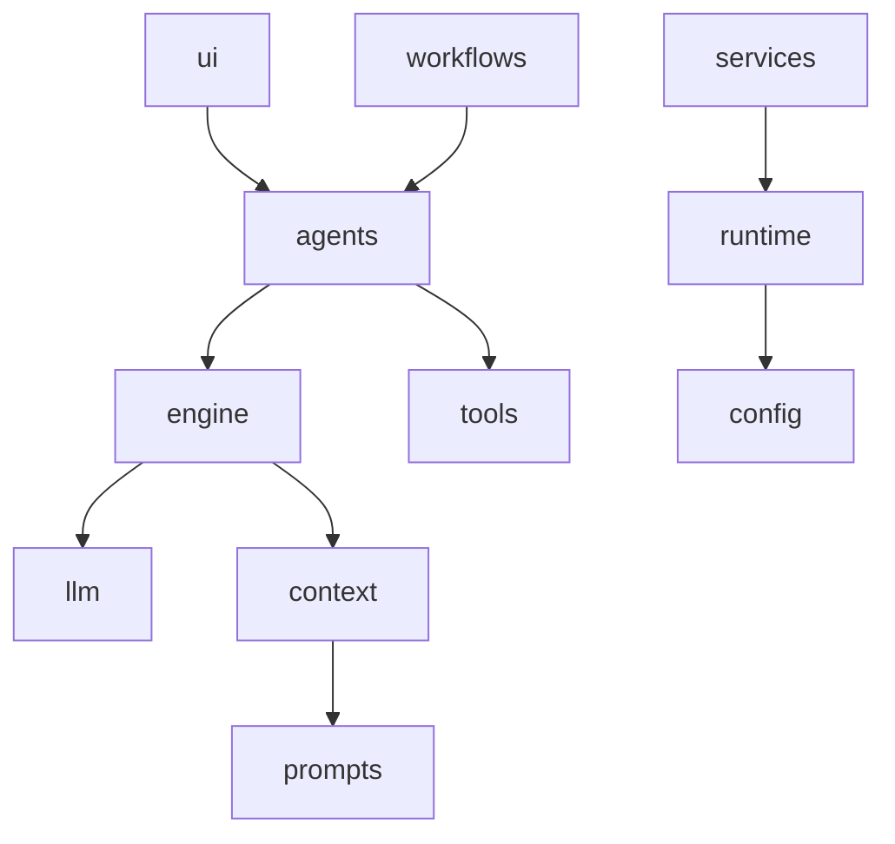
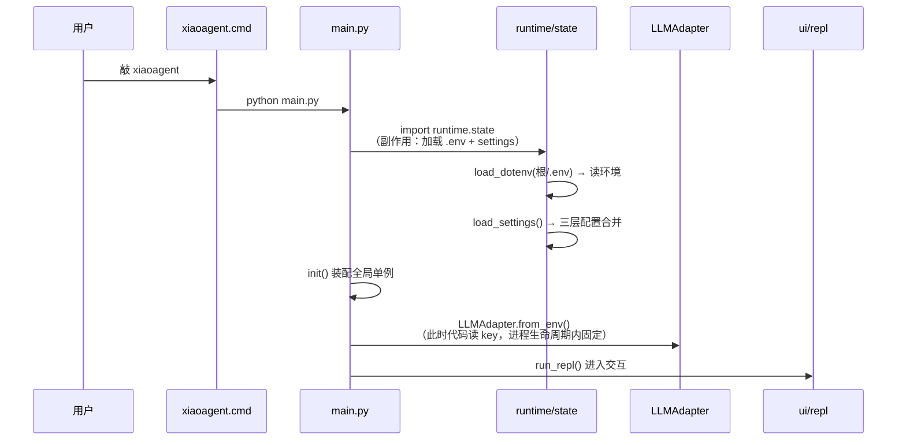
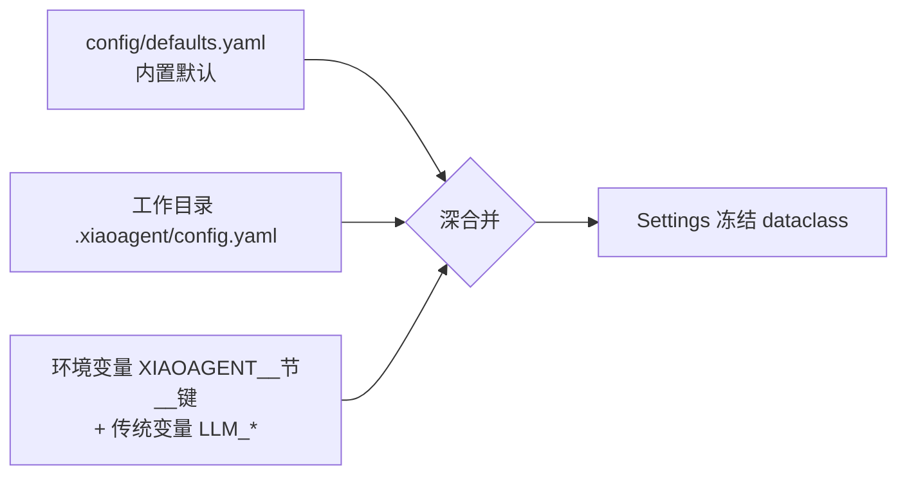
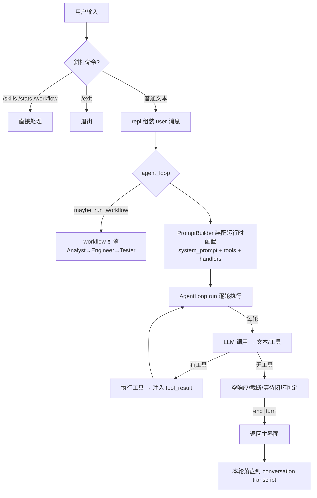
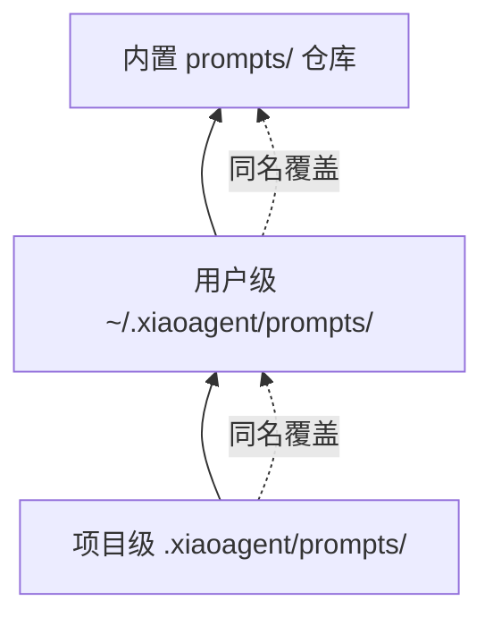
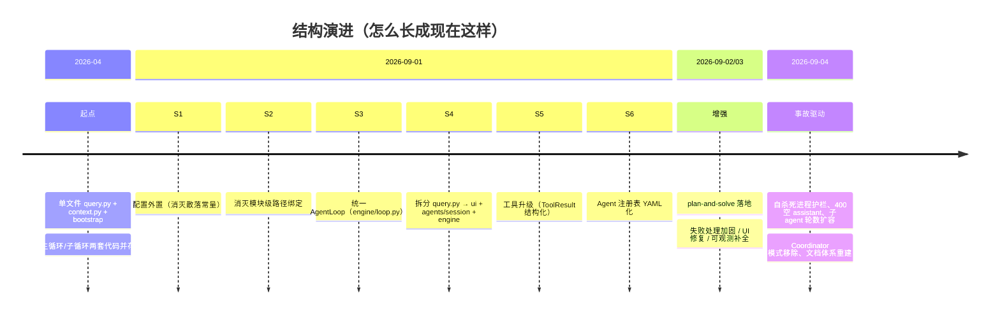

# 总览与启动流程

> 本文回答三个问题：**这是什么**（定位与边界）、**代码长在哪**（目录地图与依赖方向）、
> **从敲下 `xiaoagent` 到模型回答之间发生了什么**（启动链路与一次对话的数据流）。
> 全文以仓库根为基准路径，写于 2026-09-04（S1-S6 深度重构后）。

## 目录

- [它是什么：一个什么样的 Agent](#它是什么)
- [为什么这样组织：目录地图与依赖方向](#为什么这样组织)
- [冷启动：配置、状态与全局单例](#冷启动)
- [请求生命周期：从输入到回答](#请求生命周期)
- [配套机制一瞥：提示词三级覆盖与配置分层](#配套机制一瞥)
- [关键名词速查](#关键名词速查)
- [业界调研：编程 Agent 的产品形态](#业界调研)
- [当前实现的成熟度评估](#成熟度评估)
- [不足与进一步优化方向](#不足与优化方向)
- [演进记录：这套结构是怎么一步步长出来的](#演进记录)

## 业界调研

### 编程 Agent 的产品形态

编程 Agent（Coding Agent）是"让 LLM 可靠地操纵文件系统与 shell、拆解任务、自我纠错、长期记忆、多 Agent 协作"的产品。业界标杆是 Claude Code（Anthropic 官方 CLI），同类产品有 Cline、Aider、Codex CLI、OpenHands 等。它们的共同命题不是"封装 LLM 聊天"，而是把工程问题沉淀成可测试、可观测、可替换的组件。

### 业界主流共识（参考 `docs/01-research/类似产品横向分析报告.md`）

1. **统一循环 + 可插拔钩子**：主/子/工作流共用一套循环骨架，差异通过配置与钩子表达。
2. **上下文管理是核心工程挑战**：长会话 token 膨胀、压缩、缓存是决定产品可用性的关键。
3. **权限与安全是底线**：模型自主执行操作，必须有多层防护（模式 + 规则 + 危险检测）。
4. **可观测性支撑迭代**：黑盒 Agent 出问题无法复盘，事件式 trace + 转录是标配。
5. **多 Agent 按需派生**：主 Agent 自主派生子 Agent（而非强制预选模式）。

### 横向产品定位（超越 CC 的全局视野）

编程 Agent 不止 CC 一个范式，按"编排复杂度"和"抽象层级"可大致分几个阵营：

| 阵营 | 代表 | 核心特征 | 与本项目的关系 |
|------|------|----------|----------------|
| **交互式 CLI 编程助手** | Claude Code、Codex CLI、Gemini CLI、Cline | 预置循环 + 多层权限 + 上下文压缩，面向"人在回路"的编程 | 本项目的主形态 |
| **轻量 Agent SDK** | OpenAI Agents SDK | 三原语（Agents/Handoffs/Guardrails），Python 原生编排，max_turns 默认 10 | 本项目的"主 Agent 派发子 Agent"借鉴其 Handoffs 理念 |
| **低层编排框架** | LangGraph | 图编排 + checkpointer + 断点恢复 + human-in-the-loop | 作为对照（本项目的"预置循环"是另一条路） |
| **多 Agent 协作框架** | AutoGen / CrewAI / MetaGPT | 对话驱动 / 角色任务 / SOP 流水线三种编排哲学 | 本项目 workflows/ 借鉴 MetaGPT SOP |
| **操作系统式记忆 Agent** | MemGPT/Letta | 分层记忆 + 虚拟上下文 + 自我编辑记忆 | 作为记忆系统的对照流派 |

**本项目的定位**：走"交互式 CLI 编程助手"主线（CC 形态），但在两个子方向做了跨流派融合——`workflows/`（MetaGPT SOP 三角色）+ `agents/subagent.py`（OpenAI Handoffs 式自主派发）。这种"以 CC 为骨架、融合 MetaGPT 与 OpenAI 理念"的定位，是理解本项目架构的关键线索。

### 主要问题与解决方案

| 问题 | 业界方案 | 本项目对应 |
|------|----------|-----------|
| 主/子循环行为漂移 | 统一 AgentLoop | engine/loop.py + LoopSpec/LoopHooks |
| 长会话 token 爆炸 | 渐进式压缩 + 缓存 | context/compact.py L1-L5 |
| 黑盒无法复盘 | 事件式 trace + 转录 | services/tracing.py + repl 转录 |
| 模型误删/危险操作 | 权限分层 + 危险检测 | services/permissions.py |
| 自定义能力扩展 | 声明式配置（YAML/Markdown） | agents/registry.py + skills/ |

## 它是什么

这是一个 **Claude Code 风格的模块化 AI 编程助手**（命令名 `xiaoagent`，历史名 coding agent）。它的核心命题不是"封装一个 LLM 聊天"（那是 200 行的事），而是把**让 LLM 可靠地操纵文件系统与 shell、拆解任务、自我纠错、长期记忆、多 Agent 协作**这些工程问题，沉淀成一组可测试、可观测、可替换的组件。可以用一句话概括它与其他玩具 demo 的分界：

> 模型负责"想"，框架负责"让它想的事情能安全、稳定、可持续地发生"。



技术特征（各自解决的原始痛点）：

| 特征 | 解决的痛点 |
|------|-----------|
| 统一 AgentLoop（一个循环 + LoopSpec/LoopHooks） | 重构前主/子 Agent 两套循环、保护行为漂移、bug 双份 |
| 上下文压缩 L1-L5 + token 预算 | 长会话 token 爆炸、API 报 prompt 超长 |
| `ToolResult` 结构化结果（str 子类带 ok） | 用字符串前缀嗅探错误太脆弱（"Error:" 误判） |
| 权限五模式 + 危险命令检测 + 工具级自杀护栏 | 无确认跑危险命令 / 子 Agent 把宿主进程杀掉 |
| 事件式可观测（JSONL trace + 转录 + /stats） | 黑盒 Agent 出问题无法复盘 |
| Agent 注册表 YAML 化 | 内置/用户/项目三层可覆盖的自定义子 Agent |

## 为什么这样组织

### 目录地图



### 依赖方向（谁会 import 谁）



设计上的三条纪律（S1-S6 重构的验收标准）：

1. **薄组装层**：`main.py`/`agents/session.py` 只负责"把单例和钩子粘起来"，
   真正逻辑在 `engine/loop.py` 等可单测的核心里；
2. **UI 与逻辑分离**：`ui/` 只做渲染与读输入，逻辑通过钩子回调暴露，不在核心层 print；
3. **配置外置**：一切阈值/路径/开关进 `config/`，代码零魔法数字。

## 冷启动



关键点拆解（这些都是"设计出来"而非"顺手写的"）：

**1. `.env` 在 import 时加载（runtime/state.py:19）**

```python
if not load_dotenv(_root / ".env", override=True):
    load_dotenv(_root / ".env.example", override=True)
```

- 加载位置固定为**源码目录**，与"你在哪个工作目录敲 xiaoagent"无关——用户改 key 只需改这一处；
- 为什么 import 时加载而非 main 里显式调用？因为大量模块在 import 阶段就 `from runtime.state import settings`
  读配置，必须保证 import 顺序在模块顶层引用前完成加载。副作用（全局状态）被刻意集中在一个文件里；
- 推论：**LLM key 进程启动时读一次**，运行中改 `.env` 不生效，必须重启。这是文档要反复强调的用户须知。

**2. 分层配置（config/loader.py）**



- `Settings` 全部 `frozen=True`：运行期不可变，杜绝"某处偷偷改了阈值"的隐式状态；
- 未知节/未知键**报错**而非忽略：把拼写错误从"静默失效"升级为"加载即失败"；
- 覆盖示例：`XIAOAGENT__LOOP__DEFAULT_MAX_TURNS=80`。

**3. 全局单例容器**

`runtime/state.py` 是所有单例的共享容器（`state.llm/todo/skills/task_mgr/bg/perm_rules/ mcp/memory/agent_tasks`）。为什么不用全局变量散布各处？因为各模块互相引用会产生循环 import；集中容器让依赖方向始终"指向 state"，并可被测试 monkeypatch（几乎所有单测都靠`monkeypatch.setattr("runtime.state.…")` 或 patch 模块内引用实现隔离）。

## 请求生命周期



分层职责（谁负责什么，为什么这样分）：

- `ui/repl.py`：输入体验（多行、编辑器、退出词）、**进程级兜底**（agent_loop 外层 try/except：
  漏网异常只终结本次请求，`[Session preserved]`）、逐轮转录；
- `agents/session.py`：主 Agent 的"组装与钩子"——把权限、压缩、通知、截断续写、UI 回调
  挂到统一循环上（这是"主 Agent 与子 Agent 唯一的差别都在 hooks/spec 里"的直接体现）；
- `engine/loop.py`：纯骨架。它不认识 todo、不认识 skill、不认识权限——只执行
  "调 LLM → 执行工具 → 注入结果 → 判定出口"，所有领域逻辑通过 hooks 注入。  这种"核心无业务"的刻意抽象，是它可被主/子/工作流三角色复用的前提。

## 配套机制一瞥

### 提示词三级覆盖（prompts/loader.py）


- 高优先级文件整体替换同名低优先级文件，无需改源码即可定制任何提示词；
- `prompts/base.md` 是主/子 Agent 共享的行为基底（反偷懒规则、planning、delegation 指引）。

### 三层记忆写入引导

一句话概括"记忆怎么写"的现状（详见 06-记忆系统）：系统提示词 + 工具描述共同引导，不依赖框架强插。追踪层用 `memory_write/memory_read` 事件量化"引导是否真的生效"。

## 工作流程示例：一次会话的完整走查

把上面的架构压成一次可感的过程。假设用户在 `myproj/` 目录运行 xiaoagent，输入"给项目加个 `/healthz` 并补测试"：

**Step 0 启动**（只在会话开始发生一次）

```
$ xiaoagent
[LLM] provider=openai, model=deepseek-v4-flash        ← init() 从 .env 读 key/模型
╭─ XiaoAgent (deepseek-v4-flash)                      ← repl 进入交互
╰─ /skills list skills · /<skill> invoke · /stats ... 
```

背后：`runtime/state` 加载 `.env` + `settings`；`main.init()` 建全部单例；第一个用户消息前，主循环第一次调 LLM 时才由 `PromptBuilder` 装配 system prompt（静态区 base.md 规则 + 动态区 cwd/git/CLAUDE.md/技能/记忆）。

**Step 1 首轮请求**

```
user: 给项目加个 /healthz 并补最小测试
```

repl 识别非斜杠 → `agent_loop` → `PromptBuilder.build_runtime_config` 得到 system_prompt/tools/handlers → `AgentLoop.run` turn 1。

**Step 2 计划与执行（多轮工具循环）**

```
turn 1  llm.chat → stop_reason=tool_use
  > TodoWrite(items=[4项])          → 返回渲染后的清单（0/4 completed）
turn 2  llm.chat → tool_use
  > read_file("app.py")             → 带行号内容（框架先走权限→只读放行→safe_path→读取→可能截断）
turn 3  llm.chat → tool_use
  > edit_file(app.py, old=..., new=...) → 唯一匹配校验→写入→diff 回执
turn 4  llm.chat → tool_use
  > write_file(test_healthz.py, ...)    → Successfully wrote ... (N bytes)
turn 5  llm.chat → tool_use
  > run_shell(pytest -q)            → 退出码0/输出回填
turn 6  llm.chat → end_turn
assistant: 已完成：/healthz 已加、测试通过（1 passed）
```

每一轮之间：`pre_turn` 先跑 L1-L3 本地压缩（本例小，不触发）→ `on_response` 记录 llm_response（tokens/latency 进 trace）→ 工具执行前 `check_permission`（本例只读/编辑在 default 模式会弹确认，bypass 模式直接放行）→ 工具结果截断后回填。

**Step 3 收尾**

repl 的 finally 把本轮新消息写入 `conversation-*.jsonl`；用户输入 `/stats` 可看到本会话聚合（LLM 调用数、tokens、各工具调用次数、trace 路径）：

```
Session stats (32 events)
  LLM: 6 calls, 0 errors, 8,214 in / 2,097 out tokens, 41.8s
  Tools: 6 calls (0 errors)
    TodoWrite: 2x, ...
    read_file: 1x, ...
  Trace: .xiaoagent/transcripts/session-20260904-….jsonl
```

**可观测闭环**：如果你想复盘"为什么它改了 app.py 而没改 config.py"，打开 trace 按 turn 回放工具顺序与参数（含 command/path 预览），或打开 conversation transcript 看完整消息。

## 关键名词速查

| 名词 | 含义 | 出现位置 |
|------|------|----------|
| turn | 循环一轮 = 一次 LLM 调用 + 可能的工具执行 | engine/loop.py |
| block | 响应 content 中的块（text / tool_use / tool_result） | Anthropic 消息语义 |
| LoopSpec | 一次循环的不可变配置 | engine/loop.py |
| LoopHooks | 循环扩展点（pre_turn / execute_tool / on_response…） | engine/loop.py |
| ToolResult | str 子类，内容即本体 + ok/error 元数据 | engine/results.py |
| TokenTracker | 上下文 token 预算跟踪 | context/compact.py |
| CircuitBreaker | 压缩熔断（连续失败暂停自动压缩） | context/compact.py |
| transcript | 逐轮增量落盘的会话转录 | ui/repl.py |
| tracer | 事件式可观测，写入 session-*.jsonl | services/tracing.py |

## 成熟度评估

作为总览，从"整体架构成熟度"角度评估（各子系统的细节评估见对应文档）：

| 维度 | 本项目 | 成熟度 |
|------|--------|--------|
| 架构分层（薄组装 + 可单测核心） | ✅ ui/agents/engine/context/services 分层清晰 | 高 |
| 统一循环复用 | ✅ 主/子/工作流三角色共用 engine/loop.py | 高 |
| 配置外置（零魔法数字） | ✅ config/ 三层覆盖 + frozen dataclass | 高 |
| 可观测性 | ✅ JSONL trace + 转录 + /stats | 高 |
| 扩展性（注册表 YAML 化） | ✅ agents/skills/prompts 三层可覆盖 | 高 |
| 单例容器 + 依赖方向清晰 | ✅ runtime/state 集中 + 无循环 import | 高 |
| 模块化程度 | ✅ 10 大子系统，各可独立文档化 | 高 |
| MCP 集成 | ⚠️ 有 services/mcp.py 但未测试重构 | 中 |
| 测试覆盖 | ⚠️ 单测 500+ 通过，但缺端到端集成测试 | 中 |

**总体判断**：经过 S1-S6 深度重构 + 事故驱动加固，整体架构已从"单文件 demo"演进为"模块化、可测试、可观测、可扩展"的成熟结构，各子系统成熟度详见对应文档（02-09）。主要短板在 MCP 集成与端到端测试两个外围方向。

## 不足与优化方向

1. **MCP 集成未测试重构**：`services/mcp.py` 已有代码但未经测试与重构（用户明确要求暂不编写 MCP 文档）。这是能力外设里最不成熟的一块，需专项测试后再纳入文档体系。

2. **缺端到端集成测试**：单测 500+ 通过覆盖各模块，但缺"启动 → 完整会话 → 多轮工具 → 结束"的端到端测试。真实事故（自杀死进程、400 空 assistant）都是端到端场景才暴露的。可补一个"脚本化会话"的集成测试。

3. **缺打包/分发机制**：当前靠 `python main.py` + `.cmd` 包装运行，无 pip 包/独立可执行文件分发。`xiaoagent.cmd` 依赖源码目录存在。可考虑 PyInstaller 打包或 setup.py。

4. **配置文档分散**：配置项（config/defaults.yaml）尚无独立参考手册，用户要改阈值需读源码。可补一份《配置参考手册》。

5. **依赖管理可再明确**：requirements.txt 存在，但 Python 版本要求（3.14）、平台差异（Windows 路径处理）未在 README 充分说明。

## 演进记录



每轮"从为什么 → 怎么做"的完整复盘，散见各子系统文档的附录（变更史表），以及 `../03-retrospectives/` 与 `../02-plans/结构深度重构计划-2026-09-01.md`（S1-S6 执行记录）。
