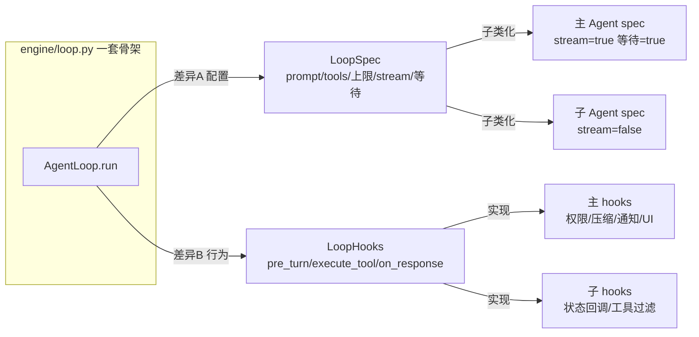
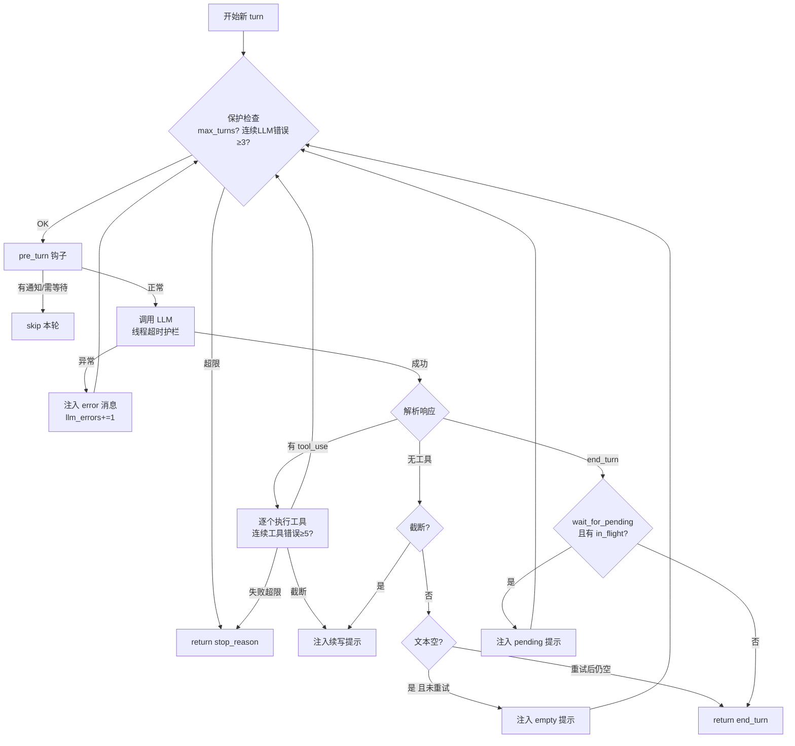
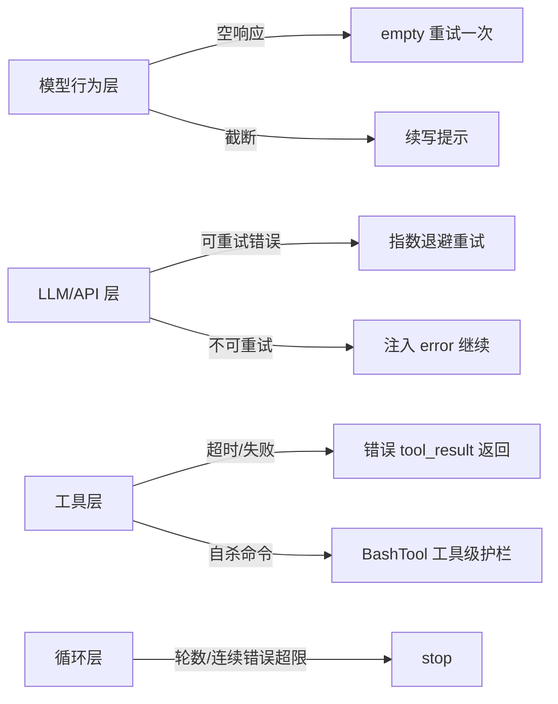

# 核心循环：统一 AgentLoop 的算法与设计

> 对应代码：`engine/loop.py`（骨架）、`agents/session.py`（主循环 hooks）、
> `engine/notifications.py`（通知等待）、`engine/errors.py`（保护参数）、`agents/task_queue.py`（异步队列）。
> 本篇重点做**算法级推导**：把"为什么这么写"从"怎么写的"里拆出来，并用模拟交互演示算法落地后的真实对话形态。
> 写于 2026-09-04，最近更新 2026-09-04。

## 目录

- [要解决的根本问题](#要解决的根本问题)
- [抽象设计：LoopSpec 与 LoopHooks 的推导](#抽象设计)
- [主循环的逐分支算法](#主循环的逐分支算法)
- [等待闭环（异步子 Agent 结果不丢）](#等待闭环异步子-agent-结果不丢)
- [plan-and-solve 的提醒计数](#plan-and-solve-的提醒计数)
- [LLM 异常注入式恢复](#llm-异常注入式恢复)
- [六道防线](#六道防线)
- [保护参数](#保护参数)
- [业界调研：共识、问题与方案](#业界调研)
- [当前实现的成熟度评估](#成熟度评估)
- [不足与进一步优化方向](#不足与优化方向)
- [附录 · 变更历史](#附录)

## 业界调研

### 核心循环在 Agent 领域的定位

Agent 循环（Agent Loop）是 Agent 的"心脏"——`while True: 调模型 → 执行工具 → 注入结果 → 判定出口`。它是 ReAct（Reasoning + Acting）范式的工程实现：模型推理（reason）产生工具调用（act），框架执行工具并回填结果，模型基于结果继续推理。循环的质量直接决定 Agent 的稳定性、可扩展性与可测试性。

### 业界主流共识

1. **统一循环骨架**：主 Agent、子 Agent、工作流角色共用一套循环，差异通过"配置 + 钩子"表达，而非写多套循环（多套循环会导致保护行为漂移、bug 双份）。
2. **循环必须带保护**：maxTurns、连续错误计数、空响应检测、截断续写——CC 用 `maxTurns` + `turnCount` + Stop Hook + CircuitBreaker 多层防失控。
3. **错误注入式恢复**：LLM 异常不直接放弃，而是把错误以 `<error>` 消息注入，让模型下一轮看到并自我修正。
4. **plan-and-solve 引导而非闸门**：todo 是普通工具，是否规划由模型判断，框架只在"说了要做却忘了推进"时提醒（CC 的 TodoWrite + plan mode 是"可选闸门"）。

### 主要问题与解决方案

| 问题 | 表现 | 业界方案 |
|------|------|----------|
| 主/子两套循环行为漂移 | 同能力两份实现 | 统一 AgentLoop + LoopSpec/LoopHooks |
| 无限循环 | LLM 持续 tool_use 不推进 | maxTurns + 连续工具/LLM 错误上限 |
| 空响应/静默失败 | 模型什么也没说 | 空响应检测 + 注入 `<error>` 续跑一次 |
| 空 assistant 400 连击 | 毒消息落库 | 空响应不落库 + adapter 兜底 |
| 异步结果丢失 | 模型过早 end_turn | 等待闭环（wait_for_pending + 三态等待） |
| 输出截断退出 | max_tokens 截断 | 截断续写提示 |

### Agent 循环的两大实现范式（超越 CC 的全局视角）

业界实现"Agent 循环"有两条路，本项目与 CC 走的是同一条，但另一条（LangGraph）是重要的架构对照：

| 维度 | 预置循环（CC / 本项目 / OpenAI SDK） | 显式图编排（LangGraph） |
|------|--------------------------------------|--------------------------|
| **循环方式** | 框架内置 while 循环（思考→工具→观察），开发者不可改 | 开发者显式定义节点/边/条件，无预置循环 |
| **抽象层级** | 高层封装，上手快 | 低层编排框架，控制粒度细 |
| **状态管理** | 框架内部管理，不易干预 | 显式状态 schema + checkpointer，可持久化、回溯 |
| **并行** | 依赖框架能力（CC Fork / 本项目后台子 Agent） | 原生 Send API map-reduce 并行 |
| **人工介入** | 有限（权限确认等） | 原生 human-in-the-loop（interrupt_before/after） |
| **断点恢复** | 较弱 | 强（checkpointer 断点续跑、时间旅行） |
| **代价** | 定制受限 | 样板代码多 |

**关键差异的推导**：LangGraph 的 `recursion_limit`（默认 25）限制的是**图的超步数**（super-step），不是模型轮次——它把"循环"从"框架内置"下沉为"开发者可重写的图"。OpenAI Agents SDK 则相反，用**内建 loop + runtime 托管**（turns/tool/guardrails/handoffs/sessions 全由 SDK 管），`max_turns` 默认仅 **10**（极低，逼迫开发者显式调高）。CC 的语义是"默认不设轮数上限、靠上下文压缩兜底"。

**本项目的选择**：走"预置循环"路线（`engine/loop.py` 统一 AgentLoop），因为它的核心诉求是"主/子/工作流三角色共用一套高质量骨架"，预置循环 + 配置化差异最契合；图编排的灵活性与可恢复性暂非刚需（但 checkpointer 断点恢复是值得借鉴的待办，见优化方向）。`max_turns` 语义上对齐 CC（大数兜底），而非 OpenAI 的"低默认逼开发者显式调高"。

## 要解决的根本问题

Agent 产品的循环看上去很简单：`while True: 调模型; 执行工具; 注入结果`。但一旦把"主 Agent、子 Agent、工作流角色"都放进这同一个循环，第一个架构决策就出现了：

> 是写两套循环，还是一套循环 + 配置化差异？

我们经历过前者（重构前 `query.py` 主循环与 subagent/team 子循环并存），代价是：**保护行为漂移**（一个修了另一个忘修）、**bug 双份**、每加一个能力要在两个地方各写一遍。因此重构后的答案是**后者**，把差异收敛成两个正交抽象：



```python
@dataclass
class LoopSpec:
    system_prompt: Any
    tool_defs: list
    tool_handlers: dict
    max_turns: int = 50
    max_consecutive_tool_errors: int = 5
    max_consecutive_llm_errors: int = 3
    llm_timeout: float | None = None     # 线程级超时护栏
    stream: bool = False
    wait_for_pending: bool = False       # 主 Agent=true：end_turn 前等后台任务

class LoopHooks:                          # 默认全 no-op，子类按需覆盖
    def pre_turn(self, ctx, messages, tracker) -> bool: ...   # True=本轮跳过 LLM
    def execute_tool(self, ctx, block) -> str: ...
    def post_tools(self, ctx, messages, tool_msg): ...
    def maybe_compact(self, ctx, messages): ...
    def on_response(self, ctx, response): ...
    def has_pending_work(self, messages) -> bool: ...
    def on_stop(self, stop_reason, error_count): ...
```

## 抽象设计

### 为什么这样拆：核心不认识业务

`engine/loop.py` **不 import** todo、skill、memory——它只做"调 LLM → 执行工具 → 注入结果 → 判定出口"。todo 提醒是 session 的 `post_tools` 钩子、权限是 `execute_tool` 钩子、压缩是 `maybe_compact`/`pre_turn` 钩子。这套设计的收益：

1. **核心可被纯单测覆盖**：`tests/unit/test_core_loop.py` 用假 LLM 序列驱动循环，不碰网络、不碰文件系统。
2. **子 Agent / 工作流角色免费继承骨架质量**：`subagent.py` 只实现 `_SubAgentHooks`（工具执行 + 状态回调），就拿到了 max_turns、连续错误上限、截断续写等全部保护。
3. **领域能力可独立演化**：权限从"无"到"五模式 + bypass-immune + 自杀护栏"，核心循环一行没动。

### 消息约定：Anthropic 块语义

循环内部用 Anthropic 风格的 content block 消息（对 OpenAI 兼容 API 由 `llm/adapter.py._convert_message` 转换）：

```
assistant: [text("我先看一下文件…"), tool_use(id=t1, name=read_file, input={...})]
user:      [tool_result(tool_use_id=t1, content="文件内容…", is_error?)]
assistant: [text("已读完，现在动手写…"), tool_use(id=t2, ...)]
```

三个关键约定，直接影响后续所有算法：

- 一次 assistant 响应可携带**多个** `tool_use`（并行工具），所以工具执行是 `for block in tool_blocks` 的循环；
- `tool_result` 以 **user 角色**注入（Anthropic 官方约定，OpenAI 侧转成 `role=tool`）——这决定了"工具结果"和"用户说的话"在消息序列里地位相同，模型都当作下一轮输入；
- 失败时给 `tool_result` 加 `is_error=True`，模型将其视为一等失败信号主动换策略。`ToolResult`（engine/results.py）是 str 子类：**内容即本体**（模型看到的就是那段文本），`ok/error` 是给框架读的结构化元数据。这解决了"用字符串前缀嗅探错误"的脆弱约定（输出里恰有 "Error:" 就被误判）。

## 主循环的逐分支算法

先看完整控制流，再逐分支推导"为什么这个分支在这个位置"。



### 算法伪代码（保留精确分支顺序）

```text
for turn in 1..max_turns:
    if turn > max_turns:          return stop("max_turns")
    if llm_errors >= 3:           return stop("llm_errors")

    if hooks.pre_turn(...):       continue            # 本轮不调 LLM（通知/等待/压缩后继续）

    try:    resp = llm(...)
    except LLMError as e:
        inject <error>; llm_errors += 1
        if llm_errors >= 3:       return stop("llm_errors")
        continue                                      # 给模型一次自我恢复机会

    tool_blocks = [b for b in resp.content if b.type=="tool_use"]
    has_text    = extract_text(resp) 非空
    truncated   = resp.is_truncated

    # 关键防御：空响应（无文本且无工具）不落库 —— 防 400 毒消息（见附录 A-3）
    if tool_blocks or has_text:
        messages.append(assistant(content=resp.content))

    if tool_blocks:
        for block in tool_blocks:
            out = hooks.execute_tool(block)           # 权限/追踪在这里
            inject tool_result(tool_use_id, str(out), is_error=判定失败)
            if 连续工具错误 >= 5: return stop("tool_errors")
        if truncated: inject 截断续写
        continue

    if truncated: inject 截断续写; continue            # 无工具但截断
    if 文本为空:
        if 未重试过: inject <error>空响应提示; continue
        return stop("end_turn", text="")              # 重试后仍空，正常结束
    if wait_for_pending and hooks.has_pending_work(messages):
        inject <background-tasks-pending>; continue   # 等子 Agent
    return stop("end_turn", text)
```

### 分支顺序为什么是这个样子（算法推导）

这段伪代码里有几条"踩过坑才长出来"的分支，顺序本身是正确性的一部分：

1. **LLM 异常不直接放弃**，而是把错误以 `<error>` 用户消息注入——模型下一轮能看到自己刚才报错，往往能自我修正（"工具超时了，换个更小的范围再试"）。**只有连续 3 次**都失败才放弃（连续计数，不是总失败数——一次成功会重置计数，详见后文"LLM 异常注入式恢复"）。

2. **空响应防御在 append 之前判定**：如果模型返回 content 为空且无 tool_use 的响应，把它留在历史里会让 OpenAI/DeepSeek 对之后**每一轮**都报 400（content/tool_calls 双空）。所以"空响应不落库"，由下方的空响应检测注入提示让它重说一遍。**这个分支必须在 `messages.append` 之前**，否则毒消息已经进历史了。

3. **截断续写发生在工具执行之后**：如果上一轮输出被 max_tokens 截断且本轮还有工具，续写提示要在工具结果注入之后再放。原因是 API 约束——assistant(tool_calls) 之后必须紧跟 tool 消息，不能插一条 user 文本。

4. **等待闭环放在"无工具"分支的最末尾、end_turn 之前**：只有模型已经"说完话、没再调工具、准备结束"时，才值得检查"是不是还有后台任务没回来"。如果它还在调工具，等它调完再说。

## 等待闭环：异步子 Agent 结果不丢

**问题定义**：主 Agent 派发后台子 Agent（`agent` 工具 `run_in_background=true` 或 BashTool 后台）后，如果模型过早 end_turn，子 Agent 的结果会滞留队列——用户看到的回复缺了关键内容，且没有任何报错。这是最难排查的一类"静默错误"。

**为什么不能简单"阻塞等所有完成"**：因为后台任务可能运行几十秒甚至几分钟，主循环每轮都阻塞会浪费大量时间；但又不能"完全不等"，否则结果丢失。需要的是**有条件的等待**——"有结果就收，没结果就等一会再看，全收齐了才让模型汇总"。

### 算法步骤：三态协作

这个算法横跨三个文件、四个函数，先看它的数据基础 `AgentTaskQueue`（`agents/task_queue.py`）：

```python
class AgentTaskQueue:
    def __init__(self):
        self._results: Queue = Queue()          # 已完成通知队列
        self._in_flight: int = 0                # 在飞计数
        self._lock = threading.Lock()
        self._event = threading.Event()         # 有新通知时 set()

    def submit(self, task_id, agent_type, status, result):
        with self._lock:
            self._results.put({...})            # 结果入队
            self._in_flight = max(0, self._in_flight - 1)
            self._event.set()                   # 唤醒等待者

    def increment(self):                        # 派发时调用
        with self._lock:
            self._in_flight += 1

    def drain(self) -> (list, int):             # 非阻塞取全部
        with self._lock:
            notifications = []
            while not self._results.empty():
                notifications.append(self._results.get_nowait())
            if self._results.empty():
                self._event.clear()             # 清空队列后清除事件
            return notifications, self._in_flight

    def wait_and_drain(self, timeout=120) -> (list, int):
        self._event.wait(timeout=timeout)       # 睡到被唤醒或超时
        return self.drain()
```

**关键推导：为什么用 `Event` 而不是 `Queue.get(timeout)`？**

主循环想要的是"**要么立刻有通知，要么等一会再看**"，并且要顺带知道 `in_flight`（还剩几个在飞）。`Queue.get(timeout)` 只能表达"取一个或超时"，无法同时拿到"还剩几个在飞"，也无法表达"没取到但还想继续等下一轮"。`Event.wait + 统一 drain` 正好表达"睡到被唤醒或超时"两种出口，然后一次性把队列清空。

`Event` 的 set/clear 生命周期是精心对齐的：
- `submit()` 时 `_event.set()`（有结果到了，唤醒等待者）；
- `drain()` 清空队列后 `_event.clear()`（没结果可取了，下次 wait 会重新睡）。

### 主循环的三层协作

**第 1 层**（`loop.py`，end_turn 前）：模型说"我结束了"，但先问一句"还有没有后台任务在飞"。

```python
if spec.wait_for_pending and hooks.has_pending_work(messages):
    inject "<background-tasks-pending>...还在跑，等结果...</background-tasks-pending>"
    continue    # 不结束，回到循环头
```

`has_pending_work` 实现（`session.py`）极简：`return state.agent_tasks.get_in_flight() > 0`。它只回答"有没有在飞"，不碰队列。

**第 2 层**（`session.py` 的 `pre_turn`）：每轮开始时先收通知。

```python
def pre_turn(self, ctx, messages, tracker) -> bool:
    # ... L1-L3 压缩 ...
    if state.agent_tasks:
        content, skip_llm = process_agent_notifications(
            state, wait_for_inflight=True,
            wait_timeout=settings.loop.agent_wait_timeout)
        if content:
            messages.append({"role": "user", "content": content})
            tracker.track_new_message(...)
        if skip_llm:
            return True     # 本轮跳过 LLM，继续等
    return False
```

**第 3 层**（`notifications.py` 的 `process_agent_notifications`）：真正的三态决策算法。

```python
def process_agent_notifications(state, wait_for_inflight, wait_timeout):
    agent_notifs, in_flight = state.agent_tasks.drain()          # ① 先非阻塞收
    has_new = bool(agent_notifs)

    # ② 没有新完成的通知但仍有任务在飞 → 阻塞等一轮
    if wait_for_inflight and not has_new and in_flight > 0:
        agent_notifs, in_flight = state.agent_tasks.wait_and_drain(wait_timeout)
        if not agent_notifs:                                     # 超时仍无
            return None, True   # skip LLM，继续等
        has_new = True

    if not agent_notifs:
        return None, False      # 无事发生，正常调 LLM

    parts = [组装 <task-notification> for n in agent_notifs]
    if wait_for_inflight and in_flight > 0:
        parts.append("<in-flight-count>N</in-flight-count>")
    else:
        parts.append("<all-complete/>")

    # ③ 收到通知但仍有任务在飞 → 注入通知但 skip LLM，继续收集
    if wait_for_inflight and has_new and in_flight > 0:
        return "\n".join(parts), True

    return "\n".join(parts), False   # 全部收齐，调 LLM 汇总
```

**这个三态决策是算法核心**，逐条推导：

| 状态 | drain 结果 | 决策 | 为什么 |
|------|-----------|------|--------|
| 无事发生 | 无通知、无在飞 | 返回 `(None, False)`，正常调 LLM | 没有任何后台任务 |
| 有任务在飞、暂无结果 | 无通知、有在飞 | `wait_and_drain` 阻塞等 | 先不调 LLM，等结果 |
| 阻塞后超时仍无 | 仍无通知 | 返回 `(None, True)`，skip LLM | 别让模型空转，下一轮再等 |
| 收到部分结果、还有在飞 | 有通知、有在飞 | 注入通知 + `(content, True)`，skip LLM | **别让模型基于不完整结果下结论**，继续收 |
| 全部收齐 | 有通知、无在飞 | 注入 `<all-complete/>` + `(content, False)` | 模型拿到全量结果，开始汇总 |

关键洞察是最后两行：**即使收到通知，只要还有任务在飞，就不调 LLM**——因为如果模型此刻就基于"3 个任务只回来 1 个"的结果回答，会得到不完整的结论。必须等到 `<all-complete/>` 才放行。

### 模拟交互：派发 3 个后台调研，看算法如何等待

假设用户说："分别调研 auth / db / api 三个模块的实现，给我对比结论。" 模型判断三个方向独立、可并行，于是派 3 个后台 explore agent。

**turn 1 — 模型派发 3 个后台任务**

```
[turn 1] calling llm.chat (stream=True)
assistant（模型意图）: 我来并行调研三个模块。
  > agent(type=explore, prompt="调研 auth 模块…", run_in_background=true)
  > agent(type=explore, prompt="调研 db 模块…",   run_in_background=true)
  > agent(type=explore, prompt="调研 api 模块…",  run_in_background=true)
[turn 1] llm.chat returned, stop_reason=tool_use, blocks=3
```

三个 `run_in_background=true` 触发 `run_subagent_async`：`increment()` 3 次 → `in_flight=3`；三个 daemon 线程各自跑 `run_subagent`。终端立刻打印：

```
  [SubAgent] 启动 Worker: 调研 auth 模块 (type: explore, id: agent-3f2a9c01)
  [Worker:explore] 任务进行中... (id: agent-3f2a9c01)
  [SubAgent] 启动 Worker: 调研 db 模块   (type: explore, id: agent-8b41d2e7)
  [Worker:explore] 任务进行中... (id: agent-8b41d2e7)
  [SubAgent] 启动 Worker: 调研 api 模块  (type: explore, id: agent-77c0f5b3)
  [Worker:explore] 任务进行中... (id: agent-77c0f5b3)
```

**turn 2 — 模型想结束，被等待闭环拦住**

假设此刻三个子 Agent 都还没完成。模型下一轮说"我正在等待三个调研结果"，然后准备 end_turn。循环走到 end_turn 前的检查：

```
[turn 2] calling llm.chat (stream=True)
assistant: 正在等待三个模块的调研结果…
[turn 2] llm.chat returned, stop_reason=end_turn, blocks=1
（循环内部）has_pending_work()? → in_flight=3 > 0 → 是
（循环内部）注入 <background-tasks-pending>，continue，不结束
```

模型被"按住"了，循环不结束。

**turn 3 — pre_turn 阻塞等，等到 auth 先完成**

```
（pre_turn）drain() → 无通知，in_flight=3
（pre_turn）wait_and_drain(120) → 阻塞……
  [agent-wait] 等待 3 个 Worker 完成...
（3 秒后 auth 完成，submit 触发 event.set()）
  ✓ Agent [explore] completed
（pre_turn）收到 1 个通知，但 in_flight=2 > 0
（pre_turn）skip_llm=True → 本轮不调 LLM，continue
```

注入给消息序列的是（虽然本轮不调 LLM，但消息已落历史）：

```xml
<task-notification>
  <task-id>agent-3f2a9c01</task-id>
  <type>explore</type>
  <status>completed</status>
  <result>auth 模块采用 JWT 中间件，入口在 middleware/auth.py…</result>
</task-notification>
<in-flight-count>2</in-flight-count>
```

**关键点**：收到 auth 结果了，但 db、api 还在飞，所以 `skip_llm=True`——**模型此刻没被叫起来**，避免了"只看到 1/3 结果就下结论"。

**turn 4、5 — 继续等，直到全部收齐**

```
（turn 4 pre_turn）wait_and_drain → 收到 db 完成 → in_flight=1 → skip_llm=True
（turn 5 pre_turn）wait_and_drain → 收到 api 完成 → in_flight=0 → 注入 <all-complete/>
（turn 5 pre_turn）skip_llm=False → 本轮正常调 LLM
```

turn 5 的消息序列里，模型看到三份 `<task-notification>` + `<all-complete/>`，于是：

```
assistant: 三个模块对比结论如下：
  auth：JWT 中间件 + 角色表，亮点是 refresh 轮换…
  db：SQLAlchemy ORM，连表查询集中在 repository 层…
  api：FastAPI 路由 + Pydantic 校验，异常统一由 handler 捕获…
  三者耦合点：auth 中间件依赖 db 的 user 表，api 层依赖 auth 注入的 current_user…
```

**这个模拟演示了算法落地后的真实形态**：模型的对话历史里，那三份调研结果是框架注入的 `<task-notification>` 消息（不是模型自己"记住"的），`<all-complete/>` 是让它"现在可以汇总了"的信号，而它全程没看到三个子 Agent 的完整调研日志——只看到 4000 字符内的摘要（结果截断见 08 文档）。

## plan-and-solve 的提醒计数

**问题定义**：plan-and-solve 的业界两个极端是"强制 plan mode"（硬性两段：先出计划、再执行，计划不通过不许动手）与"纯自由"（模型自己决定）。强制 plan 对简单任务是浪费，纯自由又会让复杂任务"说好要规划结果忘了推进"。

我们的中间路线是**引导而非闸门**：todo 是普通工具，是否要做计划由模型判断，框架只在"说了要做却忘了推进"时提醒。

### 算法步骤：一个计数器的生命周期

核心在 `session.py` 的 `post_tools` 钩子，以及两个实例变量：

```python
# __init__ 里
self.rounds_without_todo = 0      # 连续多少轮没用 TodoWrite
self.used_todo_this_turn = False  # 本轮是否用了 TodoWrite

# on_llm_start 里（每轮开始重置）
self.used_todo_this_turn = False

# execute_tool 里（用了 TodoWrite 就打标）
if block.name == "TodoWrite":
    self.used_todo_this_turn = True

# post_tools 里（每轮工具执行完检查）
def post_tools(self, ctx, messages, tool_msg):
    self.rounds_without_todo = 0 if self.used_todo_this_turn else self.rounds_without_todo + 1
    if (state.todo and state.todo.has_open_items()
            and self.rounds_without_todo >= settings.tools.todo_reminder_rounds):
        tool_msg["content"].append({
            "type": "text",
            "text": "<reminder>Update your todos.</reminder>\n"
                    f"Current todo list:\n{state.todo.render()}"
        })
```

**推导这个算法的三个设计点**：

1. **为什么是"连续多轮"而不是"总轮数"**：如果模型每完成一项就 `TodoWrite` 一次（全量替换、标记 completed），计数器会不断归零。只有它"闷头干活、N 轮不碰清单"时计数器才会累加到阈值触发提醒。这精确表达了"忘了推进"而非"还在推进"。

2. **为什么 reminder 要附上当前清单**（`state.todo.render()`）：如果不附，模型看到 `<reminder>Update your todos</reminder>` 就得翻几十轮上下文去"考古"自己之前列了什么。附上清单让它零成本回到节奏。这是"减少认知负担"的体现。

3. **为什么放在 `post_tools` 而非 `pre_turn`**：因为 `post_tools` 在工具结果刚注入之后，此刻模型"刚干完一轮活"，是提醒"该更新计划了"的最佳时机；而且能顺带把 reminder 塞进同一条 user 消息的 content 数组里，不额外增加一轮。

### 模拟交互：todo 从建立到提醒

**场景**：用户要"给项目加健康检查端点 + 补测试"，模型判断是复杂任务，先建计划。

**turn 1 — 建计划**

```
[turn 1] calling llm.chat (stream=True)
assistant: 这是个多步任务，我先列个计划。
  > TodoWrite(items=[
      {content:"阅读 app 结构与路由", status:"in_progress", activeForm:"Reading app structure"},
      {content:"实现 /healthz",       status:"pending", activeForm:"Adding /healthz"},
      {content:"补测试",              status:"pending", activeForm:"Writing tests"},
      {content:"跑全量测试",          status:"pending", activeForm:"Running suite"},
    ])
[turn 1] llm.chat returned, stop_reason=tool_use, blocks=1
```

`execute_tool` 里 `used_todo_this_turn=True`；`post_tools` 里 `rounds_without_todo=0`。工具返回：

```
[>] 阅读 app 结构与路由 <- Reading app structure
[ ] 实现 /healthz
[ ] 补测试
[ ] 跑全量测试

(0/4 completed)
```

**turn 2 — 读文件（没碰 todo）**

```
[turn 2] calling llm.chat (stream=True)
  > read_file("app.py")
[turn 2] llm.chat returned, stop_reason=tool_use, blocks=1
```

`used_todo_this_turn=False` → `rounds_without_todo=1`。假设 `todo_reminder_rounds=3`，还没到阈值，不提醒。

**turn 3 — 写代码（又没碰 todo）**

```
[turn 3] calling llm.chat (stream=True)
  > edit_file(app.py, old="...", new="... @app.get('/healthz')...")
[turn 3] llm.chat returned, stop_reason=tool_use, blocks=1
```

`rounds_without_todo=2`，仍不提醒。

**turn 4 — 继续写测试（连续第 3 轮没碰 todo，触发提醒）**

```
[turn 4] calling llm.chat (stream=True)
  > write_file(test_healthz.py, ...)
[turn 4] llm.chat returned, stop_reason=tool_use, blocks=1
```

`rounds_without_todo=3`，达到阈值。`post_tools` 在工具结果后面追加：

```text
<reminder>Update your todos.</reminder>
Current todo list:
[>] 阅读 app 结构与路由 <- Reading app structure
[ ] 实现 /healthz
[ ] 补测试
[ ] 跑全量测试

(0/4 completed)
```

**turn 5 — 模型看到 reminder，更新清单**

```
[turn 5] calling llm.chat (stream=True)
assistant: 我已经实现了 /healthz 并写了测试，更新一下进度。
  > TodoWrite(items=[
      {content:"阅读 app 结构与路由", status:"completed",  activeForm:"Reading app structure"},
      {content:"实现 /healthz",       status:"completed",  activeForm:"Adding /healthz"},
      {content:"补测试",              status:"completed",  activeForm:"Writing tests"},
      {content:"跑全量测试",          status:"in_progress", activeForm:"Running suite"},
    ])
```

`used_todo_this_turn=True` → `rounds_without_todo=0`，计数器归零。返回：

```
[x] 阅读 app 结构与路由
[x] 实现 /healthz
[x] 补测试
[>] 跑全量测试 <- Running suite

(3/4 completed)
```

这个模拟演示了计数器的**自愈**：模型不需要框架一直盯着，只需在它"忘了几轮"时轻轻戳一下，附上清单，它就能自己回到"边做边标"的节奏。这就是"引导而非闸门"的落地形态。

## LLM 异常注入式恢复

**问题定义**：LLM 调用可能失败（429 限流、5xx、网络抖动、400 非法请求）。失败分两类：**可重试的**（限流/过载/超时，等一会就好）和**不可重试的**（400/401/402，请求本身有问题）。

可重试错误由 `llm/adapter.py` 内部做退避重试（详见 09 文档）；重试仍失败或不可重试错误，抛给循环。循环的处置算法是：

```python
try:
    resp = self._call_llm(messages)
except (LLMError, APIRetryExhaustedError) as e:
    resp = None
    consecutive_llm_errors += 1
    if consecutive_llm_errors >= spec.max_consecutive_llm_errors:   # 3
        return _result("llm_errors", error_count=consecutive_llm_errors)
    # 注入错误消息，供 LLM 下一轮自行恢复
    err_type = getattr(e, "error_type", None)
    err_name = err_type.value if err_type else "unknown"
    error_msg = {"role": "user",
                 "content": f"<error>{err_name}: {str(e)[:200]}</error>"}
    messages.append(error_msg)
    hooks.maybe_compact(ctx, messages)     # 错误后也检查一次压缩
    continue
finally:
    hooks.on_llm_end(ctx, resp if resp is not None else None)
```

**推导：为什么"注入错误消息继续"比"直接放弃"好**：

- 错误被转成一条 **user 角色的 `<error>` 消息**，模型下一轮能看到"自己刚才的调用失败了，原因是什么"。这给了模型一个**自我修正的上下文**——比如"工具超时了，换个更小的范围再试"或"这个请求有问题，我该向用户解释"。
- **连续计数**（`consecutive_llm_errors`）而非总计数：一次成功调用后 `consecutive_llm_errors = 0`（在 `try` 块后的正常路径重置）。这表达了"偶尔一次失败没事，连着 3 次失败说明环境真的坏了，别再耗"。

**为什么错误后要 `maybe_compact`**：错误注入会往历史里塞消息，可能推高 token 利用率，顺手检查一次压缩是防御性设计。

### 模拟交互：一次 429 后的自我恢复

```
[turn 7] calling llm.chat (stream=True)
（LLM 调用抛 LLMError: RATE_LIMIT，adapter 已重试 3 次仍失败）
[Agent] LLM ERROR: type=APIRetryExhaustedError, error_type=RATE_LIMIT
（循环）consecutive_llm_errors=1 < 3，注入 <error> 消息，continue

[turn 8] calling llm.chat (stream=True)
（消息序列末尾多了一条：<error>RATE_LIMIT: ...</error>）
assistant: 刚才请求被限流了，我换一种方式：先缩小读取范围，减少调用次数。
  > read_file("src/models.py", limit=50)
[turn 8] llm.chat returned, stop_reason=tool_use, blocks=1
（consecutive_llm_errors 重置为 0）
```

模型看到 `<error>` 后主动调整了策略（缩小范围、减少调用），而不是机械重试同样的操作。这就是"注入式恢复"的价值——**框架不替模型做决策，而是把失败事实交给模型，让它用智能去应对**。

## 六道防线

按"谁先触发"排列：



| 防线 | 触发 | 恢复路径 | 位置 |
|------|------|----------|------|
| 空响应 | 无文本且无工具 | `<error>` 续跑一次，仍空则正常结束（防死循环） | loop.py |
| 输出截断 | `is_truncated` | "从断点继续，不要重复" | loop.py |
| API 可重试错误 | 429/5xx/网络 | 退避重试（详见 09-稳定执行） | adapter.py |
| API 不可重试错误 | 400/401/402 | `<error>` 注入 → 模型向用户解释 | loop.py |
| 工具失败 | `ok=False` | `is_error` tool_result → 模型自行调整 | loop.py |
| 自杀命令 | 杀 python 的 shell | `self_kill_guard` 拒绝执行 | BashTool.py |
| max_turns | 轮数越界 | 停止；产物已逐文件落盘，不丢 | loop.py |

## 保护参数

| 参数 | 值 | 说明 |
|------|----|------|
| 主循环 `DEFAULT_MAX_TURNS` | 50 | 编排者轮次（等子任务不耗轮） |
| 子 Agent（explore/plan/general/verification） | **80** | 2026-09-04 扩容 |
| `MAX_CONSECUTIVE_TOOL_ERRORS` | 5 | 同轮内连续工具错误上限 |
| `MAX_CONSECUTIVE_LLM_ERRORS` | 3 | 跨轮连续 LLM 错误上限 |
| `MIN_OUTPUT_LENGTH` | 1 | 空响应对齐"完全静默"语义 |
| `llm_timeout` | 见 settings | 线程级护栏，防停滞流挂死循环 |

## 成熟度评估

对照业界共识，逐条评估：

| 能力 | 本项目 | 成熟度 |
|------|--------|--------|
| 统一循环骨架 | ✅ engine/loop.py + LoopSpec/LoopHooks | 高 |
| 循环保护（maxTurns/连续错误） | ✅ 三道上限 | 高 |
| 错误注入式恢复 | ✅ `<error>` 注入 + 连续计数 | 高 |
| 空响应检测 | ✅ MIN_OUTPUT_LENGTH + 续跑 | 高 |
| 空 assistant 400 防护 | ✅ 不落库 + adapter 兜底 | 高（事故驱动） |
| 截断续写 | ✅ is_truncated + 续写提示 | 高 |
| 等待闭环 | ✅ wait_for_pending + 三态等待 | 高 |
| plan-and-solve 引导 | ✅ TodoWrite + reminder 计数 | 高 |
| 核心可单测 | ✅ test_core_loop 假 LLM 驱动 | 高 |
| 流式并行工具执行 | ❌ 无（串行 for） | 低 |

**总体判断**：核心循环是本项目成熟度最高的模块——统一骨架、五道防线、等待闭环、plan-and-solve 都已对齐业界最佳实践，且经多轮事故驱动打磨（400 空 assistant、异步结果丢失、自杀死进程都是真实事故催生的加固）。差距仅在"流式并行工具执行"这一执行效率点。

## 不足与优化方向

1. **工具串行执行**：一轮返回多个 tool_use 时逐个串行执行，CC 用 `StreamingToolExecutor` 边接收边执行 + 只读工具并行。工具多/网络慢时是瓶颈（详见 03 工具系统）。

2. **plan-and-solve 仍是"软引导"**：todo 是普通工具，模型可以完全不建计划就动手。CC 有 EnterPlanMode 的"硬闸门"（可选强制先规划）。当前"软引导"对大多数任务够用，但对"必须规划否则返工"的复杂任务，缺一个可选的强制 plan 模式。

3. **等待闭环超时语义可细化**：`agent_wait_timeout`（120s）超时后 skip LLM 继续等，但若子 Agent 实际卡死（而非慢），会一直等到 80 轮耗尽。可加"等待超时 N 次后提示用户是否继续等/取消"的交互。

4. **空响应续跑只有一次**：`_MAX_EMPTY_RETRIES = 1`，若模型连续空响应，第二次就正常结束（final_text 空）。这在"模型短暂卡顿"场景够用，但"模型持续故障"时用户看到的是空回复而非明确错误。可加"空响应结束时的原因提示"。

5. **循环级可观测可再细**：已有 llm_response/tool_call 事件，但循环的"分支决策"（为什么走了 empty/truncation/wait 分支）未入 trace。补 `loop_branch` 事件可复盘"这一轮为什么没调 LLM"。

## 附录

### 变更历史：这个循环怎么被"事故"一步步打磨出来

| 遇到的问题 / 测出的 bug | 问题分析 | 解决方法 | 时间 |
|--------------------------|----------|----------|------|
| 主/子两套循环行为漂移 | 同能力两份实现，改一处漏一处 | S3 统一 AgentLoop + LoopSpec/LoopHooks | 09-01 |
| `tokens=0` | DeepSeek 流式 usage 放在 `choices=[]` 的尾 chunk，先判 choices 会跳过它 | 先读 usage 再判 choices（适配器） | 09-03 |
| 异步子 Agent 结果丢失 | end_turn 时 in_flight>0，结果滞留队列 | `wait_for_pending` + `has_pending_work()` + 三态等待算法 | 09-03 |
| **400 空 assistant 连击**（metagpt Engineer 三连 400 中止，真实事故） | 空响应被落库 → OpenAI/DeepSeek 对双空消息 400（不可重试）→ 每轮带毒 | 空响应不落库；adapter 双空给 `content=""` 兜底 | 09-03/04 |
| 子 Agent 轮数不够（Engineer 43 轮仍在正常写码被截停） | 大任务轻松超 45 轮；CC 语义为"默认不限、靠压缩兜底" | 全部内置子 Agent → 80；config 同步 | 09-04 |
| 空响应判定过严（`MIN_OUTPUT_LENGTH=5` 把 "ok" 当空） | 阈值语义错：把"简短"当"静默" | 语义改为完全空（=1） | 09-03 |
| 工具输出含 "Error:" 被误判失败 | 字符串前缀嗅探脆弱 | `ToolResult` 结构化 ok/error（S5） | 09-01 |
