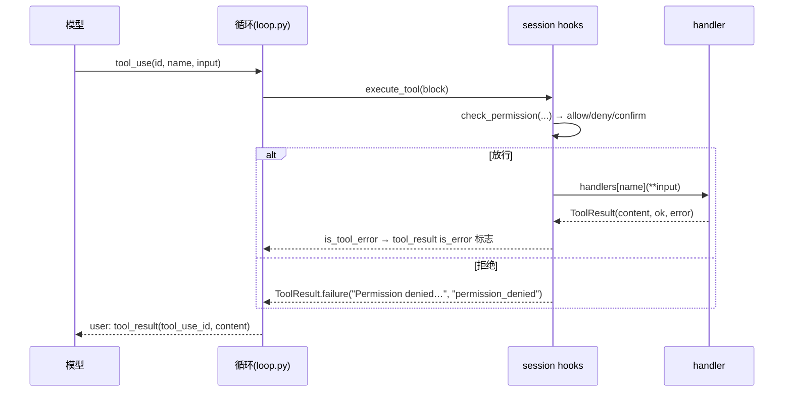
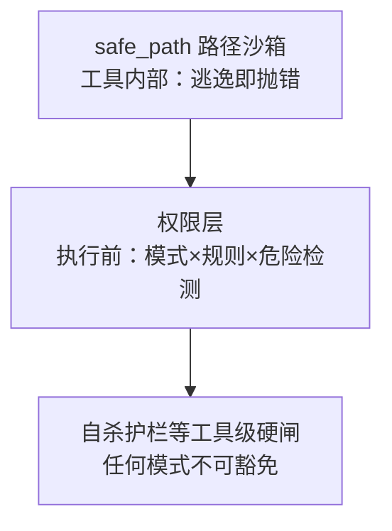

# 工具系统：模型的手，框架的边界

> 工具是 Agent 与世界的接口：模型用 `run_shell`/`write_file` 等"手"改变世界，框架决定这些手能伸多远、错手了怎么收场。本篇从**一个工具的完整生命周期**出发，逐个拆解本项目每个关键工具的设计动机与实现细节——不仅讲"它做了什么"，更讲"为什么做成这样、踩过哪些坑"。
> 对应代码：`tools/*.py`（各工具）、`tools/__init__.py`（注册聚合）、`engine/results.py`（ToolResult）、`utils/path.py`（路径沙箱）、`utils/truncate.py`（结果截断）。写于 2026-09-04。

## 目录

- [工具是什么，什么不是](#工具是什么什么不是)
- [注册与分发：从 DEFINITION 到 handler](#注册与分发)
- [读文件：read_file 的行号哲学](#读文件)
- [改文件：write_file 与 edit_file 的分工](#改文件)
- [检索：list_files 与 grep_search](#检索)
- [执行：run_shell 的克制与护栏](#执行)
- [计划：TodoWrite 的完整设计](#计划)
- [委托与流水线：agent 与 run_workflow](#委托与流水线)
- [结果边界：truncate 与 ToolResult](#结果边界)
- [安全贯穿：safe_path + 权限层 + 工具护栏](#安全贯穿)
- [业界调研：共识、问题与方案](#业界调研)
- [当前实现的成熟度评估](#成熟度评估)
- [不足与进一步优化方向](#不足与优化方向)
- [附录 · 变更历史](#附录)

## 业界调研

### 工具系统在 Agent 领域的定位

工具系统是 AI Agent 区别于普通 Chatbot 的核心能力载体——**普通 Chatbot 只能"说"，Agent 能"做"**。如果 LLM 是大脑，工具系统就是双手：大脑负责决策（选哪个工具、传什么参），双手负责执行（文件 I/O、Shell 命令、API 调用）。工具系统本质是 **Function Calling 协议的工程化落地**——围绕"模型输出 tool_use → 应用执行 → tool_result"这一协议，构建定义、注册、权限检查、执行、结果处理、UI 渲染的完整体系。

### 业界主流共识（以 Claude Code 为标杆，见 `cc源码调研/01-cc-tool system.md`）

1. **统一接口 + Fail-Closed 默认**：所有工具（内置/MCP/REPL）共享统一 `Tool` 接口，`buildTool()` 工厂铺默认值——`isReadOnly: false`（默认有副作用）、`isConcurrencySafe: false`（默认不并发）。忘记配置的后果是"多一个弹窗"（烦但安全），而非"数据损坏"。
2. **错误是数据，不是异常**：任何阶段错误都转成 `tool_result(is_error: true)` 返回模型，让模型自我纠正，而非抛出异常中断对话。
3. **纵深防御**：BashTool 是攻击面最大的工具，CC 实现 7+ 层安全（AST 解析、23 项静态检查、命令替换阻断、路径约束、沙箱）。
4. **缓存感知的工具列表管理**：内置工具与 MCP 工具分区排序（MCP 变动不影响内置缓存键）、延迟加载（`shouldDefer`）。

### 主要问题与解决方案

| 问题 | 表现 | 业界方案 |
|------|------|----------|
| 模型什么都往 shell 塞 | 绕过沙箱与可观测性 | 专用工具优先（read_file 代替 cat、edit_file 代替 sed） |
| 工具结果撑爆上下文 | 单次返回数万字符 | maxResultSize 持久化 + 预览 + 按需读取 |
| 编辑改错位置 | search-replace 歧义 | 字符串唯一性匹配（非行号，幂等） |
| grep 退出码 1 被误判失败 | "无匹配"≠"错误" | 退出码语义白名单 |
| 工具幻觉出不存在工具 | 模型输出未知 name | 合成错误块，不阻断循环 |
| 参数 JSON 被截断 | 流式输出中断 | 修复性解析 + `_parse_error` 字段 |

**CC 比本项目多出的关键能力**：流式并行执行（`StreamingToolExecutor` 边接收边执行）、并发安全分区（只读并行/写入串行）、工具延迟加载（`ToolSearchTool`）、输入感知安全语义（`isReadOnly(input)` 对 ls 只读、对 rm 非只读）。

### 工具系统与能力扩展的不同思路（超越 CC 的全局视角）

工具系统之外，业界对"如何扩展 Agent 能力"和"如何让模型理解代码库"有几种不同侧重：

| 思路 | 代表 | 核心机制 | 与本项目的关系 |
|------|------|----------|----------------|
| **函数即工具 + 参数验证** | OpenAI Agents SDK | 任何 Python 函数变工具，Pydantic 自动 schema + 验证，MCP 内置 | 本项目用 dict schema + handler，缺 Pydantic 式强类型验证 |
| **MCP 协议扩展** | 跨产品协议 | 跨进程/跨语言工具扩展，JSON-RPC | 本项目有 services/mcp.py 但未测试重构 |
| **仓库地图** | Aider | repomap 图排名算法选最相关符号（≤1k token），辅助模型定位 | 本项目靠 grep/list_files 探索，无 repomap |
| **工具作为"能力" vs "知识"** | Skill（CC）/ MCP | 工具 = 原子能力，Skill = 组合流程，MCP = 外部扩展 | 本项目三者齐全（tools/skills/mcp） |

**关键洞察**：
1. **OpenAI 的"函数即工具"** 是最轻量的工具定义——不用写 JSON schema，用 Pydantic 模型自动生成 + 运行时强验证。本项目手写 dict schema，参数类型错误靠 handler 的 try/except 兜底，缺一层"自动 schema 生成 + 类型强校验"。
2. **Aider 的 repomap** 揭示工具之外的能力：与其让模型反复 grep 探索，不如给一张"自动生成 + 相关性排序"的仓库地图，让模型一次看清结构再精准定位。这是"工具系统"向"上下文构建"的延伸。
3. **MCP 是跨产品共识**：几乎所有主流 Agent（CC/OpenAI/LangChain/Cline）都支持 MCP，它是"工具扩展"的开放标准。本项目 MCP 未测试重构，是能力外设最短板。

## 工具是什么什么不是

对 LLM 而言，一个工具 = `{name, description, input_schema}`；对框架而言，一个工具 = 一段 Python `handler(**input) -> str/ToolResult`。两者靠 `tools/__init__.py` 绑定：

```python
defs     = get_all_definitions()   # 描述列表 → 交给模型（schema 本身就在花 token）
handlers = get_all_handlers()      # name → callable → 循环执行时按名分发
```

两条设计立场贯穿本篇：

**立场一：描述即行为。** 工具没有"魔法逻辑帮模型决定怎么用"；模型看到的是 description。因此每个工具的 description 都被当"行为准则"写：不只说"能做什么"，还说"什么时候该用、什么时候不该用、和别的工具什么关系"（read_file 说 "Use this instead of cat"、TodoWrite 说 "not for simple single-step tasks"、edit_file 说 "Prefer this over write_file for modifying existing files"）。这是提示词工程在工具层的延伸（呼应 00 文档）。

**立场二：框架管边界，模型管意图。** 意图（选哪个工具、传什么参）100% 交给模型；框架负责：路径别逃逸（`safe_path`）、结果别撑爆上下文（`truncate_result` + 压缩 L1）、操作要不要人确认（权限层）、别把宿主进程杀了（自杀护栏）。每一条边界都是踩出来的（见附录）。

## 注册与分发



分发细节与陷阱：`tools/__init__.py` 的 handler 全是 lambda 适配层（把 keyword args 映射成各工具 handle 的位置/命名参数）。为什么加一层而不是直接暴露 handler？因为**模型传参是 keyword**（schema 定义的名字），而各工具 handle 签名不同（有的带默认值）；适配层把"模型看到的 schema"与"Python 函数签名"解耦，改内部签名不破坏 schema。

模型偶发传坏参（缺 `pattern` 报过 `Error: 'pattern'`）——那是 schema `required` 之外的模型失误，handler 用 try/except 把它变成可读的 ToolResult 失败，模型下一轮自纠，循环不炸。**工具永不抛异常**是硬契约。

## 读文件

`read_file` 的实现只有 20 行，但每个决策都有出处：

```python
def handle(file_path, limit=None):
    lines = safe_path(file_path).read_text(encoding="utf-8").splitlines()
    if limit and limit < total:
        lines = lines[:limit]            # 前 N 行 + 提示还剩多少行
    numbered = [f"{str(i+1).rjust(4)} | {line}" for i, line in enumerate(lines)]
    return truncate_result("\n".join(numbered) + truncated_note)
```

- **为什么带行号？** 行号是"模型与文件对话"的坐标轴：`edit_file` 的 diff 输出、后续要改的位置、`grep_search` 的结果（`file:line:`）都依赖行号。没有行号，模型只能说"改那个 if 分支"，有了行号才能精确表达。
- **为什么 utf-8 显式？** Windows 控制台/旧工具默认 GBK，读源码文件易乱码。全部显式 utf-8 + `errors` 策略是 S5 的全局纪律。
- **limit 与截断是两级闸**：`limit`（行级，模型主动）在前，`truncate_result`（字符级，框架强制）在后——模型不知道结果多长，框架必须兜底。
- **错误分类**：`path_escape`（safe_path 抛的 ValueError）/ `not_found` / `io_error` 三类，配合 ToolResult 让循环层能按类别处置（而不是凭字符串猜）。

## 改文件

### 为什么 write_file 与 edit_file 要分开

写整个文件 vs 精确替换是两种心智：模型对"新建一个文件"有整篇意图，对"改一行"只有局部意图。若只用 write_file 改存量文件，会**整篇重写**——引入无意的删改（丢掉一个注释、改坏一个没注意的格式）。所以分工在提示词与描述里都写死：**新文件用 write_file，存量文件用 edit_file**。

### edit_file 的防呆三件套

```python
# 1) 引号容错：模型常输出弯引号，文件里是直引号
def _normalize_quotes(s): re.sub(r"[\u2018\u2019\u2032]", "'", ...)  # 等
# 2) 唯一性检查：old_string 必须恰好出现一次
count = content.count(actual)
if count > 1: return ToolResult.failure("found N times… must be unique…", "ambiguous_match")
# 3) diff 回执：告诉模型改了哪几行
```

逐个讲设计动机：

- **唯一性检查**是最重要的一条：search-and-replace 的最大风险是"你以为改的是第 3 处，实际 replace 改了第 1 处"。要求 old_string 唯一，逼模型提供足够上下文（把周围几行一起包进 old_string），从根上杜绝歧义编辑。出错时错误信息还教模型"Provide more surrounding context"——工具不只是报错，还指路。
- **引号容错**：真实事故的教训——模型输出中文引号/弯引号时精确匹配必然失败，来回试错浪费轮次。`_find_actual_string` 先精确匹配、失败后把两边都标准化再匹配，返回文件里的**原始串**做替换（保证 diff 干净）。
- **diff 回执**：改完把 `@@ -行,行 +行,行 @@` 的简易 diff 给模型，让它确认"改对地方了"。这也是行号哲学的另一半：闭环反馈。
- `old_string` 找不到 → `not_found` 而非静默成功；找错位置是编辑事故中最贵的一种，宁可让模型重来。

### write_file 的细节

`fp.parent.mkdir(parents=True, exist_ok=True)`——自动建父目录省去模型"先 mkdir 再 write"的多余轮次。返回 `(len(content) bytes)` 让模型知道写入了多少。

## 检索

### list_files：glob + mtime 排序

- 为什么**按修改时间倒序**？模型最关心"最近在动什么"（刚改的文件/刚生成的构建产物），新文件排前面命中率远高于按名排。
- 为什么 glob 而非递归扫描全部？glob 让模型用 `**/*.py` 精确表达意图，避免返回一整个大仓库（那是 `ls -R` 的灾难）。
- 输出用相对 WORKDIR 的路径、超上限只显示前 N 并提示总数——防止几千个文件刷爆上下文。

### grep_search：纯 Python 重写的前因后果

原实现调用系统 `grep` 二进制，在 Windows 上不可用、编码不可控、行为因版本漂移。S5 重写成纯 Python。它的工程细节值得逐条展开：

```python
_SKIP_DIRS = {".git", "__pycache__", "node_modules", ".xiaoagent", ...}   # 对齐 rg 默认
def _iter_files(root, include):   # os.walk + 原地过滤 dirnames[:] 阻止进入跳过目录
def _read_lines_safe(path):       # NUL 字节启发式判二进制；UTF-8 解码失败→replace→仍败跳过
```

- **跳过目录用 `dirnames[:] = [...]` 原地过滤**：直接在 os.walk 的列表上过滤，从根上阻止递归进 `.git/node_modules`（性能与噪音双赢）；
- **二进制检测用 NUL 字节启发式**（前 8KB 含 `\x00`）：这是 grep 同款策略——比按扩展名猜可靠（一个 `.txt` 也可能塞了二进制）；
- **解码策略分两段**：UTF-8 失败后用 `errors="replace"` 兜底，仍失败当二进制跳过——中文环境常见"声明 utf-8 实为其他编码"，replace 保证不整文件炸掉；
- **超时护栏**：循环里 `time.time() - started > timeout_s` 才检查，整个搜索带 `grep_timeout`（秒）上限，超时返回错误而非挂死模型一轮；
- **命中上限**：`grep_max_matches` 个后停止并提示 `... and more matches`——搜索是"找线索"，不是"导出全文"；
- **正则语法错误**单独报 `invalid_input`（而不是让文件遍历白跑一遍）。
- 结果格式 `file:line:内容` 与 read_file/edit_file 的行号体系互相咬合。

## 执行

`run_shell`（BashTool）是权限与安全压力最大的工具。它暴露三个参数：`command`、`timeout`（默认 120s）、`run_in_background`。设计决策：

```python
# grep/diff/test 等退出码 1 不是错误
_EXIT1_OK_COMMANDS = {"grep", "diff", "test", "cmp", "comm"}

r = subprocess.run(command, shell=True, cwd=WORKDIR, capture_output=True,
                   text=True, timeout=timeout, encoding="utf-8", errors="replace")
```

- **退出码语义**：非 0 一律报 `Command failed (exit code N)`，但 grep/diff/test 的 1 是"没匹配/有差异"——列入白名单按正常结果处理。这条如果不做，模型用 grep 搜不到东西会被当成"命令失败"而误判为 bug；
- **捕获输出而非继承终端**：`capture_output=True` 让结果能回填给模型；但这意味着**GUI/长驻进程会卡满 timeout**（真实事故：子 Agent 跑 GUI 游戏卡 120s），超时由 `subprocess.run` 的 timeout 杀掉子进程、返回 `timeout` 错误；
- **后台执行** `run_in_background=True` 走 BackgroundManager 线程，结果经通知回传，配合主循环等待闭环（02 文档）——`run_shell` 与 `agent` 工具的后台语义共用同一套通知机制；
- **自杀护栏**（2026-09-03 事故）：执行前先 `_would_kill_self(command)`，任何"终止动词 × python 目标"直接拒绝（`self_kill_guard`），见 04 文档。

## 计划

`TodoWrite`（TodoTool）是"plan-and-solve"的落点，也是最容易被低估的工具。看它的完整设计：

```python
def update(self, items):
    validated = []
    in_progress_count = 0
    for i, item in enumerate(items):
        # 全量替换语义：模型每次必须提交"保留的全部项"
        content = str(item.get("content", "")).strip()
        status  = str(item.get("status", "pending")).lower()
        activeForm = str(item.get("activeForm", "")).strip()
        if not content:      raise ValueError(f"Item {i}: content required")
        if status not in ("pending","in_progress","completed"):
            raise ValueError(f"Item {i}: invalid status '{status}'")
        if not activeForm:   raise ValueError(f"Item {i}: activeForm required")
        if status == "in_progress": in_progress_count += 1
        validated.append({...})
    if len(validated) > todo_max_items:  raise ValueError("Max 20 todos")
    if in_progress_count > 1:            raise ValueError("Only one in_progress allowed")
    self.items = validated
    return self.render()   # "[x]/[>]/[ ] 内容" + "(done/total completed)"
```

逐条设计理由：

- **全量替换而非增量 add/update**：这是刻意与直觉相反的决策。增量 API 的经典问题：模型说"更新第 3 项"，但因为看走眼/索引漂移，改错了项。全量替换让模型每轮提交"我脑子里完整清单长什么样"，错不错一眼可见，且天然解决删除（不写即删）。description 里明说 "This REPLACES the entire list"；
- **严格校验即"给模型上课"**：content/activeForm 缺失、status 非法直接抛错（框架捕获转 ToolResult.failure），错误信息带 `Item {i}:` 定位。模型的 list 状态机因此被"强迫"正确——这比让它在自由格式里自己维护可靠得多；
- **activeForm 为什么必填**：todo 状态如果只是 pending→done 两态，模型很容易"忘做到哪一步"。activeForm 要求 in_progress 项用现在进行时描述当前动作（"Running tests"），渲染成 `[>] Running tests <- Running tests` 的动感线索，也直接喂给多轮未更新时的 reminder；
- **一次只能一个 in_progress**：防止模型同时"进行中"一堆项（那是没在做任何一项）；
- **上限 20 条**：清单是模型要每轮重读的东西，太长会烧上下文与注意力；
- **与循环的咬合**：`has_open_items()` 供 session 的 post_tools 钩子判断"多轮没更新就注入 reminder"；`render()` 也出现在 reminder 消息里，让模型不用翻历史考古（02 文档）。

## 委托与流水线

- `agent`（AgentTool）：统一派生入口，`type` enum **动态来自注册表**（`get_definition()` 每次构建查 `registry.names()`），用户放一个 `.xiaoagent/agents/foo.yaml` 新类型即入列；异步与否 = 显式 `run_in_background` OR 类型配置 `background: true`（verification 默认后台）；
- `run_workflow`（WorkflowTool）：把需求交给 SOP 管线（Analyst→Engineer→Tester），返回结构化摘要；它被列入 `MAIN_AGENT_ONLY_TOOLS`——子 Agent 不能嵌套启动 workflow（防递归），TodoWrite 同理（防覆写主清单）。

## 结果边界

所有工具输出最终过 `truncate_result`：超过 `tools.max_result_chars` 时**保留头尾各一半**，中间提示截断了多少字符。为什么头尾各半而非保头？因为工具输出的"关键结论"常在末尾（编译错误堆栈尾、测试 summary、命令最后几行），而开头是"执行了什么"的上下文——`[... truncated N chars ...]` 的标记也明确告诉模型"这里有内容被截断了，需要的话缩小范围再查"，避免模型误以为"文件就这么短"。

`ToolResult`（str 子类带 ok/error）是另一层结构化：模型看到的是文本内容本身，框架读 `ok/error` 决定错误计数与 `is_error` 标志——见 02 文档。

## 安全贯穿

三层纵深（各自解决不同问题）：



- `safe_path` 是**第一道也是最后一道**：哪怕权限层被 bypass，路径逃逸仍被工具自身拒绝（read/write/edit 都先过它）。它的实现有个 Windows 特定坑：工作目录要 `resolve()` 再比较，否则 8.3 短路径（`C:\Users\XSX401~1\...`）会被误判为逃逸；
- 权限层管"要不要问人"（05 权限文档详述）；
- 自杀护栏管"问都不能问"的（杀宿主进程）。

## 走查示例：一次真实改动的完整工具流

场景：模型要把 `calc.py` 里的一个函数改名，并确认没有别处引用它。下面按**输入 → 工具处理 → 输出**还原每一步（含一次失败与恢复）。

**第 1 步 读文件（行号是后续一切的地基）**

```
模型 → read_file(file_path="calc.py")
工具 → safe_path 校验 → 读取 → 加行号 → (未超限不截断)
输出 →
   1 | def add(a, b):
   2 |     return a + b
   3 |
   4 | def add_then_double(a, b):
   5 |     return add(a, b) * 2
```

**第 2 步 检索引用（确认改名波及面）**

```
模型 → grep_search(pattern="add_then_double", path=".")
输出 →
calc.py:4:def add_then_double(a, b):
tests/test_calc.py:12:assert add_then_double(1, 2) == 6
```

**第 3 步 编辑（先故意给一个会歧义的 old_string，看防呆）**

```
模型 → edit_file(file_path="calc.py", old_string="add_then_double", new_string="double_sum")
工具 → _find_actual_string: 精确命中 → count=2(定义+调用) > 1
输出 → ToolResult.failure("Error: old_string found 2 times in calc.py. Must be unique.
       Provide more surrounding context to disambiguate.", "ambiguous_match")
```

**第 4 步 模型纠错（提供更多上下文）**

```
模型 → edit_file(file_path="calc.py",
         old_string="def add_then_double(a, b):", new_string="def double_sum(a, b):")
工具 → 唯一 → 替换 → 生成 diff
输出 →
Successfully edited calc.py
@@ -4,1 +4,1 @@
- def add_then_double(a, b):
+ def double_sum(a, b):
```

模型看到 diff 确认改对位置，再对测试文件做第二次 edit_file。这个序列演示了工具系统的两个设计点：**错误是教学信号**（第 3 步的错误信息直接教模型怎么改参数），**diff 是自证**（第 4 步让模型确认自己没改错地方）。

**第 5 步 验证**

```
模型 → run_shell(pytest -q)
工具 → subprocess.run(timeout=120) → 退出码 0
输出 → 1 passed in 0.21s
```

若 pytest 返回退出码 5（无测试收集到）会被当成失败并附 stderr；若输出超长（几百行 traceback），先经 truncate_result 头尾各半，再经循环的 L1 预算裁一刀——模型永远不会被塞爆。

## 成熟度评估

对照业界共识与 CC 能力，逐条评估：

| 能力 | 本项目 | 成熟度 |
|------|--------|--------|
| 统一 handler 分发 | ✅ `DEFINITION + handler` + lambda 适配层 | 高 |
| 错误是数据（ToolResult） | ✅ str 子类 + ok/error，永不抛异常 | 高 |
| 专用工具优先 | ✅ description 写"use this instead of cat/sed" | 高 |
| 文件工具防呆（唯一性/引号/diff） | ✅ edit_file 三件套 | 高（对齐 CC） |
| grep 退出码白名单 | ✅ `_EXIT1_OK_COMMANDS` | 高 |
| 结果截断 | ✅ truncate_result 头尾各半 + L1 预算 | 高 |
| 工具级护栏（自杀） | ✅ BashTool `_would_kill_self` | 高（超越 CC 常规场景） |
| 路径沙箱 | ✅ safe_path resolve + is_relative_to | 高 |
| 流式并行执行 | ❌ 无（串行 for 循环执行 tool_blocks） | 低 |
| 并发安全分区 | ❌ 无（无 isConcurrencySafe 概念） | 低 |
| 工具延迟加载 | ❌ 无（所有工具定义全量发给模型） | 低 |
| 输入感知安全语义 | ⚠️ 有（run_shell 危险命令检测），但非 CC 的 per-input 泛化 | 中 |

**总体判断**：文件/检索/执行/计划工具的核心设计（防呆、退出码、截断、护栏）已对齐甚至部分超越 CC；差距集中在"执行效率"（流式并行、并发分区）与"工具规模管理"（延迟加载）两个方向——这在工具数量少时不是问题，工具多时（接 MCP）会显现。

## 不足与优化方向

1. **串行执行工具**：当前 `for block in tool_blocks` 串行执行，即使模型一轮返回多个独立工具（如读 3 个文件）也逐个等。CC 的 `StreamingToolExecutor` 边接收边执行、只读工具并行、写入串行。工具多、网络慢时串行是明显瓶颈。可引入"并发安全分区"（isConcurrencySafe 标记）。

2. **无工具延迟加载**：所有工具定义（含完整 input_schema）全量发给模型，工具多时 system prompt 膨胀。CC 对不常用工具 `shouldDefer: true`，只发名称列表，模型通过 ToolSearch 按需加载。本项目工具数少（~10 个）暂不需，但接 MCP 后需考虑。

3. **输入感知安全语义不泛化**：危险检测只在 run_shell 上做了命令正则，没有 CC 那样"`isReadOnly(input)` 按输入判定"的泛化机制（如 edit_file 删除大量代码应算 destructive）。可作为工具定义的统一字段补上。

4. **无工具进度回调**：长命令（run_shell 120s）执行期间无中间输出，模型和用户都只能干等。CC 的 `onProgress` 让工具实时发射进度（Bash 流式 stdout）。可给 run_shell 加 `on_progress` 回调。

5. **结果持久化而非纯截断**：当前大结果直接 `truncate_result` 头尾各半，完整内容丢失（模型想看去头尾再读一次）。CC 持久化到磁盘 + 返回路径引用 + 2KB 预览，无损。这是"截断 vs 持久化"的取舍——截断简单但有信息损失。

6. **无 Pydantic 式强类型参数验证**：dict schema 靠 handler 的 try/except 兜底，参数类型错误（如传字符串而非数字）要到执行时才暴露。OpenAI 用 Pydantic 自动生成 schema + 运行时强验证。可引入 Pydantic 模型定义工具参数。

7. **无仓库地图（Aider repomap）**：大仓库场景模型反复 grep/list_files 探索，无一张自动生成 + 相关性排序的仓库地图。可借鉴 Aider 的图排名算法，生成 ≤1k token 的结构地图辅助定位。

## 附录

### 变更历史

| 遇到的问题 / bug | 问题分析 | 解决方法 | 时间 |
|------------------|----------|----------|------|
| 字符串前缀嗅探误判失败 | 输出含 "Error:" 即误判 | ToolResult 结构化 ok/error | 09-01 |
| grep 依赖系统二进制不可跨平台 | Windows 无 grep/编码乱 | S5 纯 Python 重写（跳过目录/二进制启发式/超时） | 09-01 |
| 子 Agent 递归/覆写主计划 | agent/run_workflow/TodoWrite 泄漏 | MAIN_AGENT_ONLY_TOOLS 强制剔除 | 09-02 |
| edit_file 引号不匹配反复试错 | 模型输出弯引号 | 引号标准化容错匹配 | 09-01 |
| edit_file 改错位置 | old_string 多处匹配 | 唯一性检查 + "give context" 提示 | 09-01 |
| **子 Agent 清理进程把宿主杀掉** | run_shell 无自保护 | BashTool 自杀护栏（任何权限模式） | 09-03 |
| 结果撑爆上下文 | 单次工具输出可达数万字符 | truncate_result 头尾各半 + 压缩 L1 | 09-01 |
| list_files 缺参 `Error: 'pattern'` | 模型漏传必需参数 | required schema + handler 返回可读失败 | 09-03 |
| 路径逃逸（含 Windows 短路径误判） | 比较未 resolve | safe_path 统一 resolve 后 is_relative_to | 09-01 |
