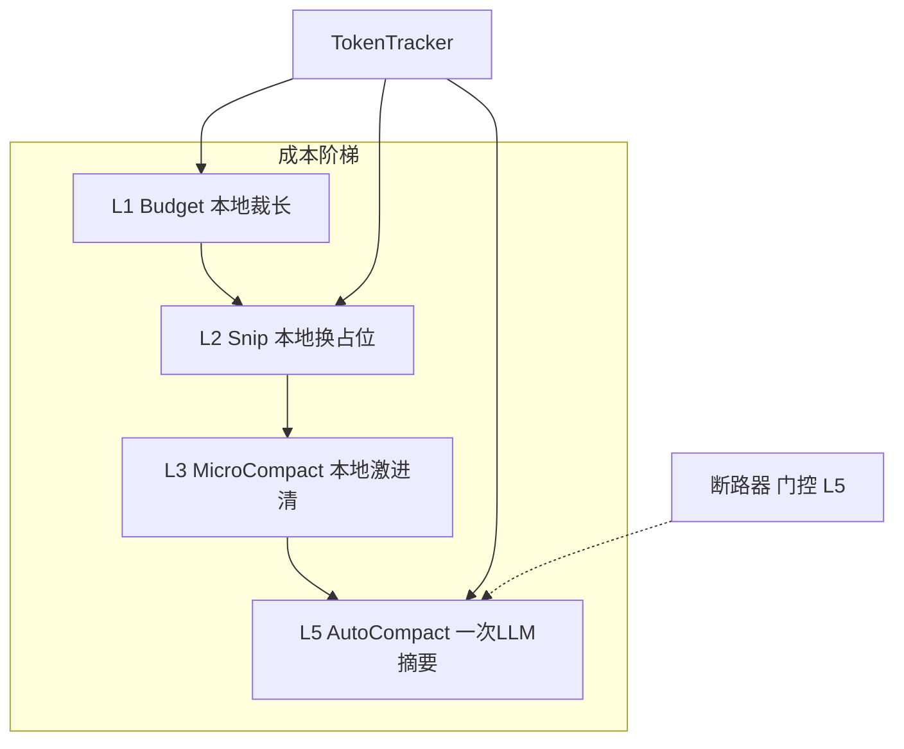
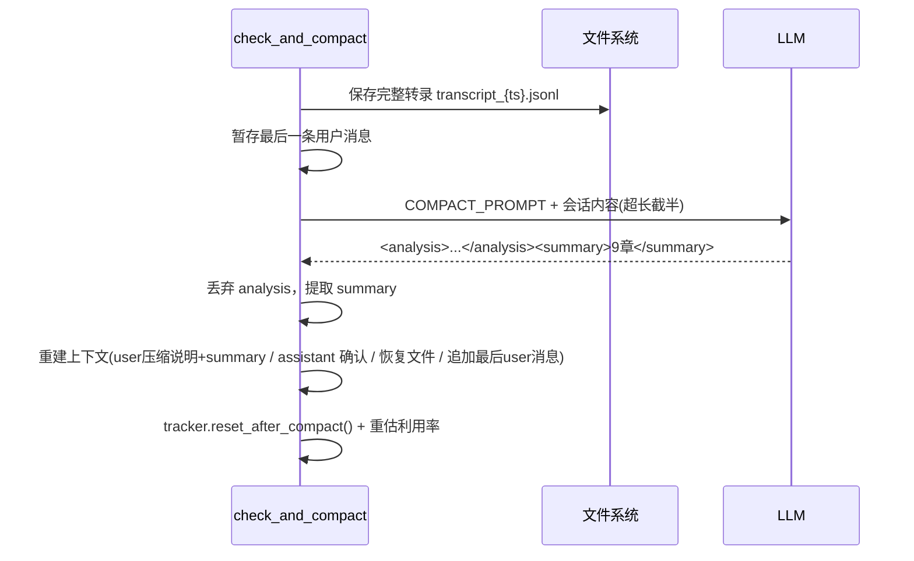
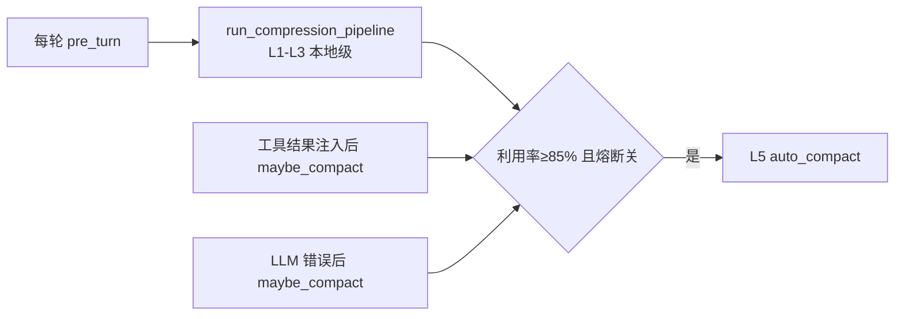

# 上下文管理：五级压缩流水线的设计与实现

> 上下文是 Agent 的"工作记忆"，而它有两个物理极限：模型的 context window（硬顶）与 API 计价（每 token 都要钱）。压缩系统的目标不是"不超窗"，而是**在超窗之前，按成本从低到高逐级让出空间，同时最小化信息损失**。本篇走读 `context/compact.py` 的实现：预算从哪来、每一级怎么判、压缩后怎么恢复。
> 对应代码：`context/compact.py`（压缩）、`config/loader.py` CompactSettings（阈值）、`engine/loop.py`（检查点）。写于 2026-09-04。

## 目录

- [上下文消耗的结构](#上下文消耗的结构)
- [Token 预算从哪来：锚点 + 增量](#token-预算)
- [总体架构与成本阶梯](#总体架构)
- [L1 Tool Result Budget](#l1)
- [L2 Snip](#l2)
- [L3 MicroCompact](#l3)
- [L5 AutoCompact：全量摘要](#l5)
- [压缩后恢复：文件与技能不丢](#压缩后恢复)
- [断路器：失败的级联要熔断](#断路器)
- [检查点分布与触发时机](#检查点)
- [提示词缓存：现状说明](#提示词缓存)
- [业界调研：共识、问题与方案](#业界调研)
- [当前实现的成熟度评估](#成熟度评估)
- [不足与进一步优化方向](#不足与优化方向)
- [附录 · 变更历史](#附录)

## 业界调研

### 上下文管理在 Agent 领域的定位

LLM 的一切推理建立在**上下文窗口**之上——一次推理能"看到"的全部信息总量。上下文管理是"系统性地决定在有限窗口中放什么、何时移除过时信息、移除后如何保持工作连贯性"。一次真实编码会话产生的原始文本轻松超百万 token，而窗口只有 ~200K，取舍不当会导致：忘记刚编辑的文件、重复读取、输出与之前决策矛盾、API 报 prompt-too-long。

### 业界主流共识（以 Claude Code 为标杆，见 `cc源码调研/07-cc-上下文管理.md`）

1. **渐进式压缩，而非暴力截断**：CC 用五级策略（L1 Tool Result Budget → L2 Snip → L3 MicroCompact → L4 Context Collapse → L5 AutoCompact），从零成本到高成本逐级递进，每一级在前一级不足以释放空间时才激活。
2. **锚点 + 增量 Token 估算**：用 API 返回的 `usage.input_tokens` 当精确锚点，只估算锚点之后新增的少量消息，误差从纯客户端的 30%+ 降到 <5%，零额外 API 调用。
3. **缓存感知**：压缩策略必须考虑与 Prompt Cache 的交互——MicroCompact 分"缓存冷/热"两条路径（缓存冷直接改消息，缓存热用 `cache_edits` API 保持前缀）。
4. **断路器防级联**：连续压缩失败 3 次跳过自动压缩（真实数据：引入前 1279 个会话出现 50+ 次连续失败，每天浪费 ~250K API 调用）。

### 主要问题与解决方案

| 问题 | 表现 | 业界方案 |
|------|------|----------|
| 工具结果撑爆窗口 | 单次 read_file 可达数万字符 | L1 预算裁剪（持久化而非截断，留 2KB 预览） |
| 历史消息线性膨胀 | 早期结果已无用仍占 token | L2 Snip（替换为占位符，保留消息链完整性） |
| 缓存过期后旧内容浪费 | 空闲后缓存失效 | L3 MicroCompact 时间触发（保留最近 N 条） |
| 压缩本身超长 | 摘要请求 > max_tokens | 80K 上限 + 头尾各半截断 |
| 压缩失败级联 | 失败→涨→再压缩→再失败 | CircuitBreaker 三态机（3 次熔断） |
| 压缩后接不上话 | 最近文件/技能内容丢失 | 压缩后恢复（文件 + 技能 + 预算控制） |

**CC 比本项目多出的关键能力**：Context Collapse（L4，投影式只读视图，不修改原始消息、可回退）、双路径 MicroCompact（缓存编辑 API）、缓存感知的分区工具排序。

### 上下文管理的不同思路（超越 CC 的全局视角）

业界对"窗口写满怎么办"有几条不同的路，CC/本项目的"渐进式压缩"只是其中之一：

| 思路 | 代表 | 核心机制 | 本质 |
|------|------|----------|------|
| **渐进式压缩** | CC / 本项目 | 五级从廉价到昂贵逐级让出空间，L5 才用 LLM 摘要 | 丢弃/摘要（有损） |
| **虚拟上下文 + 分页** | MemGPT/Letta | 核心记忆 ↔ 归档记忆之间换入换出，窗口外信息仍在归档层 | 换入换出（可找回） |
| **仓库地图 + 按需读取** | Aider | 不压缩对话，而是用 repomap（图排名算法选最相关符号）精准定位，模型按需读具体文件 | 精准索引（避免读全量） |
| **图状态持久化** | LangGraph | checkpointer 持久化状态，断点续跑，不靠摘要重建 | 状态快照（可恢复） |

**Aider repomap 的启发**：它用 `--map-tokens`（默认仅 1k token）动态裁剪"仓库地图"——只发最相关的类/函数签名，用图排名算法选"与当前聊天最相关"的代码部分。这回答了"如何让模型理解大仓库而不读全量"：**发一张廉价的结构地图，让模型按需读细节**。本项目靠 grep/list_files 让模型自己探索，缺一张"自动生成 + 相关性排序"的仓库地图（见优化方向）。

**MemGPT 的启发**：它的"分页"与压缩的根本区别是**信息可找回性**——压缩丢弃了早期细节，分页只是把细节换到归档层（向量检索可召回）。长会话"早期读过的文件内容"在本项目 L2 snip 后被替换为占位符（需重读），MemGPT 则归档后仍可检索。这是"有损 vs 无损"的取舍，压缩更省 token，分页找回性更强。

## 上下文消耗的结构

一个会话的 token 由四类构成：系统提示词（固定几 K）、工具结果（单次可达数万字符）、对话历史（逐轮线性增长）、技能/记忆注入（按需）。其中**工具结果是最不可控的变量**——模型自己无法预估 `read_file` 一次返回多少字符。压缩系统因此默认把工具结果当作首要"可让出空间"。

## Token 预算

设计目标：知道"现在用了多少"，但不为精确计量付出额外 API 调用。方案是**锚点 + 增量**：

```python
class TokenTracker:
    # 锚点：API 每次返回的 usage.input_tokens（服务端精确值）
    def update_from_response(self, response):
        self.last_input_tokens = response.input_tokens   # 服务端算的
        ...
    # 增量：锚点之后新增消息的本地粗略估算
    def track_new_message(self, message):
        self._new_tokens_since_anchor += _estimate_tokens(json.dumps(message, default=str))
    def estimate_current_tokens(self):
        return self.last_input_tokens + self._new_tokens_since_anchor   # 锚点 + 增量
    def get_utilization(self):
        return self.estimate_current_tokens() / EFFECTIVE_WINDOW
```

**为什么这套比"纯本地估算全程"精确？——误差的数学推导**：

设本地估算的**相对误差**为 `e`（经验值约 30%，中文更高）。纯本地估算全程的总误差就是 `e`。而"锚点 + 增量"策略把用量拆成两段：

```
estimate = anchor + delta
          ↑        ↑
       服务端精确   本地估算
```

其中 `anchor`（API 回传的真实 input_tokens）误差为 0，只有 `delta`（锚点之后新增的那一小段）带误差。设 `anchor` 占当前总量的比例为 `r`（通常 0.7~0.9，因为锚点每轮都刷新，增量只是"上一次 API 调用之后"新加的一两条消息），则总误差为：

```
误差 = e * (1 - r)    # 只作用在增量部分
```

当 `r=0.85`、`e=30%` 时，总误差 ≈ `30% * 15% = 4.5%`。这就是 "<5%" 的来源——**误差被"锚点占比"稀释了**。锚点刷新得越频繁（每轮 LLM 调用都刷新），增量越小，误差越小。

本地估算的 CJK 修正（`_estimate_tokens`）：

```python
cjk = sum(1 for ch in text if '\u4e00' <= ch <= '\u9fff')
return int(cjk / 1.5 + (len(text) - cjk) / 3)   # CJK ~1.5 字符/token，ASCII ~3 字符/token
```

为什么中文要单独加权？旧系数按 3 字符/token 算，中文实际密度接近 2 倍——系统性低估中文会话利用率，会**让压缩触发过晚**（等真超窗就晚了）。这条是中文场景专属的 bug，写在注释里防止回退。

## 总体架构



| 级 | 触发 | 做什么 | 成本 |
|----|------|--------|------|
| L1 | 利用率 ≥50% | 把超长 tool_result 截到头尾各半 | 本地 |
| L2 | 利用率 ≥60% | 过时 tool_result 内容换占位符 | 本地 |
| L3 | 距上次 API ≥300s | 除最近 1 条外全部清空 | 本地 |
| L5 | 利用率 ≥85% 且熔断关闭 | LLM 双阶段摘要替换历史 | 1 次 LLM |
| L4 | - | Context Collapse：规模不需要，跳过 | - |

设计原则一句话：**越便宜的越先做，只有到 L5 才动用一次 LLM 调用**；而 L5 又是"唯一会真的调模型的"，所以用断路器保护它（见下）。

## L1

`budget_tool_results(messages, utilization)` 是**动态预算**：50%–70% 时超过 30K 字符的 tool_result 截为 30K；>70% 时收紧到 15K。实现要点：

- 只处理 `user` 消息里的 `tool_result` block（对话消息内部结构见 02 文档）；
- **为什么动态而非固定**：上下文越紧张，越值得为"将来还有新消息"腾空间；宽松时不折腾，避免无谓的信息损失。

### 截断公式的推导

核心代码是"头尾各半 + 中缝提示"，但 `keep_each` 的计算藏着一个精确的预算账：

```python
budget = BUDGET_TIGHT if utilization > BUDGET_TIGHT_THRESHOLD else BUDGET_NORMAL  # 15K 或 30K
keep_each = (budget - 80) // 2     # ← 关键：中缝提示占 80 字符，剩下平分给头尾
block["content"] = (
    block["content"][:keep_each]
    + f"\n\n[... budgeted: {original_len - keep_each * 2} chars truncated ...]\n\n"
    + block["content"][-keep_each:]
)
```

推导 `keep_each = (budget - 80) // 2`：截断后的总长度要 **≤ budget**。三段构成：头部 `keep_each` + 中缝提示（约 80 字符的 `[... budgeted: N chars truncated ...]`）+ 尾部 `keep_each`。所以：

```
keep_each + 80 + keep_each ≤ budget
        → 2 * keep_each ≤ budget - 80
        → keep_each = (budget - 80) // 2
```

**为什么用 `// 2`（整除）而不是 `/ 2`**：`keep_each` 必须是整数（切片索引），且向下取整保证三段总长严格 ≤ budget，不会因为四舍五入越界。80 是"中缝提示"的保守估长——宁可略保守（多截一点）也不超预算。

**为什么头尾各半而不是全留头**：关键结论/返回码常在尾部（`run_shell` 的输出末尾是 exit code、文件末尾是 `if __name__ == "__main__"`），全留头会丢掉尾部关键信息。头尾各半是"保留开头上下文 + 保留结尾结论"的折中。

## L2

`snip_stale_results(messages, utilization)` 回答："哪些 tool_result 的内容已经过时，可以只留一个指针？"

```python
SNIPPABLE_TOOLS = {"read_file", "grep_search", "list_files", "run_shell"}  # 结果可重取
SNIP_PLACEHOLDER = "[Content snipped - re-read if needed]"

# 规则 1：永远保留最近 SNIP_KEEP_RECENT(=3) 条（模型可能正在引用）
# 规则 2：每个文件的最新一次 read_file 不 snip（内容是"当前版本"）
# 规则 3：只清 content，保留 tool_use block（模型仍能看到"我读过它"）
```

三条规则的推理：

1. **可重取才可 snipe**：read/grep/list/shell 的结果重新调用即可恢复，而 write/edit 的结果记录"改了什么"，不可丢，所以不在白名单；
2. **保留最近几条**：模型刚拿到的结果多半正在被引用，先保证近处完整；
3. **per-file 最新读保护**是最细的一条：同一文件被读过多次时，旧读取很可能已过时（文件被改过），但**唯一一次读取**不能 snipe——否则模型会忘记"自己读过该文件"，误以为文件是新的。规则 2 的实现是从后往前找每个文件的首个（最新）read_file 并跳过。这是"压缩不得改变模型对世界状态的认知"原则的直接体现。

### snip 的算法步骤

`snip_stale_results` 的完整算法（`context/compact.py`），逐步骤看它如何"既要清理又要不改变模型认知"：

```text
输入: messages（原地修改）, utilization

步骤 1  阈值门控：utilization < SNIP_THRESHOLD(0.6) → 直接返回

步骤 2  收集所有 tool_result：
        for msg in messages（只 user 消息、content 是 list）:
            for block in msg.content（type == "tool_result"）:
                用 block.tool_use_id 反查 _find_tool_use() 得到 (tool_name, tool_input)
                若 tool_name ∈ SNIPPABLE_TOOLS → 加入 tool_results

步骤 3  数量门控：len(tool_results) <= SNIP_KEEP_RECENT(3) → 返回

步骤 4  划分候选：candidates = tool_results[:-3]  （去掉最近 3 条）

步骤 5  构建"每文件最新读取"索引（从后往前，首个即最新）：
        latest_file_read = {}
        for block, name, inp in reversed(tool_results):
            if name == "read_file":
                fpath = inp["file_path"]
                if fpath not in latest_file_read:
                    latest_file_read[fpath] = id(block)   # 记下该 block 的内存 id

步骤 6  执行 snip：
        for block, name, inp in candidates:
            if name == "read_file" 且 latest_file_read[fpath] == id(block):
                continue        # 这是该文件的最新读取，保留
            if len(content) > 100:
                block["content"] = "[Content snipped - re-read if needed]"
```

**推导 `id(block)` 作为"最新读取"的判据**：`latest_file_read` 存的是 `id(block)`（Python 对象内存地址），因为同一个 `file_path` 可能被读多次，而每个 `tool_result` block 是不同对象——`id()` 精确区分"哪一个 block 是那个文件的最新读取"。用 `file_path` 本身做 key、`id(block)` 做 value，就能在步骤 6 里判断"当前这个 candidate 是不是该文件的最新读取"。

**为什么 `len(content) > 100` 才 snip**：内容太短（<100 字符）替换成占位符反而更占空间（占位符本身 30 多字符），省不了几个 token，还平白丢失信息。这是"压缩本身也有成本"的体现——**只有当收益明显大于代价时才动手**。

## L3

`microcompact` 的时间触发逻辑：

```python
if tracker.last_api_call_time == 0: return
elapsed = time.time() - tracker.last_api_call_time
if elapsed < MICROCOMPACT_IDLE_SECONDS: return   # 5 分钟
# 保留最近 1 条 tool_result，其余 content 清空为 CLEARED_PLACEHOLDER
```

设计动机写在注释里：**距上次 API 超过 5 分钟，prompt cache 大概率已过期**——保留旧内容既没有缓存成本优势，又占空间。这正是压缩与"缓存友好"耦合的实例：既然缓存靠的是前缀稳定，长时间空闲后前缀早已失效，老结果留着纯属浪费。它比 L2 更激进（只保 1 条），因为它的触发条件是"用户去干别的事了很久"。

## L5

`auto_compact(messages, tracker)` 是唯一调用模型的级别，分六步：



要点拆解：

- **先存转录再动手**：摘要不可逆，压缩前把完整历史落盘（`transcript_*.jsonl`），路径写进重建后的第一条 user 消息——模型随时能回去查；
- **COMPACT_PROMPT 双阶段输出**：要求模型先输出 `<analysis>`（逐轮思维梳理，随后**丢弃**），再输出 `<summary>`（9 个标准化章节：Primary Request / Key Concepts / Files and Code / Errors and Fixes / Problem Solving / **All User Messages** / Pending Tasks / Current Work / Optional Next Step）。把"分析"与"摘要"分离是提示词工程：先逼模型理解，再让它产出可用的摘要；`All User Messages` 一条要逐字保留——用户意图是压缩的底线，丢用户原话=丢任务；
- **对话内容超长保护**：`max_conversation_chars`（80K）上限，超出取头尾各半——因为摘要请求本身也是 LLM 调用，不能让"压缩"先把自己撑爆；
- **重建上下文的结构**：`[Previous conversation compressed. Transcript: 路径] + summary` 作为 user 消息、紧跟一条 assistant 确认——压缩后模型"接得上话"；
- **重置追踪**：`reset_after_compact()` 清锚点，再对新消息逐条 `track_new_message` 重估利用率——压缩后利用率应该大幅回落，后续检查点以此为基线。

## 压缩后恢复

摘要能保留"结论"，但保留不了"文件当前长什么样"——模型正读到一半的文件内容若被摘要化，后续编辑会脱靶。恢复机制（`_restore_recent_files`）：

- 从旧消息里**从后往前**收集最近 read_file 过的文件（去重，受 `POST_COMPACT_MAX_FILES` 与单文件 token 上限约束——恢复本身也要留预算）；
- 压缩后把这些文件内容重新注入新上下文（并附加说明"压缩后已恢复的最近读取文件"）；
- 技能同理：压缩前已加载的技能全文按 `POST_COMPACT_SKILLS_BUDGET` 预算回填，避免"技能行为在压缩后失效"（对齐 CC 的 skills restoration 机制）。

恢复的代价边界很重要：**恢复文件本身吃 token**，所以受文件数与单文件 token 上限双重约束——宁可恢复两三个"正在改"的文件，而不是把所有读过的文件都搬回来。

### 恢复文件的收集算法（`_collect_recent_files`）

恢复哪些文件？答案是"从后往前找最近读过的文件，去重、封顶"。算法：

```text
输入: messages, max_files（POST_COMPACT_MAX_FILES，如 2）

paths = []; seen = set()
for msg in reversed(messages):           # ① 从后往前（最近优先）
    if msg.role != "assistant": continue # 只找 assistant 消息里的 read_file 调用
    for block in msg.content:
        if block.name != "read_file": continue
        fpath = block.input["file_path"]
        if fpath and fpath not in seen:  # ② 去重：同一文件只取第一次（即最近的）读到
            seen.add(fpath); paths.append(fpath)
    if len(paths) >= max_files: break    # ③ 封顶
return list(reversed(paths))             # ④ 转回时间正序
```

**推导两个关键点**：

1. **为什么 `reversed(messages)`（从后往前）+ `seen` 去重**：从后往前遍历，意味着"越靠后的 read_file 越先被遇到"，而 `seen` 保证每个文件只取第一次遇到（即**最近一次**）读取。这精确表达了"恢复的是文件的最新版本认知"——模型最后读到的那版内容才是它该继续基于的内容。

2. **为什么最后 `reversed(paths)` 转回正序**：收集时是"最新优先"的倒序，但恢复回填时希望模型按"阅读顺序（旧→新）"重新看到文件，所以转回时间正序。这是"收集顺序 ≠ 呈现顺序"的分离——收集要"最近优先"，呈现要"阅读自然"。

恢复时的截断边界（`_restore_recent_files`）：每文件 `POST_COMPACT_MAX_TOKENS_PER_FILE * 3` 字符（按 ASCII ~3 字符/token 反推），超长加 `[... file truncated ...]`。恢复本身也要受预算约束，不能"为了恢复把上下文又撑爆"。

## 断路器

L5 失败（摘要格式不对、模型报错、解析失败）如果反复触发，会是"压缩失败 → 上下文继续涨 → 再压缩 → 再失败"的级联浪费。`CircuitBreaker` 是三态机：

```python
CLOSED → HALF_OPEN(0<n<3) → OPEN(≥3)
should_skip(): consecutive_failures >= MAX_AUTOCOMPACT_FAILURES   # 3 次后跳过自动压缩
record_success(): 清零    # 成功 / /compact 手动成功 / 新会话
```

为什么手动 `/compact` 也能重置？因为手动成功说明"不是模型问题，是自动时机/内容问题"，值得给自动压缩一次机会。

### 状态机的推导：为什么是"连续 3 次"而不是"累计 3 次"

`CircuitBreaker` 是三态机，但关键设计在**"连续"而非"累计"**：

```python
class CircuitBreaker:
    def __init__(self):
        self.consecutive_failures = 0       # 注意：不是 total_failures

    def should_skip(self):
        return self.consecutive_failures >= MAX_AUTOCOMPACT_FAILURES  # 3

    def record_success(self):               # 成功即清零
        self.consecutive_failures = 0

    def record_failure(self):
        self.consecutive_failures += 1
```

推导"连续 3 次失败"vs"累计 3 次失败"的区别：

- **累计 3 次**：只要历史上有过 3 次失败（哪怕中间成功过 100 次），就永久熔断。这是错的——偶发的格式失误不该永久关闭自动压缩。
- **连续 3 次**：只有"连续 3 次都失败"才熔断。一次成功就清零计数器，表达"系统恢复了，重新计数"。

状态机语义：

```
CLOSED（正常）  →  失败  →  HALF_OPEN（0 < n < 3）  →  再失败  →  OPEN（n ≥ 3，跳过自动压缩）
     ↑                                              ↓
     └────────────── record_success() 清零 ──────────┘

should_skip() 在 OPEN 时返回 True → check_and_compact 直接 return None（不压缩）
record_success() 触发条件：auto_compact 成功 / 手动 /compact 成功 / 新会话
```

**为什么熔断后"跳过压缩"而非"报错"**：因为熔断的语义是"自动压缩这条路现在不可靠，别再烧 API 了"，而不是"会话出错"。跳过压缩后，上下文会继续涨，但至少不会陷入"压缩失败→上下文涨→再压缩→再失败"的级联。用户仍可手动 `/compact` 救场，成功后 `record_success()` 让自动压缩恢复工作。

## 检查点

压缩的触发点决定"多早干预"：靠得太近会反复压缩，靠得太远会撞窗。当前检查点分布在：



`run_compression_pipeline` 每轮先跑便宜的 L1-L3（本地零成本），达到 L5 阈值才考虑调模型；`maybe_compact` 挂在工具轮后与 LLM 错误后——错误场景往往伴随上下文膨胀（重复错误消息），优先压缩。

## 提示词缓存

现状：**未实现**（llm 层无 cache_control 之外的主动缓存管理）。系统提示词已做动静分离并打 `cache_control` 标记（见 00 文档），但 API 侧缓存命中与否由服务商决定；项目只完成了调研（`docs/01-research/prompt cache深度调研.md`）与计划（`docs/02-plans/prompt cache实现计划.md`）。若接入，收益主要是长会话前缀的缓存复用；L3 的设计（空闲后清旧内容）已经隐含了对"缓存前缀失效"的尊重。

## 模拟：利用率从 45% 涨到 90% 时各级如何接力

设定：有效窗口约 120K token。模型 `read_file` 读了一个 12 万字符的大文件，加上对话历史，利用率一下到 0.6。

**t0（利用率 0.6，首次过 L1 阈值 0.5）**：`pre_turn` 的 `budget_tool_results` 把超 30K 字符的 tool_result 截断，消息从"12 万字符全文"变成：

```text
   1 | # 大型源码文件
   2 | import ...
   ... (约 14960 字符保留)
   
   [... budgeted: 120480 chars truncated ...]
   
   ...文件末尾几行...
  151200 | if __name__ == "__main__":
```

模型的认知从"我见过全文"变成"我见过开头结尾，中间被裁剪"——占位符明说了这一点，模型后续需要细节时会主动缩小范围重读（例如 `read_file(file, limit=50)` 或 grep 定位后再读）。

**t1（利用率 0.62，过 L2 阈值 0.6）**：`snip_stale_results` 把更早几轮的 read/grep/list/shell 结果替换为 `[Content snipped - re-read if needed]`，但**保留最近 3 条**与**每个文件的最新读取**——本文件的唯一一次读取刚被保留，所以它不在此轮被 snip。

**t2（用户离开 6 分钟）**：`microcompact` 发现距上次 API 超过 300s，把除最近 1 条外的 tool_result content 全清成 `[Old tool result content cleared]`。为什么敢这么激进？6 分钟前的内容既没有缓存优势，也大概率与当前无关。

**t3（利用率 0.87，过 L5 阈值 0.85 且熔断关闭）**：`check_and_compact` 调 `auto_compact`：

```
1. 全量转录落盘 .xiaoagent/transcripts/transcript_1690….jsonl
2. COMPACT_PROMPT + 会话内容(>80K则头尾各半) → LLM
3. 解析 <summary>（9 章），丢弃 <analysis>
4. 重建消息: [Previous conversation compressed. Transcript: 路径] + summary
              + assistant "Understood. I have the context..."
              + 恢复最近读取的 2 个文件内容（POST_COMPACT_MAX_FILES 内）
              + 追加最后一条用户消息
5. tracker.reset_after_compact() → 对重建后消息重估 → 利用率应回落(如 0.3)
```

**t4（熔断保护）**：如果第 3 步摘要解析失败，breaker 记一次失败；连续 3 次失败后自动压缩被跳过，避免"压缩失败→上下文涨→再压缩"的空转；此时 `/compact` 手动成功会重置熔断。

这个模拟说明一个核心事实：**压缩不是一次"大扫除"，而是四道接力闸**——前三级零成本地把最肥的工具结果逐级让出，只有最后 15% 的空间才动用一次 LLM 摘要，而且摘要也做了转录存档 + 文件恢复的兜底。

## 成熟度评估

对照业界共识与 CC 能力，逐条评估：

| 能力 | 本项目 | 成熟度 |
|------|--------|--------|
| 渐进式压缩 L1-L5 | ✅ L1 Budget + L2 Snip + L3 MicroCompact + L5 AutoCompact | 高（L4 跳过，规模不需要） |
| 锚点 + 增量估算 | ✅ TokenTracker + CJK 修正 | 高（对齐 CC） |
| 断路器 | ✅ CircuitBreaker 三态机 | 高（对齐 CC） |
| 压缩后恢复 | ✅ 恢复文件 + 技能预算 | 高 |
| 双阶段摘要（analysis + summary） | ✅ COMPACT_PROMPT 双 XML 块 | 高 |
| 有效窗口阈值体系 | ⚠️ 阈值配置化但缺 CC 的"警告/危险/阻塞"多级状态 | 中 |
| 缓存感知（冷热双路径） | ❌ 无 cache_edits，L3 统一直接改消息 | 低 |
| Context Collapse（L4） | ❌ 无（跳过） | - |
| Prompt Cache 实际接入 | ❌ 未实现（仅调研 + 计划） | 低 |

**总体判断**：核心"五级压缩 + 锚点估算 + 断路器 + 恢复"已完整对齐 CC 的设计思想，是本项目成熟度最高的模块之一；差距在"缓存感知"（L3 未区分冷热、未接入真实 Prompt Cache）这一块。

## 不足与优化方向

1. **Prompt Cache 未实际接入**：动静分离 + `cache_control` 标记已做（00 文档），但 llm 层没有主动的缓存管理，命中与否由服务商决定。可接入 Anthropic 的 cache_control 前缀标记，配合"分区工具排序"（内置工具 + MCP 工具分别排序，MCP 变动不影响内置缓存键）。

2. **L3 缺缓存感知双路径**：当前 MicroCompact 无论缓存冷热都直接改消息，若缓存仍热（活跃对话中），改消息会导致缓存键失效、前缀重传。CC 用 `cache_edits` API 在服务端就地删除旧结果、保持前缀。若将来接入缓存，这是必须补的能力。

3. **无 Context Collapse（L4）**：CC 的 L4 是"投影式只读视图"——不修改原始消息（可回退），在 90% 利用率主动重构，优先于 L5 全量摘要。本项目直接 L3 → L5 跳变，中间缺一个"可逆的轻量折叠"档位。长会话（接近窗口上限）时，L5 全量摘要不可逆，L4 能保留更多细节。

4. **多级警告状态缺失**：CC 有 warning/error/autocompact/blocking 四级阈值状态（82%/85%/90% 等），UI 分色提示、阻塞请求。本项目只有 `WARNING_THRESHOLD` 一条警告线。可补"接近阻塞时拒绝新请求"的硬闸，防 prompt-too-long 撞墙。

5. **压缩后 token 重估精度**：`reset_after_compact()` 后对新消息逐条 `track_new_message` 重估，但恢复的文件内容是大段文本，估算精度依赖 CJK 系数。可让下次 LLM 调用的 usage 回填作为新锚点（当前已经会，但可显式记录"压缩后首轮 usage"作为校正点）。

6. **无仓库地图机制（Aider 式）**：大仓库场景下，模型靠 grep/list_files 探索，无一张"自动生成 + 相关性排序"的仓库地图（repomap）。可借鉴 Aider：用图排名算法生成 ≤1k token 的结构地图（关键类/函数签名 + 依赖关系），让模型精准定位而非盲目探索。

7. **无 MemGPT 式"可找回"归档层**：L2 snip / L3 清理后，早期工具结果被替换为占位符，细节丢失（需重读文件）。MemGPT 的归档层保证信息可召回。作为长期方向，可在压缩时把被 snipe 的完整内容写入归档区（类似 L5 的 transcript 存档，但粒度更细、可检索）。

## 附录

### 变更历史

| 遇到的问题 / bug | 问题分析 | 解决方法 | 时间 |
|------------------|----------|----------|------|
| 单文件旧实现：80K 硬编码 + 无结构摘要 | 硬编码、全量 json 摘要质量差 | 五级管线 + 阈值全部配置化 | 09-01 |
| 中文会话压缩过晚 | 3 字符/token 低估中文 | CJK 感知估算（1.5 字符/token） | 09-01 |
| 压缩破坏"读文件"认知 | 唯一读取被 snip | per-file 最新读保护 | 09-01 |
| 压缩失败级联浪费 | L5 反复失败反复烧 API | CircuitBreaker 三态机（3 次熔断） | 09-01 |
| 摘要后接不上话 | 最近文件/技能内容丢失 | _restore_recent_files + 技能预算回填 | 09-01 |
| 压缩请求自身超长 | 会话过长 → 摘要请求 > max_tokens | 80K 上限 + 头尾各半截断 | 09-01 |
| 利用率估算不准 | 纯本地估算误差大 | 锚点（API usage）+ 增量策略，误差 <5% | 09-01 |
| 自动压缩时机不对 | 刚触发就被 /compact 手动救场 | breaker 手动成功也重置（故障分类） | 09-01 |
