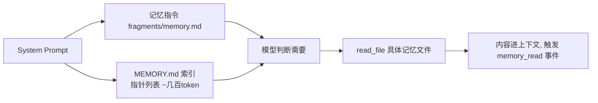

# 记忆系统：让 Agent 跨会话记住该记住的

> 记忆要回答三个工程问题：**写什么**（触发条件）、**放哪**（目录与格式）、**怎么召回**（渐进注入）。更隐蔽的第四个问题是**如何证明它工作**——本项目用可观测事件把"引导有没有生效"变成可量化指标。本篇走读 `services/memory.py` 与 `prompts/fragments/memory.md`。
> 对应代码：`services/memory.py`、`prompts/fragments/memory.md`、`services/permissions.py`（白名单）、`services/tracing.py`（memory_write/read 事件）。写于 2026-09-04。

## 目录

- [记忆问题的四问](#记忆问题的四问)
- [存储格式：一条记忆一个文件](#存储格式)
- [写入引导：触发条件与两步法](#写入引导)
- [召回：索引常驻，正文按需](#召回)
- [权限与限界](#权限与限界)
- [完整示例：一次纠偏如何变成记忆](#完整示例)
- [如何证明它在工作](#如何证明)
- [业界调研：共识、问题与方案](#业界调研)
- [当前实现的成熟度评估](#成熟度评估)
- [不足与进一步优化方向](#不足与优化方向)
- [附录 · 变更历史](#附录)

## 业界调研

### 记忆系统在 Agent 领域的定位

LLM 天生无状态，每次 API 调用从零开始。**Memory（记忆）** 是 Agent 跨越单次对话边界、持久化保存和召回信息的能力，让 Agent 从"无状态问答工具"进化为"有上下文感知的协作伙伴"。没有记忆的 Agent 永远是新手：每次都要重新了解用户偏好、重新踩同样的坑、重新探索代码库。

### 业界主流共识（以 Claude Code 为标杆，见 `cc源码调研/08-cc-记忆系统-v2.md`）

1. **只记不可推导的信息**：代码模式、git 历史、文件结构都是自描述的（Agent 实时读代码成本极低），记忆应专注保存"实时获取不到"的——用户偏好、决策背景、外部指针。
2. **闭合分类法而非自由标签**：CC 用 `user/feedback/project/reference` 四类型，每种有明确写入条件和正文结构；自由标签会导致标签膨胀（"preference"/"pref"/"user-pref" 指同一东西）。
3. **渐进式注入（索引常驻 + 正文按需）**：MEMORY.md 索引（≤200行/25KB）始终在 System Prompt，具体记忆文件按相关性动态加载。
4. **记忆是线索而非结论**：记忆是"时间点快照"，使用前必须验证当前状态（代码可能已重构）。

### 主要问题与解决方案

| 问题 | 表现 | 业界方案 |
|------|------|----------|
| 记忆从不写入 | 模型不知道何时该写 | 强制触发条件（mandatory triggers）+ 类型模板 |
| 写了不该写的 | 代码路径/对话细节污染索引 | "What NOT to save" 排除清单 |
| 索引无限膨胀 | 常驻成本失控 | 200行/25KB 双重截断 + 文件数上限 |
| 召回不准 | 关键词匹配漏掉语义相关记忆 | 轻量模型 sideQuery 语义选择 top 5 |
| 记忆与现实漂移 | 代码重构后记忆过期 | "记忆是线索"原则 + 只存不可推导信息 |
| 引导是否生效不可知 | 黑盒 | memory_write/read 可观测事件 |

### 记忆系统的两大流派（超越 CC 的全局视角）

业界对"Agent 长期记忆"有两种截然不同的实现哲学，本项目与 CC 走的是同一支，但另一支（MemGPT/Letta）提供了重要对照：

| 维度 | 文件式记忆（CC / 本项目） | 操作系统式记忆（MemGPT/Letta） |
|------|---------------------------|-------------------------------|
| **核心隐喻** | 记忆 = 磁盘上的 Markdown 文件，模型用 Write/Read 操作 | 记忆 = 操作系统的分层内存（RAM/磁盘），模型是"被操作系统调度的进程" |
| **分层结构** | MEMORY.md 索引 + 记忆文件（两级召回） | core memory（核心记忆，常驻）+ archival memory（归档记忆，按需检索）+ recall memory（召回记忆） |
| **上下文管理** | 靠压缩管线 L1-L5 让出空间 | 靠"虚拟上下文 + 内存分页"在窗口内外搬数据（virtual context management） |
| **写入方式** | 提示词引导模型显式 write_file | 自我编辑记忆（self-editing memory）——模型主动决定何时读写 |
| **召回方式** | 索引 description 语义匹配 / 模型自主 read_file | 归档记忆向量检索 + 分页调入核心记忆 |
| **核心洞见** | 只记不可从代码推导的信息 | 上下文窗口是**受限内存资源**，需要像 OS 一样调度 |

**MemGPT 的核心思想**（arXiv:2310.08560 "LLM as Operating Systems"）：不扩大模型窗口，而是借鉴操作系统的虚拟内存/分页机制——把不常用的信息从"核心记忆"换出到"归档记忆"，需要时再换入，让有限窗口表现得像更大。这与 CC/本项目的"渐进式压缩"是**两条路**：压缩是"丢弃/摘要"（不可逆或有损），分页是"换入换出"（信息仍在归档层，可找回）。

**CrewAI 的 memory 视角**：在 Crew 级别内置 short-term / long-term / entity 三类 memory，作为团队运行时能力（而非文件系统约定）。OpenAI Agents SDK 区分 `Sessions`（轮次间上下文持久化）与 `Agent memory`（sandbox agent 内的记忆），概念上与"会话状态 vs 长期记忆"的区分对应。

**本项目的选择**：采用 CC 的文件式（简单、可观测、对齐 memdir 约定），未采用 MemGPT 的操作系统式（复杂，但"记忆不丢失、可找回"的语义更强）。详见"优化方向"。

## 记忆问题的四问

每次新会话，模型对用户与项目一无所知。跨会话记忆的目标是让经验沉淀，但实现方式必须避免两个极端：**全塞进系统提示词**（token 爆炸 + 用不到的长期占预算）与**让模型自由发挥**（格式失控、无法召回）。本项目按"CC 的 memdir 约定"落地，核心决策是：

> 记忆 = 普通文件。写记忆用 write_file，读记忆用 read_file——不引入专用工具。

这个决策初看反直觉（"记忆不是应该有专门 API 吗"），但它让框架极简：不新增工具认知、模型本就熟练文件操作、权限与追踪都能按**路径**工作。代价是"什么时候该写"必须靠提示词引导（见 §写入引导），而引导是否有效，要靠观测（见 §如何证明）。

## 存储格式

```
.xiaoagent/memory/
├── MEMORY.md            # 索引：始终注入 System Prompt（≤200 行 / 25KB）
├── user_role.md         # 一条记忆 = 一个文件
└── merge_policy.md
```

```markdown
---
name: user-role
description: user is a data scientist focused on logging infra
type: user
---
User is a data scientist... (正文)
```

- **四种类型**（`MEMORY_TYPES = {user, feedback, project, reference}`）：给模型分类心智，让它知道"这条记哪类"——feedback 记纠偏、project 记不可从代码推导的决策等；
- **frontmatter 解析**是极简正则（`^---\n(.*?)\n---`，逐行 `k: v`），不是完整 YAML——够用且零依赖，坏文件在 `list_memories` 里被 try/except 跳过（一个坏文件不拖垮索引）；
- **一条一个文件**的理由：并发编辑不互相踩；`read_file` 按需加载天然细粒度；`description` 就是召回依据。

### frontmatter 解析的算法（为什么不用完整 YAML）

`_parse_frontmatter` 用极简正则而非 YAML 解析器：

```python
@staticmethod
def _parse_frontmatter(text: str) -> dict:
    match = re.match(r"^---\n(.*?)\n---", text, re.DOTALL)   # ① 匹配开头 --- ... ---
    if not match:
        return {}                                            # 无 frontmatter → 空
    meta = {}
    for line in match.group(1).strip().splitlines():         # ② 逐行解析
        if ":" in line:
            k, v = line.split(":", 1)                        # ③ 只 split 第一个冒号
            meta[k.strip()] = v.strip()
    return meta
```

**推导三个设计决策**：

1. **为什么是极简正则而非 `yaml.safe_load`**：记忆的 frontmatter 只需要 `name/description/type` 三个平铺的字符串字段，不需要嵌套、列表、多行值。引入 PyYAML 是为一个用不到 10% 特性的场景付依赖成本。正则 + 逐行 `k: v` 零依赖、够用、且**可预测**（不会因 YAML 的某个 edge case 解析失败）。

2. **为什么 `split(":", 1)`（限制为 1 次）**：description 可能含冒号（如 `description: user likes a:b notation`）。`split(":", 1)` 只在**第一个冒号**处切分，`k` 是字段名、`v` 是剩余全部（含冒号）。如果 `split(":")` 会切碎含冒号的值。

3. **为什么 `re.DOTALL` + `(.*?)` 非贪婪**：`re.DOTALL` 让 `.` 匹配换行，`(.*?)` 非贪婪匹配到**第一个** `---` 结束（frontmatter 的结束标记），而不是贪婪地吞到正文里某个可能的 `---`。这是"只取 frontmatter 不碰正文"的关键。

### 索引截断的算法（两级上限）

`get_index_content()` 读 MEMORY.md 并施加"行数 + 字节数"双重上限：

```python
lines = content.splitlines()
if len(lines) > MAX_INDEX_LINES:            # 200 行
    content = "\n".join(lines[:MAX_INDEX_LINES])
    content += f"\n\n[WARNING: MEMORY.md truncated at {MAX_INDEX_LINES} lines]"
if len(content.encode("utf-8")) > MAX_INDEX_BYTES:   # 25KB
    content = content[:MAX_INDEX_BYTES]
    content += "\n\n[WARNING: MEMORY.md truncated at 25KB]"
```

**推导为什么是"行数 + 字节数"双上限而非单一**：行数上限防"记忆条数过多"（200 条指针），字节数上限防"单条 description 过长"（一行就写了几百字）。两者截断的是**不同维度**——行数管"多少条"，字节数管"每条多长"。先按行截（保结构完整），再按字节截（保总成本可控）。

**为什么截断后要附 `[WARNING]` 而非静默**：静默截断会让模型"以为索引就是全部"——它不知道有 300 条记忆只看到了 200 条。WARNING 明示"还有被截掉的部分"，模型可以按需用 `read_file` 直接读具体记忆文件绕过索引。这是"压缩不得欺骗模型认知"原则的又一体现（同 05 文档 L2 snip 的占位符）。

### 路径判定的算法（防逃逸）

`is_memory_path()` 判定一个写入路径是否落在记忆目录内（权限白名单用）：

```python
def is_memory_path(self, file_path: str) -> bool:
    p = Path(file_path)
    if not p.is_absolute():
        p = state.WORKDIR / p               # 相对路径基于 WORKDIR 解析
    resolved = p.resolve()
    return resolved.is_relative_to(self.memory_dir.resolve())
```

**推导关键点**：

1. **为什么相对路径基于 `WORKDIR` 而非进程 `cwd`**：两者在正常启动时相等，但语义上"文件操作相对于工作目录"才是正确约定（与 `utils.path.safe_path` 一致）。用 WORKDIR 避免"进程 cwd 被意外改变后路径判定错位"。

2. **为什么必须 `resolve()` 再 `is_relative_to()`**：`resolve()` 把 `..`、符号链接、相对路径全部归一化为绝对规范路径。否则 `"../memory/x.md"` 这种写法——字符串层面看 `../` 不在记忆目录内，但 `resolve()` 后可能恰好在记忆目录内（或反之）。**`resolve` 是防 `../` 逃逸伪装的核心**：先归一化再判断包含关系，堵死"用相对路径绕过白名单"的洞。

3. **为什么捕获 `(ValueError, OSError)`**：`resolve()` 在路径含非法字符或文件系统异常时可能抛错，此时返回 `False`（默认不放行白名单），宁可让权限系统走普通确认流程。

## 写入引导

`prompts/fragments/memory.md` 定义了**强制触发条件**（不是建议，是 MUST）：

```markdown
## When to Write (mandatory triggers)
Do NOT wait to be asked — you MUST save a memory when any of these occurs:
- Task completed: 记录关键成果/非显然决策/遗留问题  (type: project)
- User states a preference: 语气/格式/工作流规则  (type: feedback)
- Important decision made: 方案选择与理由        (type: project)
- User corrects you: 记下纠偏与原因，别再犯        (type: feedback)
When in doubt whether to save — save it. Saving is cheap; re-learning is expensive.
```

配套的"两步法"与"什么不该记"：

```markdown
Step 1: write_file 写记忆文件（带 frontmatter）
Step 2: 在 MEMORY.md 加一行 `- [Title](file.md) — one-line hook`

What NOT to save: 代码可推导的模式/架构；git 历史；CLAUDE.md 已有内容；
本次会话的临时细节（该用 tasks）；调试解法（修复已在代码里）
```

设计要点：**触发条件给场景 + 类型 + 结构模板**（feedback 的 structure 甚至规定 `rule → Why: → How to apply:`），这是给 LLM 的"可执行规范"而不是散文——提示词工程通用手段（见 00 文档）。"What NOT to save"同样重要：不加约束，模型会把代码路径和对话细节都存进来，污染索引。

## 召回



- **索引常驻**：`get_prompt_section()` 在动态区注入（见 00 文档）：fragments 指令（`{{memory_dir}}` 替换为真实绝对路径）+ `## Current Memory Index` 追加 MEMORY.md 内容（为空时明确写 `(empty — no memories saved yet)`——空提示比不存在更能防模型困惑）；
- **正文按需**：模型靠索引里的 description 决定读哪个文件——这是"两级召回"：第一级是索引（几百 token 常驻），第二级是全文（按需加载）；
- 索引超限自动截断并附警告（200 行或 25KB），保证常驻成本可控。

### 两级召回的成本推导

为什么"索引常驻 + 正文按需"优于"全量常驻"或"全量不驻"？用一个成本模型：

```
设：N 条记忆，每条正文 ~200 token，每条索引指针（description 一行）~15 token

方案 A：全量常驻（所有记忆正文塞进 System Prompt）
  成本 = N * 200 token，每轮都付，无论用不用得到
  N=50 时：10000 token 常驻成本（每轮！）

方案 B：全量不驻（记忆只存磁盘，不注入任何东西）
  成本 = 0，但模型根本不知道有这些记忆 → 永远不会想起 → 记忆失效

方案 C（本项目）：索引常驻 + 正文按需
  常驻成本 = N * 15 token（只有指针）
  按需成本 = k * 200 token（k = 实际读了几条，通常 1~3 条）
  N=50 时：常驻 750 token + 按需 200~600 token
```

**方案 C 的优势**：常驻成本从 `N*200` 降到 `N*15`（约 1/13），而按需加载只在实际需要时付出——因为**绝大多数会话根本不需要全部记忆**，只有少数相关的那几条值得读全文。这就是"渐进式披露"在记忆上的应用：**用一层便宜的指针换取"知道有什么"，把贵的全文推迟到"确定要用"**。

`get_prompt_section()` 的装配算法：

```python
def get_prompt_section(self):
    self.ensure_dir()
    instructions = load_prompt("fragments/memory.md").replace(
        "{{memory_dir}}", str(self.memory_dir))     # ① 替换为绝对路径
    index_content = self.get_index_content()
    if index_content:
        instructions += f"\n\n## Current Memory Index\n\n{index_content}"
    else:
        instructions += f"\n\n## Current Memory Index\n\n(empty — no memories saved yet)"
    return instructions
```

**推导 `{{memory_dir}}` 必须替换为绝对路径**：fragments/memory.md 里的指令会告诉模型"把记忆写到 `{{memory_dir}}`"，但这个占位符对模型无意义——它需要知道真实路径（如 `C:\Users\...\proj\.xiaoagent\memory`）才能用 `write_file` 写过去。替换为绝对路径是"指令从模板变成可执行"的关键一步。

**推导"空索引也显式写 `(empty)`"**：如果不写，动态区就完全没有"记忆索引"这个段落，模型可能困惑"我有没有记忆系统？"。显式写 `(empty — no memories saved yet)` 让模型明确知道"记忆系统启用了，但还没有内容"，避免它去猜。这是"显式优于隐式"的提示词原则。

## 权限与限界

| 机制 | 内容 |
|------|------|
| 编辑白名单 | `permissions.py` 检查 `is_memory_path`：记忆目录内写/读直接 allow，不弹确认（自家后院自由出入） |
| 路径判定 | 相对路径基于 WORKDIR 解析后 `resolve()` 再 `is_relative_to(memory_dir)`——与 safe_path 同语义，防 `../` 逃逸伪装 |
| 数量上限 | 单文件总数 ≤200（防失控膨胀） |
| 文件落点 | `.xiaoagent/memory/`（随项目走，不污染工作区） |

## 完整示例

场景：用户说"以后给回复别用 markdown 表格"。这是 feedback 类触发（用户表达偏好），模型应当走：

**第 1 步：写记忆文件**

```
模型调用 write_file(file_path=".xiaoagent/memory/no_md_tables.md", content="""---
name: no-markdown-tables
description: user dislikes markdown tables in replies; use plain text or lists
type: feedback
---
Avoid markdown tables when replying to this user.

Why: user explicitly said they find tables noisy in chat.
How to apply: prefer plain lists / prose for structured answers.""")
```

**第 2 步：更新索引**

```
模型调用 edit_file(file_path=".xiaoagent/memory/MEMORY.md", old_string=..., new_string=...)
→ 追加一行: - [no-markdown-tables](no_markdown_tables.md) — 回复别用 md 表格
```

**第 3 步：可观测**——session trace 里出现：

```json
{"event":"tool_call","tool":"write_file","path":".xiaoagent/memory/no_md_tables.md",...}
{"event":"memory_write","tool":"write_file","path":".xiaoagent/memory/no_md_tables.md",...}
```

`memory_write` 事件是 `_trace_tool` 检测到"写入路径落在记忆目录"时打的——这就是"引导是否生效"的硬指标。几小时后新会话里，模型读到 MEMORY.md 索引这行，选择 read_file 拉全文，又触发 `memory_read`——闭环成立。

## 如何证明

`/stats` 与 session trace 提供三类指标：`memory_write` 数量（该写时真写了）、`memory_read` 数量（写了之后被想起）、两者长期为 0 时排查方向（fragments 是否被覆盖、frontmatter 解析是否失败、记忆目录路径是否错位）。

## 成熟度评估

对照业界共识与 CC 能力，逐条评估：

| 能力 | 本项目 | 成熟度 |
|------|--------|--------|
| 闭合四类型 + frontmatter | ✅ user/feedback/project/reference | 高（完全对齐 CC） |
| 只存不可推导信息 | ✅ fragments/memory.md 的 What NOT to save | 高 |
| 索引常驻 + 正文按需 | ✅ MEMORY.md 索引 + read_file 按需 | 高 |
| 索引双重截断 | ✅ 200行/25KB | 高（对齐 CC） |
| 强制触发条件 + 结构模板 | ✅ mandatory triggers + Rule/Why/How | 高 |
| 权限白名单 | ✅ is_memory_path → allow | 高 |
| 可观测（write/read 事件） | ✅ memory_write/read 埋点 | 高 |
| 语义召回（sideQuery） | ❌ 无，靠模型自主 read_file | 低 |
| 后台自动提取 | ❌ 无，纯靠主 Agent 显式写 | 低 |
| Session/Agent/Auto Dream | ❌ 均无 | - |

**总体判断**：核心"存储格式 + 写入引导 + 两级召回 + 权限 + 可观测"已完成且对齐 CC，是成熟度较高的模块；差距在"召回智能化"（无 sideQuery 语义选择）与"写入自动化"（无后台提取）两个方向。

## 不足与优化方向

1. **召回依赖模型自觉**：当前正文召回靠模型"看到索引 description 后主动 read_file"，没有 CC 的 `selectRelevantMemories` 语义选择。当索引长、任务相关性不明显时，模型可能不读或读错。可引入"轻量 sideQuery 用模型选 top N 相关记忆"（CC 用 Sonnet，本项目可用 flash 降成本），在用户查询时自动注入相关记忆。

2. **写入完全依赖主 Agent 显式动作**：如果模型某轮"忘了"触发强制条件，记忆就漏写。CC 用 `extractMemories` 后台 forked agent 在对话结束时 fire-and-forget 萃取，作为显式写入的兜底。这是本项目记忆"完整性"最大的短板。

3. **无记忆巩固机制**：长时间使用后，feedback 类记忆会积累大量相似条目（如"不要表格"和"少用表格"重复）。CC 的 Auto Dream 定期合并冗余。本项目缺这一层，可先做"用户手动 /dream"而非全自动。

4. **无会话级记忆**：长对话压缩后，正在做的工作状态（"正在重构第 3 步"）会被摘要化。CC 有 Session Memory（10 段模板）在 compact 时保留。本项目靠 L5 摘要的 "Current Work" 章节近似覆盖，但没有结构化模板。

5. **缺 `DIR_EXISTS_GUIDANCE` 类优化**：CC 观察到模型写记忆前浪费 turn 去 `ls/mkdir -p`，于是在 prompt 里声明"目录已存在，直接写"。本项目的 `ensure_dir()` 在代码层建目录，但 prompt 没显式告知，模型可能仍浪费轮次检查。

6. **未探索 MemGPT 式"记忆不丢失"语义**：当前记忆随索引截断/文件覆盖存在信息丢失风险（截断的索引项只能靠 read_file 绕过，无结构化归档）。MemGPT 的"归档记忆 + 分页召回"保证信息可找回。作为长期方向，可在文件式基础上加一层"归档记忆"（低频记忆自动降级到归档区 + 向量检索召回），兼顾简单与不丢失。

## 附录

### 变更历史

| 遇到的问题 / bug | 问题分析 | 解决方法 | 时间 |
|------------------|----------|----------|------|
| 记忆从不写入 | 无触发规则，模型不知道何时该写 | fragments/memory.md 强制触发条件 + 类型 + 模板 | 09-01 |
| 写了不该写的（代码路径/对话细节） | 只有"When to write"没有"What NOT" | 加 What NOT to save 清单 | 09-01 |
| 索引无限膨胀 | 无上限 | 200 行/25KB 截断 + 警告 | 09-01 |
| 无法确认引导生效 | 黑盒 | memory_write/read 事件埋点 + /stats | 09-01 |
| 记忆目录编辑被权限拦 | 不在白名单 | is_memory_path → allow | 09-01 |
| 单文件解析损坏影响整体 | 坏 frontmatter 炸遍历 | list_memories try/except 跳过 | 09-01 |
| 用户/项目想改记忆规则需改代码 | 规则硬编码在代码 | fragments 三级覆盖（覆盖 memory.md 即可） | 09-01 |
