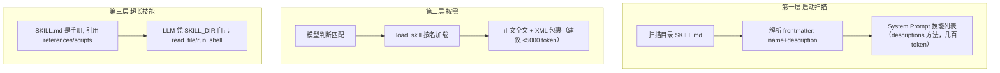
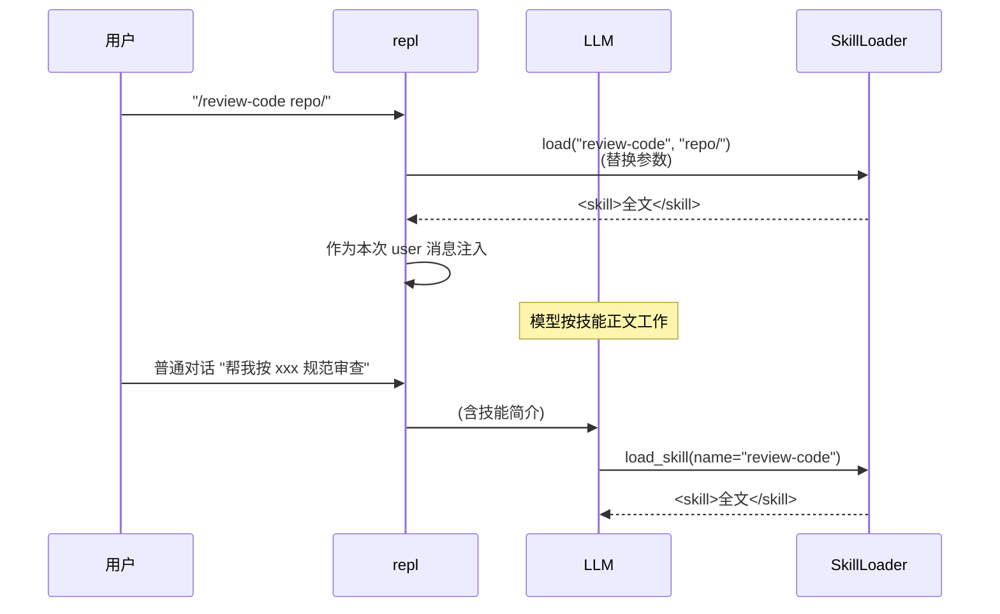

# 技能系统：渐进式披露的 Agent Skills

> 技能（skill）回答一个具体问题：**如何让模型"按专家流程做事"而不烧 token**。解法是"指令文档化 + 渐进披露"：启动只给简介，用到才加载全文，超大技能还能自我组织为"手册 + 引用资源"。本篇走读 `skills/loader.py`、`tools/SkillTool.py`、REPL 斜杠入口与规范兼容策略。
> 对应代码：`skills/loader.py`、`tools/SkillTool.py`、`ui/repl.py`（斜杠）、`prompts/fragments/skills.md`。规范依据 https://agentskills.io/specification 。写于 2026-09-04。

## 目录

- [技能与工具/记忆的区别](#技能与工具的区别)
- [三层渐进披露](#三层渐进披露)
- [规范兼容：必填校验 + 可选宽容](#规范兼容)
- [扫描与多级来源](#扫描与多级来源)
- [加载与参数替换](#加载与参数替换)
- [两种触发入口](#两种触发入口)
- [治理与安全](#治理与安全)
- [完整示例：安装并调用一个外部技能](#完整示例)
- [业界调研：共识、问题与方案](#业界调研)
- [当前实现的成熟度评估](#成熟度评估)
- [不足与进一步优化方向](#不足与优化方向)
- [附录 · 变更历史](#附录)

## 业界调研

### 技能系统在 Agent 领域的定位

技能（skill）回答一个具体问题：**如何让模型"按专家流程做事"而不烧 token**。它不新增"能力"（那是工具的职责），注入的是**领域的操作规范**（何时查什么、先做什么、输出长什么样）。CC 对 Skill 的定义很精辟：**"指导 Agent 如何思考和行动的专家知识模板"**——它是 prompt 模板 + 元数据 + 执行上下文的组合，通过 SkillTool 桥接融入工具流水线，同时保持 Markdown 定义的低门槛。

### 业界主流共识（以 Claude Code 为标杆，见 `cc源码调研/05-cc-skills集成-v2.md`）

1. **渐进式披露**：启动只加载 frontmatter（name + description + whenToUse），正文调用时才读。CC 的 System Prompt 只放约 1% 上下文预算（≈8KB/200K 窗口）。
2. **双入口调用**：斜杠命令（用户明确指定）+ Skill 工具（LLM 判断自动匹配），两条路径汇合到同一 `getPromptForCommand`。
3. **Markdown-as-Config**：SKILL.md = YAML frontmatter + Markdown 正文，零门槛、人类可读、Git diff 清晰。
4. **多层来源 + 优先级覆盖**：CC 有 6 层（managed > user > project > additional > bundled > legacy），高优先级覆盖低优先级。

### 主要问题与解决方案

| 问题 | 表现 | 业界方案 |
|------|------|----------|
| 技能越多 prompt 越大 | 挤占对话上下文 | 三阶段预算分配（全量→截断→仅名称） |
| 坏技能拖垮技能表 | 单个解析失败影响全部 | 必填校验失败即跳过 |
| 技能无法接收参数 | 静态模板无法适配任务 | `$ARGUMENTS/$ARG_N` 位置参数替换 |
| 技能需定位自己的资源 | 引用的模板/脚本路径未知 | `${SKILL_DIR}` 环境变量替换 |
| 超大技能挤爆单次加载 | 语料库/脚本集过大 | 第三层披露：SKILL.md 引用 references/scripts |
| 技能要执行命令 | 静态 prompt 无法动态取值 | Shell 内联 `` !`command` ``（CC，MCP 技能禁用） |

**CC 比本项目多出的高级能力**（供参考）：条件激活（`paths` glob 匹配文件路径才显示技能）、Fork 上下文隔离（`context: fork` 在独立子 Agent 执行）、安全属性白名单（`SAFE_SKILL_PROPERTIES` 前向兼容）、压缩后技能恢复。

## 技能与工具的区别

| | 工具 tool | 技能 skill | 记忆 memory |
|---|-----------|-----------|-------------|
| 本质 | 可执行 handler | 指令文档 SKILL.md | 事实/偏好文件 |
| 模型接触 | 每轮可见 schema | 启动见简介，按需全文 | 索引常驻、正文按需 |
| 作用 | 能做事 | 按专家流程做事 | 记住上下文 |

技能不新增"能力"，它注入的是**领域的操作规范**（何时查什么、先做什么后做什么、输出长什么样）。这个定位决定它必须与上下文成本做交易——于是有了渐进披露。

## 三层渐进披露



第一层控制常驻成本（几十个技能也只几百 token）；第二层"用到才贵"；第三层让超大技能（语料库、脚本集）不挤爆单次加载——SKILL.md 负责"怎么用"，`references/`/`scripts/` 按需自取。第三层是规范里的关键约定：**框架不需要认识技能内部结构**，LLM 靠 `${SKILL_DIR}` 展开一切。

### 渐进披露的成本推导

与 06 记忆的两级召回同构，但多一层（第三层）。用成本模型对比：

```
设：S 个技能，每个 SKILL.md 正文 ~3000 token，简介 ~15 token

方案 A：全量常驻（所有技能正文进 System Prompt）
  成本 = S * 3000 token，每轮都付
  S=10 时：30000 token 常驻 —— 直接吃掉大半窗口，不可接受

方案 B（本项目）：三层渐进披露
  第一层常驻 = S * 15 token（简介列表）
  第二层按需 = 1 * 3000 token（用到的那个技能全文）
  第三层按需 = 超大技能按 ${SKILL_DIR} 自取 references/scripts
  S=10 时：常驻 150 token + 按需 3000 token
```

**关键洞察**：技能正文动辄几千 token，但一个会话通常只用 0~1 个技能。全量常驻是为"几乎不会用到的 9 个技能"持续付费；渐进披露只在"确定要用"时才付那一个技能的钱。**第三层是规范里最巧的设计**——它让"技能"这个抽象从"一份 SKILL.md"扩展成"一个目录 + 任意资源"，而框架完全不需要知道技能内部结构：`${SKILL_DIR}` 展开成目录路径后，LLM 用现成的 `read_file`/`run_shell` 自己去读 `references/`、跑 `scripts/`。框架的复杂度没有随技能复杂度增长。

## 规范兼容

兼容策略是"**必填校验 + 可选宽容**"：

```python
MAX_NAME_CHARS = 64
_NAME_PATTERN = re.compile(r"^[a-z0-9]+(-[a-z0-9]+)*$")   # 小写字母数字连字符

def _is_valid(meta, name):
    if not (1 <= len(name) <= 64) or not _NAME_PATTERN.match(name): return False
    desc = meta.get("description", "")
    if not desc or len(desc) > 1024: return False
    return True
```

- **必填**：name 合法 + description 非空——不合规的技能**跳过**加载（坏文件不拖垮技能表）；
- **可选**：license/compatibility/metadata/allowed-tools 等一律不校验，原样保留进 meta——开源生态的技能常带这些字段，校验它们只会制造"装不上"；
- 为什么 name 强制小写连字符？规范如此，且它是斜杠命令的合法字符集（避免把 `/\` 等带进命令解析）。

### 规范校验的算法（必填校验 + 可选宽容）

`_is_valid` 精确回答"一个技能文件能不能被注册"：

```python
MAX_NAME_CHARS = 64
_NAME_PATTERN = re.compile(r"^[a-z0-9]+(-[a-z0-9]+)*$")   # 小写字母数字连字符

def _is_valid(meta, name):
    if not (1 <= len(name) <= 64) or not _NAME_PATTERN.match(name):
        return False
    desc = meta.get("description", "")
    if not desc or len(desc) > 1024:
        return False
    return True
```

**推导 name 正则 `^[a-z0-9]+(-[a-z0-9]+)*$`**：

- `[a-z0-9]+` 开头必须有至少一个字母/数字；
- `(-[a-z0-9]+)*` 后续零个或多个 `-单词` 段（连字符不能连续、不能在开头/结尾）；
- 全小写，不含 `/`、`\`、空格、下划线、大写。

为什么这么严格？**name 是斜杠命令的合法字符集**——`/huchenfeng-perspective` 里的 `huchenfeng-perspective` 必须能安全地解析为命令名。如果 name 含 `/`（如 `foo/bar`），斜杠命令 `/foo/bar args` 会被解析混乱。强制小写连字符从源头保证"name 可直接作为斜杠命令使用"。这也是为什么 `_NAME_PATTERN` 是"必填校验"而非"可选"——它关系到命令解析的正确性。

**推导"可选字段宽容"的边界**：license、compatibility、metadata、allowed-tools 等字段**不校验、不报错、原样进 meta**。因为开源生态的技能常带这些字段，且它们的合法取值千变万化（license 可能是 SPDX 标识、可能是一段文字）。校验它们 = 制造"这个开源技能装不上"的假阳性。必填项（name/description）是"能用"的下限，可选字段是"增强信息"，框架不该替技能作者决定增强信息的格式。

### 扫描与重名去重的算法

`__init__` 的扫描逻辑，重点在**重名去重**：

```python
def __init__(self, *skill_dirs):
    self.skills = {}
    for skills_dir in skill_dirs:                    # ① 多目录，先扫描者优先
        if not skills_dir.exists():
            continue
        for f in sorted(skills_dir.rglob("SKILL.md")):   # ② rglob 递归找 SKILL.md
            meta, body = self._parse_frontmatter(f.read_text(...))
            name = meta.get("name", f.parent.name)   # ③ name 缺省取目录名
            if not self._is_valid(meta, name):
                continue                              # ④ 不合规跳过
            if name not in self.skills:               # ⑤ 重名先到先得
                self.skills[name] = {...}
```

**推导五个关键点**：

1. **`rglob("SKILL.md")` 而非 `glob`**：`rglob` 递归所有子目录，支持"技能仓库"——一个目录里嵌多个技能子目录（每个子目录一个 SKILL.md）。`glob` 只扫一层，会漏掉嵌套技能。

2. **`sorted()` 保证扫描顺序确定**：文件系统遍历顺序不稳定（依赖 inode 顺序），`sorted()` 让重名冲突时"谁胜出"可复现——这在多目录来源时尤其重要（同一个 name 在不同目录出现时，胜出者必须确定）。

3. **`name` 缺省取目录名 `f.parent.name`**：规范允许 name 写在 frontmatter 里，也允许省略（默认用技能目录名）。这兼容"技能目录名即技能名"的常见实践。

4. **重名"先到先得"（`if name not in self.skills`）**：先扫描的目录优先级高（`skill_dirs` 参数顺序即优先级），同名技能后扫描的被丢弃。这对应"项目级 > 项目配置级 > 用户级"的优先级——项目级技能优先于同名用户级技能。

5. **不合规技能跳过而非报错**：一个坏 SKILL.md（name 非法/description 空）只跳过自己，不影响其他技能。这对应"坏文件不拖垮技能表"的容错原则。

## 扫描与多级来源

```python
def __init__(self, *skill_dirs):   # 多目录，先扫描优先
    for skills_dir in skill_dirs:
        for f in sorted(skills_dir.rglob("SKILL.md")):
            meta, body = parse_frontmatter(...)
            if not self._is_valid(meta, name): continue
            if name not in self.skills:           # 重名先到先得
                self.skills[name] = {"meta","body","path","skill_dir": str(f.parent)}
```

来源优先级（对齐 cc）：项目级 `{workdir}/skills/` > 项目配置级 `{workdir}/.xiaoagent/skills/` > 用户级 `~/.xiaoagent/skills/` > 仓库内置（实际装配顺序以 `main.py` 传入为准）。目录里嵌目录也没关系：`rglob("SKILL.md")` 支持"技能仓库"（一个目录装多个技能）。

## 加载与参数替换

`SkillLoader.load(name, arguments)` 的核心：

```python
content = skill["body"]
if arguments:
    content = content.replace("$ARGUMENTS", arguments)
    for i, arg in enumerate(arguments.split(), 1):
        content = content.replace(f"$ARG_{i}", arg)
content = content.replace("${SKILL_DIR}", skill["skill_dir"])
return f'<skill name="{name}">\n{content}\n</skill>'
```

### 参数替换的算法步骤

`load(name, arguments)` 的完整流程，逐步推导：

```text
步骤 1  查名：skill = self.skills.get(name)
        未命中 → 返回 "Error: Unknown skill 'name'. Available: a, b, c"

步骤 2  参数替换（仅当 arguments 非空）：
        ① content.replace("$ARGUMENTS", arguments)   # 整体参数
        ② args_list = arguments.split()              # 按空白拆分
           for i, arg in enumerate(args_list, 1):
               content.replace(f"$ARG_{i}", arg)      # $ARG_1, $ARG_2, ...

步骤 3  目录替换（无条件）：
        content.replace("${SKILL_DIR}", skill["skill_dir"])

步骤 4  XML 包裹：
        return f'<skill name="{name}">\n{content}\n</skill>'
```

**推导三个细节**：

1. **为什么 `$ARGUMENTS` 和 `$ARG_N` 分开替换，且先替换 `$ARGUMENTS`**：`$ARGUMENTS` 是"全部参数原样"，`$ARG_N` 是"第 N 个参数"。两者用途不同——技能作者可能想要完整字符串（如传给脚本），也可能想要拆分后的单个参数（如文件名、路径）。**先替换 `$ARGUMENTS` 再替换 `$ARG_N`** 的顺序很关键：因为 `arguments` 本身可能含 `$ARG_1` 字样的文本（极端情况），如果先替换 `$ARG_1` 再替换 `$ARGUMENTS`，会把刚替换进去的内容再污染一次。先 `$ARGUMENTS` 后 `$ARG_N` 避免这个（理论上的）自污染。

2. **为什么 `arguments.split()`（任意空白）而非只按空格**：用户传参可能是 `"file.py --flag value"`，也可能含 tab 或换行。`split()` 无参数时按**任意连续空白**拆分，比 `split(" ")` 更健壮（连续多个空格不会产生空串元素）。

3. **`${SKILL_DIR}` 为什么无条件替换**：即使没有传参数，技能正文也可能引用 `${SKILL_DIR}` 来定位自己的 `references/`、`scripts/`。所以目录替换**不放在 `if arguments` 内**，而是始终执行——这是第三层披露的物理基础：技能正文里写 `read ${SKILL_DIR}/references/xxx.md`，加载后变成 `read C:\...\skill_dir\references\xxx.md`。

### XML 包裹的作用

返回带 `<skill name="...">...</skill>` 包裹，而非裸文本。三个作用：

1. **边界标记**：模型在长上下文里能清晰识别"这一段是注入的技能，不是对话/工具结果"——降噪；
2. **压缩恢复的锚点**：05 文档的压缩后技能恢复（`POST_COMPACT_SKILLS_BUDGET`）能按 `<skill>` 边界精确抓取技能内容回填，而不是模糊截取；
3. **参数自证**：`name="..."` 让模型知道"我当前加载的是哪个技能"，避免多技能加载时的身份混淆。

### 缺参的处理哲学

参数**不存在时不报错**：skill 里写了 `$ARG_5` 但用户只给了 3 个参数，`replace("$ARG_5", ...)` 不命中就原样留着（`$ARG_5` 字面量残留在正文里）。为什么不像函数调用那样报"缺参数"？因为**技能是自包含文档，不是函数**——缺参怎么兜底（用默认值？提示用户？报错？）是技能作者的领域知识，应该由技能正文教模型处理，而非框架强行规定。框架只负责"把有的参数替换进去"，不替技能作者做领域决策。

`SkillTool.handle` 是薄壳：调 `state.skills.load(name, args)`，`Error: Unknown skill ...` 转成 `ToolResult.failure(error="unknown_skill")`——模型拿到的错误里会列出可用技能名（`Available: a, b, c`），等于现场提示"你是不是记错名了"。

## 两种触发入口



- **斜杠入口**（用户主动，`ui/repl.py`）：`/{name} [args]` → 直接加载全文并替换本次 query。为什么要有它？模型自主调用有时"想不起来"或判断保守，用户想"强制用这个技能"时就该有一条不需要模型点头的路。repl 只处理**已注册**的技能名（`state.skills.skills`），未知斜杠原样交给 LLM（不误伤 `/xxx` 写法）；
- **自然入口**（模型主动）：System Prompt 里的 `Available skills:` 列表 + `fragments/skills.md` 说明（"描述匹配当前任务时 load_skill"）驱动模型判断。技能列表放系统提示词而不是工具参数，是刻意选择：列表是"可选项清单"，模型应先扫一眼清单再决定。

两个入口都触发 `skill_load` 追踪事件，`invoked_via=slash/tool` 区分"用户点开"与"模型想起"。

### 双入口的算法差异（模拟交互）

设有一个技能 `review-code`，正文引用 `$ARGUMENTS` 和 `${SKILL_DIR}`。两个入口的完整流转对比：

**入口一：斜杠（用户强制，绕过模型判断）**

```
用户输入：/review-code src/api/

repl 流程（ui/repl.py）：
  1. 解析出 skill_name="review-code", args="src/api/"
  2. if "review-code" in state.skills.skills:      # 已注册才处理
       content = state.skills.load("review-code", "src/api/")
       # load 内部：$ARGUMENTS → "src/api/", ${SKILL_DIR} → "C:\...\review-code\"
       query = "<skill name=\"review-code\">\n...含 src/api/ 的正文...\n</skill>"
  3. 记录 skill_load 事件（invoked_via="slash"）
  4. 把 query 作为本次 user 消息发给 LLM

（模型直接收到技能全文，按正文流程工作，无需"判断要不要用"）
```

**入口二：自然（模型主动，经判断）**

```
用户输入：帮我审查一下 src/api/ 的代码质量

流程：
  1. System Prompt 里有 "Available skills:\n  - review-code: 代码审查流程"
  2. 模型看到任务与 review-code 的 description 匹配
  3. 模型调用工具 load_skill(name="review-code", args="src/api/")
  4. SkillTool.handle → state.skills.load(...) → 返回 <skill>全文</skill>
  5. 记录 skill_load 事件（invoked_via="tool"）
  6. 模型读到技能全文，按正文流程工作
```

**推导两个入口的本质区别**：

- **斜杠入口是"用户意图的直接表达"**：用户明确说"用这个技能"，框架不需要模型"想起"或"判断"，直接加载全文注入。这解决了"模型自主调用有时想不起来或判断保守"的问题——给用户一条**不需要模型点头的路**。

- **自然入口是"模型的自主决策"**：模型看到 description 后自己判断"这个技能匹配当前任务"，再主动 `load_skill`。这是渐进披露的完整闭环：第一层（简介）让模型"知道有这个技能"，第二层（全文）由模型"按需拉取"。

**为什么 repl 只处理"已注册"的技能名**：`if skill_name in state.skills.skills` 是关键门控——未知斜杠（如 `/foo` 不是技能）不拦截，原样交给 LLM 处理（LLM 可能把它当普通指令）。这避免"斜杠命令系统"与"用户想写 `/xxx` 但非技能"冲突。

**可观测的意义**：两个入口都打 `skill_load`，但 `invoked_via` 不同。这带来一个分析能力——统计"用户主动点开的技能" vs "模型自己想起的技能"的比例，能回答"技能的 description 写得好不好"（如果某个技能总是被斜杠点开而从不被模型想起，说明它的 description 不够吸引模型、或触发词不明确）。

## 治理与安全

- `load_skill` 属只读工具，任何权限模式放行；
- **加载 ≠ 执行**：技能目录可带 `scripts/`，但执行脚本仍须模型显式 `run_shell`——危险检测与自杀护栏照常生效。防护不因"内容来自外部技能"而降级；
- 安装约定（`fragments/skills.md`）：用户级装 `~/.xiaoagent/skills/`，项目级装 `{workdir}/skills/`；装完**重启会话生效**（技能在启动时扫描）；
- 描述列表在 System Prompt 注入时截断到 `skill_description_max_chars`（默认 250），防一个话痨技能霸屏。

## 完整示例

安装调用一个真实外部技能（户晨风视角技能 `huchenfeng-perspective`，2026-09-03 实测路径）：

**安装**（模型自行下载审查后放入）：

```
模型: run_shell 检查仓库是标准 SKILL.md 结构 → read_file 审阅 SKILL.md 与 tools/*.py
     （无网络外联、无危险操作）→ 复制到 ~/.xiaoagent/skills/huchenfeng-perspective/
模型: "将在下次启动会话后生效"（skills 启动时扫描）
```

**调用（斜杠，用户强制）**：

```text
coding-agent >> /huchenfeng-perspective 安卓手机太好用了，你觉得呢
```
repl 把参数注入 `$ARGUMENTS`，正文全文（约 13K 字符：角色规则 + 99 条带日期语录）作为本次消息；模型按正文剧本工作（先连环查户口 → 苹果人/安卓人定性 → 反问句式回答）。

**调用（自然，模型想起）**：下次对话提到触发词，模型看到 `Available skills:` 里有 `huchenfeng-perspective: 户晨风视角：以"购买力挑战"…` 后自行 `load_skill`。

**可观测**：两次调用都留下 `skill_load` 事件；用户能看到本次是 `invoked_via=slash` 还是 `tool`——技能到底是被"点开"还是"想起"，变成可分析数据。

## 成熟度评估

对照业界共识与 CC 能力，逐条评估：

| 能力 | 本项目 | 成熟度 |
|------|--------|--------|
| 三层渐进披露 | ✅ 简介列表 → load_skill 全文 → ${SKILL_DIR} 自取 | 高 |
| 双入口调用 | ✅ 斜杠 + load_skill 工具，invoked_via 区分 | 高 |
| Markdown-as-Config | ✅ SKILL.md = frontmatter + body | 高 |
| 多级来源 + 优先级 | ✅ 项目 > 项目配置 > 用户（3 层） | 中（CC 有 6 层） |
| 必填校验 + 可选宽容 | ✅ name 正则 + description，可选字段忽略 | 高 |
| 参数替换 | ✅ $ARGUMENTS/$ARG_N/${SKILL_DIR} | 中（CC 另有命名参数、Shell 内联、无占位符追加） |
| 条件激活（paths） | ❌ 无 | 低 |
| Fork 上下文隔离 | ❌ 无（技能全 inline 注入主对话） | 低 |
| 安全属性白名单 | ❌ 无（靠权限层的 load_skill 只读放行） | 低 |
| 压缩后技能恢复 | ⚠️ 有 POST_COMPACT_SKILLS_BUDGET 预算，但非 CC 的 addInvokedSkill 记录机制 | 中 |

**总体判断**：核心"渐进披露 + 双入口 + 参数替换 + 规范兼容"已完成且对齐 CC，成熟度较高；差距在"条件激活""Fork 隔离""Shell 内联""安全白名单"四个方向（均为 CC 的高级特性）。

## 不足与优化方向

1. **无条件激活（paths）**：所有技能始终出现在 `Available skills` 列表，即使与当前任务无关。CC 的 `paths` 让技能只在匹配文件路径时激活（Monorepo 里后端开发者看不到 React 技能）。技能多时，条件激活能显著减少选择负担与 prompt 体积。

2. **无 Fork 上下文隔离**：技能全文注入主对话，若技能涉及大量工具调用（如"批量审查整个仓库"）会污染主上下文。CC 的 `context: fork` 让技能在独立子 Agent 执行（独立 token 预算 + 独立工具池）。这是超大技能场景下的关键能力。

3. **无 Shell 内联**：技能正文无法在加载时动态获取环境（如 `!`git branch --show-current``）。当前只能靠 `${SKILL_DIR}` 静态替换，动态环境信息需要模型自己调 run_shell。可补一个受限的 Shell 内联（带超时 + MCP 技能禁用）。

4. **安全白名单缺失**：`load_skill` 一律只读放行，但技能正文若声明 `allowed-tools: [Bash]` 或 `hooks`，CC 会要求用户确认（SAFE_SKILL_PROPERTIES 前向兼容）。本项目对技能内容完全不设信任分级——一个恶意技能可以诱导模型执行任意命令（虽受权限层拦截，但少了一道"来源信任分级"）。

5. **压缩后技能恢复机制弱**：当前靠 L5 压缩时的 `POST_COMPACT_SKILLS_BUDGET` 预算回填，但没有像 CC `addInvokedSkill` 那样精确记录"哪些技能被调用过、内容是什么"，恢复时靠模糊抓取。可引入"调用即记录"的 invoked_skills 列表。

## 附录

### 变更历史

| 遇到的问题 / bug | 问题分析 | 解决方法 | 时间 |
|------------------|----------|----------|------|
| 技能元数据太薄、格式自造 | 未对齐规范，开源技能不兼容 | agentskills.io 规范：必填校验 + 可选宽容 | 09-02 |
| 缺斜杠入口 | 只有模型自主调用不可控 | REPL `/name [args]` 直接注入 | 09-02 |
| 技能无法接收参数 | 无占位符 | `$ARGUMENTS/$ARG_N/${SKILL_DIR}` 替换 | 09-02 |
| 坏技能文件拖垮技能表 | 无校验 | 必填校验失败即跳过 | 09-02 |
| 描述太长霸屏 | 无长度控制 | descriptions() 截断 250 字符 | 09-02 |
| slash 触发在 trace 不可见 | 只埋 load_skill 路径 | 斜杠路径补 skill_load + invoked_via | 09-03 |
| 安装位置混乱 | 无约定 | fragments/skills.md 装哪/何时生效 | 09-02 |
