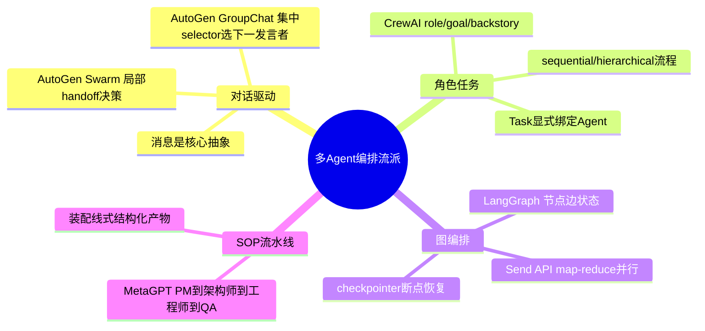
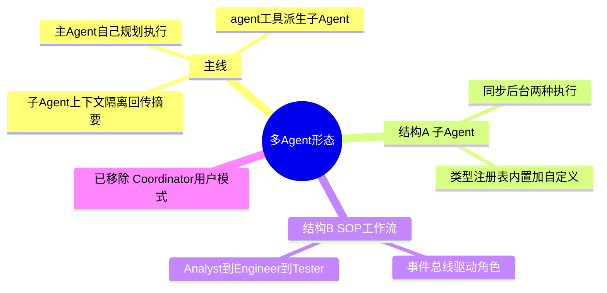
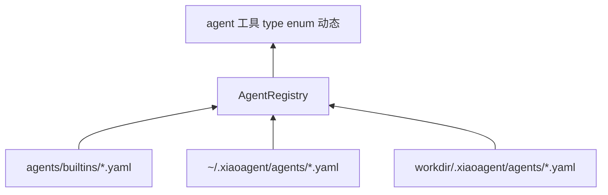
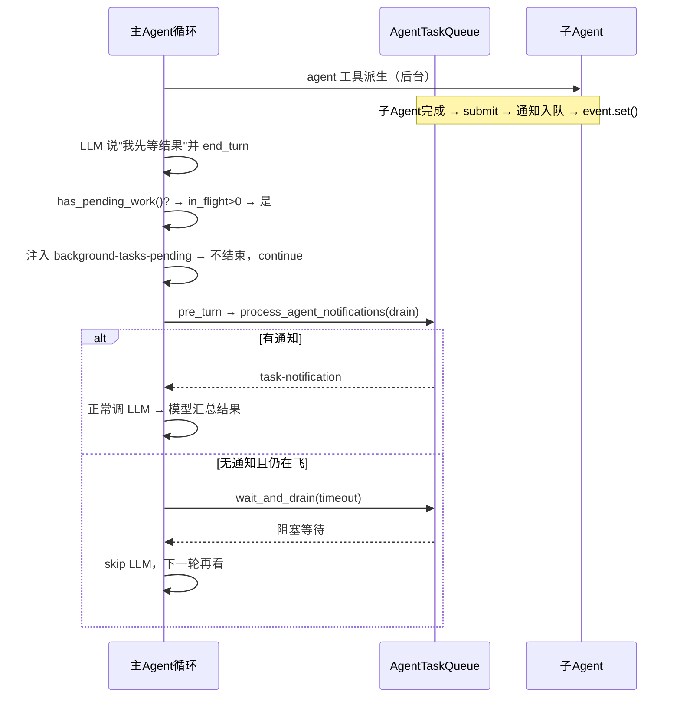
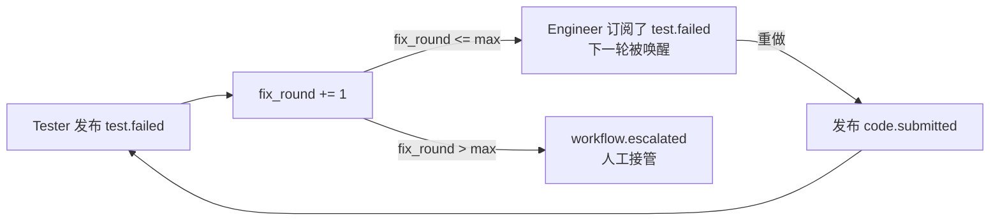

# 多 Agent 与工作流：从"能派活"到"能跑 SOP"

> 本篇回答四层问题：**子 Agent 怎么派生**（同步/后台）、**结果怎么回传**（AgentTaskQueue + 等待闭环）、**类型怎么扩展**（注册表）、**SOP 工作流怎么编排**（事件总线 + 角色运行时）。重点做**算法级推导**，并用模拟交互展示算法落地后的真实对话/终端形态。
> 对应代码：`agents/subagent.py`、`agents/task_queue.py`、`agents/registry.py` + `builtins/*.yaml`、`tools/AgentTool.py`、`workflows/`（engine/gateway/role_runtime/event_bus/artifact_store/structured_output/prompting）。写于 2026-09-04，最近更新 2026-09-04。

## 目录

- [先说结论：本项目多 Agent 长什么样](#先说结论)
- [类型注册表：YAML 驱动的动态 enum](#类型注册表)
- [子 Agent 派生的同步/后台决策](#子-agent-派生的同步后台决策)
- [AgentTaskQueue 的三态等待](#agenttaskqueue-的三态等待)
- [工作流的 round-robin 事件驱动](#工作流的-round-robin-事件驱动)
- [角色运行时的 JSON 解析链](#角色运行时的-json-解析链)
- [失败回环与产物版本化](#失败回环与产物版本化)
- [完整模拟：一次 /workflow 的逐轮走查](#完整模拟)
- [移除记录：曾经的 Coordinator 模式](#移除记录)
- [业界调研：共识、问题与方案](#业界调研)
- [当前实现的成熟度评估](#成熟度评估)
- [不足与进一步优化方向](#不足与优化方向)
- [附录 · 变更历史](#附录)

## 业界调研

### 多 Agent 编排在 Agent 领域的定位

子 Agent 是由主 Agent 动态创建的独立 Agent 实例（独立系统提示、工具集、上下文、生命周期），是"分治策略"的工程实现。多 Agent 编排是协调多个 Agent 协同工作的完整机制。**为什么单 Agent 不够**：LLM 上下文窗口有限、注意力随上下文衰减、单次调用串行无并行、无隔离机制（一次错误推理污染后续）、成本随对话线性增长。

### 业界主流共识（以 Claude Code 为标杆，见 `cc源码调研/06-cc-子agent及多agent编排-v2.md`）

1. **递进式模式**：CC 有 Simple SubAgent → Fork → Coordinator → Swarm 四种递进模式，简单任务不启动复杂编排（避免过度工程化）。
2. **四类专业化内置 Agent**：Explore（只读搜索）、Plan（结构化规划）、General（通用执行）、Verification（对抗验证），各配不同工具集/模型/输出要求。
3. **纵深工具过滤**：四层过滤（ALL_AGENT_DISALLOWED → CUSTOM_DISALLOWED → ASYNC_ALLOWED → 类型级 disallowed），任一层可独立拦截。
4. **deny-by-default 上下文隔离**：子 Agent 可变状态默认隔离，显式 opt-in 共享——忘记配置共享导致功能缺失（易发现），而非安全漏洞（隐蔽）。

### 主要问题与解决方案

| 问题 | 表现 | 业界方案 |
|------|------|----------|
| 单 Agent 上下文爆炸 | 大任务串行执行上下文膨胀 | 子 Agent 上下文隔离 + 回传摘要 |
| 独立任务被迫串行 | 无法并行 | Fork/后台子 Agent 并行 |
| 子 Agent 越权 | Explore 误改文件 | 双重锁（prompt 软约束 + disallowedTools 硬约束） |
| 子 Agent 递归失控 | 子 Agent 再派子 Agent | 递归防护（querySource + 消息扫描） |
| 验证回避 | 模型找借口不跑测试 | 对抗性验证 Agent（红队理念） |
| 后台结果丢失 | 父 Agent 过早结束 | 等待闭环 + task-notification |

### 多 Agent 编排的四大流派（超越 CC 的全局视角）

Claude Code 之外，多 Agent 编排还有几个重要流派，设计哲学差异显著，本项目的工作流（SOP）与子 Agent（主循环派发）其实分别借鉴了其中两支：



| 流派 | 代表 | 核心抽象 | 协作机制 | 适用场景 |
|------|------|----------|----------|----------|
| **对话驱动** | AutoGen | Messages + Agent + Team | GroupChat 集中 selector / Swarm 局部 handoff，对话推进直到终止条件 | 动态协作、研究、复杂多步对话 |
| **角色 + 任务** | CrewAI | Crew(role/goal/backstory) + Task(description/expected_output) | 任务显式绑定 Agent，sequential 或 hierarchical(manager 分配) | 业务自动化、内容生产 |
| **图编排** | LangGraph | 节点 + 边 + 状态 + checkpointer | 显式图执行，Send API map-reduce 并行，human-in-the-loop | 复杂工作流、可恢复、需人工介入 |
| **SOP 流水线** | MetaGPT | 标准化岗位(PM/架构师/工程师/QA) | 装配线式按阶段产出结构化文档 | 复杂软件项目生成 |

**本项目对应关系**：`workflows/`（metagpt-lite）是 **MetaGPT 流派**（SOP 三角色流水线）；`agents/subagent.py` 的"主 Agent 自主派发"更接近 **OpenAI Agents SDK 的 Handoffs 理念**（agent 把任务委托给其他 agent，而非 CC 的 Fork 缓存共享）。而 **LangGraph 的图编排** 是另一条路——它不内置循环，而是让开发者显式定义节点/边，本项目选择的是"统一循环 + 配置化差异"（见 02 文档），图编排作为对照可作为未来演进方向。

**OpenAI Agents SDK 的轻量视角**：它只有三个原语（Agents / Handoffs / Guardrails），强调"原语尽量少、Python 原生编排"——这与 CC 的"递进式复杂模式（SubAgent/Fork/Coordinator/Swarm）"形成对比。本项目倾向于 OpenAI 的轻量哲学（主 Agent 自主派发，无 CC 式多模式预选）。

**CC 比本项目多出的关键能力**：Fork 的 Prompt Cache 共享（字节级前缀继承，并行子 Agent 成本降 60%+）、声明式自定义 Agent（`.claude/agents/*.md`）、"理解不可委派"原则（协调者必须消化发现而非简单转发）、Scratchpad 协作空间、Swarm 团队模式。

## 先说结论

经历数轮调研反思（见 `docs/01-research/多Agent架构调研与模式辨析-2026-09-02.md`），本项目收敛成**一条主线 + 两种结构**：



主线是主流产品验证过的形态：**主 Agent 自己就是协调者**，用 `agent` 工具按需派活；SOP 是给"值得角色分工的开发任务"的结构化管线。

## 类型注册表



### 算法：三层加载 + 校验

`AgentRegistry` 的加载顺序即优先级：`builtins` → `user`（`~/.xiaoagent/agents`）→ `project`（`{workdir}/.xiaoagent/agents`）→ `extra`（测试注入）。`_load_dir` 按 `sorted()` 遍历 `*.yaml/*.yml/*.json`，`_parse_file` 对每个文件做四步校验：

1. **未知字段检查**：`set(data) - _VALID_FIELDS` 非空即抛错——捕获拼写错误（如 `allowd_tools` 会被立刻揪出来，而不是静默忽略）。
2. **必填字段 + 类型检查**：`system_prompt: str`、`allowed_tools: list`、`max_turns: int`（且 `int` 检查排除 `bool`，因为 Python 里 `True is int`）。
3. **`max_turns > 0`**。
4. **规范化**：`allowed_tools` 转 `frozenset`、`name` 默认取文件名主干。

核心效果：**放一个 YAML = 新类型立刻出现在 `agent` 工具 enum**。`AgentTool.get_definition()` 每次构建时查 `registry.names()` 生成 enum——所以会话中新增类型也会在下一次工具列表里出现，无需改代码。

### 主 Agent 专属工具的强制剔除

`agents/definitions.py` 的 `MAIN_AGENT_ONLY_TOOLS = {TodoWrite, run_workflow}`，`get_filtered_tools` 里 `allowed - MAIN_AGENT_ONLY_TOOLS` **无条件剔除，即使 YAML 写了也不生效**：

| 工具 | 为什么子 Agent 不能用 |
|------|----------------------|
| `TodoWrite` | `state.todo` 是全局单例，子 Agent 写入会覆写主 Agent 的计划清单 |
| `run_workflow` | 子 Agent（如 workflow 角色用的 general）嵌套启动工作流 = 递归 |

这是"配置别想绕过安全"在工具层的体现——安全约束放在代码层兜底，而不是指望 YAML 作者自觉。

### 内置类型工具集纪律

| 类型 | 角色 | 关键约束 |
|------|------|----------|
| explore | 只读调研 | 只读集 |
| plan | 规划 | 只读集 |
| general | 完整执行 | 读写+shell+load_skill；**无 agent**（防递归） |
| verification | 对抗测试 | 只读 + shell；`background: true` |

## 子 Agent 派生的同步/后台决策

`tools/AgentTool.py` 的 `handle()` 是唯一入口：

```python
def handle(prompt, description="", type="general", run_in_background=False):
    config = get_agent_config(type)
    should_async = run_in_background or config.get("background", False)
    if should_async:
        return run_subagent_async(prompt, type, description)
    else:
        return run_subagent(prompt, type)
```

**推导这个决策树**：`should_async` 由两个来源 OR 而成——
1. **调用时显式传参** `run_in_background=True`：模型根据任务是否独立、是否可并行自行判断（工具描述里明确写了"ONLY for independent tasks; order-dependent tasks must use synchronous execution"）。
2. **类型配置默认** `background: true`（如 verification）：对抗测试天生就该后台跑，不阻塞主 Agent 的总结节奏。

**同步 vs 后台的本质区别**：

| | 同步 `run_subagent` | 后台 `run_subagent_async` |
|---|---|---|
| 语义 | 像函数调用，阻塞到结束返回摘要 | 起线程后立刻返回"已启动"，结果后续到达 |
| 返回给模型 | 子 Agent 的最终文本 | `"Worker 'xxx' started in background (id: ...)"` |
| 结果路径 | 直接作为 tool_result 回填 | `submit()` 入队 → 主循环经等待闭环收 `<task-notification>` |
| 适用 | 顺序依赖的任务 | 独立可并行的任务 |

### 算法步骤：后台派发的完整序列

`run_subagent_async`（`agents/subagent.py`）的关键序列：

```python
task_id = f"agent-{uuid.uuid4().hex[:8]}"
trace("agent_dispatch", task_id=task_id, ...)   # ① 可观测：派发事件
state.agent_tasks.increment()                   # ② 在飞计数 +1

def _run():
    try:
        result = run_subagent(prompt, agent_type, description)
        state.agent_tasks.submit(task_id, agent_type, "completed", result[:4000])  # ③ 结果入队，在飞 -1
    except Exception as e:
        state.agent_tasks.submit(task_id, agent_type, "error", str(e))

threading.Thread(target=_run, daemon=True).start()   # ④ daemon 线程执行
return f"Worker '{label}' started in background (id: {task_id})..."
```

**四个设计的推导**：

1. **`task_id` 用 `uuid4().hex[:8]`**：足够唯一即可，不需要全局唯一性保证——它只是用来在 trace 里关联 `agent_dispatch` 与 `agent_done`、在通知里让主 Agent 区分多个 Worker。
2. **`increment()` 在派发时同步调用，`submit()` 在完成时调用**：这两个操作必须配对，`in_flight` 才准确反映"还有几个在飞"。等待闭环的 `has_pending_work()` 依赖这个数字。
3. **`daemon=True`**：后台线程不阻塞进程退出——主进程退出时这些线程被强制终止（这也是为什么"进程被 kill 时子 Agent 结果会丢"的根本原因，见 02 等待闭环）。
4. **结果截断 `result[:4000]`**：子 Agent 摘要太长对主 Agent 是噪音（调研结果要点化）。4000 是 2026-09-03 从 2000 放宽后的值——2000 逼主 Agent 重新调研的成本高于多读点摘要。

### 子 Agent 的循环：统一骨架的薄封装

子 Agent 的循环是 `engine/loop.py` 的薄封装（`_SubAgentHooks` 只做工具执行与状态回调），继承统一骨架的全部保护（max_turns=80、连续错误上限、截断续写），但**不带权限确认/压缩/UI**——它是"隔离的执行单元"。区别在于 `LoopSpec`：

```python
spec = LoopSpec(
    system_prompt=system_prompt,
    tool_defs=tool_defs, tool_handlers=tool_handlers,
    max_turns=max_turns,
    llm_timeout=LoopConfig.LLM_RESPONSE_TIMEOUT,
    stream=False,                    # 不流式（结果回传给主 Agent，不直出终端）
    # 无 wait_for_pending（子 Agent 自己不会再派后台任务）
)
```

### 子 Agent 结束后的字符串映射

`_run_agent_loop` 把 `LoopResult` 映射回字符串约定，**关键是区分"正常结束"和"被保护机制截停"**：

```python
if result.stop_reason == "max_turns":
    return (f"(SubAgent stopped at max_turns={max_turns} before completing "
            f"the task. The result below may be INCOMPLETE — treat it as "
            f"partial work, or re-dispatch with a tighter scope.)\n"
            f"{result.final_text or ''}")
if result.stop_reason == "tool_errors":
    return f"(SubAgent stopped: {result.error_count} tool errors in one turn)"
if result.stop_reason == "llm_errors":
    return f"(SubAgent stopped after {result.error_count} consecutive LLM errors)"
```

**推导**：如果子 Agent 被 max_turns 截停，它返回的是"残次结果"——主 Agent 必须知道这一点，否则会把半成品当成品。所以截停时**显式加前缀说明**，并建议"用更小范围重新派发"。这是"保护机制触发时不静默"的原则。

## AgentTaskQueue 的三态等待

`AgentTaskQueue` 是"通知队列 + 在飞计数 + 阻塞事件"三合一（`threading.Queue + Lock + Event`）。数据结构与 `submit/increment/drain/wait_and_drain` 的完整实现见 02 文档"等待闭环"，这里只强调它的**数据基础角色**：



**为什么用 `Event` 而不是 `Queue.get(timeout)`**：主循环想要的是"要么立刻有通知，要么等一会再看"，并且要顺带知道 `in_flight`；`Event.wait + 统一 drain` 正好表达"睡到被唤醒或超时"两种出口。三态决策的完整推导（含"收到部分结果仍 skip LLM"的关键点）见 02 文档，这里不再重复。

## 工作流的 round-robin 事件驱动

`WorkflowEngine.run()` 是工作流的心脏。先看它的完整结构，再逐层推导。

```python
def run(self, requirement, workflow_id="metagpt-lite-3role"):
    cfg = self.loader.load(workflow_id)              # ① 加载 YAML
    bus = EventBus()
    artifact_store = ArtifactStore("artifacts")
    prompt_builder = PromptBuilderForWorkflow()

    runtimes = {role.name: RoleRuntime(...) for role in cfg.roles}   # ② 每角色一个运行时
    for role in cfg.roles:
        bus.subscribe(role.name, role.subscriptions)  # ③ 注册订阅关系
    bus.publish(StructuredMessage(topic="user.requirement", ...))    # ④ 发布初始事件

    fix_round = 0
    for step_idx in range(cfg.max_steps):             # ⑤ 主循环：最多 max_steps 步
        progressed = False
        for role in cfg.roles:                        # ⑥ 固定顺序轮询角色
            incoming = bus.consume(role.name)         # ⑦ 取该角色 inbox 全部消息
            if not incoming:
                continue
            progressed = True
            try:
                produced = runtimes[role.name].execute(...)  # ⑧ 角色执行
            except Exception as exc:
                # ⑨ 单角色崩溃 → 发布 workflow.failed，不炸整线
                ...
                return WorkflowRunResult(status=FAILED, ...)
            for msg in produced:                      # ⑩ 发布角色产物
                bus.publish(msg)
                if msg.topic == "test.failed":
                    fix_round += 1                    # ⑪ 失败回环计数
                    if fix_round > cfg.max_fix_rounds:
                        ... return (ESCALATED)
                if msg.topic in cfg.terminal_topics:
                    ... return (PASSED/FAILED)        # ⑫ 终态
        if not progressed:                            # ⑬ 无进展 → 停滞
            break
    return WorkflowRunResult(status=status, ...)
```

### 逐层推导

**① 配置驱动**：`loader.load()` 加载 YAML（默认 `metagpt-lite-3role.yaml`），含 roles、subscriptions、max_steps、max_fix_rounds、terminal_topics、产物路径。换一个 workflow 只需换 YAML，引擎代码不动。

**③ 订阅关系是核心抽象**：`bus.subscribe(role.name, role.subscriptions)` 建立 `topic -> role` 映射。典型拓扑：

```
AnalystDesigner 订阅 ["user.requirement"]      发布 analysis.done
Engineer        订阅 ["analysis.done", "test.failed"]  发布 code.submitted
Tester          订阅 ["code.submitted"]         发布 test.passed | test.failed
```

**⑥⑦ round-robin 轮询 + 事件驱动的混合**：每步固定顺序遍历 roles，每个角色 `consume` 自己的 inbox（**读取后清空**，语义是"本轮全部消费"）。这是关键设计——**不是纯事件驱动**（那样需要复杂的调度器），而是"每步把所有角色轮一遍，谁有消息谁动"。简单、可预测、易调试，代价是空轮询（没消息的角色白走一遍 `consume`）。

**⑬ `progressed` 标志防死循环**：如果一整步没有任何角色消费到消息，说明流程停滞（比如某角色没发布预期的 topic），直接 `break` 结束，避免 `max_steps` 次空转。

**⑨ 单角色崩溃不炸整线**：每个角色的 `execute` 包在 try/except 里，崩溃时发布 `workflow.failed` 并返回 FAILED 结果。这保证"一个角色挂掉"不会让整个 Python 进程崩溃（对比之前的"自杀命令杀宿主"事故，见附录）。

### EventBus 的路由算法

`event_bus.py` 的三个核心方法：

```python
def subscribe(self, role_name, topics):
    for topic in topics:
        self._subscriptions[topic].add(role_name)

def publish(self, message):
    self._event_log.append(message)                 # ① 先记录日志（审计/回放）
    role_names = set(self._subscriptions.get(message.topic, set()))
    role_names.update(self._subscriptions.get("*", set()))   # ② 通配符订阅
    if message.send_to:                             # ③ 定向投递过滤
        role_names = {n for n in role_names if n in message.send_to}
    for role_name in role_names:
        self._inboxes[role_name].append(message)    # ④ 投递到各角色独立 inbox

def consume(self, role_name):
    inbox = self._inboxes.get(role_name)
    if not inbox:
        return []
    items = list(inbox)
    inbox.clear()                                   # 读取后清空
    return items
```

**推导**：每个角色独立 inbox（`deque`），避免消息抢占；`consume` 读取后清空，保证每条消息只被消费一次；`event_log` 全程记录，事后可回放整个工作流的消息流（`WorkflowRunResult.event_log`）。

## 角色运行时的 JSON 解析链

角色输出是 LLM 的自由文本，而总线需要结构化（payload 有字段约束）。`RoleRuntime._parse_output` 是稳定性主战场，转换链：

```
raw 文本
  → extract_json_object()          # ① 提取 JSON
       ├─ 成功 → ensure_fields()   # ② 补必填字段
       └─ 失败 → _reformat_retry() # ③ 一次小 LLM 调用重格式化
                 └─ 仍失败 → ensure_fields 兜底（旧行为，不炸）
  → _safe_int(blocker_count)        # ④ 数字字段安全转换
```

**① `extract_json_object` 的两级提取**（`structured_output.py`）：

```python
_JSON_BLOCK_RE = re.compile(r"```json\s*(\{[\s\S]*?\})\s*```", re.IGNORECASE)

def extract_json_object(text):
    fence = _JSON_BLOCK_RE.search(text)     # 第一级：```json 围栏块
    if fence:
        try: return json.loads(fence.group(1))
        except: pass
    start, end = text.find("{"), text.rfind("}")   # 第二级：首尾花括号
    if start >= 0 and end > start:
        try: return json.loads(text[start:end+1])
        except: return None
    return None
```

**推导**：第一级匹配 ```json 围栏块（模型被训练成喜欢这样输出）；失败则退到第二级"首尾花括号"兜底（允许模型没按围栏输出，比如直接 `{...}`）。两级都失败才返回 None，触发 reformat_retry。

**③ `_reformat_retry` 的代价权衡**：用**一次额外 LLM 调用**让模型把原始输出转成合法 JSON。

```python
resp = _state.llm.chat(
    system="You convert agent output to strict JSON. Respond with ONLY the JSON object...",
    messages=[{"role": "user",
               "content": f"Convert the following output to a JSON object with these "
                          f"top-level fields: {schema_hint}\n..."
                          f"Output to convert:\n{raw_output}"}],
    max_tokens=4096)
```

**为什么必须有 reformat_retry**：历史 bug——Tester 输出格式失误时，旧逻辑把"解析失败"当成"测试失败"，触发一轮**无效 fix 循环**（Engineer 白改一轮）。用一次额外 LLM 调用换一次"澄清机会"，远便宜于无效返工。

**② `ensure_fields` 的兜底约定**：

```python
def ensure_fields(data, required_fields, raw_text):
    data = data or {}
    for field in required_fields:
        data.setdefault(field, [] if field.endswith("s") else "")  # 字段名以 s 结尾给空列表
    data.setdefault("raw_output", raw_text)                        # 保留原文供排障
    return data
```

**推导**：字段名以 `s` 结尾（如 `objectives`、`changed_files`、`defects`）默认给空列表，其余给空字符串——这是一个**约定俗成的启发式**，避免每个角色写死字段类型。`raw_output` 永远保留，排障时能看原文。

**④ `_safe_int` 防御 LLM 的非数字输出**：

```python
def _safe_int(value):
    try: return int(value or 0)
    except (TypeError, ValueError): return 0
```

`blocker_count` 可能是 `"两个"` 这种中文数字，`int("两个")` 会抛 ValueError，安全转 0。防御"LLM 自由发挥"。

### 角色 prompt 的模板渲染

`PromptBuilderForWorkflow.build_role_prompt` 用**约定占位符替换**而非 `str.format`：

```python
def _render_known_placeholders(template, variables):
    rendered = template
    for key, value in variables.items():
        rendered = rendered.replace(f"{{{key}}}", value)   # 只替换 {key}
    return rendered
```

**推导**：角色模板里可能有 JSON 示例（含大量花括号），用 `str.format` 会把这些花括号误解析成占位符。`replace(f"{{{key}}}", value)` 只替换约定好的 `{requirement}` 等，JSON 花括号不受影响。这是"防模板渲染误伤"的经典陷阱。

## 失败回环与产物版本化

**失败回环**：Tester 发布 `test.failed` 时，引擎计数 `fix_round += 1`，然后**不直接驱动 Engineer**——而是靠订阅关系：`test.failed` 这个 topic 恰好也是 Engineer 的订阅之一，所以下一轮 round-robin 遍历到 Engineer 时，它会 `consume` 到这条 `test.failed` 消息，自动被唤醒。



**推导：为什么失败回环不用显式的"if test.failed then 调 Engineer"**——因为订阅机制天然支持：Engineer 的订阅列表里包含 `test.failed`，`publish(test.failed)` 会自动路由到 Engineer 的 inbox。引擎只负责"计数 + 判断是否超限"，不负责"决定谁该响应"——这是事件驱动架构的核心优势（新增角色/拓扑只需改 YAML 订阅关系）。

**产物版本化**：`_persist_artifacts` 在 `fix_round > 0` 时文件名加 `.r1/.r2` 后缀：

```python
def _with_suffix(path, suffix):
    dot = path.rfind(".")
    if dot > path.rfind("/"):
        return path[:dot] + suffix + path[dot:]   # a/b.md + .r1 → a/b.r1.md
    return path + suffix
```

**推导**：修复循环不覆盖历史产物，事后能对比"第几轮改坏了什么"。这是"修复覆盖历史导致无法回溯"事故的解法。

### Tester 的严格判定

```python
verdict = str(parsed.get("verdict", "")).strip().lower()
blocker_count = _safe_int(parsed.get("blocker_count"))
is_passed = verdict == "pass" and blocker_count == 0
if verdict not in ("pass", "fail"):
    print(f"Tester verdict invalid: {verdict!r}, treating as fail")
topic = self.role.publish["on_pass"] if is_passed else self.role.publish["on_fail"]
```

**推导**：`is_passed` 要求**同时满足** `verdict == "pass"` 且 `blocker_count == 0`——不能只判 verdict（"pass 但有 2 个 blocker"是矛盾的）。`verdict` 缺失/非法时**先打日志再按 fail 处理**：默认 fail 会把"模型没输出判定"伪装成"测试没通过"，让排障者误以为真有 bug。显式日志 + 按 fail 是"宁可多修一轮也要可解释"。

### 心跳：长角色的可见性

`_run_subagent_with_heartbeat` 在 daemon 线程跑 subagent，主线程每秒打印：

```python
while thread.is_alive():
    thread.join(timeout=heartbeat_seconds)   # 每秒醒来一次
    if thread.is_alive():
        waited += heartbeat_seconds
        print(f"\r[Workflow] {role.name} working [{waited:>4}s] | {status_text}\033[K", end="")
```

**推导**：长角色（几十秒）无心跳会让用户以为卡死——心跳把"在干活"变成可见。`status_callback` 由 `_SubAgentHooks.on_llm_start/execute_tool` 触发，把子 Agent 内部的"turn x/y: tool z"状态传出来。

## 完整模拟

### 一次 /workflow 的逐轮走查

场景：`/workflow 用 python 写一个带 UI 的迷宫游戏`。下面把引擎算法、角色运行时、事件总线串起来，展示每一步的输入/输出。

**step 1 — AnalystDesigner 消费 user.requirement**

```
[Workflow] start id=metagpt-lite-3role
[Workflow] requirement: 用 python 写一个带 UI 的迷宫游戏
[Workflow] loaded config: roles=3, max_steps=24, max_fix_rounds=3
[Workflow] step 1/24 (fix_round=0/3)
```

引擎 `publish(user.requirement)` → 路由到 AnalystDesigner 的 inbox。遍历到 AnalystDesigner 时 `consume` 到 1 条消息。

角色运行时 `execute` 把这条消息拆成 prompt（`build_role_prompt` 渲染 `analyst` 模板，注入 requirement + incoming_topics + artifact_refs + fix_round=0），然后 `run_subagent(type=plan, system_prompt_override=中性提示词)`：

```
[Workflow] AnalystDesigner running subagent(type=plan)...
[Workflow] AnalystDesigner working [ 24s] | turn 3/20: waiting llm
[Workflow] AnalystDesigner subagent done (output_len=3570)
```

plan 子 Agent 内部（它是只读的，会 read_file/list_files 调研现有目录），最终输出一段带 JSON 的文本。角色运行时 `_parse_output` 提取出：

```json
{
  "summary": "实现一个 Python 迷宫游戏，使用 pygame 作为 UI 库",
  "objectives": ["生成随机迷宫", "玩家可控移动", "胜利判定"],
  "technical_design": "迷宫用 Prim 算法生成，pygame 渲染，键盘控制",
  "module_plan": ["maze_generator.py 负责迷宫生成", "maze_game.py 负责 UI 与主循环"],
  "acceptance_criteria": ["能生成迷宫", "能控制移动", "到达终点判定胜利"],
  "risks": ["pygame 可能未安装"]
}
```

`_persist_artifacts` 落盘 `artifacts/analysis/analysis_design.md/.json`（fix_round=0 无后缀）。`_build_messages` 发布 `analysis.done`（AnalystDesigner 不是 Tester，走 `publish.default`）：

```
[Workflow] AnalystDesigner subagent done (output_len=3570)
[Workflow] role=AnalystDesigner published topic=analysis.done, artifacts=2
```

**step 1 继续 — Engineer 消费 analysis.done**

同一 step 内，round-robin 继续遍历到 Engineer，`consume` 到 `analysis.done`：

```
[Workflow] role=Engineer consume=1
[Workflow] Engineer running subagent(type=general)...
[Workflow] Engineer working [ 37s] | turn 8/45: tool write_file
```

Engineer（type=general，**有写文件权限**）根据分析文档写码：`maze_generator.py` → `maze_game.py` → 验证脚本。最终输出：

```json
{
  "implementation_summary": "实现了 Prim 迷宫生成 + pygame UI",
  "changed_files": ["maze_generator.py", "maze_game.py"],
  "entry_points": ["python maze_game.py"],
  "run_commands": ["python -m pytest tests/ -q"],
  "assumptions": ["已安装 pygame"],
  "known_risks": ["无"]
}
```

发布 `code.submitted`：

```
[Workflow] Engineer subagent done (output_len=4120)
[Workflow] role=Engineer published topic=code.submitted, artifacts=2
```

**step 1 继续 — Tester 消费 code.submitted**

```
[Workflow] role=Tester consume=1
[Workflow] Tester running subagent(type=verification)...
[Workflow] Tester subagent done (output_len=2941)
```

Tester（type=verification，只读 + shell，**后台**）跑测试、对抗式审查。假设发现 pygame 未安装导致测试失败：

```json
{
  "verdict": "fail",
  "blocker_count": 1,
  "passed_checks": ["迷宫生成逻辑正确"],
  "failed_checks": ["pygame 未安装，无法启动 UI"],
  "test_commands": ["python -m pytest tests/ -q"],
  "defects": ["缺少依赖安装说明，requirements.txt 未包含 pygame"],
  "summary": "功能代码正确，但缺少依赖声明"
}
```

`_build_messages` 判定：`verdict == "fail"` → 发布 `test.failed`：

```
[Workflow] role=Tester published topic=test.failed, artifacts=2
```

**失败回环触发**：

```
[Workflow] test.failed -> fix_round=1/3
[Workflow] step 2/24 (fix_round=1/3)
```

引擎 `fix_round` 从 0 → 1（`1 <= max_fix_rounds=3`，不 escalate）。

**step 2 — Engineer 被 test.failed 唤醒**

round-robin 遍历到 Engineer，它订阅了 `test.failed`，`consume` 到缺陷单：

```
[Workflow] role=Engineer consume=1
[Workflow] Engineer running subagent(type=general)...
```

Engineer 的 prompt 里 `fix_round=1`，它知道自己是在修复，于是补 `requirements.txt`（加 pygame）。输出后 `_persist_artifacts` 用 `.r1` 后缀落盘 `artifacts/engineer/implementation.r1.md/.json`——**不覆盖第一轮的产物**。发布 `code.submitted`。

Tester 再测，这次 `verdict=pass, blocker_count=0` → 发布 `test.passed`。引擎命中 `terminal_topics`：

```
[Workflow] terminal topic=test.passed, status=passed
[Workflow] finished in 183.2s
[Workflow] id=metagpt-lite-3role
[Workflow] status=passed, terminal_topic=test.passed
[Workflow] summary=Workflow completed successfully with passing tests.
[Workflow] artifacts:
- artifacts/analysis/analysis_design.md
- artifacts/analysis/analysis_design.json
- artifacts/engineer/implementation.md
- artifacts/engineer/implementation.r1.md
- artifacts/tester/test_report.md
```

`gateway.maybe_run_workflow` 把结果回文本给主 Agent，主会话不退出：

```
assistant: 迷宫游戏已完成并通过测试。实现包含 Prim 迷宫生成 + pygame UI，产物已保存在 artifacts/ 目录。可以直接 python maze_game.py 运行。
```

**这个模拟演示的关键点**：
1. **事件驱动**：`analysis.done → code.submitted → test.failed → code.submitted → test.passed` 的完整消息链，每步都由订阅关系路由，引擎不写死流程。
2. **round-robin**：同一 step 内顺序遍历三角色，谁有消息谁动。
3. **失败回环**：`test.failed` 既让引擎 `fix_round+1`，又因 Engineer 订阅了它而自动唤醒 Engineer。
4. **产物版本化**：`.r1` 后缀保留两轮产物，事后能对比"第一轮缺了 requirements.txt，第二轮补上了"。
5. **心跳**：`[ 37s] | turn 8/45: tool write_file` 让长角色可见。

## 移除记录

曾经的 Coordinator 用户模式（独立 system prompt + 只读工具白名单 + 规划-执行分离）于 2026-09-04 从运行时代码**彻底移除**（模块、配置节、prompts、测试、UI 字样一并清理，等待语义统一为 `wait_for_inflight`）。判定依据与教训见 `docs/01-research/多Agent架构调研与模式辨析-2026-09-02.md` 与 `docs/archive/Coordinator模式详解.md`。一句话经验：**"协调者"是架构角色（主 Agent 本来就能当），不是产品功能（不该做成用户可开关的模式）**。

## 成熟度评估

对照业界共识与 CC 能力，逐条评估：

| 能力 | 本项目 | 成熟度 |
|------|--------|--------|
| 子 Agent 派生（同步/后台） | ✅ agent 工具 + run_subagent/async | 高 |
| 四类内置 Agent | ✅ explore/plan/general/verification | 高（对齐 CC 四类型） |
| 类型注册表 + 动态 enum | ✅ YAML 三层 + 动态 enum | 高（对齐 CC 声明式） |
| 工具过滤（防越权/递归） | ✅ MAIN_AGENT_ONLY_TOOLS + 类型 allowed_tools | 高 |
| 等待闭环 | ✅ wait_for_pending + 三态等待 | 高 |
| 对抗性验证 | ✅ verification 后台 + verdict 严格判定 | 高 |
| SOP 工作流 | ✅ metagpt-lite 事件总线 + 角色运行时 | 高（本项目特色） |
| 结果截断 | ✅ 4000 字符 | 中 |
| Fork Prompt Cache 共享 | ❌ 无 | 低 |
| 声明式自定义 Agent | ⚠️ YAML 自定义（非 CC 的 .md） | 中 |
| 上下文隔离（deny-by-default） | ⚠️ 子 Agent 天然隔离（无共享需求），无显式 opt-in 机制 | 中 |
| Scratchpad / Swarm / SendMessage | ❌ 无 | - |

**总体判断**：核心"子 Agent 派生 + 四类型 + 注册表 + 工具过滤 + 等待闭环 + SOP 工作流"已完整实现且对齐 CC 思想，成熟度较高；差距在"Fork 缓存共享"（成本优化）与"高级编排"（Scratchpad/Swarm）两个方向。

## 不足与优化方向

1. **无 Fork Prompt Cache 共享**：并行派多个后台子 Agent 时，每个子 Agent 都从冷启动（不继承父上下文），各自重新发送 system prompt + 工具定义。CC 的 Fork 模式共享字节级前缀，成本降 60%+。若接 Anthropic 缓存，这是并行调研场景的关键优化。

2. **自定义 Agent 用 YAML 而非 .md**：CC 用 `.claude/agents/*.md`（Markdown frontmatter）降低创建门槛，本项目用 YAML（结构更严谨但门槛略高）。两者各有利弊，可考虑支持 Markdown 格式兼容。

3. **无"理解不可委派"约束**：CC 的 Coordinator 明确禁止"based on your findings"式简单转发（信息每转发一层衰减一次）。本项目工作流的角色间传递是结构化 payload，天然规避了这个问题，但子 Agent 派发时主 Agent 若简单转发调研结果，会有同样的信息衰减。可在 base.md 的 Delegation 段补一条约束。

4. **无显式上下文隔离机制**：子 Agent 当前天然隔离（不继承父历史），但没有 CC 的 `createSubagentContext()` 那样显式的"隔离/共享"配置（如 readFileState 克隆、abortController 单向传播）。单 Agent 场景够用，多 Agent 深度协作（子 Agent 需要读父 Agent 已读文件缓存）时缺。

5. **工作流角色 prompt 覆盖依赖 override**：工作流角色用 `system_prompt_override` 整体替换内置 agent 的 system prompt（避免双指令冲突）。CC 用更细粒度的"override + append"分层。当前方案能解决问题但粒度粗，未来若角色需要"保留 agent 能力 + 追加角色约束"会受限。

## 附录

### 变更历史

| 遇到的问题 / bug | 问题分析 | 解决方法 | 时间 |
|------------------|----------|----------|------|
| 子 Agent 双循环漂移 | 主/子两套循环 | S3 统一 AgentLoop，subagent 变薄封装 | 09-01 |
| 双层 API 重试 | 子循环重复重试 | 移除，统一 adapter | 09-01 |
| 类型硬编码 | 加类型改代码 | S6 注册表 + 动态 enum | 09-01 |
| 后台结果丢失（真实事故） | end_turn 时在飞 | wait_for_pending 闭环 + 三态等待 | 09-02 |
| 角色双指令冲突（真实） | prose+JSON 模板并存 | 中性 system_prompt_override | 09-02 |
| JSON 失败被当业务失败（真实） | 格式失误→无效 fix 轮 | reformat_retry 一次澄清 | 09-02 |
| 子 Agent 结果太短逼主 Agent 重查 | 2000 截断太狠 | 放宽到 4000 | 09-03 |
| 修复覆盖历史产物 | fix 轮覆盖文件 | fix_round 版本后缀 | 09-02 |
| 长角色无感知 | 几十秒无输出 | 心跳日志 | 09-02 |
| Coordinator 与普通模式重叠 | 模式冗余 | 整体移除（2026-09-04） | 09-04 |
| 子 Agent 清理进程杀宿主 | run_shell 无自保护 | 自杀护栏（见 04） | 09-03 |
| 角色模板花括号被 str.format 误解析 | JSON 示例含花括号 | 约定占位符 replace 替换 | 09-02 |
