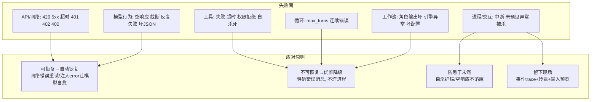
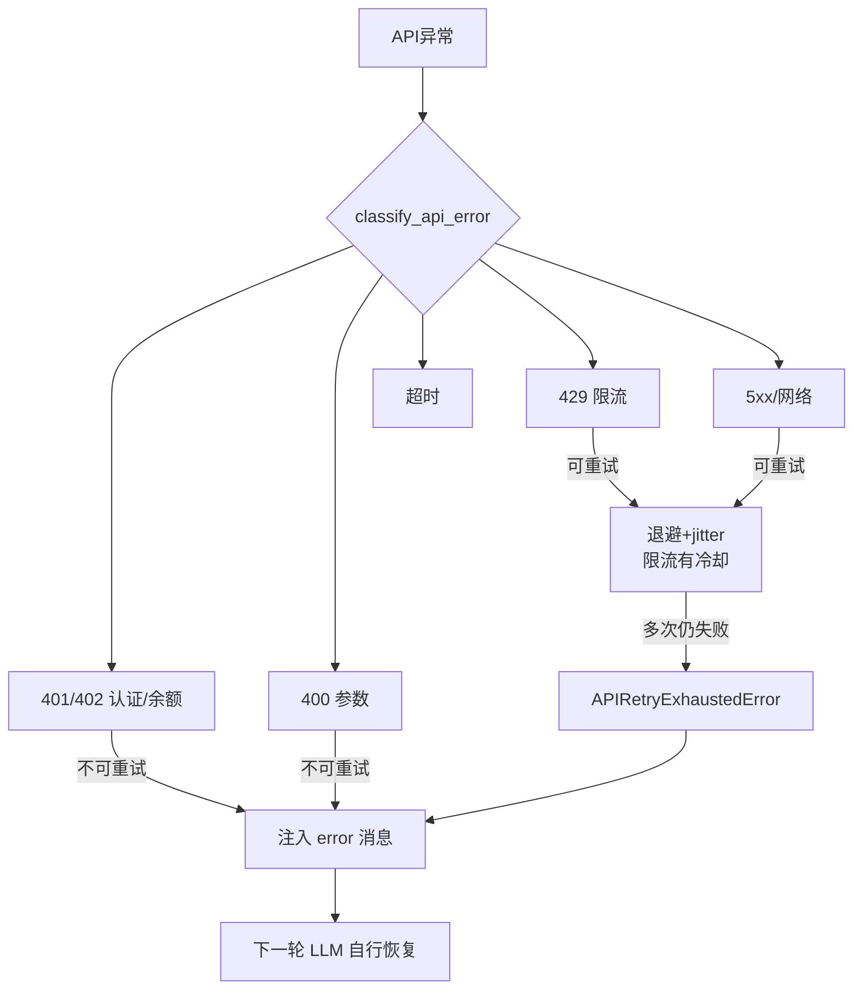
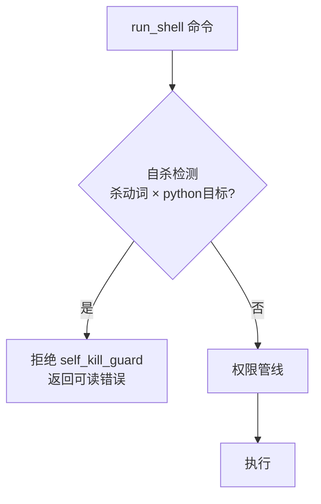
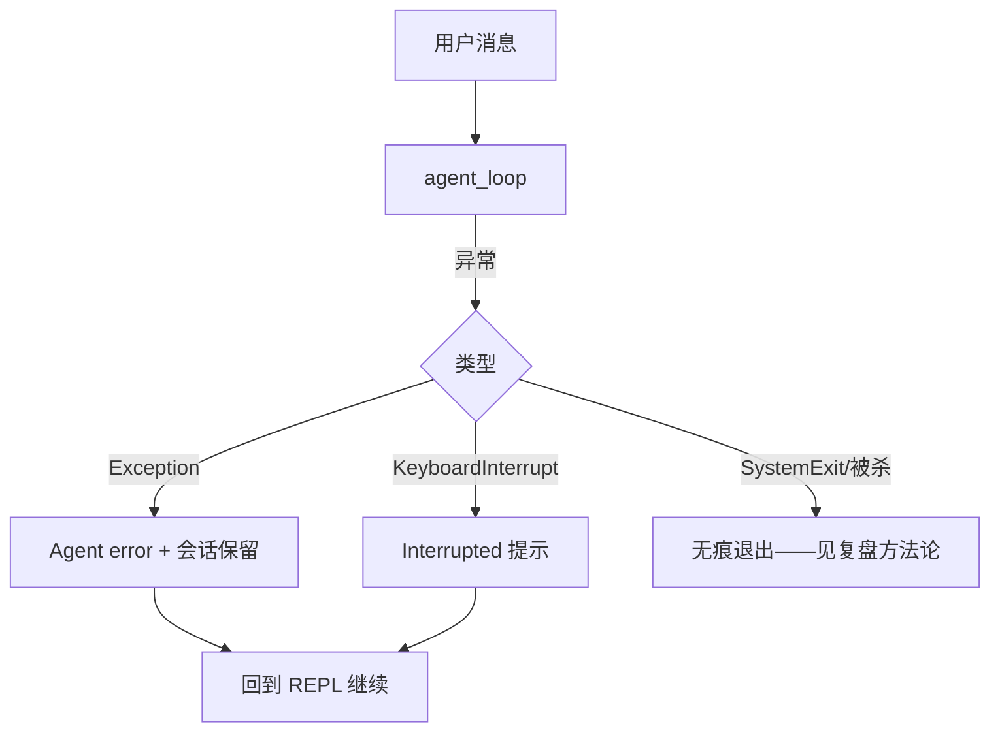

# 稳定执行：失败处理与可观测性

> "Agent 能不能稳定工作"是反复打磨的主线。本文从**失败发生在哪、为什么发生、
> 怎么接住、怎么恢复、怎么复盘**五个问题展开，最后给可观测性设计。
> 对应代码：`engine/errors.py`、`llm/adapter.py`、`engine/loop.py`、`services/permissions.py`、
> `tools/BashTool.py`、`services/tracing.py`、`ui/repl.py`、`workflows/`。
> 写于 2026-09-04。

## 目录

- [先建立心智模型：失败分五层](#先建立心智模型)
- [API 层：分类、重试与不可重试](#api-层)
- [模型行为层：空响应、截断与自恢复](#模型行为层)
- [工具层：错误成为可读结果](#工具层)
- [进程与交互层：兜底与转录](#进程与交互层)
- [可观测性：看得到才修得了](#可观测性)
- [复盘方法论：莫名退出怎么查](#复盘方法论)
- [业界调研：共识、问题与方案](#业界调研)
- [当前实现的成熟度评估](#成熟度评估)
- [不足与进一步优化方向](#不足与优化方向)
- [附录 · 变更历史与待办](#附录)

## 业界调研

### 失败处理在 Agent 领域的定位

Agent 运行生命周期中，失败遍布 LLM 层（超时/错误码/格式异常/网络错误）、工具层（执行异常/参数错误/未知工具）、循环层（无限循环/上下文耗尽）。失败处理的目标是回答四个问题：**失败发生在哪、为什么发生、怎么接住、怎么恢复**。

### 业界主流共识（以 Claude Code 为标杆，见 `docs/01-research/Agent失败处理调研报告.md`）

1. **Never Fail Silently**：所有错误都有分类、记录和用户可见提示。
2. **Recovery First**：优先尝试恢复（重试/降级/压缩/续写），而非直接退出。
3. **Layered Defense**：多层防护，单一机制失效不导致灾难。
4. **Observability**：所有错误埋点，便于线上诊断。

### 主要问题与解决方案

| 问题 | 表现 | 业界方案 |
|------|------|----------|
| API 错误直接崩溃 | 429/529/401 无重试 | 错误分类 + 可重试白名单 + 指数退避 jitter |
| max_tokens 截断退出 | 输出被截断后 agent 直接结束 | 截断续写（"从断点继续，不要重复"）+ 恢复次数限制 |
| 无限循环 | LLM 持续 tool_use 不推进 | maxTurns + 连续错误计数 |
| 工具异常阻断循环 | 单工具失败整个 agent 退出 | "错误是数据" → tool_result(is_error) 让模型自纠 |
| 压缩失败级联 | 失败→涨→再压缩→再失败 | CircuitBreaker（3 次熔断） |
| 空响应/静默失败 | 模型什么也没说 | 空响应检测 + `<error>` 注入续跑一次 |
| 模型降级 | 529 持续过载 | Fallback 模型（CC 特有） |

**CC 比本项目多出的关键能力**：模型降级（FallbackTriggeredError 切换 fallback 模型）、OAuth token 自动刷新、持久会话长等待重试（最长 6 小时）、JSON 截断修复（截取到最后一个完整对象）。

### 失败处理的不同侧重（超越 CC 的全局视角）

不同框架对"如何让 Agent 稳定"有不同侧重：

| 思路 | 代表 | 核心机制 | 与 CC 的差异 |
|------|------|----------|--------------|
| **Guardrails fail-fast** | OpenAI Agents SDK | 输入输出并行校验，不通过快速失败 | CC 侧重"错误分类 + 重试恢复"，OpenAI 侧重"前置校验防错" |
| **断点恢复** | LangGraph | checkpointer 每步存状态快照，失败/中断后精确续跑 + 时间旅行 | CC 的恢复是"重试/注入错误让模型自愈"，LangGraph 是"状态回滚重跑" |
| **模型降级** | CC | 529 连续 3 次后切换 fallback 模型 | OpenAI/LangGraph 无此概念（单模型假设） |
| **沙箱隔离** | OpenHands/E2B | shell 放沙箱，命令失败不伤宿主 | CC 用 sandbox 层，本项目无 |

**关键洞察**：

1. **OpenAI Guardrails 的"防错"视角** 与 CC 的"纠错"视角互补——CC 是"错了怎么恢复"，OpenAI 是"错之前先校验拦截"。本项目已覆盖"纠错"（分类/重试/截断续写/断路器），缺"防错"（工具输出合法性校验）。

2. **LangGraph 的断点恢复** 是另一个稳定性维度——它不靠"让模型自愈"，而是靠"状态快照 + 精确重跑"。失败后从 checkpointer 恢复，而非注入错误消息让模型重新理解。这对"确定性流程"更可靠，本项目靠"错误注入式恢复"（更适合自主决策场景），但 checkpointer 的"会话级断点续跑"值得借鉴（如进程崩溃后恢复会话）。

3. **沙箱隔离** 是"防错"里最彻底的一层——命令在沙箱执行，失败/恶意都不伤宿主（详见 04 文档优化方向）。

## 先建立心智模型



一句话总纲：**把不可恢复的事故降级成可恢复的工具失败，把可恢复的失败变成可读的错误消息，把错误过程完整记下来。**

## API 层

错误处理的两段式设计：**先分类，再决策**。



实现要点：

```python
# engine/errors.py
class APIErrorType: ...              # RATE_LIMIT/AUTH_ERROR/BAD_REQUEST/BILLING_ERROR/...
def is_retryable_error(t) -> bool:   # 只有网络类/限流/过载可重试
def get_retry_delay(attempt, t, retry_after_ms): ...  # 指数退避 + jitter
# llm/adapter.py chat():
for attempt in ...:
    try: return _call(...)
    except ...:
        traceback 进 trace（终端只一行）
        if not is_retryable: 直接抛（由循环注入 <error> 恢复）
        else: 退避 delay 后重试
```

为什么 400（如"空 assistant 消息"）不可重试？重试不会改变参数错误；改错的是消息本身，必须从根上防（见附录事故 A-3：源头是不该把空 assistant 落库）。

### 走读：一条 429 与一条 400 的完整处置差异

```
429 (rate limit)                   400 (Invalid assistant message)
classify → RATE_LIMIT              classify → BAD_REQUEST
is_retryable? 是                    is_retryable? 否
  → attempt 2, 退避 delay(s) 重试      → 不再重试, 直接抛出
     ├─ 成功 → 正常继续                  → loop 捕获 → 注入 <error>消息
     └─ 多次仍败 → APIRetryExhausted      → 下一轮模型看到错误自行调整
        → 注入 <error>
```

关键差异：429 是**资源暂时紧张**，等一等就会好，所以值得花退避成本重试；400 是**请求本身非法**（例如历史里残留了一条空 assistant 消息），重试 100 次结果一样，所以分类器直接判不可重试，把问题交回给"修正消息"（源头防护见 02 附录 A-3）而不是重试循环。`is_retryable_error` 那张白名单的本质就是回答一个问题：**重试是否有机会成功**。

### 分类实现走读（engine/errors.py）

`classify_api_error(error)` 的判定顺序是"**status 优先，message 兜底**"。先看完整算法步骤，再推导这个顺序：

```text
输入: error（捕获的异常对象）

步骤 1  提取 status（SDK 异常带 status 属性，网络异常可能没有）
        error_msg = str(error).lower()
        status = getattr(error, "status", None)

步骤 2  若有 status（status is not None）→ 按状态码分支：
        429          → RATE_LIMIT
        529          → SERVER_OVERLOAD
        408          → REQUEST_TIMEOUT
        401 / 403    → 按 message 细分:
                          "oauth"/"token"         → TOKEN_REVOKED
                          "api-key"/"invalid"     → INVALID_API_KEY
                          否则                     → AUTH_ERROR
        404          → INVALID_MODEL
        >= 500       → SERVER_ERROR
        400          → 按 message 细分:
                          "prompt is too long"/"context" → PROMPT_TOO_LONG
                          "max_tokens"/"output"          → MAX_OUTPUT_TOKENS
                          "media"/"image"/"pdf"          → MEDIA_SIZE_ERROR
                          "tool_use"/"tool_result"       → TOOL_USE_MISMATCH

步骤 3  无 status → 按 message 关键词兜底：
        "oauth" / ("token"+"revoked") → TOKEN_REVOKED
        "timeout"                     → TIMEOUT
        "connection"/"connect"        → CONNECTION_ERROR
        "json"+"decode"/"parse"       → JSON_PARSE_ERROR
        "rate limit"/"429"            → RATE_LIMIT
        "overload"/"529"              → SERVER_OVERLOAD
        "balance"/"credit"            → BILLING_ERROR
        否则                           → UNKNOWN
```

**推导"status 优先，message 兜底"的顺序**：

1. **status 最可靠**：HTTP 状态码是协议层的事实，`429` 就是限流、`404` 就是模型不存在，不会错。所以优先按 status 分类。

2. **status 内部用 message 细分**：`401/403` 和 `400` 本身不够精确——401 可能是 token 撤销、也可能是 key 无效、也可能是权限不足，三种的**用户提示和恢复方式不同**（token 撤销要 `/login`，key 无效要改配置，权限不足要联系管理员）。所以 status 确定大类后，再用 message 关键词细分。

3. **无 status 时 message 兜底**：网络层异常（连接失败、超时）没有 status 属性，只能靠 message 里的关键词判断。这是"最后一道防线"。

**一个关键观察（已知待办）**：`classify_api_error` 对 402 没有显式 status 分支，靠 message 里的 "balance"/"credit" 才落到 `BILLING_ERROR`——若服务商 402 的 message 不带这些词，会被判 UNKNOWN。这也是"额度 402 后 workflow 仍空转派发 fix 轮"（见附录待办）的间接原因之一：分类没把 402 明确识别为不可恢复的计费错误。

**可重试白名单**（`is_retryable_error`）只有六类：`RATE_LIMIT / SERVER_OVERLOAD / TIMEOUT / CONNECTION_ERROR / SERVER_ERROR / REQUEST_TIMEOUT`。其余（AUTH/BILLING/BAD_REQUEST 家族/PROMPT_TOO_LONG 等）一律不重试。

**退避算法**（`get_retry_delay`）的公式推导：

```python
def get_retry_delay(attempt, error_type, retry_after_ms=None):
    # ① 优先 API 给的 Retry-After（服务端最懂什么时候恢复）
    if retry_after_ms is not None:
        return min(retry_after_ms, RetryConfig.MAX_DELAY_MS)   # 封顶

    # ② 按错误类型选基础延迟
    base = (RetryConfig.OVERLOAD_BASE_DELAY_MS if error_type == SERVER_OVERLOAD
            else RetryConfig.BASE_DELAY_MS)

    # ③ 指数退避：base * 2^(attempt-1)
    delay_ms = min(base * (2 ** (attempt - 1)), RetryConfig.MAX_DELAY_MS)

    # ④ jitter：加 base * 0.25 * random()
    jitter = int(delay_ms * RetryConfig.JITTER_RATIO * random.random())
    return min(delay_ms + jitter, RetryConfig.MAX_DELAY_MS)
```

**为什么是 `base * 2^(attempt-1)`（指数退避）而非固定间隔**：

- **固定间隔**（每次等 1s）：若服务端过载持续 10s，固定 1s 会在前 10 次都撞墙——浪费请求次数，还可能加重过载。
- **指数退避**：第 1 次等 `base`，第 2 次等 `2*base`，第 3 次等 `4*base`……等待时间指数增长，给服务端越来越长的恢复窗口，同时请求频率越来越低（对过载服务更友好）。

以 `base=1000ms` 为例，前 4 次重试的等待序列：

```
attempt=1 → 1000ms
attempt=2 → 2000ms
attempt=3 → 4000ms
attempt=4 → 8000ms
（封顶 MAX_DELAY_MS=32000ms）
```

**为什么加 jitter（随机抖动）**：

指数退避有一个著名的"**惊群效应**"问题：如果大量客户端同时遇到限流，都用**相同**的指数退避，它们会在**同一时刻**再次发起请求——造成二次限流雪崩。jitter 给每个客户端的等待时间加一个随机扰动，把它们"错峰"：

```
无 jitter：客户端 A、B、C 都在 t=1000ms 重试 → 撞一起
有 jitter：A 等 1000ms，B 等 1180ms，C 等 950ms → 错开
```

`JITTER_RATIO=0.25` 表示 jitter 幅度是当前延迟的 25%（`delay * 0.25 * random()`），既错峰又不至于偏离太远。**加 jitter 后仍封顶 MAX_DELAY_MS**，保证总延迟不失控。

**为什么封顶 MAX_DELAY_MS（32s）**：指数退避不加封顶会无限增长（`2^10 = 1024s`），但用户等不了 17 分钟。32s 是"最长愿意让用户等"的工程上限——超过就交给 `APIRetryExhaustedError`，由循环注入 `<error>` 让模型换策略。

**为什么 529 用更短的 `OVERLOAD_BASE_DELAY`**：529（服务过载）比 429（限流）更容易恢复——限流有固定的冷却窗口（30 分钟 cooldown），而过载往往几秒就好。对更容易恢复的错误用更短的初始延迟，能更快地"趁热重试"，不值得等太久。

### 模拟交互：一次 429 的重试全序列

设 `base=1000ms, max_delay=32000ms, max_retries=3`，模型调用 LLM 遇到 429：

```
[llm.chat] EXCEPTION in attempt 1: type=RATE_LIMIT, msg=429 Too Many Requests
  → classify: 429 → RATE_LIMIT → is_retryable=True
  → 无 Retry-After 头 → 退避 1000ms（base * 2^0）+ jitter 120ms = 1120ms
  → 等待 1.12s 后重试

[llm.chat] EXCEPTION in attempt 2: type=RATE_LIMIT, msg=429 Too Many Requests
  → 退避 2000ms（base * 2^1）+ jitter 300ms = 2300ms
  → 等待 2.3s 后重试

[llm.chat] EXCEPTION in attempt 3: type=RATE_LIMIT, msg=429 Too Many Requests
  → 退避 4000ms（base * 2^2）+ jitter 800ms = 4800ms
  → 等待 4.8s 后重试

[llm.chat] EXCEPTION in attempt 4: 超过 max_retries=3
  → 抛 APIRetryExhaustedError(RATE_LIMIT, attempts=3)
  → 循环捕获 → 注入 <error>RATE_LIMIT: ...</error>
  → 下一轮模型看到错误，自行调整（如"缩小范围减少调用"）
```

**对比：如果是 400，序列完全不同**：

```
[llm.chat] EXCEPTION in attempt 1: type=BadRequestError, msg=400 Invalid assistant message
  → classify: 400 → BAD_REQUEST → is_retryable=False
  → 不重试，直接抛（attempt 1 即终止）
  → 循环捕获 → 注入 <error>BAD_REQUEST: ...</error>
  → 模型看到错误（但真正的修复是源头：空 assistant 不落库，见 02 附录）
```

这个对比揭示了分类算法的核心价值：**同样是"失败"，429 值得花 8 秒退避去换一次成功机会，400 重试 100 次也是同样的结果，所以 0 重试直接交还**。`is_retryable_error` 白名单的本质就是回答"**重试是否有机会成功**"。

**用户友好消息**（`get_error_message`）把每种类型映射成一句话（`CREDIT_BALANCE_LOW = "Credit balance is too low."` 等），这是最终 `<error>` 注入里给模型看的"发生了什么"——模型据此决定是向用户解释、还是换策略。

## 模型行为层

### 空响应

模型"什么也没说、也没调工具"是静默失败。处理顺序很关键（见 02 文档）：

```
若响应无文本且无 tool_use:
    不把该 assistant 消息写进历史   ← 防 400 毒消息（A-3 事故教训）
    首次：注入 <error>你的上一条回复为空… → 下一轮
    仍空：正常结束（不给模型无限次机会）
```

阈值语义：`MIN_OUTPUT_LENGTH=1` 表示"完全空才当空"——曾用 5 误伤过 "ok" 这类简短回复。

### 输出截断

max_tokens 截断会丢尾巴。处理：注入"你上一条被截断在 N 字符，请从这里继续，不要重复已说内容"。在"有工具调用的一轮"里，续写提示必须放在工具结果之后（遵守 API 对 assistant(tool_calls) 后必须紧跟 tool 消息的约束）。

### 自恢复护栏

任何 LLM 异常都以 `<error>` user 消息注入后继续——模型能看到自己刚犯的错并自我调整。配合 `prompts/base.md` 的反偷懒规则（"先查工具再说不"），多数一次性的模型失误能被一轮修复，而不是整段对话失败。

## 工具层

工具的契约是**永不抛异常**：handler 异常被捕获转 `ToolResult.failure`；超时返回 timeout错误；权限拒绝返回 denial。循环据此给 `tool_result` 加 `is_error`，模型拿错误当信号调整策略。意外之外还有一道**工具级护栏**：



为什么放工具不放权限？权限模式是用户可调的（bypass 很常见）；"杀自己宿主"则任何模式都不该发生，因此是**绕过权限系统的硬闸**（详见 04-权限与安全）。

## 进程与交互层



- REPL 的 try/except 把"未预见 bug"降级为"本次请求失败"，会话历史保留；
- **逐轮增量转录**（`conversation-*.jsonl`）：每轮结束立即写盘，普通退出不丢；
  但对 SIGKILL 级别的杀进程仍是尽力而为（转录补不上进程被强杀的那一轮）——这正是  复盘方法论的用武之地。

## 可观测性

```mermaid
graph LR
  subgraph 事件流 session-*.jsonl
    LLM[llm_response/llm_error]
    TC[tool_call+输入预览]
    AG[agent_spawn/agent_done]
    MW[memory_write/read]
    SL[skill_load via=slash/tool]
    CP[compact]
  end
  subgraph 转录 conversation-*.jsonl
    MSG[逐轮完整消息含skill注入]
  end
  subgraph 交互入口
    ST[/stats 聚合]
  end
```

| 想回答的问题 | 看什么 |
|--------------|--------|
| 花了多少钱/多少轮 | `llm_response`（tokens、latency）、`/stats` |
| 哪一步失败了 | `tool_call` 的 `ok=false` + 错误类别 |
| 卡在哪个 agent | `agent_spawn/done` 的 agent_id/type/stop_reason |
| 记忆引导是否有效 | `memory_write/read` 数量 |
| 技能有没有被用 | `skill_load`（invoked_via 区分用户点开/模型想起）|
| **死前最后一步干了什么** | `tool_call.command`/`path`（输入预览——事故后复盘的关键）|

设计原则：**终端降噪、trace 全量**。完整 traceback 进 `llm_traceback` 事件，终端只打一行摘要——否则一次限流就能刷几百行（这也是早期真实体验教训）。

## 复盘方法论

真实事故（2026-09-03 "进程莫名消失"）沉淀的四步排查：

1. 找最后一次事件 → 确定死在哪个 agent、哪一轮、哪个工具；
2. 看 `tool_call` 的 command/path 预览 → 还原"死前最后一步做了什么"；
3. 按"死法"分流：有 Python 记录 = 代码 bug；无痕退出 = SystemExit/break；
   被杀 = 基本锁定 shell 自杀死命令（子 Agent 清理进程）；
4. 结论驱动加固：把"不可恢复的杀进程"变成"可读的工具失败"（自杀护栏），
   让下一次事故退化为一次普通工具错误。

## 成熟度评估

对照业界共识与 CC 能力，逐条评估：

| 能力 | 本项目 | 成熟度 |
|------|--------|--------|
| 错误分类（APIErrorType） | ✅ status 优先 + message 兜底，20+ 类型 | 高 |
| 可重试白名单 + 指数退避 jitter | ✅ 六类可重试 + `base*2^(n-1)` + jitter | 高 |
| 截断续写 | ✅ is_truncated → 注入续写提示 | 高 |
| maxTurns + 连续错误计数 | ✅ 三道上限（turns/tool/llm） | 高 |
| 工具错误是数据 | ✅ ToolResult is_error | 高 |
| 空响应检测 | ✅ MIN_OUTPUT_LENGTH + 注入续跑 | 高 |
| 断路器 | ✅ CircuitBreaker | 高 |
| 可观测（trace + 输入预览） | ✅ tool_call command/path 预览 | 高 |
| 模型降级（Fallback） | ❌ 无 | 低 |
| OAuth token 刷新 | ❌ 无（API key 模式无此需求） | - |
| JSON 截断修复 | ⚠️ 有 `_json_parse_error` 标记，但无"截取到完整对象"修复 | 中 |
| 402 计费错误明确处理 | ❌ 靠 message 兜底，无显式 status 分支 | 低（已知待办） |

**总体判断**：核心"分类 + 重试 + 截断续写 + 上限 + 断路器 + 可观测"已完整对齐 CC 设计，成熟度很高（这一块经历了多轮事故驱动打磨）；差距在"模型降级"与"402 显式处理"两个点。

## 不足与优化方向

1. **无模型降级（Fallback）**：CC 在连续 3 次 529 后切换 fallback 模型（如 flash → haiku）。本项目单模型，529 持续过载只能退避重试到耗尽。若配置多模型，可补"过载降级到更小模型"。

2. **402 计费错误未显式处理**：`classify_api_error` 对 402 靠 message 的 "balance/credit" 才落到 BILLING_ERROR，无显式 status 分支。这导致"额度 402 后 workflow 仍空转派发 fix 轮"（已知待办）。应补 402 → BILLING_ERROR 的 status 分支，并让 BILLING/AUTH 错误在 workflow 中立即失败。

3. **JSON 截断修复不彻底**：当前工具参数 JSON 截断时给 `_json_parse_error` 标记，但没做"截取到最后一个完整对象"的修复尝试（CC 的方案一）。可补 `_repair_truncated_json`：找最后一个 `}` 截断重试。

4. **REPL 退出原因未记录**：`atexit` 未区分"干净退出"与"被杀"（已知待办）。补 `atexit` 记录 exit reason，复盘"进程莫名消失"时能直接区分。

5. **权限决策未入 trace**：`skill_load`/`tool_call` 已带输入预览，但权限决策（哪个规则拦的、confirm 还是 deny）未入 trace。补 `permission_decision` 事件，复盘"为什么这个命令被拦"时有据可查。

6. **无 Guardrails（输入输出校验）**：OpenAI Agents SDK 的 Guardrails 并行校验模型输入输出（fail-fast），与本项目的"错误分类重试"互补。可补"工具输出合法性校验"，防止模型被坏输出带偏。

7. **无 checkpointer 断点恢复**：LangGraph 用 checkpointer 每步存状态快照，失败/崩溃后精确续跑。本项目靠"注入错误让模型自愈"，进程崩溃后会话丢失（虽有转录，但无法从断点续跑）。可补"会话级状态快照 + 恢复"，应对长任务的进程崩溃。

## 附录

### 变更历史

| 遇到的问题 / bug | 问题分析 | 解决方法 | 时间 |
|------------------|----------|----------|------|
| 后台子 Agent 结果滞留 | end_turn 时有 in_flight | wait_for_pending 等待闭环 | 09-02 |
| 连续失败无用户感知 | 分类缺失 | APIErrorType + 分类重试 + `<error>` 恢复 | 09-03 |
| **空 assistant 400 连击** | 毒消息落库（02 附录 A-3）| 空响应不落库 + adapter 兜底 | 09-03 |
| **自杀死进程无痕中断** | 清理命令杀 python | BashTool 工具级护栏 + 危险清单补全 | 09-03 |
| 崩溃后无法还原现场 | tool_call 不记输入 | command/path 预览入 trace | 09-03 |
| traceback 刷屏 | 全量堆栈打终端 | 终端一行 + trace 全量 | 09-03 |
| 转录随崩溃丢失 | 进程死亡整轮未落盘 | 逐轮增量转录 | 09-03 |
| 402 后 workflow 空转派发 fix 轮 | BILLING 非中止条件 | **待办**：建议 BILLING/AUTH 直接终止 workflow | 09-04 |

### 已知待办

- workflow 在 BILLING/AUTH 错误下立即失败并给明确消息；
- REPL 正常退出路径记录 exit reason（atexit），区分"干净退出"与"被杀"；
- `skill_load`/`tool_call` 已带输入预览，可进一步把权限决策也入 trace（哪个规则拦的）。
