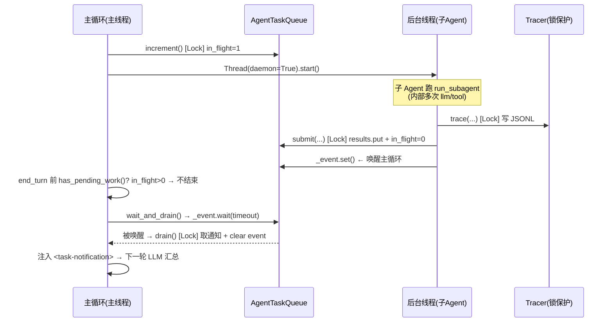

# 并发与消息传递：手搓的线程、队列与事件总线

> 本篇回答一个具体问题：**子 Agent 的队列、线程、通知、消息总线、订阅发布，是手搓的还是用现成库？底层原理是什么？** 结论先给：**全部手搓，只用了 Python 标准库的 `threading` + `queue` + `collections`，没有 `asyncio`，没有消息中间件（RabbitMQ/Redis/Celery），也没有任何第三方并发库。** 本篇把每一处并发原语的实现和原理拆开讲，让你看到真正的实现细节，而不是停留在"有队列""有线程"的概念层。
> 对应代码：`agents/task_queue.py`、`agents/subagent.py`、`workflows/event_bus.py`、`workflows/role_runtime.py`、`services/background.py`、`services/tracing.py`、`engine/loop.py`。写于 2026-09-07。

## 目录

- [全景：所有并发原语的使用点](#全景)
- [为什么是"手搓"而不是现成库](#为什么手搓)
- [线程 threading.Thread 与 daemon](#线程)
- [结果回传的三种模式：holder dict 与 Queue](#结果回传)
- [queue.Queue 的线程安全原理](#队列原理)
- [threading.Lock 互斥锁](#锁)
- [threading.Event 事件同步](#事件)
- [消息总线 EventBus 的订阅发布](#事件总线)
- [完整链路：一个后台子 Agent 从派发到回收](#完整链路)
- [线程安全的坑与隐患](#坑)
- [附录 · 变更历史](#附录)

## 全景

先看一张全景表，把散落在 7 个文件里的并发原语全部列出来：

| 原语 | 标准库来源 | 使用点 | 用途 |
|------|-----------|--------|------|
| `threading.Thread(daemon=True)` | 标准库 | `engine/loop.py:_chat_with_timeout` | LLM 调用超时护栏 |
| `threading.Thread(daemon=True)` | 标准库 | `agents/subagent.py:run_subagent_async` | 后台子 Agent 执行 |
| `threading.Thread(daemon=True)` | 标准库 | `services/background.py:run` | 后台 shell 命令 |
| `threading.Thread(daemon=True)` | 标准库 | `workflows/role_runtime.py:_run_subagent_with_heartbeat` | 工作流角色心跳监控 |
| `queue.Queue` | 标准库 | `agents/task_queue.py` | 子 Agent 完成通知队列 |
| `queue.Queue` | 标准库 | `services/background.py` | 后台 shell 完成通知队列 |
| `threading.Lock` | 标准库 | `agents/task_queue.py` | 保护 in_flight 计数 |
| `threading.Lock` | 标准库 | `workflows/role_runtime.py` | 保护心跳状态文本 |
| `threading.Lock` | 标准库 | `services/tracing.py` | 保护 JSONL 文件写入 |
| `threading.Event` | 标准库 | `agents/task_queue.py` | 唤醒阻塞等待的主循环 |
| `defaultdict + deque` | 标准库 | `workflows/event_bus.py` | 订阅发布 + 每角色 inbox |

**没有用到的**：`asyncio`（异步 IO）、`concurrent.futures`（线程池/进程池）、`multiprocessing`（多进程）、任何消息中间件（RabbitMQ/Redis/Celery）、任何第三方并发库（`gevent`、`eventlet`）。

## 为什么手搓

这里有一个关键的架构判断：**为什么不用 `asyncio`？为什么不用消息中间件？**

**1. 不用 asyncio 的原因**：本项目的并发瓶颈是 **LLM 调用与 shell 执行**——它们本质是**阻塞 IO**（HTTP 请求、`subprocess.run`），而不是高并发网络 IO。`asyncio` 的价值在于"单线程内通过事件循环调度大量并发连接"，但本项目同一时刻只有"主循环 + 几个后台子 Agent"，并发度极低（通常 < 10）。用 `asyncio` 需要把整个调用链改造成 `async/await`（LLM 客户端、工具 handler、循环骨架全部 async 化），改造成本极高，收益却很小。**线程** 是最直接的方案：一个阻塞任务就开一个线程，`threading` 标准库开箱即用。

**2. 不用消息中间件的原因**：RabbitMQ/Redis 解决的是**跨进程、跨机器的消息传递**（生产者消费者在不同进程甚至不同主机）。本项目的"后台子 Agent"和"主循环"在**同一个进程内**（都是 Python 对象），用进程内的 `queue.Queue` 就够了。引入中间件是过度设计——多一个外部依赖、多一层序列化、多一个故障点。

**3. 为什么用线程而非多进程**：`multiprocessing` 的价值是绕过 GIL 做 CPU 密集并行。但本项目的并发任务都是 IO 密集（等 LLM 响应、等 shell 输出），GIL 在 IO 等待时会释放，线程已经足够。多进程还带来"状态不共享"的麻烦——子 Agent 需要读 `state.llm`、写 `state.tracer`，进程间通信成本远高于线程间共享内存。

所以结论是：**在"单进程、低并发、IO 密集"的场景下，标准库的线程 + 队列是正确且克制的选择。** 手搓的不是"轮子"，而是用标准库原语组合出恰好满足需求的同步机制。

## 线程

### `threading.Thread` 与 `daemon=True` 的底层含义

四个使用点都是同一个模式：

```python
thread = threading.Thread(target=_target, daemon=True)
thread.start()          # 启动线程，立刻返回，不阻塞
```

关键在 `daemon=True`。要理解它，先要知道 Python 进程退出规则：

- **非 daemon 线程**（默认）：进程退出时会**等待**所有非 daemon 线程结束后才真正退出；
- **daemon 线程**：进程退出时**不等它**，直接强制终止。

本项目所有后台线程都 `daemon=True`，原因是：**保证 REPL 退出（`/exit` 或 Ctrl+C）时，不被卡住的后台任务拖住**。如果某个后台子 Agent 卡在 120s 的 shell 超时里，用户敲 `/exit` 应该立刻退出，而不是等它跑完。daemon 的代价是：**后台线程可能在"半路"被强制杀掉**——这正是之前"自杀死进程"事故里结果丢失的根源之一（进程没了，daemon 线程的结果自然也没了，见 02 文档等待闭环）。

### 超时护栏：`join(timeout)` + `is_alive()` 的配合

`engine/loop.py` 的 LLM 调用超时护栏，是"线程 + 超时"最典型的用法：

```python
def _chat_with_timeout(self, messages: list):
    result_holder: dict = {}
    error_holder: dict = {}

    def _target():
        try:
            result_holder["resp"] = self._chat(messages)   # 阻塞的 LLM 调用
        except Exception as exc:
            error_holder["error"] = exc

    thread = threading.Thread(target=_target, daemon=True)
    thread.start()
    thread.join(timeout=self.spec.llm_timeout)   # ① 最多等 llm_timeout 秒

    if thread.is_alive():                        # ② join 返回但线程还活着 → 超时
        raise LLMError(..., APIErrorType.TIMEOUT)
    if "error" in error_holder:                  # ③ 线程内异常回传到主线程
        raise error_holder["error"]
    return result_holder.get("resp")             # ④ 正常拿到结果
```

逐步讲原理：

1. **`thread.join(timeout)`**：让主线程阻塞等待子线程结束，但**最多等 `timeout` 秒**。时间到了就返回，不管子线程结没结束。
2. **`thread.is_alive()`**：join 返回后，用这个判断"是正常结束，还是超时了"——如果线程还活着，说明是超时（LLM 调用卡住了）。
3. **超时后的处理**：抛出 `LLMError(TIMEOUT)`，但**注意**——那个卡住的线程还在后台跑（daemon 线程无法被强制中断），只是主循环不再等它了。这就是为什么 Python 里"超时"是"放弃等待"而非"真正杀掉任务"。
4. **holder dict 回传**：见下一节。

### 心跳监控：`join(timeout=1)` 的轮询用法

`role_runtime.py` 的 `_run_subagent_with_heartbeat` 用了另一种 join 模式——**短超时轮询**，实现"边等边打印心跳"：

```python
thread = threading.Thread(target=_target, daemon=True)
thread.start()

waited = 0
while thread.is_alive():                 # 只要线程还活着就循环
    thread.join(timeout=1)               # 每轮最多等 1 秒
    if thread.is_alive():                # 1 秒后还活着 → 打印一次心跳
        waited += 1
        with status_lock:
            status_text = latest_status["text"]
        print(f"\r[Workflow] {role.name} working [{waited:>4}s] | {status_text}")
```

原理：`join(timeout=1)` 不是"等 1 秒就结束整个循环"，而是"**这一轮最多等 1 秒**"。每 1 秒醒来一次，检查线程是否还活着，活着就打印一条心跳。这样长任务（几十秒）期间，终端每秒刷新一次进度，用户不会以为卡死。

## 结果回传

### 三种模式：holder dict、Queue、共享状态 + Lock

后台线程要把结果回传给主线程，本项目用了三种模式，各有适用场景：

**模式一：holder dict（闭包捕获可变容器）**

`loop.py` 的超时护栏和 `role_runtime.py` 的心跳都用它：

```python
result_holder: dict = {}
def _target():
    result_holder["resp"] = self._chat(messages)   # 闭包内修改外部 dict
```

**原理**：Python 闭包内**不能直接给外部变量赋值**（除非 `nonlocal`），但**可以修改外部可变对象的内容**。`dict` 是可变对象，`result_holder["resp"] = ...` 是"修改 dict 的内容"而非"重新绑定变量"，所以不需要 `nonlocal`。这是"线程间回传单次结果"的最简模式——适合"一个线程跑一次，主线程读一次"的场景。

**模式二：queue.Queue（生产-消费）**

`task_queue.py` 和 `background.py` 用它：

```python
self._results.put({...})   # 生产端：后台线程完成时 put
self._results.get_nowait()  # 消费端：主循环 drain 时 get
```

**原理**：`Queue` 是**线程安全**的生产-消费队列，天然解决"多生产者单消费者"（多个子 Agent 同时完成，主循环统一收）。它比 holder dict 强在：支持**多个结果排队**（holder dict 只能存一个，后写覆盖先写）。适合"多个后台任务、结果可能同时到达"的场景。

**模式三：共享状态 + Lock**

`role_runtime.py` 的 `latest_status` 用锁保护：

```python
latest_status = {"text": "starting"}
status_lock = threading.Lock()

def _on_status_update(status):
    with status_lock:
        latest_status["text"] = clean     # 写

# 主线程读：
with status_lock:
    status_text = latest_status["text"]   # 读
```

**原理**：`latest_status` 被后台线程**反复写**、被主线程**反复读**，且读写是"读-改-写"复合操作（其实这里是简单赋值）。加锁保证**同一时刻只有一个线程在访问**，避免读到"写了一半"的状态。适合"高频共享可变状态"的场景。

## 队列原理

### `queue.Queue` 为什么线程安全

这是最值得讲透的。`queue.Queue` 不是"普通 list 加个锁"，它的内部实现是 **`collections.deque` + `threading.Condition`**：

```
queue.Queue 内部结构：
├── self.queue = deque()          # 真正的数据容器（双端队列）
├── self.mutex = Lock()           # 保护 deque 的互斥锁
├── self.not_empty = Condition()  # "非空"条件变量（消费者等待）
└── self.not_full  = Condition()  # "未满"条件变量（生产者等待，本项目无界不用）

put(item)：
    with self.not_full:
        with self.mutex:
            self.queue.append(item)      # 入队
        self.not_empty.notify()          # 唤醒一个等待的消费者

get()：
    with self.not_empty:
        while not self.queue:            # 队列空 → 等待（注意是 while 不是 if）
            self.not_empty.wait()
        with self.mutex:
            return self.queue.popleft()  # 出队
```

**关键原理**：

1. **`deque` 是数据容器**：双端队列，两端 append/pop 都是 O(1)，比 list 的头部操作高效。
2. **`Condition` 是"锁 + 等待队列"的复合体**：它内部有一个 `Lock` 和一个"等待线程队列"。`wait()` 会**原子地释放锁并挂起线程**，直到被 `notify()` 唤醒——这正是"消费者等待生产者"的经典同步原语。
3. **`get()` 里的 `while not self.queue`**（而非 `if`）：这是并发编程的经典防御——即使 `notify()` 唤醒了，也可能被其他线程抢先消费，所以醒来后要**重新检查**队列是否真的非空。`if` 判断一次有竞态，`while` 循环保证醒来后条件成立才继续。

### 本项目的"非阻塞"用法

本项目不用 `Queue.get()`（阻塞等），而用 `get_nowait()` + `empty()` 做**非阻塞轮询**：

```python
# task_queue.py 的 drain()
while not self._results.empty():
    notifications.append(self._results.get_nowait())
```

**原理**：`get_nowait()` 在队列空时**立即抛 `queue.Empty` 异常**而非阻塞等待。配合 `empty()` 预判，实现了"有多少收多少，没有就算了"的非阻塞语义。主循环每轮 `pre_turn` 时调用，不阻塞主流程。真正的"阻塞等待"交给了 `Event`（见下节），而不是 `Queue.get`。

## 锁

### `threading.Lock` 的底层与用法

`Lock` 是互斥锁，底层是 `_thread.allocate_lock()`（一个不可重入的二值信号量）：

```python
with self._lock:           # 等价于 lock.acquire() ... lock.release()
    self._in_flight += 1   # 临界区：同一时刻只有一个线程能执行
```

**原理**：`with lock:` 的 `__enter__` 调 `acquire()`，`__exit__` 调 `release()`。`acquire()` 时如果锁已被别的线程持有，当前线程**阻塞等待**直到锁释放。这保证临界区内的代码是"原子"的（不会被其他线程穿插）。

**为什么不可重入**：`Lock`（非 `RLock`）不能重复 acquire——同一线程连续 acquire 两次会死锁。本项目的临界区都很短（一个计数自增、一次状态赋值），不会出现"锁内再调需要锁的函数"，所以用更轻的 `Lock` 而非 `RLock`。

### 三处锁分别保护什么

| 锁 | 保护对象 | 为什么需要锁 |
|----|----------|--------------|
| `AgentTaskQueue._lock` | `_in_flight` 计数 | 派发线程 `increment()`、完成线程 `submit()`、主循环 `drain()` 三者并发读写同一个计数器，不加锁会竞态（`i += 1` 是读-改-写三步，可能丢失更新） |
| `role_runtime.status_lock` | `latest_status` 状态文本 | 后台线程反复写、主线程反复读，避免读到写一半的字符串 |
| `Tracer._lock` | JSONL 文件写入 | 多个后台子 Agent 可能同时 `trace()`，不加锁会导致两个事件交错写进同一行、JSON 损坏 |

## 事件

### `threading.Event` 的原理与"为什么用它而非 Queue.get(timeout)"

`Event` 是线程同步的"信号灯"，底层是一个**布尔标志 + Condition**：

```python
class Event:
    def __init__(self):
        self._flag = False
        self._cond = Condition()

    def set(self):      # 点亮信号灯
        with self._cond:
            self._flag = True
            self._cond.notify_all()      # 唤醒所有 wait 的线程

    def clear(self):    # 熄灭信号灯
        with self._cond:
            self._flag = False

    def wait(self, timeout=None):        # 等待信号灯点亮
        with self._cond:
            if not self._flag:
                self._cond.wait(timeout)
            return self._flag
```

`task_queue.py` 用它实现"主循环阻塞等待子 Agent 完成"：

```python
# submit() 里（后台线程完成时）
self._event.set()         # 点亮信号灯，唤醒主循环

# wait_and_drain() 里（主循环等待时）
self._event.wait(timeout=timeout)   # 睡到信号灯亮，或超时
return self.drain()

# drain() 里（消费完后）
if self._results.empty():
    self._event.clear()   # 队列空了，熄灭信号灯，下次 wait 会重新睡
```

**为什么用 `Event` 而非 `Queue.get(timeout)`？** 这是 02 文档"等待闭环"反复强调的设计点，现在讲它的**底层原因**：

- `Queue.get(timeout)` 的语义是"**取一个元素，或超时**"——它绑定在"取数据"这个动作上；
- 本项目主循环想要的是"**要么立刻有结果，要么睡一会再看，并且要顺带知道还剩几个在飞（in_flight）**"——这是一个"等待 + 查询"的复合语义，`Queue.get` 表达不了"顺便查 in_flight"。

`Event.wait + 统一 drain` 的配合正好：`wait` 负责"睡到被唤醒或超时"，`drain` 负责"一次性清空队列 + 返回 in_flight"。**set/clear 的生命周期也被精心对齐**——`submit` 时 set（有结果了），`drain` 清空后 clear（没结果可取了），保证下一次 `wait` 在队列空时正确地重新阻塞。

## 事件总线

### EventBus 手搓的订阅发布

`workflows/event_bus.py` 是工作流（SOP）的核心，用 `defaultdict` 手搓了完整的发布-订阅：

```python
class EventBus:
    def __init__(self):
        self._subscriptions: dict[str, set[str]] = defaultdict(set)      # topic → {role}
        self._inboxes: dict[str, deque[StructuredMessage]] = defaultdict(deque)  # role → 消息队列
        self._event_log: list[StructuredMessage] = []                     # 全局日志（审计/回放）

    def subscribe(self, role_name, topics):
        for topic in topics:
            self._subscriptions[topic].add(role_name)      # 建立 topic → role 映射

    def publish(self, message):
        self._event_log.append(message)                    # ① 先记日志
        role_names = set(self._subscriptions.get(message.topic, set()))
        role_names.update(self._subscriptions.get("*", set()))   # ② 通配符订阅
        if message.send_to:                                # ③ 定向投递过滤
            role_names = {n for n in role_names if n in message.send_to}
        for role_name in role_names:                       # ④ 投递到各角色 inbox
            self._inboxes[role_name].append(message)

    def consume(self, role_name):
        inbox = self._inboxes.get(role_name)
        if not inbox:
            return []
        items = list(inbox)
        inbox.clear()          # ⑤ 读取后清空：每条消息只被消费一次
        return items
```

**逐步讲原理**：

1. **`defaultdict(set)` 存订阅关系**：`topic → {订阅它的角色集合}`。`defaultdict` 让 `self._subscriptions[topic]` 在 key 不存在时自动创建空 set，省去手动判空。`set` 保证同一角色订阅同一 topic 两次不会重复（`add` 幂等）。

2. **`defaultdict(deque)` 存每角色 inbox**：每个角色一个独立的消息队列。`deque` 支持两端 O(1) 操作，`append` 入队、`clear` 清空都高效。独立 inbox 避免"消息抢占"——A 角色消费消息不影响 B 角色。

3. **`publish` 的四处路由**：先记 `event_log`（审计），再查订阅关系（含 `*` 通配符），再按 `send_to` 定向过滤，最后投递到各角色 inbox。这是"发布-订阅"的标准三段：**记录 → 路由 → 投递**。

4. **`consume` 读取后清空**：语义是"本轮全部消费"。工作流引擎每步 round-robin 遍历角色，`consume` 拿走该角色 inbox 里的**所有**消息（可能多条），然后清空——保证每条消息只被消费一次，不会重复触发。

**为什么不用现成的 pub/sub 库**：Python 生态里没有"标准库级"的进程内发布订阅，第三方（如 `blinker`、`pypubsub`）引入依赖却只省几十行代码。而且本项目的订阅关系极简单（topic → 角色，一层映射），`defaultdict` 手搓 20 行就够，且完全可控（`event_log` 审计、`send_to` 定向投递都是自定义语义，现成库未必支持）。

## 完整链路

### 一个后台子 Agent 从派发到回收的全过程

把上面所有原语串起来，看一次后台子 Agent 的完整生命周期：



**每一步对应的原语**：

1. **派发**（`subagent.py`）：`increment()`（Lock 保护计数）→ `Thread(daemon=True).start()`（后台执行）。
2. **执行**（后台线程内）：子 Agent 内部跑统一循环（多次 LLM + 工具），每次工具调用 `trace()`（Lock 保护 JSONL 写入）。
3. **完成**（后台线程）：`submit()`（Lock 保护：`results.put` + `in_flight -= 1`）→ `_event.set()`（唤醒等待者）。
4. **主循环不结束**（`loop.py`）：end_turn 前 `has_pending_work()` 查 `in_flight > 0`，为真则注入 `<background-tasks-pending>` 继续等。
5. **主循环等待**（`notifications.py`）：`wait_and_drain()` → `_event.wait(timeout)` 阻塞，被 `set()` 唤醒或超时。
6. **主循环消费**：`drain()`（Lock 保护：`get_nowait` 取全部 + `clear` event）→ 注入 `<task-notification>` → 下一轮 LLM 汇总结果。

这一整条链路里，**没有一处阻塞式 `Queue.get`，没有回调注册，没有 Future/Promise**——全是"主循环轮询 + Event 唤醒"的协作式并发。这是理解本项目并发模型的关键：**不是事件驱动（回调地狱），不是 async/await（协程），而是最朴素的"多线程 + 锁 + 信号灯"的经典并发模型**。

## 坑

### 手搓并发的隐患与已知边界

手搓并发原语是有代价的，这些是当前实现的已知边界（也是未来重构的候选点）：

| 隐患 | 说明 | 当前状态 |
|------|------|----------|
| **daemon 线程结果丢失** | 进程退出时 daemon 线程被强制终止，未完成的后台任务结果丢失 | 已知（02 文档等待闭环 + 转录补救），无法根治，只能靠"等待闭环"让主循环尽量别提前退出 |
| **`empty()` 的竞态** | `drain()` 里 `while not empty(): get_nowait()` 在**多消费者**场景下有竞态（两个线程同时判空、同时 get，第二个 get_nowait 抛 Empty）。本项目是**单消费者**（只有主循环 drain），所以安全 | 单消费者场景无风险；若未来多消费者需加锁 |
| **不可重入 Lock 的死锁风险** | 临界区内再调用需要锁的函数会死锁。当前临界区都极短、无嵌套调用 | 当前无风险，靠约定维持 |
| **超时≠终止** | `join(timeout)` 超时后，卡住的线程仍在跑（daemon 无法强杀），只是主循环不等了。反复超时会积累"僵尸线程" | 已知边界，Python 无优雅强杀线程的机制 |
| **EventBus 非线程安全** | `EventBus` 没有加锁，因为工作流是**单线程串行**执行（round-robin 逐个角色跑），没有并发 publish | 当前安全；若未来工作流角色并行执行，需加锁 |
| **GIL 限制** | 多线程在 CPU 密集任务上无并行加速（GIL 只允许一个线程执行 Python 字节码）。本项目是 IO 密集，GIL 在 IO 等待时释放，所以无碍 | 当前无碍，但"多线程并行算力"是错觉 |

## 附录

### 变更历史

| 遇到的问题 / bug | 问题分析 | 解决方法 | 时间 |
|------------------|----------|----------|------|
| 后台子 Agent 结果丢失 | end_turn 时 in_flight>0，主循环提前结束，daemon 线程结果滞留 | `wait_for_pending` + `has_pending_work` + `Event` 三态等待 | 09-03 |
| 自杀死进程无痕中断 | daemon 线程清理命令杀宿主 python | BashTool 工具级护栏（见 04 文档） | 09-03 |
| 崩溃后无法复盘 | 并发下 trace 写入无锁、输入未记录 | `Tracer._lock` 保护 JSONL + command/path 预览 | 09-03 |
| 长角色无感知 | 后台线程跑几十秒无输出 | `role_runtime` 心跳（`join(timeout=1)` 轮询 + status_lock） | 09-02 |
| 双层 API 重试 | 子循环重复重试 | 移除，统一 adapter（见 08 文档） | 09-01 |
