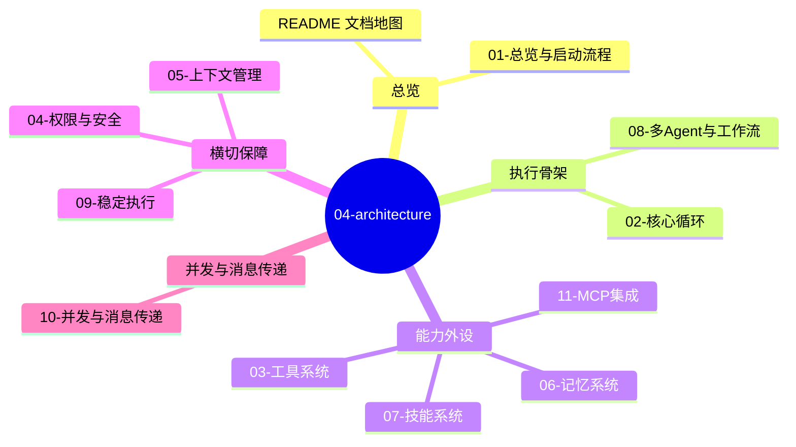

# 04-architecture — 项目架构详解（当前版）

> 本目录讲解**当前代码**（S1-S6 深度重构后架构）。与代码对照阅读，路径以仓库根为基准。
> 历史版本详解已移入 `../archive/`（见下方归档映射）。
> 评估沿用保留的 `项目评估体系详解.md`，不另行编写。

## 文档地图

| 文档 | 主题 | 对应代码 |
|------|------|----------|
| [00-提示词工程与行为规则](00-提示词工程与行为规则.md) | 三级覆盖、动静分离、base.md 逐节拆解、fragments、度量 | `prompts/` · `context/prompt.py` |
| [01-总览与启动流程](01-总览与启动流程.md) | 定位、目录地图、启动链路、配置分层、Prompt 体系、演进 | `main.py` · `runtime/` · `config/` · `prompts/` |
| [02-核心循环](02-核心循环.md) | ReAct 骨架、plan-and-solve、错误恢复、等待闭环、截断续写（含附录·变更史） | `engine/loop.py` · `agents/session.py` |
| [03-工具系统](03-工具系统.md) | 工具定义/注册/分发、ToolResult、隔离与动态能力（含附录） | `tools/` · `engine/results.py` |
| [04-权限与安全](04-权限与安全.md) | 模式/规则/危险检测、决策管线、bypass-immune、自杀护栏（含附录） | `services/permissions.py` · `tools/BashTool.py` |
| [05-上下文管理](05-上下文管理.md) | 五级压缩管线、预算跟踪、熔断、压缩后恢复（含附录） | `context/compact.py` · `config/` |
| [06-记忆系统](06-记忆系统.md) | 跨会话记忆、写引导、渐进式注入、可观测 KPI（含附录） | `services/memory.py` · `prompts/fragments/memory.md` |
| [07-技能系统](07-技能系统.md) | Agent Skills 规范、三层披露、双入口、多级来源（含附录） | `skills/` · `tools/SkillTool.py` · `ui/repl.py` |
| [08-多Agent与工作流](08-多Agent与工作流.md) | 子 Agent、注册表、同步/后台、SOP 引擎、Coordinator 移除记录（含附录） | `agents/` · `workflows/` |
| [09-稳定执行](09-稳定执行.md) | 失败五层全景、恢复机制、可观测性、复盘方法论（含附录） | `engine/errors.py` · `services/tracing.py` |
| [10-并发与消息传递](10-并发与消息传递.md) | 线程/队列/锁/事件/事件总线的底层原理、手搓 vs 现成库、完整链路 | `agents/task_queue.py` · `workflows/event_bus.py` · `services/background.py` |
| [11-MCP集成](11-MCP集成.md) | MCP 客户端、stdio 传输、工具发现/转换/命名、超时与死锁防护（含附录） | `services/mcp.py` · `mcp.json.example` |
| `项目评估体系详解.md`（保留） | eval/ 体系（不重写） | `eval/` |

## 归档映射（2026-09-04）

旧文档 → `../archive/`：

| 归档文件 | 取代者 |
|----------|--------|
| `archive/项目详解-v2.md` | 01/02/03/05 拆分覆盖 |
| `archive/项目失败处理详解.md` | 09-稳定执行 |
| `archive/Coordinator模式详解.md` | 08 中"Coordinator：为什么被判定多余"一节 |
| `archive/MetaGPT简化版...详解.md` | 08-多Agent与工作流 |

## 阅读顺序建议

1. 想了解整体：`00`（行为从哪来）→ `01` → `02`；
2. 想了解单个子系统：直接读对应篇（各篇自含动机/设计/实现/事故）；
3. 排查线上问题：`09`（复盘方法论）→ `02`/`04` 附录的变更史对照；
4. 每一篇末尾的"附录·变更历史"是多年事故与修复合集的索引——新功能或重构前先看它。
