# 项目失败处理详解

本文档详细解析 AI Agent 项目中实现的失败处理机制，参考 Claude Code 的设计理念，涵盖错误分类、重试策略、JSON 截断修复、Agent 循环保护等核心能力。

---

## 0. OpenAI 工具调用流程 - 基础概念梳理

### 0.1 三种角色（Role）

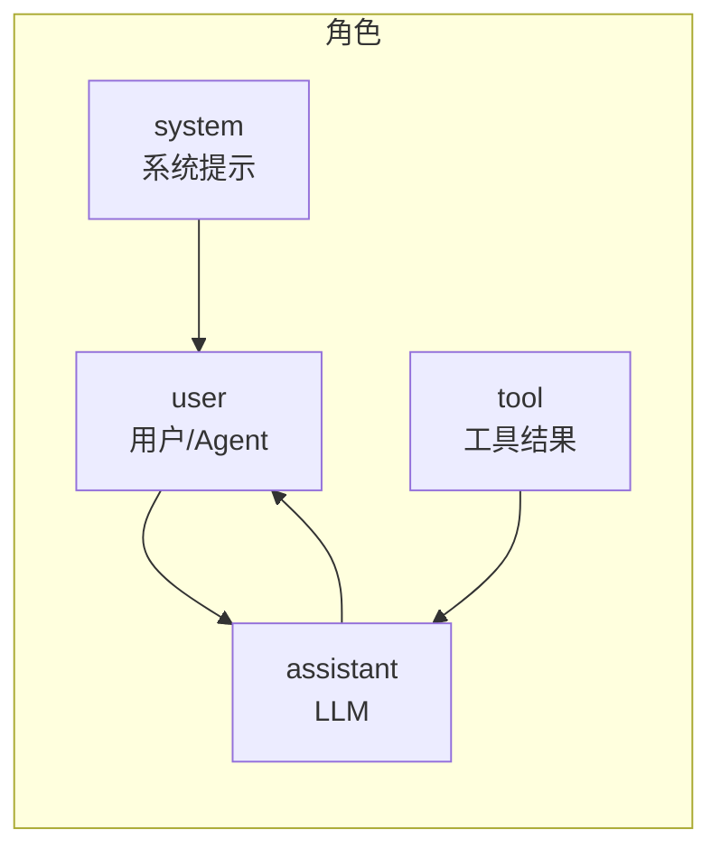

| 角色 | 谁发送 | 内容 |
|------|--------|------|
| `system` | 开发者 | 系统提示词，告诉 LLM 它是什么角色 |
| `user` | 用户/Agent | 用户的消息，或 Agent 注入的错误/截断通知 |
| `assistant` | LLM | LLM 的响应，可能包含 `content`（文本）或 `tool_calls`（工具调用） |
| `tool` | Agent | **工具执行结果**，回复给 LLM 看 |

**注意**：`tool` 不是独立角色名，而是 `user` 角色的一种特殊形式，专门用于返回工具执行结果。

### 0.2 工具调用的完整交互流程

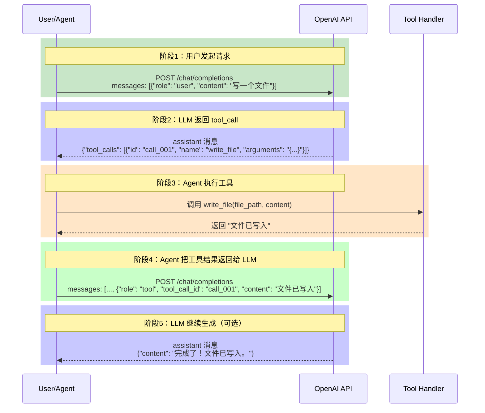

### 0.3 字段对照表

```
┌─────────────────────────────────────────────────────────────────────────────┐
│                           assistant 消息                                      │
│  content: "我来帮你写文件"           ← LLM 的文本回复                          │
│  tool_calls: [                    ← 需要调用工具                               │
│    {                                                              ──────────┐ │
│      id: "call_001",                 ← 工具调用的唯一 ID                       │ │
│      type: "function",                                                       │ │ ← OpenAI 格式
│      function: {                      ← function 类型                         │ │
│        name: "write_file",            ← 工具名称                              │─┤ │
│        arguments: "{...}"              ← 工具参数（JSON 字符串）                │ │
│      }                                                                ──────────┘ │
│    }                                                                     ──────────┐
│  ]                                                                           │ │
│                                                                               │ │ ← Anthropic 格式
│  tools: [{                       ← 这是工具定义，不是消息字段！                 │─│
│    name: "write_file",                                                        │ │
│    input: {file_path: "...", content: "..."}   ← 参数                          │ │
│  }]                                                                           │ │
└─────────────────────────────────────────────────────────────────────────────┘

┌─────────────────────────────────────────────────────────────────────────────┐
│                             tool 消息                                         │
│  {                                                                            │
│    "role": "tool",                    ← role 是 "tool"（不是 "user"！）        │
│    "tool_call_id": "call_001",         ← 对应 assistant 的 tool_calls id       │
│    "content": "文件已写入"              ← 工具执行结果                          │
│  }                                                                            │
└─────────────────────────────────────────────────────────────────────────────┘
```

### 0.4 项目内部的数据结构

项目中使用了 **Anthropic 风格**的内部表示（`tool_use` 块），因为项目最初可能为 Anthropic API 设计，后来扩展支持 OpenAI：

```python
# llm.py 中 response.content 的块结构

# Anthropic/OpenAI 统一格式（内部使用）
class SimpleNamespace:
    type = "text"           # 普通文本块
    text = "内容..."

    type = "tool_use"       # 工具调用块
    id = "call_001"         # 工具调用 ID
    name = "write_file"     # 工具名称
    input = {...}           # 工具参数（已解析的 dict）

    type = "tool_result"    # 工具结果块（发送给 LLM 时）
    tool_use_id = "call_001"
    content = "文件已写入"
```

### 0.5 一次完整的工具调用示例

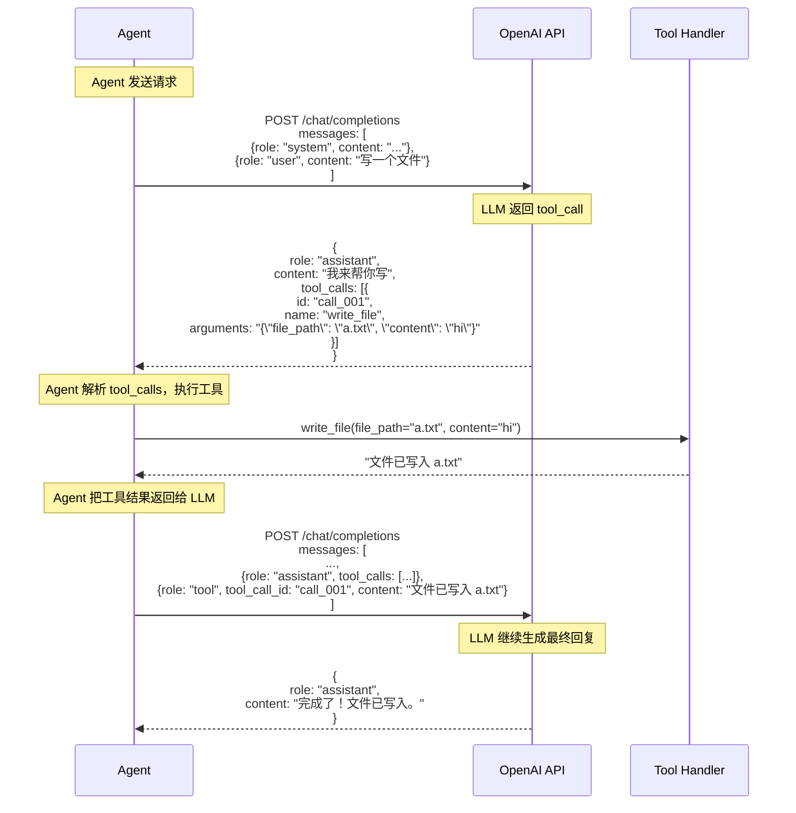

### 0.6 关键规则

```mermaid
flowchart TD
    A[OpenAI API 规则] --> B["tool_calls 必须紧跟在一对 tool_result 之后"]
    A --> C["每个 tool_call 必须有对应的 tool_result"]
    A --> D["tool_result 的 tool_call_id 必须匹配对应的 tool_call id"]

    B --> E[正确顺序：<br/>assistant(tool_calls) → tool(result) → assistant(继续)]
    C --> E
    D --> E

    F[错误示例] --> G["assistant(tool_calls) → user(其他消息) → assistant(tool_calls)"]
    F --> H["↑ API 会报 400 错误！"]
```

---

## 1. 架构概览

### 1.1 系统架构图

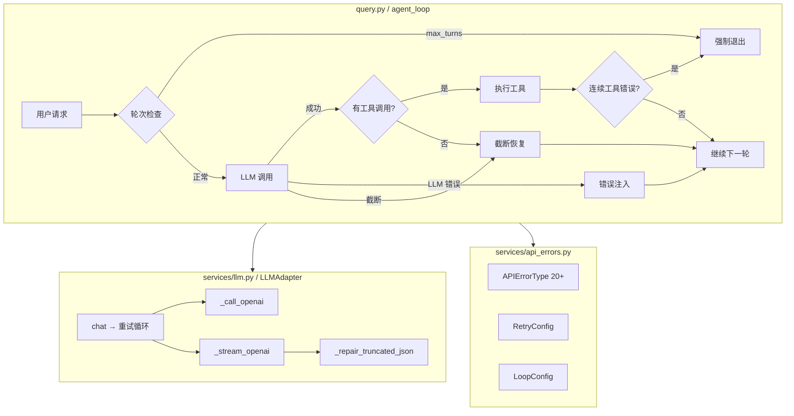

### 1.2 组件职责

| 组件 | 职责 |
|------|------|
| `query.py` | Agent 循环控制、权限检查、错误注入 |
| `services/llm.py` | LLM 调用适配、重试策略、JSON 修复 |
| `services/api_errors.py` | 错误分类、配置常量、重试计算 |
| `services/compact.py` | Token 追踪、上下文压缩 |

---

## 2. 错误分类体系

### 2.1 错误类型枚举

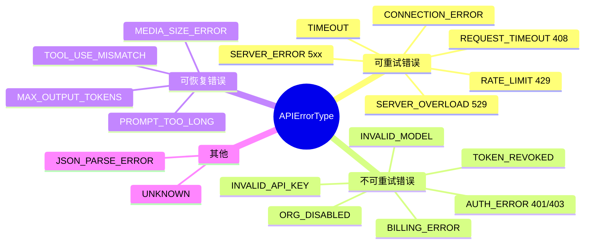

### 2.2 `classify_api_error()` 分类逻辑

```python
def classify_api_error(error: Exception) -> APIErrorType:
    # 1. 优先检查 HTTP status code
    status = getattr(error, "status", None)
    if status == HTTPStatus.RATE_LIMIT:
        return APIErrorType.RATE_LIMIT
    if status >= 500:
        return APIErrorType.SERVER_ERROR

    # 2. 关键词匹配（无 status 时兜底）
    error_msg = str(error).lower()
    if "oauth" in error_msg or ("token" in error_msg and "revoked" in error_msg):
        return APIErrorType.TOKEN_REVOKED
    if "timeout" in error_msg:
        return APIErrorType.TIMEOUT
    # ...
```

---

## 3. API 重试机制

### 3.1 指数退避 + Jitter 算法详解

**问题背景**：当 API 请求失败时（网络抖动、服务器限流），立即重试往往会再次失败。

**动机**：等待一段时间再重试，给服务器恢复的时间。

**简单方案**：固定等待时间（如 1 秒）。问题：如果失败 10 次，就要等 10 秒，太慢了。

**指数退避方案**：等待时间指数增长

```
第 1 次失败 → 等 1 秒
第 2 次失败 → 等 2 秒
第 3 次失败 → 等 4 秒
第 4 次失败 → 等 8 秒
...
```

**Jitter（抖动）**：如果大量客户端同时失败，它们可能会同时重试，再次造成拥塞（"惊群效应"）。Jitter 是在指数退避的基础上添加随机偏移量，让重试时间分散开。

```
无 Jitter：
客户端 A: 失败 → 等 1s → 重试 ─┐
客户端 B: 失败 → 等 1s → 重试 ─┼→ 同时到达 → 再次拥塞
客户端 C: 失败 → 等 1s → 重试 ─┘

有 Jitter：
客户端 A: 失败 → 等 1s + 0.2s → 重试 ─┐
客户端 B: 失败 → 等 1s + 0.5s → 重试 ─┼→ 分散开 → 减少拥塞
客户端 C: 失败 → 等 1s + 0.8s → 重试 ─┘
```

**设计原因**：

| 设计 | 原因 | 不这么设计的问题 |
|------|------|-----------------|
| 指数增长 | 临时故障快速恢复，持续故障避免无用重试 | 固定等待太慢或太快 |
| 加 Jitter | 避免多客户端同时重试造成惊群 | 所有客户端同步重试，再次拥塞 |
| 设置最大延迟 | 避免等待太久（用户耐心有限） | 可能需要等 100+ 秒 |

**完整工作流程**：

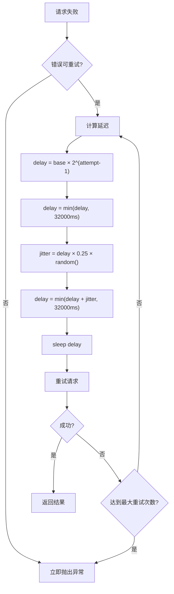

**延迟时间计算详解**：

代码中 `get_retry_delay()` 的实际计算过程：

```
第1步：计算指数退避
        delay = base × 2^(attempt-1)

第2步：第一次 cap（确保不超过最大延迟）
        delay = min(delay, 32000ms)

第3步：计算 jitter（延迟的 ±25% 随机偏移）
        jitter = delay × 0.25 × random(0~1)

第4步：第二次 cap（确保 jitter 后也不超过最大延迟）
        delay = min(delay + jitter, 32000ms)
```

**为什么要 jitter 后再次 cap？** 确保最终延迟永远不会超过 32s。

**以 BASE_DELAY_MS=1000 为例，各次重试的延迟**：

| 重试次数 | 指数退避后 | cap 后 | jitter（随机） | 最终延迟 |
|---------|-----------|--------|--------------|---------|
| 第1次 | 1000×2⁰ = 1000ms | 1000ms | +0~250ms | **1000~1250ms** |
| 第2次 | 1000×2¹ = 2000ms | 2000ms | +0~500ms | **2000~2500ms** |
| 第3次 | 1000×2² = 4000ms | 4000ms | +0~1000ms | **4000~5000ms** |
| 第4次 | 1000×2³ = 8000ms | 8000ms | +0~2000ms | **8000~10000ms** |
| 第5次 | 1000×2⁴ = 16000ms | 16000ms | +0~4000ms | **16000~20000ms** |
| 第6次 | 1000×2⁵ = 32000ms | 32000ms | +0~8000ms | **32000ms**（已达上限） |

**单客户端场景下 Jitter 仍有用的原因**：
1. 避免与 Rate Limiter 的固定节奏同步，防止每次重试都撞在同一时间点
2. 代码中 `agent` 工具可创建子 Agent，多个 Agent 可能同时遇到错误
3. 打破规律性，避免被 API 识别为"机器行为"

### 3.2 配置常量

```python
class RetryConfig:
    DEFAULT_MAX_RETRIES = 3          # 默认最大重试次数
    PROMPT_TOO_LONG_MAX_RETRIES = 2  # 上下文超限特殊处理

    BASE_DELAY_MS = 1000             # 基础退避 1s
    MAX_DELAY_MS = 32000             # 最大延迟 32s
    JITTER_RATIO = 0.25              # ±25% 随机 jitter

    OVERLOAD_MAX_RETRIES = 3         # 529 特殊处理
    OVERLOAD_BASE_DELAY_MS = 500     # 更短的初始延迟
```

### 3.3 `get_retry_delay()` 实现

```python
def get_retry_delay(attempt: int, error_type: APIErrorType,
                    retry_after_ms: Optional[int] = None) -> int:
    # 优先使用 API 返回的 Retry-After
    if retry_after_ms is not None:
        return min(retry_after_ms, RetryConfig.MAX_DELAY_MS)

    # 根据错误类型选择基础延迟
    base = (RetryConfig.OVERLOAD_BASE_DELAY_MS
            if error_type == APIErrorType.SERVER_OVERLOAD
            else RetryConfig.BASE_DELAY_MS)

    # 指数退避：base × 2^(attempt-1)
    delay_ms = base * (2 ** (attempt - 1))
    delay_ms = min(delay_ms, RetryConfig.MAX_DELAY_MS)

    # 添加 jitter（在 cap 之后再次 cap，确保不超过最大延迟）
    import random
    jitter = int(delay_ms * RetryConfig.JITTER_RATIO * random.random())
    delay_ms = min(delay_ms + jitter, RetryConfig.MAX_DELAY_MS)

    return delay_ms
```

---

## 4. JSON 截断修复

### 4.1 问题背景

这个机制与 max_tokens 截断恢复是**分开的**，用于修复 tool call 参数中的 JSON 截断。

当 LLM 生成 tool_call 时，参数是 JSON 格式。在流式输出过程中，如果响应被截断，JSON 参数可能是不完整的：

```
{"file_path": "test.py", "old_string": "hel  ← JSON 在这里被截断
```

### 4.2 修复策略

```mermaid
flowchart TD
    A[截断的 JSON 字符串] --> B{starts with {?}
    B -->|是| C[提取最后一个完整对象]
    B -->|否| D{starts with [?}
    D -->|是| E[提取最后一个完整数组]
    D -->|否| F[提取最后一个键值对]
    C --> G{parse 成功?}
    E --> G
    F --> G
    G -->|是| H[返回修复结果]
    G -->|否| I[尝试补全括号]
    I --> J{修复成功?}
    J -->|是| H
    J -->|否| K[返回 _json_parse_error]
```

### 4.3 调用位置

JSON 修复在 `llm.py` 的两个地方被调用：

1. **`_stream_openai()`** (流式调用)：
```python
parsed_args, parse_error = self._safe_parse_json(tc["arguments"])
if parse_error:
    repaired_args, repair_success = self._repair_truncated_json(tc["arguments"])
    if repair_success:
        # 使用修复后的参数
    else:
        # 标记为 JSON 解析错误
        input = {"_json_parse_error": parse_error, "_raw_args": raw_args[:200]}
```

2. **`_convert_oai_response_with_parse_recovery()`** (非流式调用)：
```python
# 同样的逻辑
```

---

## 5. Agent 循环保护

### 5.1 三大保护机制

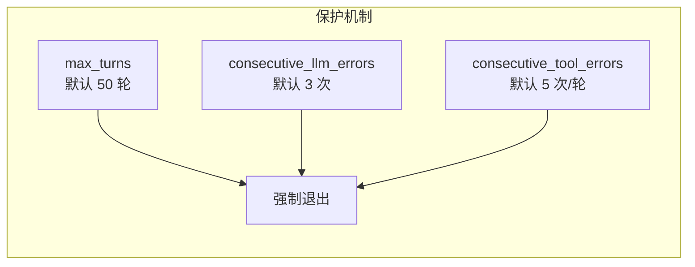

| 机制 | 配置 | 说明 |
|------|------|------|
| **max_turns** | 默认 50 | 超过轮次上限强制退出 |
| **consecutive_llm_errors** | 默认 3 | 连续 LLM 错误达到阈值停止 |
| **consecutive_tool_errors** | 默认 5 | 同轮内连续工具错误达到阈值停止 |

### 5.2 错误注入机制

Claude Code 的关键设计：**错误不静默消失，而是注入给 LLM 让它知道并自我恢复**

**设计原理**：当 API 调用失败时，与其直接退出，不如把错误信息告诉 LLM，让它有机会调整行为（比如减少请求频率、使用更简洁的输出等）。

#### 工作流程

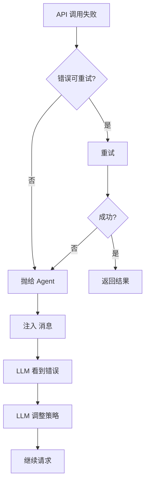

#### 代码实现（query.py）

```python
# query.py agent_loop 中捕获 LLMError
try:
    response = state.llm.chat(system_prompt, messages, tool_defs, stream=True, on_text=_on_text)
except (LLMError, APIRetryExhaustedError) as e:
    # 1. 停止动画
    _spinner.stop()

    # 2. 计数器 +1
    consecutive_llm_errors += 1

    # 3. 检查是否达到阈值
    if consecutive_llm_errors >= LoopConfig.MAX_CONSECUTIVE_LLM_ERRORS:
        print(f"\033[31m[Agent] Consecutive error limit reached, stopping.\033[0m")
        return tracker, breaker

    # 4. 注入错误消息
    error_msg = {
        "role": "user",
        "content": f"<error>{get_error_message(e.error_type)}</error>"
    }
    messages.append(error_msg)
    tracker.track_new_message(error_msg)

    # 5. 尝试压缩上下文
    compacted = check_and_compact(messages, tracker, breaker)
    if compacted is not None:
        messages[:] = compacted

    # 6. 继续循环，让 LLM 知道错误
    continue
```

#### 完整示例：429 Rate Limit 错误

**场景**：Agent 正在写一个长文档，API 返回 429 Rate Limit

---

**Step 1：Agent 发送请求（正常情况）**

```json
{
  "model": "gpt-4o",
  "messages": [
    {"role": "system", "content": "你是Claude Code..."},
    {"role": "user", "content": "写一个很长的技术文档"}
  ],
  "tools": [{"type": "function", "function": {"name": "write_file", ...}}],
  "max_tokens": 2000
}
```

**Step 2：API 返回 429 Rate Limit**

```json
{
  "error": {
    "message": "Rate limit exceeded. Please wait before trying again.",
    "type": "rate_limit_error",
    "status": 429
  }
}
```

**Step 3：LLMAdapter 捕获错误，开始重试**

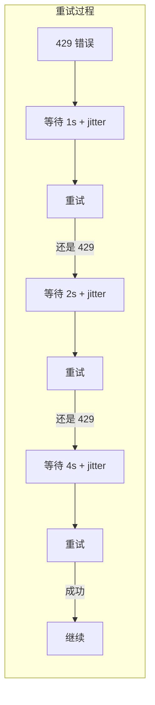

**Step 4：重试全部失败后，注入错误消息**

假设重试 3 次都失败了（每次都返回 429）。Agent 的 messages 变为：

```json
[
  {"role": "system", "content": "你是Claude Code..."},
  {"role": "user", "content": "写一个很长的技术文档"},

  {
    "role": "user",
    "content": "<error>rate_limit: Rate limit reached. Please wait before trying again.</error>"
  }
]
```

**Step 5：LLM 收到错误消息，调整策略**

LLM 看到错误消息后，可能会：
- 生成更简短的回答
- 减少工具调用次数
- 建议用户等待

LLM 返回：

```json
{
  "choices": [{
    "message": {
      "role": "assistant",
      "content": "由于 API 限流，我将分段生成文档。先写第一部分..."
    }
  }]
}
```

#### 为什么要注入错误而不是直接退出？

| 方案 | 效果 |
|------|------|
| 直接退出 | 用户需要手动重试，不知道发生了什么 |
| 注入错误消息 | LLM 知道发生了什么，可以调整策略继续工作 |

Claude Code 的理念：**让 AI Agent 能够自我恢复**，而不是一遇到错误就放弃。

---

## 6. max_tokens 截断恢复（核心设计）

### 6.1 问题背景

当 `max_tokens` 设置较小（实验目的）时，LLM 输出经常被截断。

**关键认知**：`finish_reason = "length"` 不等于"只有文本被截断"。它只说明 LLM 的输出被**强制中断**，可能同时包含 text 和 tool_calls。

### 6.2 四种场景的完整 OpenAI 格式对话记录

为了更直观理解这个问题，我们展示 OpenAI API 格式的完整对话过程。

#### 6.2.1 正常情况：agent 多轮对话过程

**一句话总结**：assistant 说"我要调用工具"，Agent 执行工具后，用 `tool` 角色把结果返回给 LLM，LLM 继续生成。

---

**Step 1：用户发起请求（Turn 1）**

Agent 发送请求：
```json
{
  "model": "gpt-4o",
  "messages": [
    {"role": "system", "content": "你是Claude Code..."},
    {"role": "user", "content": "写一个Hello World程序"}
  ],
  "tools": [{"type": "function", "function": {"name": "write_file", ...}}],
  "max_tokens": 2000
}
```

**Step 2：LLM 返回 tool_call（Turn 1 响应）**

```json
{
  "choices": [{
    "message": {
      "role": "assistant",
      "content": "我来帮你写一个Hello World程序。",
      "tool_calls": [
        {
          "id": "call_001",
          "type": "function",
          "function": {
            "name": "write_file",
            "arguments": "{\"file_path\": \"hello.py\", \"content\": \"print('Hello World')\"}"
          }
        }
      ]
    },
    "finish_reason": "tool_calls"
  }]
}
```

**Step 3：Agent 执行工具（注意：这里没有发给 LLM）**

```python
# Agent 内部执行
result = write_file(file_path="hello.py", content="print('Hello World')")
# result = "文件已写入 hello.py (23 bytes)"
```

**Step 4：Agent 把工具结果返回给 LLM（Turn 2 请求）**

```json
{
  "model": "gpt-4o",
  "messages": [
    {"role": "system", "content": "你是Claude Code..."},
    {"role": "user", "content": "写一个Hello World程序"},

    {
      "role": "assistant",
      "content": "我来帮你写一个Hello World程序。",
      "tool_calls": [
        {
          "id": "call_001",
          "type": "function",
          "function": {
            "name": "write_file",
            "arguments": "{\"file_path\": \"hello.py\", \"content\": \"print('Hello World')\"}"
          }
        }
      ]
    },

    {
      "role": "tool",
      "tool_call_id": "call_001",
      "content": "文件已写入 hello.py (23 bytes)"
    }
  ],
  "max_tokens": 2000
}
```

**关键点**：
- `tool` 是 **role** 的值，不是字段名
- `tool_call_id` 必须与 `tool_calls[].id` 匹配
- 一次 tool_call，对应一次 tool 返回

**Step 5：LLM 继续生成（Turn 2 响应）**

```json
{
  "choices": [{
    "message": {
      "role": "assistant",
      "content": "完成了！文件已写入。\n\n```python\nprint('Hello World')\n```"
    },
    "finish_reason": "stop"
  }]
}
```

---

#### 6.2.2 失败处理前：触发 max_tokens 时的多轮对话过程

**场景**：假设 `max_tokens = 100`，LLM 需要生成很长的回复。

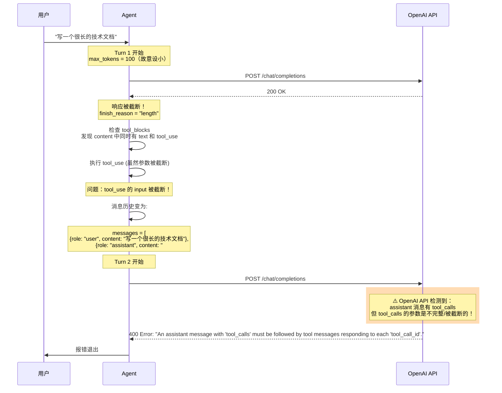

**Turn 1 发送的请求体（max_tokens=100）：**

```json
{
  "model": "gpt-4o",
  "messages": [
    {"role": "system", "content": "你是Claude Code，一个AI编程助手..."},
    {"role": "user", "content": "写一个很长的技术文档"}
  ],
  "tools": [
    {
      "type": "function",
      "function": {
        "name": "write_file",
        "description": "写入文件内容",
        "parameters": {...}
      }
    }
  ],
  "max_tokens": 100
}
```

**Turn 1 返回（被截断）：**

```json
{
  "choices": [
    {
      "message": {
        "role": "assistant",
        "content": "# 技术文档\n\n本文档详细介绍...",
        "tool_calls": [
          {
            "id": "call_001",
            "type": "function",
            "function": {
              "name": "write_file",
              "arguments": "{\"file_path\": \"doc.md\", \"content\": \"# 技术文档\n\n本文档详细"
            }
          }
        ]
      },
      "finish_reason": "length"
    }
  ],
  "usage": {
    "prompt_tokens": 200,
    "completion_tokens": 100,
    "total_tokens": 300
  }
}
```

**注意**：`finish_reason = "length"` 表示输出达到 `max_tokens` 限制被截断。

**执行工具后，Turn 2 发送的请求体（这里出错！）：**

```json
{
  "model": "gpt-4o",
  "messages": [
    {"role": "system", "content": "..."},
    {"role": "user", "content": "写一个很长的技术文档"},
    {
      "role": "assistant",
      "content": "# 技术文档\n\n本文档详细介绍...",
      "tool_calls": [
        {
          "id": "call_001",
          "type": "function",
          "function": {
            "name": "write_file",
            "arguments": "{\"file_path\": \"doc.md\", \"content\": \"# 技术文档\n\n本文档详细"
          }
        }
      ]
    },
    {
      "role": "tool",
      "tool_call_id": "call_001",
      "content": "文件已写入 doc.md"
    }
  ],
  "max_tokens": 100
}
```

**Turn 2 返回（400 错误）：**

```json
{
  "error": {
    "message": "An assistant message with 'tool_calls' must be followed by tool messages responding to each 'tool_call_id'.",
    "type": "invalid_request_error",
    "param": "messages",
    "status": 400
  }
}
```

**为什么会触发这个错误？**

**真正的原因**：当 `finish_reason = "length"` 时，LLM 返回的 `tool_calls` 的 `arguments` 是**被截断的不完整 JSON**！

```
"arguments": "{\"file_path\": \"doc.md\", \"content\": \"# 技术文档\n\n本文档详细"
                                                                        ↑ 截断了！
                                                                        这不是有效的 JSON！
```

虽然 Agent 仍然执行了工具（写入了一个被截断的文件），但 `tool_calls` 本身的参数就是不合法的。OpenAI API 在 Turn 2 校验消息历史时，发现 tool_calls 的 JSON 是不完整的，直接拒绝。

**问题的根源不是消息顺序，而是 tool_calls 参数不完整！**

---

#### 6.2.3 以前的处理方案：content 中混入 output_truncated 块

**思路**：在 response.content 列表中添加一个特殊的 `output_truncated` 块来标记截断。

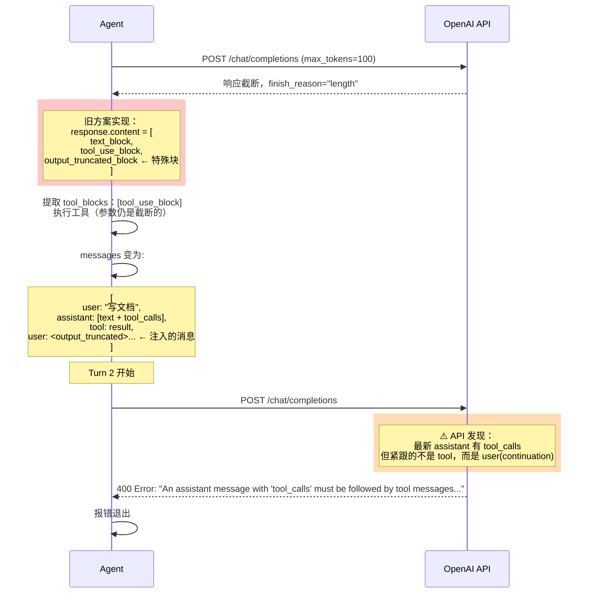

**为什么还是报错？**

```
消息历史顺序（Turn 2 发送）：
1. assistant: text + tool_calls (from Turn N)
2. tool: result (from Turn N-1's tool_call)
3. user: <output_truncated> (continuation)

↑ 问题：assistant(tool_calls) 之后紧跟的是 user(continuation)，
   不是 tool(result)！

API 规则：tool_calls 必须紧跟一个 tool 消息，不能被其他消息隔开。
```

**旧方案的核心错误**：
1. 检测到截断时，**仍然执行了工具**（参数是截断的不完整 JSON）
2. 在 tool_result **之后**注入了 `<output_truncated>` continuation 消息
3. 导致消息顺序变成：assistant(tool_calls) → tool → user(continuation)
4. API 要求：assistant(tool_calls) → **必须紧跟** tool

---

#### 6.2.4 现在的解决方案：截断状态与 content 分离

**核心改变**：
1. **`response.content` 永远只包含标准块**（text / tool_use），不混入 `output_truncated`
2. **`response.is_truncated` 作为独立字段**，而不是混在 content 中
3. **agent_loop 中正交处理**：有工具调用时正常执行，无工具调用时注入 continuation

**关键流程图**：

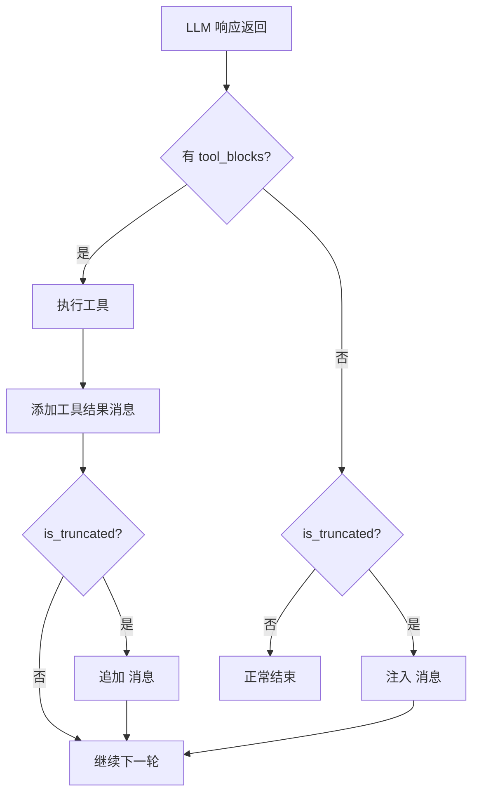

**LLMResponse 数据结构对比**：

```python
# ❌ 错误方案：截断信息混入 content
@dataclass
class LLMResponse:
    content: list  # 包含 text, tool_use, output_truncated 混在一起！
    stop_reason: str

# ✅ 正确方案：截断状态与 content 分离
@dataclass
class LLMResponse:
    content: list           # ✅ 只包含 text 和 tool_use
    stop_reason: str
    is_truncated: bool      # ✅ 独立标志
    truncated_text: str      # ✅ 截断文本独立保存
```

---

#### 6.2.5 完整的正交路径代码

**Turn 1 返回（截断）：**

```json
{
  "choices": [
    {
      "message": {
        "role": "assistant",
        "content": "# 技术文档\n\n本文档详细介绍...",
        "tool_calls": [
          {
            "id": "call_001",
            "type": "function",
            "function": {
              "name": "write_file",
              "arguments": "{\"file_path\": \"doc.md\", \"content\": \"# 技术文档\n\n本文档详细"
            }
          }
        ]
      },
      "finish_reason": "length"
    }
  ]
}
```

**问题**：`finish_reason = "length"` 说明 text 和 tool_calls 都被截断了。

**关键问题**：tool_calls 参数是**不完整的 JSON**！执行这个 tool_use 会导致文件内容不完整。

**正确的正交路径流程**：

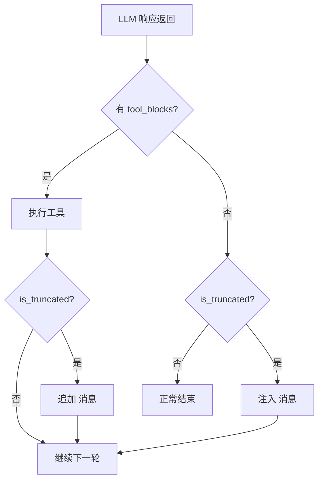

**实际代码实现（query.py）：**

```python
# 1. 先添加 assistant 消息
messages.append({"role": "assistant", "content": response.content})

# 2. 检查是否有 tool_blocks
tool_blocks = [b for b in response.content if b.type == "tool_use"]

# 3. 有工具调用 → 执行工具
if tool_blocks:
    # 执行所有工具...
    for block in tool_blocks:
        output = handler(**block.input)
        results.append({"type": "tool_result", "tool_use_id": block.id, "content": str(output)})

    # 添加工具结果
    messages.append({"role": "user", "content": results})

    # 如果同时被截断，在工具结果后追加延续提示
    if response.is_truncated:
        messages.append({
            "role": "user",
            "content": "<output_truncated>Your previous text output was cut off at "
                      + f"{len(response.truncated_text)} characters due to max_tokens limit. "
                      + "Please continue your response naturally...</output_truncated>"
        })
    continue

# 4. 无工具调用 + 截断 → 注入继续消息
elif response.is_truncated:
    messages.append({
        "role": "user",
        "content": "<output_truncated>The output above was cut off at "
                  + f"{len(response.truncated_text)} characters due to max_tokens limit. "
                  + "Please continue your previous response naturally...</output_truncated>"
    })
    continue

# 5. 正常结束
else:
    return tracker, breaker
```

**注意**：当 `is_truncated=true` 且有 `tool_blocks` 时，当前实现**仍然会执行工具**，但会在工具结果后追加 `<output_truncated>` continuation 消息。这样 LLM 在下一轮会知道需要继续生成。

---

#### 6.2.6 完整的多轮截断恢复示例

**场景**：用户要求写一个很长的技术文档，`max_tokens = 100`

---

**Turn 1：用户发起请求**

Agent 发送：
```json
{
  "model": "gpt-4o",
  "messages": [
    {"role": "system", "content": "你是Claude Code..."},
    {"role": "user", "content": "写一个很长的技术文档，包含所有编程语言的介绍"}
  ],
  "tools": [{"type": "function", "function": {"name": "write_file", ...}}],
  "max_tokens": 100
}
```

LLM 返回（被截断，text 和 tool_calls 都有）：
```json
{
  "choices": [{
    "message": {
      "role": "assistant",
      "content": "# 技术文档\n\n本文档介绍各种编程语言：\n\n## Python\nPython 是一种高级...",
      "tool_calls": [{
        "id": "call_001",
        "type": "function",
        "function": {
          "name": "write_file",
          "arguments": "{\"file_path\": \"doc.md\", \"content\": \"# 技术文档\n\n本文档介绍各种编程语言：\n\n## Python\nPython 是一"
        }
      }]
    },
    "finish_reason": "length"
  }]
}
```

Agent 检测到 `is_truncated = true` 且有 `tool_blocks`，**仍然执行工具**：
1. 执行 `write_file`（参数是被截断的，但能写入部分内容）
2. 添加工具结果
3. 注入 `<output_truncated>` continuation 消息

Agent 的 messages 变为：
```json
[
  {"role": "system", "content": "你是Claude Code..."},
  {"role": "user", "content": "写一个很长的技术文档..."},

  {
    "role": "assistant",
    "content": "# 技术文档\n\n本文档介绍各种编程语言：\n\n## Python\nPython 是一种高级...",
    "tool_calls": [{
      "id": "call_001",
      "type": "function",
      "function": {
        "name": "write_file",
        "arguments": "{\"file_path\": \"doc.md\", \"content\": \"# 技术文档\n\n本文档介绍各种编程语言：\n\n## Python\nPython 是一"
      }
    }]
  },

  {
    "role": "tool",
    "tool_call_id": "call_001",
    "content": "文件已写入 doc.md"
  },

  {
    "role": "user",
    "content": "<output_truncated>Your previous text output was cut off at 87 characters due to max_tokens limit. Please continue your response naturally from where it was interrupted, without repeating what was already said.</output_truncated>"
  }
]
```

**关键**：消息历史保持有效！`tool_calls` 有对应的 `tool` 响应，然后是 continuation 消息。

---

**Turn 2：继续生成**

Agent 发送 Turn 2 请求，LLM 看到：
- tool_calls 的 tool_result（Turn 1）
- continuation 消息（要求继续）

LLM 返回（再次被截断）：
```json
{
  "choices": [{
    "message": {
      "role": "assistant",
      "content": "编程语言，由 Guido van Rossum 创建。\n\n## JavaScript\nJavaScript 是 Web...",
      "tool_calls": [{
        "id": "call_002",
        "type": "function",
        "function": {
          "name": "edit_file",
          "arguments": "{\"file_path\": \"doc.md\", \"old_string\": \"# 技术文档\n\n本文档介绍各种编程语言：\\n\\n## Python\\nPython 是一\", \"new_string\": \"# 技术文档\n\n本文档介绍各种编程语言：\\n\\n## Python\\nPython 是一种高级编程语言...\\n\\n## JavaScript\\nJavaScript 是 Web...\"}"
        }
      }]
    },
    "finish_reason": "length"
  }]
}
```

Agent 执行 `edit_file`（追加内容），然后继续...

---

**Turn 3-8**：重复上述过程，每次追加更多内容

---

**Turn 17：生成完成**

LLM 返回：
```json
{
  "choices": [{
    "message": {
      "role": "assistant",
      "content": "以上就是主要编程语言的简要介绍。\n\n## 总结\n本文档完成了。"
    },
    "finish_reason": "stop"
  }]
}
```

Agent 检测到 `is_truncated = false` 且 `tool_blocks = []`，正常结束。

---

**最终消息历史**：

```json
[
  {"role": "system", "content": "你是Claude Code..."},
  {"role": "user", "content": "写一个很长的技术文档..."},

  {"role": "assistant", "content": "# 技术文档...", "tool_calls": [{"id": "call_001", ...}]},
  {"role": "tool", "tool_call_id": "call_001", "content": "文件已写入"},
  {"role": "user", "content": "<output_truncated>...</output_truncated>"},

  {"role": "assistant", "content": "编程语言，由 Guido van Rossum 创建...", "tool_calls": [{"id": "call_002", ...}]},
  {"role": "tool", "tool_call_id": "call_002", "content": "已追加内容"},
  {"role": "user", "content": "<output_truncated>...</output_truncated>"},

  ...（重复多轮）...

  {"role": "assistant", "content": "以上就是主要编程语言的简要介绍。\n\n## 总结\n本文档完成了。"}
]
```

**关键点**：
1. 每次 `tool_calls` 都有对应的 `tool` 响应，消息历史始终有效
2. `<output_truncated>` 消息告诉 LLM 需要继续生成
3. 最终 LLM 生成了完整的 1173 行文档
    "message": {
      "role": "assistant",
      "content": "种高级编程语言，由 Guido van Rossum 创建...\n\n## JavaScript\nJavaScript 是 Web...",
      "finish_reason": "length"
    }
  }]
}


Agent 检测到 `is_truncated = true`，**没有 tool_blocks**，注入继续消息：

```json
[
  {"role": "system", "content": "..."},
  {"role": "user", "content": "写一个很长的技术文档..."},
  {"role": "assistant", "content": "# 技术文档..."},
  {"role": "user", "content": "<output_truncated>...</output_truncated>"},
  {"role": "assistant", "content": "种高级编程语言..."},
  {"role": "user", "content": "<output_truncated>The output above was cut off at 65 characters... Please continue...</output_truncated>"}
]
```

---

**Turn 3-7：重复截断恢复过程**

每次 LLM 返回被截断，Agent 都注入 `<output_truncated>` 消息让 LLM 继续生成。

---

**Turn 8：最终完成**

LLM 返回：
```json
{
  "choices": [{
    "message": {
      "role": "assistant",
      "content": "语，由 Guido van Rossum 创建。\n\n## 总结\n以上就是主要编程语言的简要介绍。",
      "finish_reason": "stop"
    }
  }]
}
```

Agent 检测到 `is_truncated = false` 且 `tool_blocks = []`，正常结束。

---

**完整消息历史（最终）：**

```json
[
  {"role": "system", "content": "你是Claude Code..."},
  {"role": "user", "content": "写一个很长的技术文档..."},

  {"role": "assistant", "content": "# 技术文档\n\n本文档介绍各种编程语言...\n\n## Python\nPython 是一"},
  {"role": "user", "content": "<output_truncated>...cut off... Please continue...</output_truncated>"},

  {"role": "assistant", "content": "种高级编程语言，由 Guido van Rossum 创建...\n\n## JavaScript\nJavaScript 是 Web..."},
  {"role": "user", "content": "<output_truncated>...cut off... Please continue...</output_truncated>"},

  {"role": "assistant", "content": "前端开发的核心语言...\n\n## Java\nJava 是一种面向对象的..."},
  {"role": "user", "content": "<output_truncated>...cut off... Please continue...</output_truncated>"},

  {"role": "assistant", "content": "编程语言。\n\n## 总结\n以上就是主要编程语言的简要介绍。"}
]
```

**关键点**：消息历史始终保持有效状态，tool_calls 有对应的 tool_result，最终 LLM 生成了完整的文档内容。

### 6.3 LLMResponse 数据结构设计

```python
# 错误方案：截断信息混入 content
@dataclass
class LLMResponse:
    content: list  # ❌ 包含 output_truncated 块
    stop_reason: str
```

```python
# 正确方案：截断状态与 content 分离
@dataclass
class LLMResponse:
    content: list           # ✅ 只包含标准块（text / tool_use）
    stop_reason: str        # "end_turn" 或 "tool_use"
    is_truncated: bool = False   # ✅ 独立标志
    truncated_text: str = ""     # ✅ 截断时的文本内容
```

### 6.4 agent_loop 中的正交路径处理


### 6.5 实际运行效果

```
Turn 9:  生成文档 → 截断（text_len=75）→ write_file → 继续
Turn 10: 生成文档 → 截断（text_len=0）→ edit_file → 继续
Turn 11: 生成文档 → 截断（text_len=0）→ edit_file → 继续
... (多轮截断持续追加内容)
Turn 16: edit_file 失败（重复内容）→ read_file 查看 → 继续
Turn 17: 生成完成 → 正常结束
```

文档被分段追加写入，最终合并成 1173 行的完整面试准备文档。

### 6.6 截断处理的三步流程

当发生截断时，整个处理流程分为三个阶段，涉及两个模块的协作：

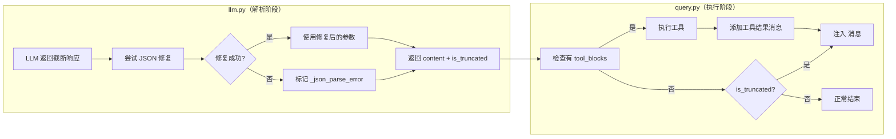

#### 第一步：JSON 截断修复（llm.py）

```python
# llm.py _stream_openai() 中处理 tool_calls 参数

for idx in sorted(collected_tool_calls.keys()):
    tc = collected_tool_calls[idx]

    # 1. 先尝试解析 JSON
    parsed_args, parse_error = self._safe_parse_json(tc["arguments"])

    if parse_error:
        # 2. 解析失败，尝试修复截断的 JSON
        repaired_args, repair_success = self._repair_truncated_json(tc["arguments"])

        if repair_success:
            # 修复成功，使用修复后的参数
            blocks.append(SimpleNamespace(
                type="tool_use",
                id=tc["id"],
                name=tc["name"],
                input=repaired_args,
            ))
        else:
            # 修复失败，标记错误但不丢弃
            blocks.append(SimpleNamespace(
                type="tool_use",
                id=tc["id"],
                name=tc["name"],
                input={"_json_parse_error": parse_error, "_raw_args": raw_args[:200]},
            ))
    else:
        # 解析成功
        blocks.append(SimpleNamespace(
            type="tool_use",
            id=tc["id"],
            name=tc["name"],
            input=parsed_args,
        ))

# 3. 检测截断，标记独立字段
is_truncated = (finish_reason == "length")
truncated_text = "".join(collected_text) if is_truncated else ""

return LLMResponse(
    content=blocks,  # ✅ 不包含 output_truncated 块
    is_truncated=is_truncated,
    truncated_text=truncated_text,
)
```

#### 第二步：执行工具（query.py）

```python
# query.py agent_loop() 中处理截断

# 1. 先添加 assistant 消息
messages.append({"role": "assistant", "content": response.content})

# 2. 检查是否有 tool_blocks
tool_blocks = [b for b in response.content if b.type == "tool_use"]

# 3. 有工具调用 → 执行工具
if tool_blocks:
    results = []
    for block in tool_blocks:
        # 执行工具（参数可能是修复后的，也可能是带 error 标记的）
        handler = tool_handlers.get(block.name)
        try:
            output = handler(**block.input) if handler else f"Unknown tool: {block.name}"
        except Exception as e:
            output = f"Error: {e}"

        # 添加工具结果
        results.append({
            "type": "tool_result",
            "tool_use_id": block.id,
            "content": str(output),
        })

    # 添加工具结果消息
    messages.append({"role": "user", "content": results})
```

#### 第三步：注入截断继续消息（query.py）

```python
    # 4. 如果同时被截断，注入继续消息
    if response.is_truncated:
        continuation_msg = {
            "role": "user",
            "content": (
                f"<output_truncated>Your previous text output was cut off at "
                f"{len(response.truncated_text)} characters due to max_tokens limit. "
                f"Please continue your response naturally from where it was interrupted, "
                f"without repeating what was already said.</output_truncated>"
            ),
        }
        messages.append(continuation_msg)

    # 5. 继续下一轮
    continue

# 6. 无工具调用 + 截断 → 只注入继续消息
elif response.is_truncated:
    continuation_msg = {
        "role": "user",
        "content": (
            f"<output_truncated>The output above was cut off at "
            f"{len(response.truncated_text)} characters due to max_tokens limit. "
            f"Please continue your previous response naturally, "
            f"starting from where it left off. Do not repeat what was already said.</output_truncated>"
        ),
    }
    messages.append(continuation_msg)
    continue
```

#### 完整消息历史示例

```
┌─────────────────────────────────────────────────────────────────────────────┐
│  Turn N：发生截断                                                         │
├─────────────────────────────────────────────────────────────────────────────┤
│  LLM 返回：                                                               │
│    content: [text_block, tool_use_block]  ← 参数可能是修复后的 JSON       │
│    is_truncated: true                                                     │
│    truncated_text: "被截断的文本..."                                       │
├─────────────────────────────────────────────────────────────────────────────┤
│  Agent 执行：                                                              │
│    1. 用修复后的参数执行 tool                                              │
│    2. 添加工具结果 → messages.append({role: "tool", ...})                │
│    3. 注入继续消息 → messages.append({role: "user", content: "<output_truncated>..."}) │
├─────────────────────────────────────────────────────────────────────────────┤
│  Turn N+1 发送的消息：                                                     │
│    [                                                                     │
│      user: "写文档",                                                      │
│      assistant: text + tool_calls,                                        │
│      tool: result,                    ← 工具执行结果                      │
│      user: <output_truncated>...      ← 告诉 LLM 被截断了，继续           │
│    ]                                                                     │
└─────────────────────────────────────────────────────────────────────────────┘
```

**关键点**：
1. JSON 修复发生在 `llm.py` 解析响应时
2. 工具执行发生在 `query.py` 的 agent_loop 中
3. 两件事是**分开**的：JSON 修复是"解析"阶段，工具执行是"执行"阶段
4. 消息历史始终保持有效状态：tool_calls 有对应的 tool 结果

---

**正常情况：Agent 请求写一个文件**

Agent 发送：
```json
{
  "model": "gpt-4o",
  "messages": [
    {"role": "system", "content": "你是Claude Code..."},
    {"role": "user", "content": "在 test.py 中写入 Hello World"}
  ],
  "tools": [{"type": "function", "function": {"name": "write_file", ...}}],
  "max_tokens": 2000
}
```

LLM 返回：
```json
{
  "choices": [{
    "message": {
      "role": "assistant",
      "content": "我来帮你写入文件。",
      "tool_calls": [{
        "id": "call_001",
        "type": "function",
        "function": {
          "name": "write_file",
          "arguments": "{\"file_path\": \"test.py\", \"content\": \"Hello World\"}"
        }
      }]
    },
    "finish_reason": "tool_calls"
  }]
}
```

Agent 执行工具：
```json
{
  "role": "tool",
  "tool_call_id": "call_001",
  "content": "文件已写入 test.py"
}
```

Agent 发送最终回复请求：
```json
{
  "messages": [
    {"role": "system", "content": "..."},
    {"role": "user", "content": "在 test.py 中写入 Hello World"},
    {"role": "assistant", "content": "我来帮你...", "tool_calls": [...]},
    {"role": "tool", "tool_call_id": "call_001", "content": "文件已写入"}
  ]
}
```

LLM 返回：
```json
{
  "choices": [{
    "message": {
      "role": "assistant",
      "content": "完成了！文件 test.py 已写入，内容是 Hello World。"
    },
    "finish_reason": "stop"
  }]
}
```

---

**出错情况：API 返回 429 Rate Limit**

Agent 发送请求，API 返回 429：
```json
{
  "error": {
    "message": "Rate limit exceeded. Please wait before trying again.",
    "type": "rate_limit_error",
    "code": "429",
    "status": 429
  }
}
```

**LLMAdapter 的处理流程：**

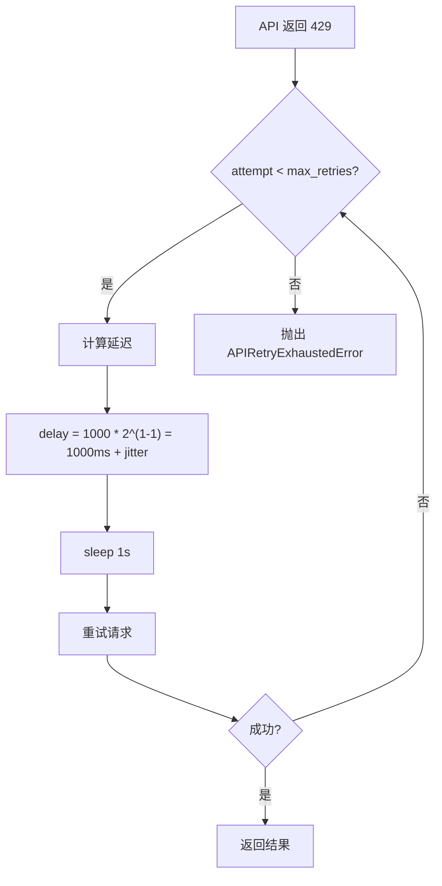

**第一次重试：**

Agent 发送请求，API 再次返回 429：
```json
{
  "error": {
    "message": "Rate limit exceeded.",
    "status": 429
  }
}
```

**第二次重试：**

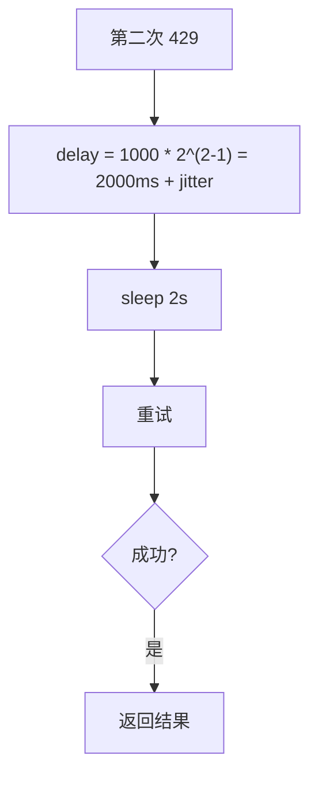

**第三次重试成功：**

```json
{
  "choices": [{
    "message": {
      "role": "assistant",
      "content": "我来帮你写入文件。",
      "tool_calls": [...]
    },
    "finish_reason": "tool_calls"
  }]
}
```

---

**错误注入到消息历史：**

如果重试**全部失败**，Agent 会注入错误消息：

```python
except (LLMError, APIRetryExhaustedError) as e:
    error_msg = {
        "role": "user",
        "content": f"<error>{get_error_message(e.error_type)}</error>"
    }
    messages.append(error_msg)
    # 继续循环
```

消息历史变为：
```json
[
  {"role": "system", "content": "..."},
  {"role": "user", "content": "在 test.py 中写入 Hello World"},
  {
    "role": "user",
    "content": "<error>rate_limit: Rate limit reached. Please wait before trying again.</error>"
  }
]
```

**为什么注入错误消息而不是直接退出？**

```
Claude Code 的设计理念：让 LLM 知道发生了什么错误，
让它有机会调整行为（比如减少请求频率、使用更简洁的输出等）
```

---

## 8. 关键常量速查表

### `LoopConfig` — Agent 循环保护

| 常量 | 默认值 | 说明 |
|------|--------|------|
| `DEFAULT_MAX_TURNS` | 50 | 主 Agent 最大执行轮次 |
| `SUBAGENT_MAX_TURNS` | 30 | SubAgent 最大执行轮次 |
| `COORDINATOR_MAX_TURNS` | 20 | Coordinator 最大执行轮次 |
| `MAX_CONSECUTIVE_TOOL_ERRORS` | 5 | 同轮连续工具错误阈值 |
| `MAX_CONSECUTIVE_LLM_ERRORS` | 3 | 连续 LLM 错误阈值 |
| `MIN_OUTPUT_LENGTH` | 5 | 最小有效输出长度 |
| `LLM_RESPONSE_TIMEOUT` | 300s | LLM 响应超时 |

### `RetryConfig` — 重试策略

| 常量 | 默认值 | 说明 |
|------|--------|------|
| `DEFAULT_MAX_RETRIES` | 3 | 默认最大重试次数 |
| `BASE_DELAY_MS` | 1000ms | 基础退避延迟 |
| `MAX_DELAY_MS` | 32000ms | 最大延迟上限 |
| `JITTER_RATIO` | 0.25 | 随机 jitter 比例 |
| `RATE_LIMIT_COOLDOWN_MS` | 600000ms | 429 错误 cooldown |
| `OVERLOAD_BASE_DELAY_MS` | 500ms | 529 错误更短初始延迟 |

---

## 9. 文件结构

```
services/
├── api_errors.py          # 错误常量集中管理
│   ├── APIErrorType       # 20+ 错误类型枚举
│   ├── HTTPStatus         # HTTP 状态码常量
│   ├── APIErrorMessage    # 用户友好错误消息
│   ├── RetryConfig        # 重试配置常量
│   ├── LoopConfig         # 循环保护配置常量
│   ├── JSONParseConfig    # JSON 修复配置常量
│   └── 工具函数
│       ├── classify_api_error()
│       ├── is_retryable_error()
│       ├── get_error_message()
│       ├── get_retry_delay()
│       └── get_max_retries_for_error()
├── llm.py                  # LLM 适配器
│   ├── LLMResponse         # 标准化响应（含截断状态分离）
│   ├── chat()              # 统一调用入口（带重试）
│   ├── _call_openai()     # OpenAI 非流式调用
│   ├── _stream_openai()    # OpenAI 流式调用
│   ├── _repair_truncated_json()  # JSON 截断修复（tool call 参数）
│   └── _convert_oai_response_with_parse_recovery()
└── compact.py             # Token 追踪 + CircuitBreaker

query.py                    # Agent 循环
├── agent_loop()           # 主循环（正交路径处理）
├── _Spinner               # 等待动画
└── _format_permission_detail()

agents/
└── subagent.py            # SubAgent 重试逻辑

tests/
├── unit/
│   ├── test_api_errors.py  # 错误分类测试
│   ├── test_json_repair.py # JSON 修复测试
│   └── test_llm_retry.py   # 重试机制测试
└── component/
    └── test_agent_loop.py  # Agent 循环测试
```

---

## 10. 测试覆盖

| 测试文件 | 覆盖内容 |
|----------|----------|
| `test_api_errors.py` | 错误分类、消息映射、重试延迟计算、最大重试次数 |
| `test_json_repair.py` | JSON 修复策略（对象/数组/键值对）、边界情况 |
| `test_llm_retry.py` | 成功/限流/不可重试/超时/连接错误/max_tokens 裁剪 |
| `test_agent_loop.py` | 轮次限制、连续错误停止、错误注入、通知注入、多工具场景 |

**总计：73 个测试用例，全部通过。**

---

## 11. 反思与总结

### 11.1 遇到的核心问题

**max_tokens 截断后，消息历史中出现 "tool_calls 无 tool_result 匹配" 的 400 错误。**

### 11.2 尝试过哪些方案

| 方案 | 思路 | 为什么失败 |
|------|------|-----------|
| **在 content 中混入 output_truncated 块** | 截断信息作为特殊 block 追加到 content 列表 | content 中混入非标准块，破坏消息结构，导致下一轮 tool_calls 缺少 tool_result |
| **丢弃截断响应中的 tool_calls** | 截断时的 tool_calls 是"半成品"，不进入历史 | 同样导致 LLM 不知道 pending 的工具调用，重试时依然失败 |
| **仅在 tool_use 分支中处理截断** | 让截断检测与工具执行混在一起 | 逻辑耦合，容易出错；且截断可能发生在纯文本生成时（无工具调用） |

### 11.3 最终如何改对

核心改变是**将截断状态从 content 块中分离出来**：

```
❌ 错误：response.content = [text_block, tool_use_block, output_truncated_block]
✅ 正确：response.content = [text_block, tool_use_block]
        response.is_truncated = True
        response.truncated_text = "..."
```

然后在 `agent_loop` 中将两条路径**完全正交化**：

```python
# 路径1：有工具调用 → 执行工具 → 正常 continue
if tool_blocks:
    ...
    continue

# 路径2：无工具调用 + 截断 → 注入继续消息 → continue
elif response.is_truncated:
    ...
    continue

# 路径3：无工具调用 + 不截断 → 正常结束
else:
    return ...
```

### 11.4 关键认知

1. **"工具调用失败就当没发生过"是错误思路**。正确做法是确保消息历史始终满足 API 的格式约束（tool_calls 必须配对 tool_result）。

2. **`finish_reason=length` 不等于"只有文本被截断"**。它只说明 LLM 的输出被强制中断，**可能同时包含 text 和 tool_calls**。处理时必须考虑这种混合情况。

3. **消息历史的 valid state 比任何单个请求的完成更重要**。即使某个请求被截断，下一个请求也必须基于一个 valid 的消息历史发出。

4. **分离关注点是正确架构的核心**。将"是否有截断"作为独立字段，而不是混入 content 列表中，让两条处理路径正交，逻辑清晰，不易出错。

5. **JSON 截断修复与 max_tokens 截断恢复是两种不同的机制**。前者修复 tool call 参数中的 JSON（用于解析），后者处理整体响应截断（用于恢复生成）。

